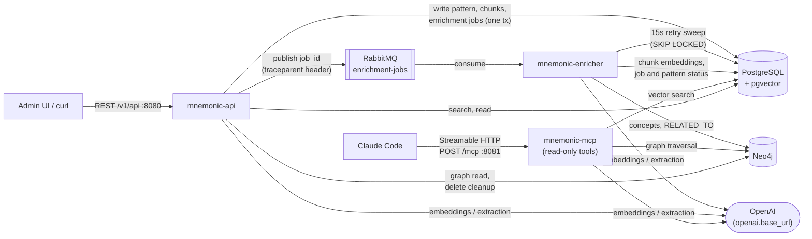

# Mnemonic Docs

> **Maturity Level**: Emerging - Documentation is in early rough draft; structure and content are actively being organized and will change frequently.  
> **Version**: v0.5.1

---

## Table of Contents

- [Usage](#usage)
- [How It Works](#how-it-works)
- [Key Considerations](#key-considerations)
- [Development Considerations](#development-considerations)
- [Versioning](#versioning)

## Usage

This repository is the **single source of truth** for architecture, design, requirements, and reference documentation across the Mnemonic solution. Source repositories reference this repo rather than maintaining their own architecture docs.

For the full vision and problem statement, see [What Is Mnemonic?](docs/concept.md).

### Quick Navigation

**First time here?** Read in this order:

1. [Concept](docs/concept.md) - understand the problem and solution
2. [System Architecture Overview](docs/architecture/system/README.md) - see how components fit together
3. [Requirements](docs/requirements.md) - learn what the system must do

## How It Works

Mnemonic is a pattern search system that integrates with Claude Code via MCP (Model Context Protocol). It stores curated engineering patterns in PostgreSQL (pgvector for embeddings) and Neo4j (concept relationships), enabling semantic search and graph traversal. Patterns are written through the Admin REST API (`mnemonic-api`), enriched asynchronously by `mnemonic-enricher` (OpenAI embeddings and concept extraction), and served read-only to Claude Code through MCP tools by `mnemonic-mcp`. Details: [System Architecture](docs/architecture/system/02-system-architecture.md) and the [post-a-pattern flow](docs/diagrams/post-pattern-flow.md).



The solution spans seven source repositories plus this documentation repo:

| Repository                                                                                    | Role                                                                      |
| --------------------------------------------------------------------------------------------- | ------------------------------------------------------------------------- |
| [mnemonic-mcp](https://github.com/twistingmercury/mnemonic-mcp)                               | Sole MCP service exposing read-only pattern search tools to Claude Code   |
| [mnemonic-api](https://github.com/twistingmercury/mnemonic-api)                               | REST API for pattern management (CRUD and search)                         |
| [mnemonic-enricher](https://github.com/twistingmercury/mnemonic-enricher)                     | Worker that embeds chunks and extracts concepts into the Neo4j graph      |
| [mnemonic-dbs](https://github.com/twistingmercury/mnemonic-dbs)                               | PostgreSQL + Neo4j schemas and Docker images                              |
| [mnemonic-admin](https://github.com/twistingmercury/mnemonic-admin)                           | Web UI for pattern management and search                                  |
| [mnemonic-patterns](https://github.com/twistingmercury/mnemonic-patterns)                     | Curated pattern library loaded into Mnemonic                              |
| [mnemonic-integration-tests](https://github.com/twistingmercury/mnemonic-integration-tests)   | Cross-service black-box tests of the full stack against an OpenAI stub    |
| [mnemonic-docs](https://github.com/twistingmercury/mnemonic-docs)                             | This repo - consolidated architecture and design docs                     |

### Current State at a Glance

| Topic          | Current value                                                                                          |
| -------------- | ------------------------------------------------------------------------------------------------------ |
| Releases       | `mnemonic-api` v0.4.1, `mnemonic-enricher` v0.4.2, `mnemonic-mcp` v0.5.1 (MCP protocol 2026-07-28)     |
| Toolchain      | Go 1.27.2, `heartbeat` v2 (`/health`), `otelx` v2 (logs, metrics, traces)                              |
| Ports          | 8080 `/health` and `/version` (all), 8080 `/v1/api` (api), 8081 `/mcp` (mcp), 9090 `/metrics` (all)    |
| Authentication | None: Phase 1 is a trusted, local, single-user environment                                             |
| Branching      | `develop` is the trunk (no `main` yet); images from `develop` are tagged `latest-dev` and `vX.Y.Z-dev` |
| Dependencies   | Dependabot weekly, grouped, targeting `develop`                                                        |

### Documentation Structure

| Directory                     | Contents                                                          |
| ----------------------------- | ----------------------------------------------------------------- |
| `docs/architecture/system/`   | System-wide: decisions, security, communication, deployment       |
| `docs/architecture/mnemonic/` | MCP service: tool definitions and response patterns               |
| `docs/architecture/dbs/`      | Database schemas, migrations, deployment                          |
| `docs/architecture/admin/`    | Frontend stack, ADRs, screen map, use cases                       |
| `docs/design/`                | Implementation-level design shared across Go services             |
| `docs/reference/`             | Pattern file schema and glossary                                  |
| `docs/diagrams/`              | System evolution diagrams (MVP 1-5) and flow diagrams             |
| `docs/guides/`                | User-facing guides: introduction, concepts, quickstart, authoring |

## Key Considerations

- **Early rough draft** - docs are still being organized and consolidated from the original monorepo split. Expect gaps, stale references, and structural changes.
- **Source of truth** - despite the draft state, this repo is the canonical location for architecture and design decisions. Source repos should not duplicate this content.
- **No authentication in Phase 1** - the current design assumes a trusted local environment.

## Development Considerations

### Quick Start

Clone this repo alongside the other Mnemonic repositories under a shared parent directory:

```text
mnemonic/
  mnemonic-mcp/               # Sole MCP server
  mnemonic-api/               # Admin REST API
  mnemonic-enricher/          # Enrichment worker
  mnemonic-dbs/               # Database images
  mnemonic-admin/             # Web UI
  mnemonic-patterns/          # Curated pattern library
  mnemonic-integration-tests/ # Cross-service tests
  mnemonic-docs/              # This repo
```

The `docker-compose.yaml` in this repo runs the whole local stack from published `latest-dev` images: PostgreSQL, Neo4j, RabbitMQ, `mnemonic-mcp` (8081), `mnemonic-api` (8080), `mnemonic-enricher` (8082 for `/health`) and the admin UI (3000). Export `MNEMONIC_OPENAI_API_KEY` first, then run `docker compose up -d`.

### Contributing

When making changes in a source repository:

1. Update the relevant architecture document here to reflect the change
2. If the change affects multiple components, update system-level architecture
3. Create or update an ADR for significant technical decisions

### Versioning

This project follows [Semantic Versioning 2.0.0](https://semver.org/).

Versions come only from git tags, in this repo and in every service repo:

```bash
git describe --tags --abbrev=0
```

The `> **Version**` line in each README and each `CHANGELOG.md` are updated by hand when a release is tagged.

---

Copyright (c) 2025-2026 Jeremy K. Johnson. All rights reserved.
