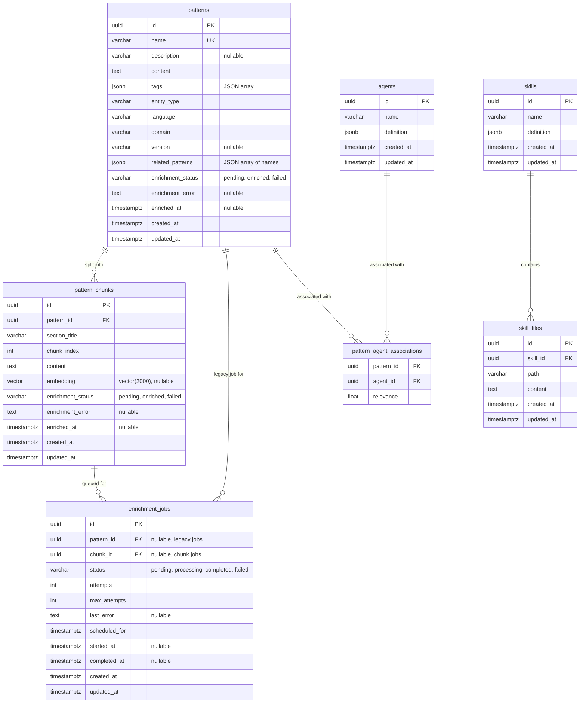
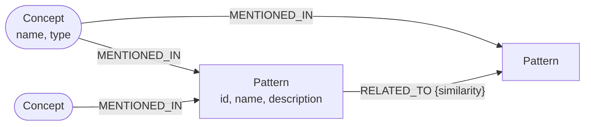
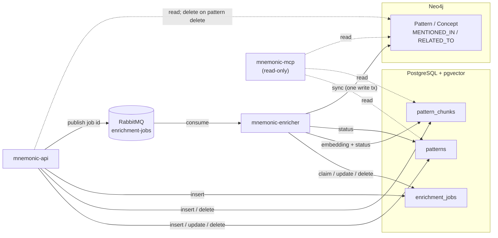

# mnemonic-dbs — Data Architecture

> Back to [Database Architecture](README.md) | [Project README](../../../README.md)

## Table of Contents

- [Database Technology Stack](#database-technology-stack)
- [PostgreSQL Schema](#postgresql-schema)
- [Neo4j Schema](#neo4j-schema)
- [Which Service Uses What](#which-service-uses-what)
- [Migration Strategy](#migration-strategy)

## Database Technology Stack

### PostgreSQL (`pgvector/pgvector:pg16`)

**Purpose:** Relational store for patterns, their semantic search chunks, and enrichment jobs. PGVector provides the `vector` extension for embedding storage and HNSW similarity search. The schema also contains `agents`, `pattern_agent_associations`, `skills` and `skill_files` tables, but no current service (`mnemonic-api`, `mnemonic-mcp`, `mnemonic-enricher`) reads or writes them; they are reserved for planned agent/skill features.

| Criterion | Requirement | How It Is Met |
| --- | --- | --- |
| Semantic search | Vector similarity over pattern chunk embeddings | `vector` extension with HNSW index on `pattern_chunks.embedding` |
| Relational integrity | FK constraints between entities | Native Postgres foreign keys |
| Enrichment tracking | Job state and retry tracking | `enrichment_jobs` table with status column |
| Flexible metadata | Tags and related-pattern names as JSON arrays | `jsonb` columns; tag filters use `?&` (list) and `@>` (search) |

### Neo4j (`neo4j:5` Community Edition)

**Purpose:** Knowledge graph projection of Postgres data. The services use `Pattern` and `Concept` nodes joined by `MENTIONED_IN` (concept to pattern) and `RELATED_TO` (pattern to pattern) relationships, for graph traversal queries that are impractical in SQL (e.g. "find patterns related to X via concept graph"). The schema also declares an `Agent` label (uniqueness constraint) and a `RELEVANT_FOR` index; no current service creates `Agent` nodes or `RELEVANT_FOR` relationships.

| Criterion | Requirement | How It Is Met |
| --- | --- | --- |
| Graph traversal | Multi-hop relationship queries | Native Neo4j Cypher traversal |
| Full-text search | Natural language pattern/concept lookup | Fulltext indexes on name and description |
| Uniqueness | One-to-one correspondence with Postgres | Uniqueness constraints on `id` / `name` |

## PostgreSQL Schema

### Entity Relationship Diagram



`patterns`, `pattern_chunks` and `enrichment_jobs` are the tables the services use; their columns above are the ones the services' SQL reads and writes. The agent and skill tables are shown with their main columns only (see [Data Storage Implementation](../../design/data-storage.md) for the full DDL) and are not used by any current service.

Notes inferred from the services' queries and e2e helpers:

- Deleting a pattern cascades to its `pattern_chunks` and `enrichment_jobs` rows (FK `ON DELETE CASCADE`); deleting a chunk cascades to its jobs.
- `enrichment_jobs_target_exclusive` requires each job to target exactly one of `pattern_id` or `chunk_id`. `mnemonic-api` only creates chunk jobs (`chunk_id` set, `pattern_id` NULL); the enricher still processes legacy pattern jobs.
- `pattern_chunks.embedding` stays NULL until the enricher embeds the chunk; search only considers rows where it is set and `enrichment_status = 'enriched'`.

### Tables

| Table | Migration | Purpose |
| --- | --- | --- |
| `agents` | 000002 | Team agents with JSONB definition blobs (not used by current services) |
| `patterns` | 000003 | Reusable context patterns (embedding column dropped in 000009; metadata columns added in 000009) |
| `pattern_agent_associations` | 000004 | Many-to-many relevance mapping between patterns and agents (not used by current services) |
| `enrichment_jobs` | 000005 | Queue and state tracking for pattern/chunk enrichment |
| `skills` | 000007 | Skill definitions (not used by current services) |
| `skill_files` | 000008 | Individual files belonging to a skill (not used by current services) |
| `pattern_chunks` | 000009 | Semantic chunks of patterns with per-chunk embeddings |

### Indexes

| Index | Table | Type | Purpose |
| --- | --- | --- | --- |
| `idx_agents_definition` | `agents` | GIN | Fast JSONB queries against agent definition |
| `idx_patterns_enriched` | `patterns` | B-tree | Filter patterns by enrichment status |
| `idx_patterns_embedding` | `patterns` | IVFFlat | Historical: dropped together with `patterns.embedding` in migration 000009; superseded by `idx_pattern_chunks_embedding` |
| `idx_pattern_chunks_embedding` | `pattern_chunks` | HNSW | Vector similarity search on chunk embeddings (vector(2000)) |
| Various on `enrichment_jobs` | `enrichment_jobs` | B-tree | Status and retry queries |

### Embedding Dimensions

Pattern chunk embeddings use `vector(2000)` (OpenAI text-embedding-3-large with Matryoshka truncation). All three services default `openai.embedding_dimensions` to 2000 and `openai.embedding_model` to `text-embedding-3-large`; changing either requires a matching schema change. Migration 000010 updated `pattern_chunks.embedding` to this dimension. The `patterns` table embedding column was removed in migration 000009 — embeddings now exist only in `pattern_chunks`.

## Neo4j Schema

### Node Types

| Label | Unique Constraint | Description |
| --- | --- | --- |
| `Pattern` | `pattern_id_unique` on `id` | Graph projection of a Postgres pattern row; properties `id` (UUID string), `name`, `description`, `updatedAt` |
| `Agent` | `agent_name_unique` on `name` | Reserved for agents; no current service creates `Agent` nodes |
| `Concept` | `concept_name_unique` on `name` | Concept extracted during enrichment; `name` (lowercase, trimmed), `type` (`technology`, `practice` or `domain`), `createdAt` |
| `SchemaVersion` | — | Tracks applied migration version (`v.version`, `v.migratedAt`) |

### Relationships

| Relationship | From → To | Properties | Purpose |
| --- | --- | --- | --- |
| `MENTIONED_IN` | `Concept → Pattern` | — | Concepts extracted from a pattern's content |
| `RELATED_TO` | `Pattern → Pattern` | `similarity` (float), `updatedAt` | Pre-computed edges between patterns that share concepts; stored in one direction, queried undirected |
| `RELEVANT_FOR` | `Pattern → Agent` | `relevance` (float) | Reserved (indexed in the schema); no current service creates it |

`RELATED_TO.similarity` is `sharedConcepts / max(conceptsA, conceptsB)`; the enricher only creates edges at or above `enrichment.related_to_min_similarity` (default 0.3).



### Indexes

| Index | Type | On | Purpose |
| --- | --- | --- | --- |
| `pattern_name_index` | B-tree | `Pattern.name` | Name-based pattern lookup |
| `concept_type_index` | B-tree | `Concept.type` | Filter concepts by category |
| `rel_relevant_for_relevance` | B-tree | `RELEVANT_FOR.relevance` | Order relationships by relevance score |
| `pattern_content_fulltext` | Fulltext | `Pattern.name`, `Pattern.description` | Natural language pattern search |
| `concept_name_fulltext` | Fulltext | `Concept.name` | Natural language concept lookup |

Auto-created indexes from uniqueness constraints: `Pattern.id`, `Agent.name`, `Concept.name`.

### Schema Version

The Neo4j schema is versioned via a `SchemaVersion` node:

```cypher
MATCH (v:SchemaVersion {name: 'mnemonic'}) RETURN v.version, v.migratedAt
```

Current version: **3** (set by `003_create_indexes.cypher`).

## Which Service Uses What

The schema is shared by three services with different access. This is what their repository code (`src/internal/repository/**`) actually does:

| Service | PostgreSQL | Neo4j |
| --- | --- | --- |
| `mnemonic-api` | Reads and writes `patterns`; inserts and deletes `pattern_chunks`; inserts `enrichment_jobs` (one pending job per chunk, in the same transaction as the pattern and chunks); chunk similarity search | Reads `RELATED_TO` and `MENTIONED_IN` for pattern detail; on pattern delete, removes the `Pattern` node and any of its concepts no other pattern mentions. Creates nothing. |
| `mnemonic-enricher` | Reads patterns and chunks; writes chunk embeddings and status, pattern enrichment status; claims, updates and deletes `enrichment_jobs` | Writes: merges the `Pattern` node, its `Concept` nodes and `MENTIONED_IN` edges, and recomputes `RELATED_TO`, all in one write transaction |
| `mnemonic-mcp` | Read-only: chunk similarity search, pattern lookups | Read-only: concepts and `RELATED_TO` lookups |



## Migration Strategy

- **Tooling:** None at runtime. Schema is applied at image build time.
- **Postgres:** SQL files named `000001_description.up.sql` … `000010_description.up.sql`, executed in order by `docker-entrypoint-initdb.d`.
- **Neo4j:** Cypher files named `001_description.cypher` … `003_description.cypher`, applied via `cypher-shell` during image build.
- **Rollback:** Pull a prior image tag. No down migration files are maintained.
- **Testing:** BATS test suites in `src/tests/bats/` verify schema state after initialization. CI gates image pushes on passing tests.
- **Adding migrations:** Add new SQL/Cypher files with the next sequence number, add corresponding BATS assertions, open a PR.

---

Copyright (c) 2025-2026 Jeremy K. Johnson. All rights reserved.
