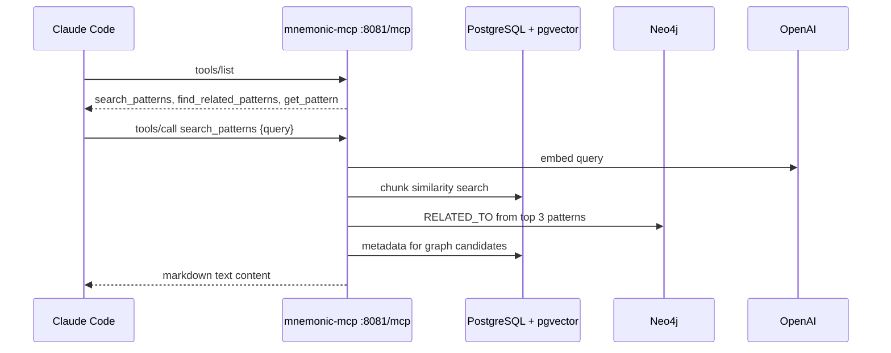

# MCP Tools

> Back to [MCP Service Architecture](README.md) | [Project README](../../../README.md)

## Table of Contents

- [Overview](#overview)
- [Tool Discovery](#tool-discovery)
- [Pattern Search Tools](#pattern-search-tools)
- [Response Formats](#response-formats)
- [Error Handling](#error-handling)
- [References](#references)

## Overview

Mnemonic exposes 3 read-only MCP tools for pattern search: `search_patterns`, `find_related_patterns`, and `get_pattern`. These tools are called during conversation when Claude Code needs team knowledge. They are served by the `mnemonic-mcp` service; the MCP service has no write tools (patterns are managed through the REST API).

## Tool Discovery

The MCP server uses Streamable HTTP in **stateless** mode at `http://localhost:8081/mcp` (port from `mcp.port`). There is **no authentication** in the current local, single-user phase, so the port should not be exposed beyond localhost.

Claude Code discovers and invokes tools in these steps:

1. **Connection**: Claude Code connects via MCP over Streamable HTTP to `http://localhost:8081/mcp`
2. **Initialization**: sends `initialize`; the server keeps no session, so this only returns server capabilities
3. **Discovery**: sends `tools/list` to receive all 3 tool registrations
4. **Invocation**: during conversation, sends `tools/call` with the tool name and arguments

Because the server is stateless, a client may also send `tools/call` directly without `initialize`. Requests should carry `Accept: application/json, text/event-stream`; the response may be framed as an SSE `data:` event.



Client configuration (Claude Code CLI):

```bash
claude mcp add --transport http --scope user mnemonic http://localhost:8081/mcp
```

Or in `.mcp.json`:

```json
{
  "mcpServers": {
    "mnemonic": {
      "type": "http",
      "url": "http://localhost:8081/mcp"
    }
  }
}
```

## Pattern Search Tools

These three tools are called during conversation when Claude Code determines that team knowledge is relevant to a user request.

### `search_patterns`

Semantic search over pattern chunks, with graph expansion of the best hits.

**Parameters:**

| Parameter   | Type         | Required | Default                              | Constraints | Description                               |
| ----------- | ------------ | -------- | ------------------------------------ | ----------- | ----------------------------------------- |
| `query`     | string       | yes      | —                                    | —           | Natural language search query             |
| `limit`     | integer      | no       | 10                                   | 1–50        | Maximum number of chunk results           |
| `threshold` | number       | no       | 0.5 (`mcp.default_search_threshold`) | 0.0–1.0     | Minimum cosine similarity score           |
| `tags`      | string array | no       | —                                    | —           | Conjunctive (AND) filter by tag           |
| `language`  | string       | no       | —                                    | —           | Filter by pattern language (e.g. `go`)    |
| `domain`    | string       | no       | —                                    | —           | Filter by pattern domain (e.g. `backend`) |

**Returns:** Markdown-formatted text. A header (`Found N sections across M patterns matching '<query>':`) is followed by one entry per matching chunk with pattern name, similarity percentage, section title, tags and the chunk content. If graph expansion finds anything, a `### Related Patterns (via graph)` section follows with up to 5 extra patterns, each with its concept-overlap similarity, the seed pattern it was found via, and shared concepts.

**Notes:** Only enriched chunks appear in results. Chunk results are ranked by pgvector cosine similarity. Graph expansion takes the top 3 distinct patterns from the vector results, follows their `RELATED_TO` edges in Neo4j (up to 5 per seed), drops patterns already in the vector results, and applies the same tag, domain and language filters (in the graph section only, patterns with language `agnostic` also pass a language filter). Expansion is best-effort: if Neo4j fails, the vector results are returned alone. There is no agent filter and no blended vector/graph score.

### `find_related_patterns`

Find patterns related to a given pattern via the knowledge graph.

**Parameters:**

| Parameter    | Type          | Required | Default | Constraints | Description                             |
| ------------ | ------------- | -------- | ------- | ----------- | --------------------------------------- |
| `pattern_id` | string (UUID) | yes      | —       | valid UUID  | ID of the pattern to find relations for |
| `limit`      | integer       | no       | 5       | 1–20        | Maximum number of related patterns      |

**Returns:** Markdown with the related patterns, each with relationship type (`RELATED_TO`), similarity score and shared concepts. Pattern content is not included.

**Notes:** Traverses `RELATED_TO` edges in Neo4j in either direction, ordered by similarity. The similarity (0.0–1.0) is concept overlap, `shared / max(conceptsA, conceptsB)`, computed during enrichment. An unknown `pattern_id` returns a not-found error; a pattern with no edges (for example, one not enriched yet) returns `No related patterns found for '<name>'.`

### `get_pattern`

Retrieve a specific pattern by ID.

**Parameters:**

| Parameter | Type          | Required | Constraints | Description         |
| --------- | ------------- | -------- | ----------- | ------------------- |
| `id`      | string (UUID) | yes      | valid UUID  | Pattern ID to fetch |

**Returns:** Markdown with the pattern name, ID, tags, enrichment status, full content, and (when enriched) up to 10 related patterns and the extracted concept names.

**Notes:** Reads the pattern from PostgreSQL and, only if its `enrichment_status` is `enriched`, its graph context from Neo4j. The graph sections are omitted when enrichment is pending or failed, or when Neo4j is unavailable (the call still succeeds). A failed enrichment shows the stored error on the status line.

## Response Formats

MCP tools return markdown-formatted text. Structured data such as similarity scores and metadata is embedded in the prose because Claude Code consumes tool results as text content during conversation. Markdown makes results readable in context without additional parsing. Exact formats are in [MCP Server Design](../../design/mcp-server.md#tool-handler-signatures).

Results are delivered as MCP tool results with:

```json
{"content": [{"type": "text", "text": "..."}]}
```

## Error Handling

Mnemonic uses two error mechanisms depending on whether the failure is at the application or transport level.

### Application-Level Errors

For not-found conditions, validation failures, and backend unavailability, Mnemonic returns a normal JSON-RPC success response with `isError: true` in the tool result and the error message as text. The `isError` flag signals to Claude Code that the tool call did not succeed. Claude Code can retry or inform the user accordingly.

| Pattern             | Message prefix        | Applies To                                                                    |
| ------------------- | --------------------- | ----------------------------------------------------------------------------- |
| Not found           | `pattern not found`   | `get_pattern` and `find_related_patterns`                                     |
| Invalid input       | `invalid input`       | All 3 tools — bad UUID, `limit` or `threshold` out of range                   |
| Service unavailable | `service unavailable` | All 3 tools — any other backend failure (PostgreSQL, Neo4j, OpenAI embedding) |

### Transport-Level Errors

For protocol problems, the MCP SDK returns a JSON-RPC error response. These use standard JSON-RPC 2.0 error codes:

| Code   | Meaning          | Description                             |
| ------ | ---------------- | --------------------------------------- |
| -32700 | Parse error      | Malformed JSON                          |
| -32600 | Invalid request  | Not a valid JSON-RPC 2.0 request        |
| -32601 | Method not found | Unknown method                          |
| -32602 | Invalid params   | Parameters do not match the tool schema |
| -32603 | Internal error   | Unexpected server error                 |

## References

- [MCP Server Design](../../design/mcp-server.md) — implementation: server setup, handlers, formats, observability
- [Service Layer Design](../../design/service-layer.md) — the services behind the tools
- [Communication Patterns](../system/03-communication-patterns.md) — protocol overview and request flow

**Next:** Return to [Architecture Overview](README.md)

---

Copyright (c) 2025-2026 Jeremy K. Johnson. All rights reserved.
