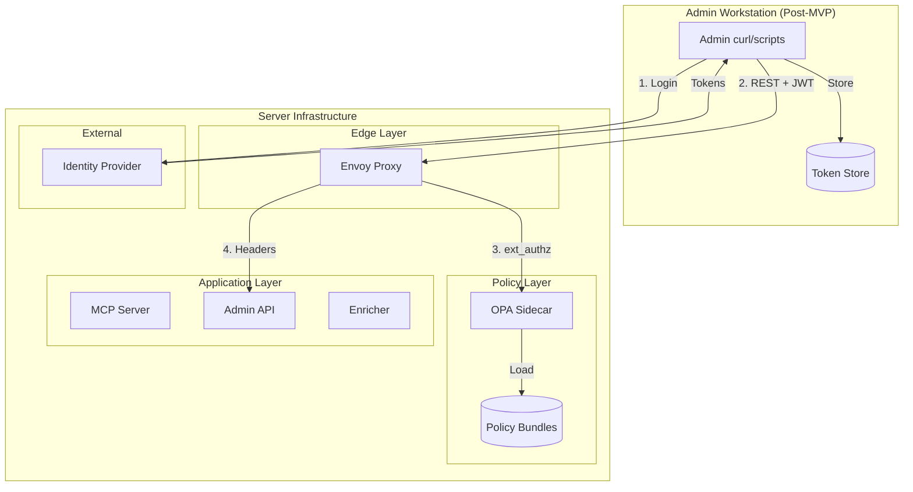
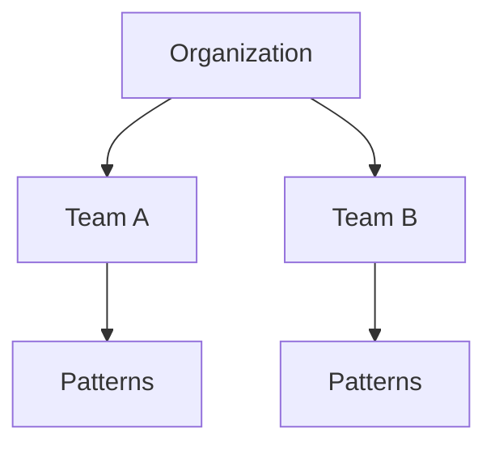
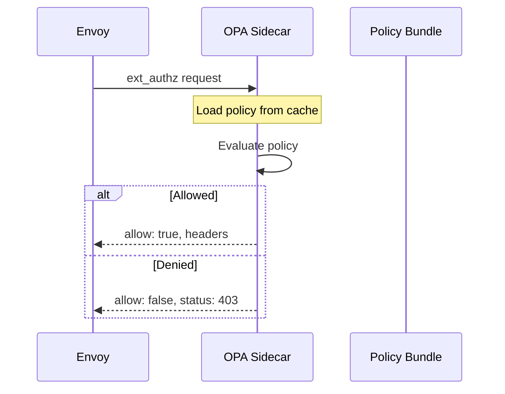
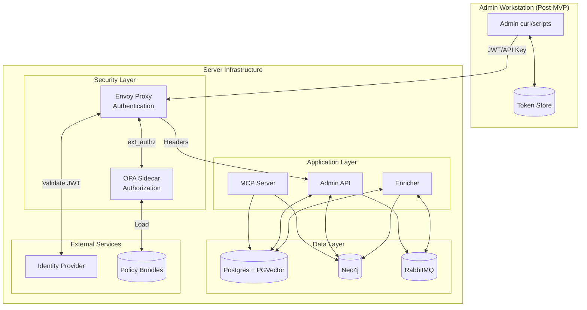
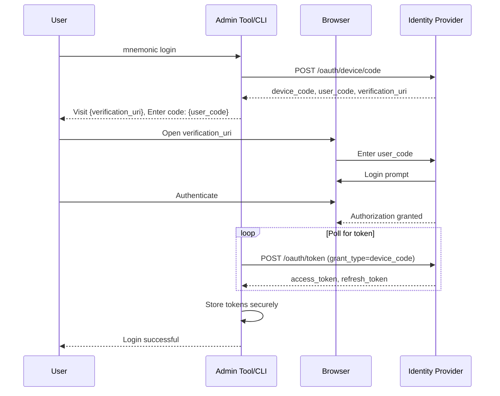
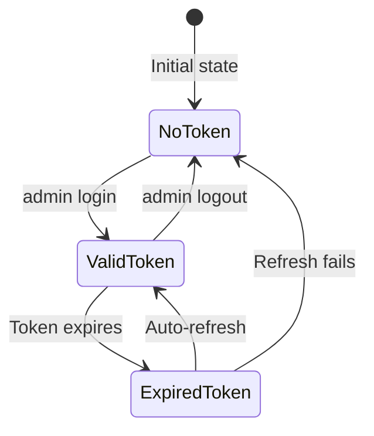
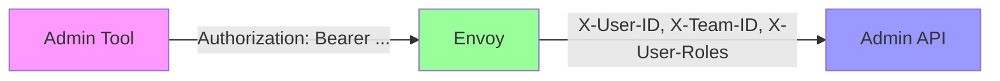
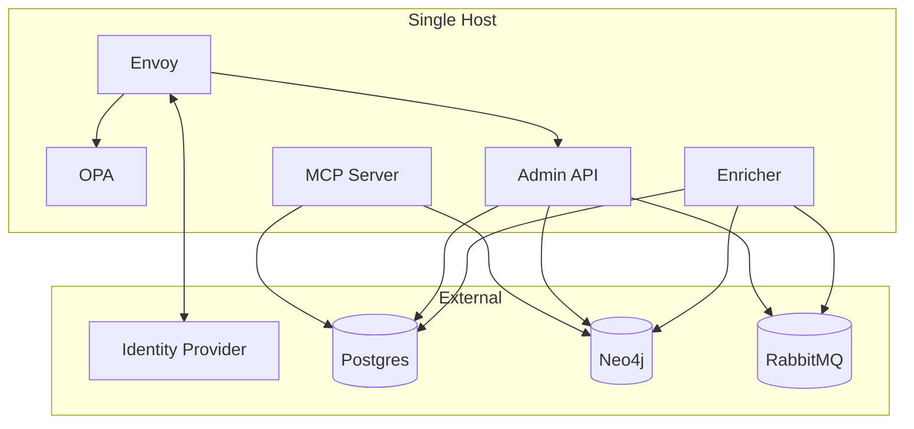
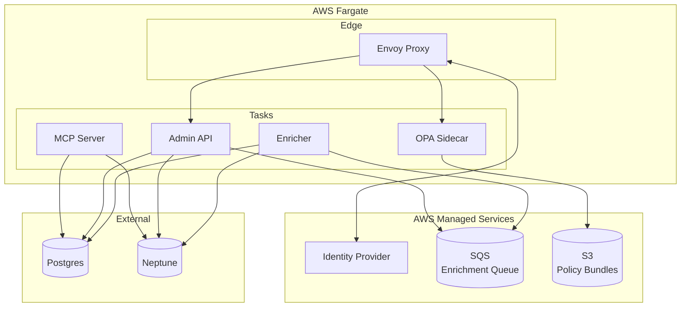
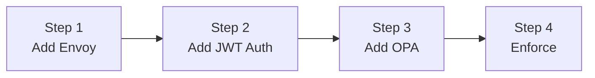

# Security Architecture

> Back to [System Architecture](README.md) | [Project README](../../../README.md)

**MVP stance:** The Mnemonic services run in a trusted network environment without authentication ([SE-1](../../requirements.md#se-1)). The MCP interface is read-only ([SE-4](../../requirements.md#se-4)) and database credentials are injected from the runtime environment ([SE-6](../../requirements.md#se-6)). Apart from [Current State](#current-state-local-phase), this document describes the **planned** Post-MVP production security architecture; none of Envoy, OPA, JWT, API keys or identity headers is implemented.

## Table of Contents

- [Current State (Local Phase)](#current-state-local-phase)
- [Introduction](#introduction)
- [Security Model Overview](#security-model-overview)
- [Authentication](#authentication)
  - [JWT Tokens](#jwt-tokens-primary)
  - [API Keys](#api-keys-secondary)
  - [Supported Identity Providers](#supported-identity-providers)
- [Authorization](#authorization)
  - [RBAC Model](#rbac-model)
  - [OPA Policy Structure](#opa-policy-structure)
- [Component Architecture](#component-architecture)
- [Admin Authentication Flow (Post-MVP Only)](#admin-authentication-flow-post-mvp-only)
  - [Device Code Flow](#device-code-flow)
  - [Token Storage](#token-storage)
- [Identity Headers](#identity-headers)
- [Architectural Decisions](#architectural-decisions)
- [Deployment Considerations](#deployment-considerations)
- [Migration Path](#migration-path)
- [Trade-offs Summary](#trade-offs-summary)

## Current State (Local Phase)

This is what the code does today (`mnemonic-api` and `mnemonic-enricher` v0.4.1, `mnemonic-mcp` v0.5.0). The phase is a trusted, local, single-user environment.

| Surface                                                               | Current behavior                                                                                                                                                               |
| --------------------------------------------------------------------- | ------------------------------------------------------------------------------------------------------------------------------------------------------------------------------ |
| MCP `/mcp` on :8081 (`mnemonic-mcp`)                                  | No authentication. Streamable HTTP (MCP 2026-07-28), stateless, read-only tools only (`search_patterns`, `find_related_patterns`, `get_pattern`); cross-origin browser requests get 403 |
| REST `/v1/api` and `/swagger` on :8080 (`mnemonic-api`)               | No authentication or authorization; any caller can create, update and delete patterns                                                                                          |
| `/health`, `/version` on :8080 and `/metrics` on :9090 (all services) | Unauthenticated                                                                                                                                                                |
| TLS                                                                   | None in process; the API removed `server.tls.*`, so TLS, if needed, terminates at a reverse proxy                                                                              |
| Secrets                                                               | `openai.api_key`, PostgreSQL, Neo4j and RabbitMQ passwords come from config or `MNEMONIC_*` environment variables (for example `MNEMONIC_OPENAI_API_KEY`); none are hard-coded |
| PostgreSQL                                                            | `database.postgres.ssl_mode`, default `prefer`                                                                                                                                 |
| RabbitMQ                                                              | SASL PLAIN credentials passed separately from the connection URL                                                                                                               |
| Error responses                                                       | Public 500 and 503 bodies use fixed messages; private logs redact upstream bodies, URLs and credential fields                                                                  |
| Data sent off-host                                                    | Pattern content and search queries go to the OpenAI API (`openai.base_url`) for embeddings and concept extraction                                                              |

Everything below this section is planned.

## Introduction

Post-MVP (Production Deployment) adds enterprise-grade security to Mnemonic using infrastructure-layer components. Authentication and authorization are handled outside the application code, keeping the services lightweight and focused on team knowledge synchronization.

This approach follows the principle of separation of concerns: security infrastructure handles identity verification and access control, while Mnemonic remains focused on its core responsibilities.

**Security Scope:**

- **Admin REST API** (`:8080`): Protected by Envoy + OPA for write operations (patterns)
- **MCP Server** (`:8081`): Read-only access in trusted environment (no authentication today). The MVP 4 and MVP 5 concept diagrams place Envoy + OPA in front of MCP as well; which applies is not yet decided

## Security Model Overview

Mnemonic security operates at the infrastructure layer rather than the application layer. This design choice provides several benefits:

- **Separation of concerns**: Security policies managed independently from application code
- **Policy updates without deployment**: Security rules can change without redeploying Mnemonic
- **Consistent enforcement**: All endpoints protected by the same security infrastructure
- **Fail-closed design**: Requests are denied by default unless explicitly allowed

The security stack consists of:

- **Envoy Proxy**: Handles authentication (JWT validation, API keys, TLS termination)
- **OPA Sidecar**: Handles authorization (fine-grained RBAC with Rego policies)
- **Mnemonic**: Receives pre-validated identity via trusted headers



## Authentication

Authentication verifies user identity before requests reach Mnemonic. Envoy handles all authentication at the edge layer.

### JWT Tokens (Primary)

JWT tokens are the primary authentication mechanism, providing rich claims for authorization decisions.

**Flow:**

1. User authenticates with identity provider via OAuth2/OIDC
2. CLI receives and stores access token and refresh token
3. CLI includes JWT in Authorization header for all requests
4. Envoy validates JWT signature using JWKS from identity provider
5. Envoy extracts claims: `user_id`, `team_id`, `roles`

**Token Characteristics:**

| Aspect     | Detail                                       |
| ---------- | -------------------------------------------- |
| Format     | JWT (JSON Web Token)                         |
| Signing    | RS256 or ES256                               |
| Validation | JWKS endpoint from identity provider         |
| Expiry     | Access token: 1 hour, Refresh token: 30 days |
| Claims     | user_id, team_id, roles, exp, iat            |

### API Keys (Secondary)

API keys provide authentication for service-to-service communication and automation scenarios where interactive login is not possible.

**Characteristics:**

- Hashed storage (never stored in plaintext)
- Rotation support with grace period
- Rate limited per key
- Scoped to specific operations

**Use Cases:**

| Scenario              | Authentication Method    |
| --------------------- | ------------------------ |
| Interactive CLI usage | JWT via Device Code Flow |
| CI/CD pipelines       | API Key                  |
| Service-to-service    | API Key                  |
| Automated scripts     | API Key                  |

### Supported Identity Providers

Envoy supports standard OAuth2/OIDC identity providers for JWT validation. The choice depends on organizational requirements.

| Provider | Use Case                | Complexity | Notes                                   |
| -------- | ----------------------- | ---------- | --------------------------------------- |
| Auth0    | SaaS, quick setup       | Low        | Managed service, minimal configuration  |
| Keycloak | Self-hosted, enterprise | Medium     | Full control, requires infrastructure   |
| Azure AD | Microsoft ecosystem     | Medium     | Native integration with Microsoft tools |
| Okta     | Enterprise SSO          | Low        | Managed service, enterprise features    |

## Authorization

Authorization determines what authenticated users can do. OPA (Open Policy Agent) evaluates policies for every request.

### RBAC Model

Access control uses Role-Based Access Control with team-scoped resources.

**Scope Hierarchy:**



**Roles:**

| Role      | Permissions                                        |
| --------- | -------------------------------------------------- |
| admin     | Full access to team resources, manage team members |
| developer | Create, update, delete patterns                    |
| viewer    | Read-only access to patterns                       |

**Resource Types:**

| Resource | Description                              |
| -------- | ---------------------------------------- |
| patterns | Engineering patterns for semantic search |

### OPA Policy Structure

OPA policies are written in Rego and evaluated for each request. Policies are loaded from bundles that can be updated independently of deployments.

```rego
package mnemonic.authz

import rego.v1

default allow := false

# Allow authenticated users to read patterns via MCP
allow if {
    input.method == "GET"
    startswith(input.path[0], "mcp")
    input.user.team_id != ""
}

# Pattern write operations require developer or admin role
allow if {
    input.method in ["PUT", "DELETE", "POST"]
    startswith(input.path[0], "v1")
    input.user.roles[_] in {"admin", "developer"}
}

# Response headers to inject
headers["X-User-ID"] := input.user.user_id
headers["X-Team-ID"] := input.user.team_id
headers["X-User-Roles"] := concat(",", input.user.roles)
```

**Policy Evaluation Flow:**



## Component Architecture

The security components integrate with the existing Mnemonic architecture.



**Component Responsibilities:**

| Component         | Responsibility                                                        |
| ----------------- | --------------------------------------------------------------------- |
| Envoy Proxy       | TLS termination, JWT validation, API key validation, header injection |
| OPA Sidecar       | Policy evaluation, RBAC enforcement, header generation                |
| Admin API         | Trust identity headers, apply business logic for pattern management   |
| MCP Server        | Read-only pattern serving; operates outside the security perimeter    |
| Enricher          | Internal consumer; not exposed through Envoy                          |
| Identity Provider | User authentication, token issuance, JWKS hosting                     |
| Policy Bundles    | Store and distribute Rego policies                                    |

## Admin Authentication Flow (Post-MVP Only)

> **Note:** This section describes authentication for the Admin REST API in Post-MVP (Production Deployment). MVP uses the Admin UI directly with no token-based authentication.

### Device Code Flow

The Device Code Flow is recommended for admin authentication when a CLI is introduced. It allows users to authenticate via a web browser without exposing credentials to the terminal.



**Flow Steps:**

1. User runs admin login command
2. Admin tool requests device code from identity provider
3. Admin tool displays verification URL and user code
4. User opens browser, enters code, authenticates
5. Admin tool polls for token completion
6. Admin tool stores tokens in secure storage
7. User can now make authenticated requests

### Token Storage

Tokens are stored using platform-native secure storage mechanisms.

| Platform | Storage Mechanism              | Security                   |
| -------- | ------------------------------ | -------------------------- |
| macOS    | Keychain                       | Hardware-backed encryption |
| Linux    | Secret Service API (libsecret) | User session encryption    |
| Windows  | Credential Manager             | DPAPI encryption           |

**Token Lifecycle:**



## Identity Headers

After successful authentication and authorization, Envoy injects identity headers that the Admin API trusts.

| Header       | Description                   | Example            |
| ------------ | ----------------------------- | ------------------ |
| X-User-ID    | Authenticated user identifier | `user_abc123`      |
| X-Team-ID    | User's team identifier        | `team_xyz789`      |
| X-User-Roles | Comma-separated roles         | `developer,viewer` |

**Trust Model:**

- The Admin API only accepts traffic from Envoy (network isolation)
- Headers are set by Envoy, not forwarded from client
- Client-provided identity headers are stripped by Envoy



## Architectural Decisions

### SEC-ADR-001: Infrastructure-Layer Security

**Context:** Mnemonic needs authentication and authorization for multi-tenant operation.

**Decision:** Handle authentication and authorization at infrastructure layer using Envoy and OPA. The Admin API receives only pre-validated identity headers.

**Rationale:**

- Services stay lightweight and focused on pattern knowledge management
- Security policies update without application deployment
- Consistent security across all endpoints
- Clear separation of concerns
- Standard, well-tested security components

**Trade-offs:**

- Additional infrastructure components to operate
- Network hop for authorization decisions
- Requires Rego expertise for policy management

### SEC-ADR-002: Authentication Strategy

**Context:** Mnemonic needs to support both interactive admin users and automated systems.

**Decision:** Support both JWT tokens and API keys with JWT as primary authentication method.

**Rationale:**

- JWT provides rich claims for authorization decisions
- API keys enable CI/CD integration and automation
- Supports enterprise identity providers
- Industry-standard protocols

**Trade-offs:**

- Two authentication paths to maintain
- API key management adds operational complexity

### SEC-ADR-003: Authorization Model

**Context:** Mnemonic needs fine-grained access control for team resources.

**Decision:** Use RBAC with team-scoped resources, extensible to ABAC if needed.

**Rationale:**

- Simple model covers most use cases
- OPA policies are straightforward to write and audit
- Clear audit trail for compliance
- Extensible to attribute-based access control

**Trade-offs:**

- Role explosion possible with complex permission requirements
- May need ABAC for advanced scenarios

## Deployment Considerations

### Minimal Deployment

For small teams or development environments.



**Characteristics:**

- Single container host with all application components
- External managed databases
- External identity provider (Auth0, Okta)
- Suitable for small teams (less than 20 users)

### AWS Fargate Deployment

For production environments with high availability requirements (MVP 5 target).



**Characteristics:**

- Envoy proxy at the edge for authentication
- OPA sidecar for authorization policy evaluation
- Policy bundles loaded from S3
- SQS replaces RabbitMQ for managed queue delivery
- Neptune replaces self-hosted Neo4j for graph storage
- Horizontal scaling via Fargate task definitions

### Failure Modes

| Failure                   | Impact                                             | Mitigation                                         |
| ------------------------- | -------------------------------------------------- | -------------------------------------------------- |
| Envoy unavailable         | All requests fail                                  | Expected behavior, load balancer health checks     |
| OPA unavailable           | All requests denied (fail-closed)                  | OPA sidecar per task, policy bundle caching        |
| IdP unavailable           | New logins fail, existing tokens work until expiry | Token refresh, offline validation with cached JWKS |
| Policy bundle unavailable | OPA uses cached policies                           | Bundle caching in OPA, durable S3 storage          |

## Migration Path

Security can be added incrementally to an existing deployment.



### Step 1: Add Envoy as Reverse Proxy

- Deploy Envoy in front of the Admin API
- No authentication, pass-through mode
- Verify traffic flows correctly
- Establish TLS termination

### Step 2: Add JWT Authentication

- Configure identity provider
- Provide admin authentication mechanism
- Configure Envoy JWT validation
- Allow both authenticated and unauthenticated requests

### Step 3: Add OPA Authorization

- Deploy OPA sidecar
- Start with permissive policies (allow all authenticated)
- Add logging for authorization decisions
- Refine policies based on access patterns

### Step 4: Enforce Security

- Require authentication for all Admin API requests
- Remove direct Admin API access
- Enable fail-closed mode
- Monitor and alert on authorization failures

## Trade-offs Summary

| Aspect        | Trade-off                                                          |
| ------------- | ------------------------------------------------------------------ |
| Complexity    | +2 components (Envoy, OPA), but security isolated from application |
| Latency       | +1-5ms per request for authorization, mitigated by caching         |
| Operational   | Policy updates without deployment, but requires Rego expertise     |
| Failure modes | Fail-closed provides security, but requires high availability      |
| Flexibility   | Standard components enable customization, but more configuration   |
| Auditability  | Clear separation enables detailed audit trails                     |

**Next:** [System Architecture](02-system-architecture.md)

See also:

- [Architecture Overview](README.md) for the full document index
- [Deployment Architecture](06-deployment-architecture.md) for deployment patterns

---

Copyright (c) 2025-2026 Jeremy K. Johnson. All rights reserved.
