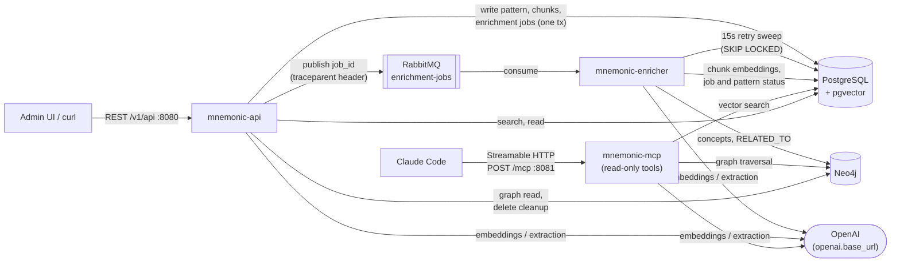
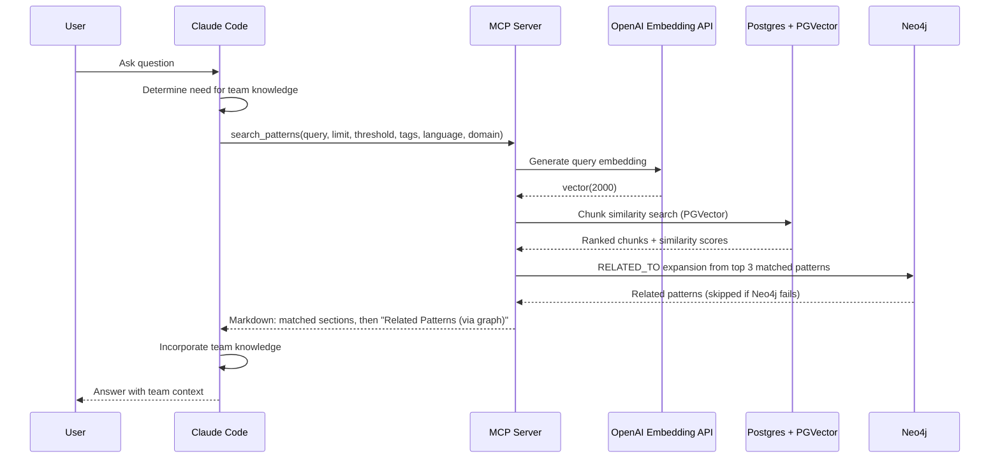
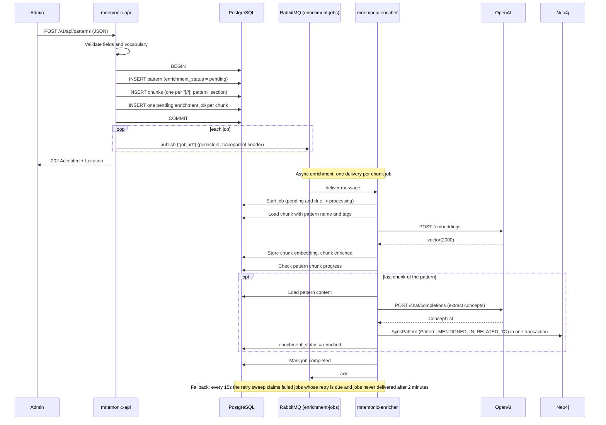
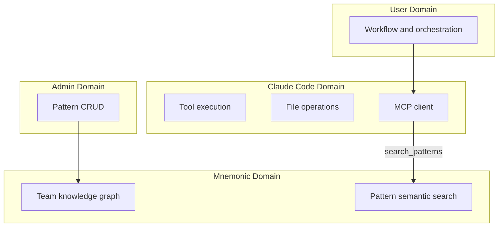

# System Architecture

> Back to [System Architecture](README.md) | [Project README](../../../README.md)

## Table of Contents

- [Architecture Overview](#architecture-overview)
- [Component Breakdown](#component-breakdown)
  - [Mnemonic MCP Server](#mnemonic-mcp-server)
  - [Mnemonic Admin API](#mnemonic-admin-api)
  - [Mnemonic Enricher](#mnemonic-enricher)
  - [Claude Code Integration](#claude-code-integration)
- [Data Flow](#data-flow)
  - [Pattern Search via MCP](#pattern-search-via-mcp)
  - [Data Loading via Admin API](#data-loading-via-admin-api)
- [Component Interactions](#component-interactions)
  - [Claude Code to MCP Server](#claude-code-to-mcp-server)
  - [Admin Tools to REST API](#admin-tools-to-rest-api)
  - [Admin API to Enricher](#admin-api-to-enricher)
- [Boundary Definitions](#boundary-definitions)
  - [Cross-Cutting Concerns](#cross-cutting-concerns)
- [Post-MVP](#post-mvp)
  - [MVP 3: Managed Infrastructure](#mvp-3-managed-infrastructure)
  - [MVP 4: Kubernetes](#mvp-4-kubernetes)
  - [MVP 5: Cloud-Native](#mvp-5-cloud-native)

## Architecture Overview

Mnemonic uses a decomposed service architecture with three independent services communicating through a message queue and shared data stores.

| Service    | Repository          | Image                                         | Ports                                                           | Role                                           |
| ---------- | ------------------- | --------------------------------------------- | --------------------------------------------------------------- | ---------------------------------------------- |
| MCP Server | `mnemonic-mcp`      | `ghcr.io/twistingmercury/mnemonic`            | 8081 `/mcp`, 8080 `/health` `/version`, 9090 `/metrics`         | Sole read-only MCP interface for Claude Code   |
| Admin API  | `mnemonic-api`      | `ghcr.io/twistingmercury/mnemonic-api`        | 8080 `/v1/api` `/swagger` `/health` `/version`, 9090 `/metrics` | REST API for pattern CRUD and search           |
| Enricher   | `mnemonic-enricher` | `ghcr.io/twistingmercury/mnemonic-enrichment` | 8080 `/health` `/version`, 9090 `/metrics`                      | Standalone worker for async pattern enrichment |

All three services serve `/health` and `/version` on `server.port` (default 8080) and Prometheus metrics on `observability.metrics.port` (default 9090, path `/metrics`). Only `mnemonic-mcp` listens on 8081 (`mcp.port`).

Only the enricher calls the extraction (chat completion) model; the API and MCP server call the embedding model to vectorize search queries. Every service also reports on OpenAI reachability in `/health`.

This is the MVP 2 topology. For the full evolution from monolith through cloud deployment, see diagrams [01](../../diagrams/01-concept-local-iteration.md) through [05](../../diagrams/05-concept-cloud-iteration.md).

## Component Breakdown

### Mnemonic MCP Server

The MCP server (`mnemonic-mcp`, MCP on port 8081) exclusively provides the read-only MCP interface for Claude Code to search the team knowledge graph. `mnemonic-api` does not serve MCP or listen on port 8081.

**Responsibilities:**

- Expose three MCP tools: `search_patterns`, `find_related_patterns`, `get_pattern`
- Query PostgreSQL + PGVector for semantic search over pattern chunks
- Query Neo4j for graph-based pattern relationships (`find_related_patterns`, and graph expansion of `search_patterns` results)

**Key Characteristics:**

- Read-only access to all data stores (no writes to any database)
- Streamable HTTP transport at `/mcp`, stateless mode, wrapped in `otelhttp` so incoming W3C trace context is continued
- Lightweight service (calls the embedding API for query vectorization only)
- No authentication (local, single-user phase)

### Mnemonic Admin API

The Admin API (`mnemonic-api`, port 8080) provides a REST interface for pattern management and search under `/v1/api`, plus Swagger at `/swagger/*any`. Health and version are served on the same port; metrics on port 9090.

**Responsibilities:**

- CRUD and semantic search for patterns: `POST`/`GET /patterns`, `GET /patterns/search`, `GET`/`PUT`/`DELETE /patterns/:id`, `GET /patterns/:id/chunks`
- Validate patterns (including the configured language and domain vocabulary, per ADR-007)
- Store the pattern, its chunks and one pending enrichment job per chunk in a single PostgreSQL transaction on create and update
- Publish each job ID to the RabbitMQ `enrichment-jobs` queue after the transaction commits
- Read Neo4j graph context for `GET /patterns/:id`; on delete, clean up the pattern's Neo4j node best-effort (the API never builds the graph)

**Key Characteristics:**

- Returns 202 Accepted for pattern create (enrichment is async); `PUT` returns 204 No Content (ADR-006)
- Best-effort RabbitMQ publish (ADR-009): if the publish fails after one reconnect and retry, the job row stays `pending` and the enricher's retry sweep claims it
- No authentication (local, single-user phase)

### Mnemonic Enricher

The Enricher (`mnemonic-enricher`) is a standalone worker that processes pattern enrichment asynchronously. Its only HTTP surface is `/health` and `/version` on port 8080 and metrics on port 9090.

**Responsibilities:**

- Consume enrichment job messages (`{"job_id": "<uuid>"}`) from the RabbitMQ `enrichment-jobs` queue, continuing the API's trace from the message headers
- Every 15 seconds, claim jobs due for retry, and jobs never delivered within a 2-minute grace period, from PostgreSQL with `FOR UPDATE SKIP LOCKED`
- Generate one embedding per chunk via the OpenAI embeddings API and store it in PostgreSQL
- When a pattern's last chunk is embedded, extract concepts via the OpenAI chat completions API, write `MENTIONED_IN` and `RELATED_TO` relationships to Neo4j, and mark the pattern `enriched`
- Every 5 minutes, return stale `processing` jobs to `pending` and delete old completed and failed jobs

**Key Characteristics:**

- Decoupled from the Admin API via RabbitMQ; PostgreSQL job rows are the source of truth
- Horizontally scalable: job start is conditional (`pending` and due) and the sweep uses `SKIP LOCKED`, so multiple instances can share the queue and table
- Bounded concurrency (`enrichment.worker_count`, default 2; `queue.rabbitmq.prefetch_count`, default 5)
- Writes to PostgreSQL (chunk embeddings, job and enrichment status) and Neo4j (concept graph)

**What Mnemonic Services Do NOT Do:**

- Host or run models (embeddings and concept extraction are calls to the OpenAI API; Mnemonic never answers user prompts)
- Store user credentials
- Execute tools or file operations
- Maintain session state

### Claude Code Integration

Claude Code integrates with Mnemonic via the MCP (Model Context Protocol) interface.

**MCP Tools Provided (3 pattern search tools):**

| Tool                    | Purpose                                   |
| ----------------------- | ----------------------------------------- |
| `search_patterns`       | Semantic search over team knowledge graph |
| `find_related_patterns` | Find patterns related to a given pattern  |
| `get_pattern`           | Retrieve specific pattern by ID           |

For full tool definitions and parameters, see [MCP Tools](../mnemonic/08-mcp-tools.md).

**Integration Characteristics:**

- Read-only access via MCP over Streamable HTTP (`http://<host>:8081/mcp`)
- Runs in a trusted environment (local, single user)
- No authentication
- Searches team knowledge for workflow patterns

## Data Flow

The following diagrams show data flow for the two primary use cases.

### Pattern Search via MCP

Graph matches are listed separately (at most 5) and do not change the vector ranking. Post-MVP: blended vector and graph ranking.

### Data Loading via Admin API

Pattern creation is a synchronous transactional write to PostgreSQL, followed by asynchronous enrichment by the Enricher. One trace spans the whole flow: the API injects W3C `traceparent` into the AMQP message headers and the Enricher continues it. The activity-level detail (validation, error branches, retries) is in [POST /v1/api/patterns — Activity Diagram](../../diagrams/post-pattern-flow.md).

If a step fails, the Enricher marks the job (and the chunk and pattern) failed and schedules a retry after `enrichment.retry_delay` (default 30s), up to the job's `max_attempts`; the retry sweep, not RabbitMQ, re-runs it.

## Component Interactions

### Claude Code to MCP Server

| Aspect            | Detail                                                 |
| ----------------- | ------------------------------------------------------ |
| Protocol          | MCP over Streamable HTTP (stateless), `/mcp` on :8081  |
| Authentication    | None (local, single-user phase)                        |
| Request contains  | MCP tool name, parameters                              |
| Response contains | Markdown text content: search results, pattern details |

### Admin Tools to REST API

| Aspect            | Detail                                                                                              |
| ----------------- | --------------------------------------------------------------------------------------------------- |
| Protocol          | REST over HTTP, `/v1/api` on :8080 (TLS, if any, terminates at a reverse proxy)                     |
| Authentication    | None (local phase); see [Security Architecture](01-security-architecture.md) for the planned design |
| Request contains  | JSON payloads for CRUD operations                                                                   |
| Response contains | Created/updated resources, or RFC 7807 problem details on error                                     |

### Admin API to Enricher

| Aspect           | Detail                                                                                                                                                                        |
| ---------------- | ----------------------------------------------------------------------------------------------------------------------------------------------------------------------------- |
| Protocol         | AMQP via RabbitMQ, default exchange, durable queue `enrichment-jobs`                                                                                                          |
| Message trigger  | Pattern create or update in Admin API (after commit), one message per chunk job                                                                                               |
| Message contains | JSON body `{"job_id": "<uuid>"}`; W3C trace context in the message headers                                                                                                    |
| Failure handling | Best-effort publish (ADR-009): one reconnect and retry, then the job stays `pending` in PostgreSQL and the enricher's 15s retry sweep claims it after a 2-minute grace period |

## Boundary Definitions

Clear boundaries separate concerns between components.

**Boundary Rules:**

- The user drives all workflow and orchestration decisions
- Claude Code is the interface; Mnemonic is the memory
- Pattern storage and search live only in Mnemonic
- Admin operations are managed via the Admin API
- File operations happen only on the workstation
- Mnemonic never receives or stores user credentials

### Cross-Cutting Concerns

- **Observability**: All three services emit structured logs, expose `/health` and `/version` on port 8080, publish OpenTelemetry metrics for Prometheus on port 9090 (`/metrics`), and export traces over OTLP gRPC when `observability.tracing.enabled` is true (off by default). One trace spans API to RabbitMQ to Enricher. See [Observability Architecture](07-observability-architecture.md).
- **Schema migration**: Migrations are pre-applied at Docker image build time via entrypoint scripts. The services neither run migrations nor check the schema version at startup; they assume the schema shipped in the database images. See [Data Architecture - Migration Strategy](04-data-architecture.md#migration-strategy).

## Post-MVP

This section covers the planned progression from the current local MVP 2 topology toward cloud-native deployment. Each milestone builds on the previous one.

### MVP 3: Managed Infrastructure

Move stateful infrastructure to managed AWS services while keeping application services local.

- Replace local PostgreSQL + PGVector with AWS RDS PostgreSQL + PGVector
- Replace local Neo4j with AWS Neptune
- Replace local RabbitMQ with AWS SQS
- MCP server, Admin API, and Enricher remain local

See [03-concept-local-iteration](../../diagrams/03-concept-local-iteration.md).

### MVP 4: Kubernetes

Deploy application services to a local Kubernetes cluster and introduce authentication and authorization.

- Deploy MCP server, Admin API, and Enricher to local single-node Kubernetes (minikube)
- Add Envoy as ingress/authN layer for MCP and Admin API traffic
- Add OPA policies as the authZ checkpoint
- Begin Helm charts for repeatable cluster deployment
- Data and queue infrastructure remain on managed AWS services

See [04-concept-local-iteration](../../diagrams/04-concept-local-iteration.md).

### MVP 5: Cloud-Native

Move the full runtime to AWS and adopt infrastructure-as-code.

- Deploy all services to AWS Fargate
- Provision infrastructure with Terraform
- Use SSM Parameter Store and Secrets Manager for runtime configuration
- Retain Envoy + OPA in the request path for MCP and Admin API authorization

See [05-concept-cloud-iteration](../../diagrams/05-concept-cloud-iteration.md).

**Next:** [Communication Patterns](03-communication-patterns.md)

---

Copyright (c) 2025-2026 Jeremy K. Johnson. All rights reserved.
