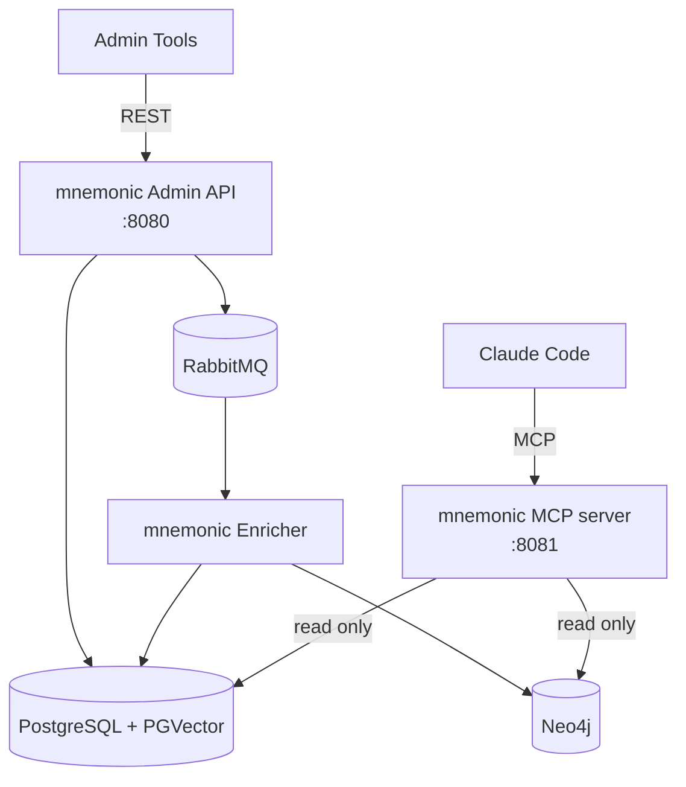
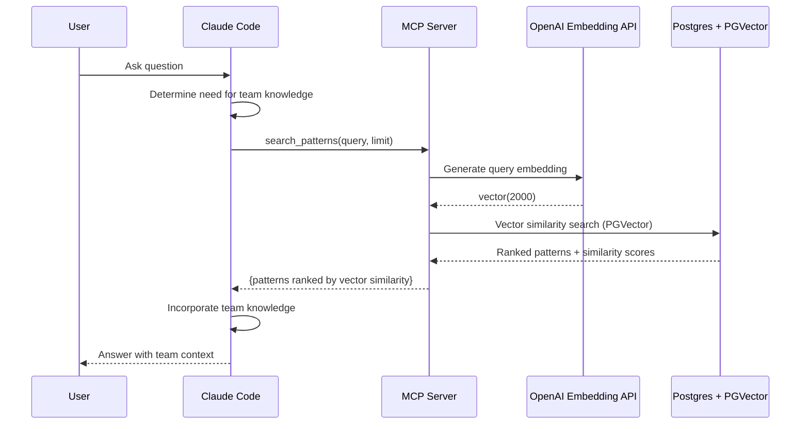
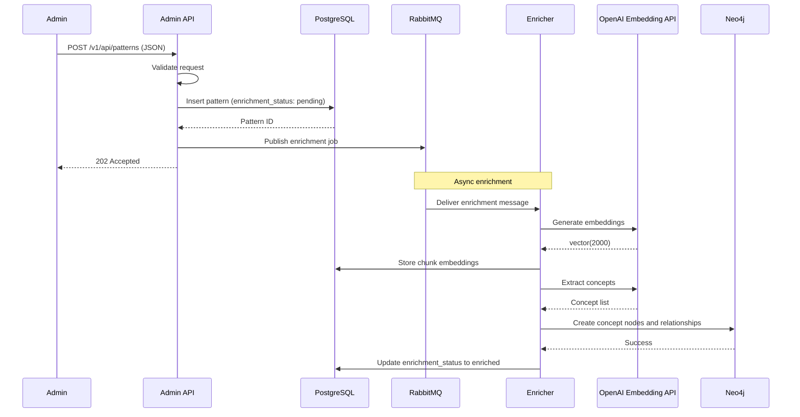
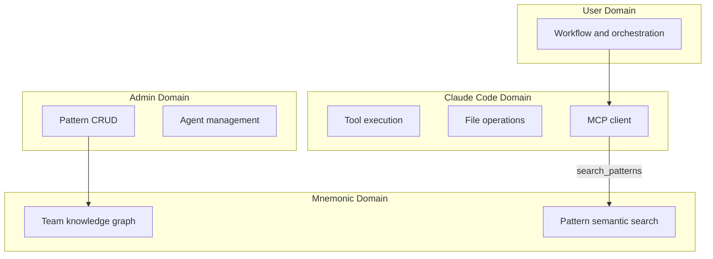

# System Architecture

> Back to [System Architecture](README.md) | [Project README](../../../README.md)

## Table of Contents

- [Architecture Overview](#architecture-overview)
- [Component Breakdown](#component-breakdown)
  - [Mnemonic MCP Server](#mnemonic-mcp-server)
  - [Mnemonic Admin API](#mnemonic-admin-api)
  - [Mnemonic Enricher](#mnemonic-enricher)
  - [Claude Code Integration](#claude-code-integration)
- [Data Flow](#data-flow)
  - [Pattern Search via MCP](#pattern-search-via-mcp)
  - [Data Loading via Admin API](#data-loading-via-admin-api)
- [Component Interactions](#component-interactions)
  - [Claude Code to MCP Server](#claude-code-to-mcp-server)
  - [Admin Tools to REST API](#admin-tools-to-rest-api)
  - [Admin API to Enricher](#admin-api-to-enricher)
- [Boundary Definitions](#boundary-definitions)
  - [Cross-Cutting Concerns](#cross-cutting-concerns)
- [Post-MVP](#post-mvp)
  - [MVP 3: Managed Infrastructure](#mvp-3-managed-infrastructure)
  - [MVP 4: Kubernetes](#mvp-4-kubernetes)
  - [MVP 5: Cloud-Native](#mvp-5-cloud-native)

## Architecture Overview

Mnemonic uses a decomposed service architecture with three independent services communicating through a message queue and shared data stores.

| Service | Repository | Port | Role |
| --- | --- | --- | --- |
| MCP Server | `mnemonic-mcp` | 8081 | Sole read-only MCP interface for Claude Code |
| Admin API | `mnemonic-api` | 8080 | REST API for pattern CRUD and administration |
| Enricher | `mnemonic-enricher` | -- | Standalone worker for async pattern enrichment |

This is the MVP 2 topology. For the full evolution from monolith through cloud deployment, see diagrams [01](../../diagrams/01-concept-local-iteration.md) through [05](../../diagrams/05-concept-cloud-iteration.md).

## Component Breakdown

### Mnemonic MCP Server

The MCP server (`mnemonic-mcp`, port 8081) exclusively provides the read-only MCP interface for Claude Code to search the team knowledge graph. `mnemonic-api` does not serve MCP or listen on port 8081.

**Responsibilities:**

- Expose three MCP tools: `search_patterns`, `find_related_patterns`, `get_pattern`
- Query PostgreSQL + PGVector for semantic search over pattern chunks
- Query Neo4j for graph-based pattern relationships

**Key Characteristics:**

- Read-only access to all data stores (no writes to any database)
- Streamable HTTP transport, stateless
- Lightweight service (calls embedding API for query vectorization only; no generative inference)
- No authentication (MVP, local trusted environment)

### Mnemonic Admin API

The Admin API (`mnemonic-api`, port 8080) provides a REST interface for pattern management and administration. Its operational endpoints, including health, version, metrics, and Swagger, remain part of the API service boundary.

**Responsibilities:**

- CRUD operations for patterns and agents
- Validate and store patterns in PostgreSQL
- Publish enrichment jobs to RabbitMQ on pattern create/update
- Sync Neo4j graph state on best-effort basis (per ADR-009)

**Key Characteristics:**

- Writes to PostgreSQL for all pattern and agent data
- Returns 202 Accepted for pattern create/update (enrichment is async)
- Best-effort RabbitMQ publish: if the queue is unavailable, the pattern is stored with `pending` status and a recovery process can re-publish
- No authentication (MVP)

### Mnemonic Enricher

The Enricher (`mnemonic-enricher`) is a standalone worker that processes pattern enrichment asynchronously.

**Responsibilities:**

- Consume enrichment job messages from RabbitMQ
- Generate embeddings via the OpenAI Embedding API
- Store chunk embeddings and update enrichment status in PostgreSQL
- Extract concepts and create relationships in Neo4j

**Key Characteristics:**

- Decoupled from the Admin API via RabbitMQ
- Horizontally scalable (multiple instances consume from the same queue)
- Writes to PostgreSQL (chunk embeddings, enrichment status) and Neo4j (concept graph)

**What Mnemonic Services Do NOT Do:**

- Perform LLM inference (services call an embedding API, but do not perform generative AI inference)
- Store user credentials
- Execute tools or file operations
- Maintain session state

### Claude Code Integration

Claude Code integrates with Mnemonic via the MCP (Model Context Protocol) interface.

**MCP Tools Provided (3 pattern search tools):**

| Tool                    | Purpose                                  |
| ----------------------- | ---------------------------------------- |
| `search_patterns`       | Semantic search over team knowledge graph |
| `find_related_patterns` | Find patterns related to a given pattern |
| `get_pattern`           | Retrieve specific pattern by ID          |

For full tool definitions and parameters, see [MCP Tools](../mnemonic/08-mcp-tools.md).

**Integration Characteristics:**

- Read-only access via MCP
- Runs in trusted environment (local network)
- No authentication (MVP)
- Searches team knowledge for workflow patterns

## Data Flow

The following diagrams show data flow for the two primary use cases.

### Pattern Search via MCP

Post-MVP: search_patterns will incorporate Neo4j graph scores for blended ranking.

### Data Loading via Admin API

Pattern creation follows a synchronous write to PostgreSQL followed by asynchronous enrichment via the Enricher.

## Component Interactions

### Claude Code to MCP Server

| Aspect            | Detail                                         |
| ----------------- | ---------------------------------------------- |
| Protocol          | MCP over Streamable HTTP                       |
| Authentication    | None (MVP, local trusted environment)          |
| Request contains  | MCP tool name, parameters                      |
| Response contains | Search results, pattern details               |

### Admin Tools to REST API

| Aspect            | Detail                                                                            |
| ----------------- | --------------------------------------------------------------------------------- |
| Protocol          | REST (HTTP/HTTPS)                                                                 |
| Authentication    | None (MVP); see [Security Architecture](01-security-architecture.md) for Post-MVP |
| Request contains  | JSON payloads for CRUD operations                                                 |
| Response contains | Created/updated resources, success/error status                                   |

### Admin API to Enricher

| Aspect              | Detail                                                                                   |
| ------------------- | ---------------------------------------------------------------------------------------- |
| Protocol            | AMQP via RabbitMQ                                                                        |
| Message trigger     | Pattern create or update in Admin API                                                    |
| Message contains    | Pattern ID and enrichment action                                                         |
| Failure handling    | Best-effort publish (ADR-009): if RabbitMQ is unavailable, pattern stored with `pending` status; recovery process can re-publish |

## Boundary Definitions

Clear boundaries separate concerns between components.

**Boundary Rules:**

- The user drives all workflow and orchestration decisions
- Claude Code is the interface; Mnemonic is the memory
- Pattern storage and search live only in Mnemonic
- Admin operations are managed via the Admin API
- File operations happen only on the workstation
- Mnemonic never receives or stores user credentials

### Cross-Cutting Concerns

- **Observability**: All three services emit structured logs, expose health check endpoints, and publish metrics. See [Observability Architecture](07-observability-architecture.md).
- **Schema migration**: Migrations are pre-applied at Docker image build time via entrypoint scripts. Services verify schema compatibility at startup but do not run migrations. See [Data Architecture - Migration Strategy](04-data-architecture.md#migration-strategy).

## Post-MVP

This section covers the planned progression from the current local MVP 2 topology toward cloud-native deployment. Each milestone builds on the previous one.

### MVP 3: Managed Infrastructure

Move stateful infrastructure to managed AWS services while keeping application services local.

- Replace local PostgreSQL + PGVector with AWS RDS PostgreSQL + PGVector
- Replace local Neo4j with AWS Neptune
- Replace local RabbitMQ with AWS SQS
- MCP server, Admin API, and Enricher remain local

See [03-concept-local-iteration](../../diagrams/03-concept-local-iteration.md).

### MVP 4: Kubernetes

Deploy application services to a local Kubernetes cluster and introduce authentication and authorization.

- Deploy MCP server, Admin API, and Enricher to local single-node Kubernetes (minikube)
- Add Envoy as ingress/authN layer for MCP and Admin API traffic
- Add OPA policies as the authZ checkpoint
- Begin Helm charts for repeatable cluster deployment
- Data and queue infrastructure remain on managed AWS services

See [04-concept-local-iteration](../../diagrams/04-concept-local-iteration.md).

### MVP 5: Cloud-Native

Move the full runtime to AWS and adopt infrastructure-as-code.

- Deploy all services to AWS Fargate
- Provision infrastructure with Terraform
- Use SSM Parameter Store and Secrets Manager for runtime configuration
- Retain Envoy + OPA in the request path for MCP and Admin API authorization

See [05-concept-cloud-iteration](../../diagrams/05-concept-cloud-iteration.md).

**Next:** [Communication Patterns](03-communication-patterns.md)

---

Copyright (c) 2025-2026 Jeremy K. Johnson. All rights reserved.
