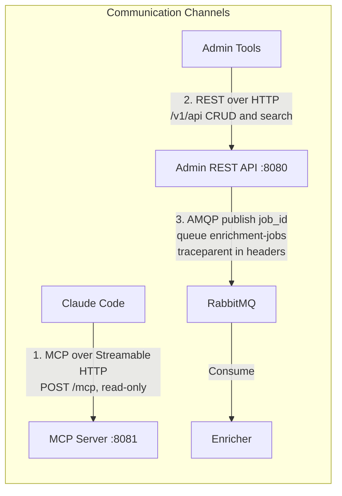
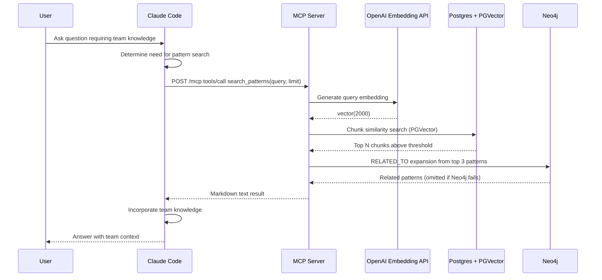
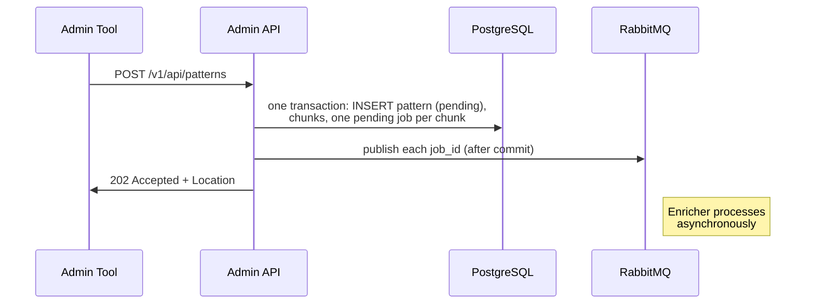
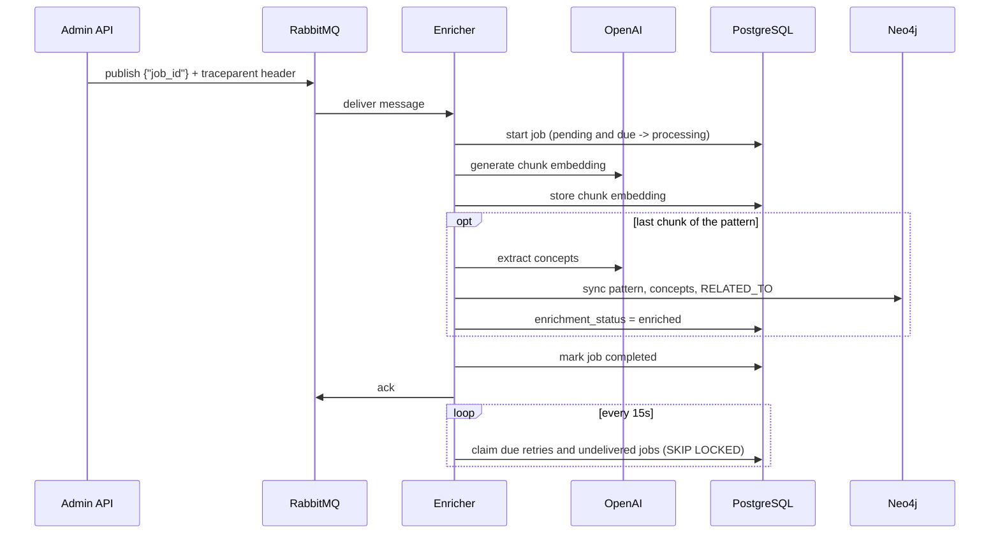
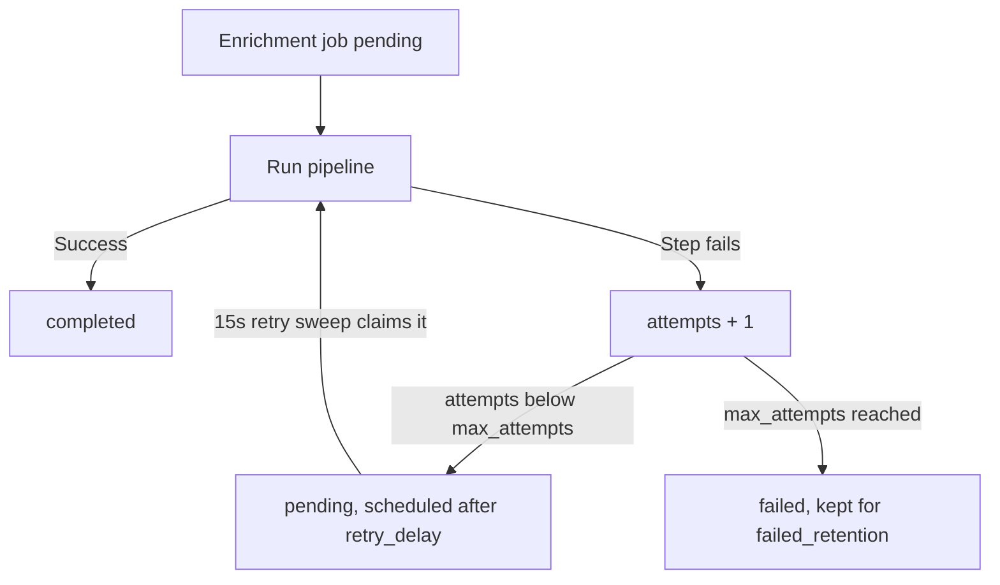
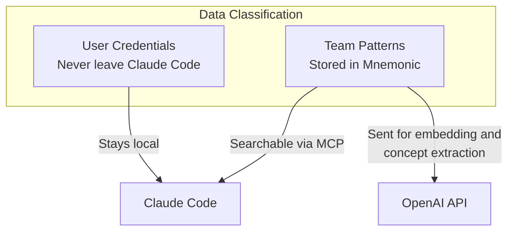

# Communication Patterns

> Back to [System Architecture](README.md) | [Project README](../../../README.md)

## Table of Contents

- [Overview](#overview)
- [Claude Code to MCP Server Communication](#claude-code-to-mcp-server-communication)
  - [MCP Tools](#mcp-tools)
  - [Request Flow](#request-flow)
  - [Response Structure](#response-structure)
  - [Error Handling](#error-handling)
- [Admin to REST API Communication](#admin-to-rest-api-communication)
  - [Admin Operations](#admin-operations)
- [Admin API to Enricher Communication](#admin-api-to-enricher-communication)
- [Resilience Patterns](#resilience-patterns)
- [Security Considerations](#security-considerations)

## Overview

Mnemonic uses three communication channels, each serving a distinct role in the system. Besides these, every service serves `GET /health` and `GET /version` on port 8080 and Prometheus metrics on port 9090 (`/metrics`), and each service talks to PostgreSQL, Neo4j and the OpenAI API directly (see [System Architecture](02-system-architecture.md#architecture-overview)).



## Claude Code to MCP Server Communication

Claude Code communicates with Mnemonic via MCP (Model Context Protocol) for read-only access to team knowledge and tooling.

### MCP Tools

Mnemonic exposes 3 read-only MCP tools for Claude Code:

**Pattern Search:**

| Tool                    | Parameters                                                                                               | Purpose                                   |
| ----------------------- | -------------------------------------------------------------------------------------------------------- | ----------------------------------------- |
| `search_patterns`       | `query: string, limit?: number, threshold?: number, tags?: string[], language?: string, domain?: string` | Semantic search over team knowledge graph |
| `find_related_patterns` | `pattern_id: string, limit?: number`                                                                     | Find patterns related to a given pattern  |
| `get_pattern`           | `id: string`                                                                                             | Retrieve specific pattern by ID           |

For full tool definitions and parameters, see [MCP Tools](../mnemonic/08-mcp-tools.md).

### Request Flow



Graph matches are appended as a separate "Related Patterns (via graph)" section (at most 5) and do not affect the vector ranking.

> **Post-MVP enhancement (planned):** A future version of `search_patterns` will blend PGVector similarity scores with Neo4j graph context into a single ranking.

**Request Characteristics:**

- Synchronous request-response via MCP protocol, Streamable HTTP in stateless mode (no MCP session state)
- Read-only access (no mutations)
- The `/mcp` handler is wrapped in `otelhttp`, so an incoming W3C `traceparent` is continued and each tool call gets a child span
- Runs on localhost in a trusted environment
- No authentication (local, single-user phase)

### Response Structure

MCP tool responses provide structured data for Claude Code integration.

**Pattern Search Response:**

MCP tool results are delivered as text content. Pattern search tools return markdown-formatted text with structured data (scores, metadata) embedded in the prose:

```json
{
  "content": [
    {
      "type": "text",
      "text": "Found 2 sections across 2 patterns matching 'error handling in Go':\n\n---\n\n## go-error-handling (92% match)\n\n**Section:** Wrapping errors\n\n**Tags:** go, errors, best-practices\n\nGo uses explicit error handling with the error interface...\n\n---\n\n## go-custom-error-types (85% match)\n\n**Section:** Domain errors\n\n**Tags:** go, errors, domain-driven\n\nFor domain errors, define types that implement the error interface...\n\n---\n\n### Related Patterns (via graph)\n\n## api-error-responses (similarity: 0.40)\n\n**Found via:** go-error-handling\n**Shared concepts:** error handling"
    }
  ]
}
```

### Error Handling

Claude Code must handle MCP server errors gracefully.

| Error Type         | Meaning               | Claude Code Behavior            |
| ------------------ | --------------------- | ------------------------------- |
| Tool not found     | Unknown MCP tool      | Fall back to local knowledge    |
| Invalid parameters | Malformed request     | Display error, suggest retry    |
| Server error       | Mnemonic unavailable  | Continue without team knowledge |
| Timeout            | Request took too long | Display timeout, suggest retry  |

## Admin to REST API Communication

Admin tools (Admin UI, curl, scripts) communicate with Mnemonic via the REST API under `/v1/api` on port 8080. The REST API manages patterns only: `POST`/`GET /patterns`, `GET /patterns/search`, `GET`/`PUT`/`DELETE /patterns/:id`, and `GET /patterns/:id/chunks`. Swagger UI is served at `/swagger/index.html`.

> **API Reference:** <!-- design docs remain in mnemonic-api/docs/design/ -->

### Admin Operations



**Request Characteristics:**

- Synchronous request-response
- JSON payloads for all operations; errors are RFC 7807 problem details carrying the active `traceId`
- `X-Request-ID` is echoed when valid (up to 128 ASCII letters, digits, `.`, `_`, `-`) and generated otherwise
- No authentication (local, single-user phase); see [Security Architecture](01-security-architecture.md) for the planned design
- `PUT` is a full replacement and returns 204 No Content ([ADR-006](00-architectural-decisions.md#adr-006)); `PUT` and `DELETE` are idempotent

## Admin API to Enricher Communication

The Admin API and Enricher communicate exclusively through RabbitMQ. There is no direct HTTP communication between these two services.

When a pattern is created or updated, the Admin API commits the pattern, its chunks and one `enrichment_jobs` row per chunk, then publishes one message per job to the durable `enrichment-jobs` queue (default exchange, routing key = queue name, persistent delivery). The body is `{"job_id": "<uuid>"}`; the Enricher reads everything else from PostgreSQL by job ID. It embeds the chunk via OpenAI and stores the embedding; when the pattern's last chunk is done it extracts concepts and syncs Neo4j.

**Trace propagation:** The publish runs in a producer span and injects W3C trace context (`traceparent`) into the AMQP message headers. The Enricher extracts it and starts a consumer span, so one trace covers the HTTP request, the publish, and the enrichment work.

**Best-effort publish (ADR-009):** If a publish fails, the Admin API waits `queue.rabbitmq.reconnect_delay` (default 5s), reconnects once and retries; if that fails it logs a warning, counts `mnemonic.queue.publish_failures_total`, and still returns success. The job row stays `pending` in PostgreSQL.

**Retry sweep fallback:** Every 15 seconds the Enricher claims, with `FOR UPDATE SKIP LOCKED`, jobs whose retry is due and never-attempted jobs that have waited more than 2 minutes for their message. Because job start is conditional (`pending` and due), a late or duplicate delivery for a job the sweep already took is simply acked.



## Resilience Patterns

### Timeout Handling

Each communication channel has timeout considerations.

| Channel            | Timeout Strategy                                                                                                |
| ------------------ | --------------------------------------------------------------------------------------------------------------- |
| Claude Code to MCP | `mcp.read_timeout` / `mcp.write_timeout` 30s, `mcp.idle_timeout` 120s                                           |
| Admin to REST API  | `server.read_timeout` / `server.write_timeout` 30s; pattern creation returns 202 without waiting for enrichment |
| Enrichment job     | `enrichment.job_timeout` 5m: a job left in `processing` longer is returned to `pending` by maintenance          |
| Enricher shutdown  | `enrichment.drain_timeout` 30s for in-flight jobs before their contexts are cancelled                           |

### Retry Logic

Retries are specific to each dependency; there is no shared retry framework.

| Where                       | Behavior                                                                                                                                                                                                       |
| --------------------------- | -------------------------------------------------------------------------------------------------------------------------------------------------------------------------------------------------------------- |
| OpenAI calls (all services) | Up to `openai.retry_attempts` (default 3) with a fixed `openai.retry_delay` (default 1s); each retry adds an `openai.embed.retry` or `openai.extract.retry` span event                                         |
| RabbitMQ publish (API)      | One reconnect and retry after `queue.rabbitmq.reconnect_delay` (default 5s), then give up; the job stays `pending`                                                                                             |
| RabbitMQ consume (Enricher) | The subscriber reconnects when the broker closes the channel                                                                                                                                                   |
| Enrichment job (Enricher)   | A failed step increments `attempts` and reschedules the job after `enrichment.retry_delay` (default 30s) until `max_attempts` (default 3), after which it stays `failed`; the 15s retry sweep runs due retries |
| Neo4j (all services)        | Queries run through the driver's managed transactions (`ExecuteQuery`, `ExecuteRead`, `ExecuteWrite`), which retry transient errors                                                                            |



### Fallback Behavior

When components are unavailable:

| Scenario               | Fallback                                                                                                                                                                    |
| ---------------------- | --------------------------------------------------------------------------------------------------------------------------------------------------------------------------- |
| MCP server unreachable | Claude Code continues without team knowledge                                                                                                                                |
| Admin API unavailable  | Display error, suggest retry later                                                                                                                                          |
| RabbitMQ unavailable   | Pattern writes still succeed; jobs stay `pending` until the retry sweep claims them; API `/health` reports RabbitMQ as Warning                                              |
| Neo4j unavailable      | `GET /v1/api/patterns/:id` returns the pattern without graph context; `search_patterns` returns vector matches without graph expansion; `/health` reports Neo4j as Critical |
| OpenAI unavailable     | API search returns 503 Service Unavailable; enrichment jobs fail and are retried                                                                                            |
| PostgreSQL unavailable | Requests fail with 500; `/health` reports PostgreSQL as Critical                                                                                                            |

## Security Considerations

### Data in Transit

| Channel              | Security Requirement                                                                                                                                                         |
| -------------------- | ---------------------------------------------------------------------------------------------------------------------------------------------------------------------------- |
| Claude Code to MCP   | Plain HTTP on the local machine (no TLS in the local phase)                                                                                                                  |
| Admin to REST API    | Plain HTTP; the API has no in-process TLS, so TLS, if needed, terminates at a reverse proxy. See [Security Architecture](01-security-architecture.md) for the planned design |
| Services to RabbitMQ | AMQP with SASL PLAIN credentials from config (`queue.rabbitmq.user` / `password`)                                                                                            |
| Services to OpenAI   | HTTPS to `openai.base_url` (default `https://api.openai.com/v1`) with `openai.api_key`                                                                                       |

### Sensitive Data Handling



**Key Principles:**

- User credentials never leave Claude Code
- Patterns are team-shared (no user-specific secrets); do not store secrets in pattern content, because it is sent to the OpenAI API
- MCP read-only access prevents accidental data modification
- No authentication in the local phase. Planned: authentication and authorization handled externally by Envoy and OPA.
- Claude Code's own LLM calls go directly from Claude Code to the Anthropic API; Mnemonic never proxies them

**Next:** [Data Architecture](04-data-architecture.md)

---

Copyright (c) 2025-2026 Jeremy K. Johnson. All rights reserved.
