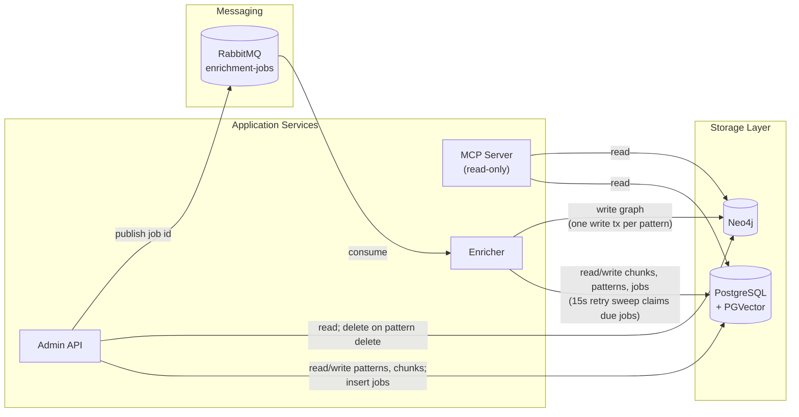
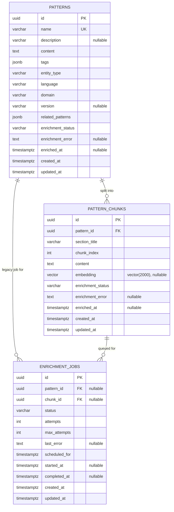
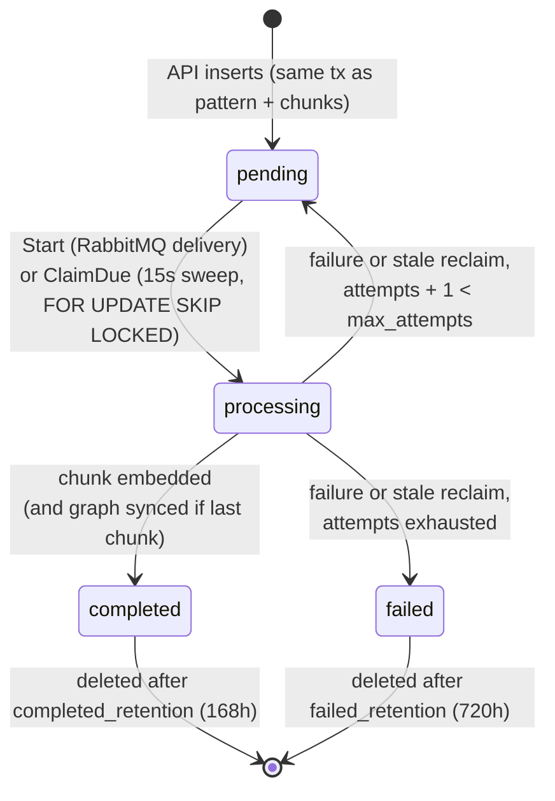
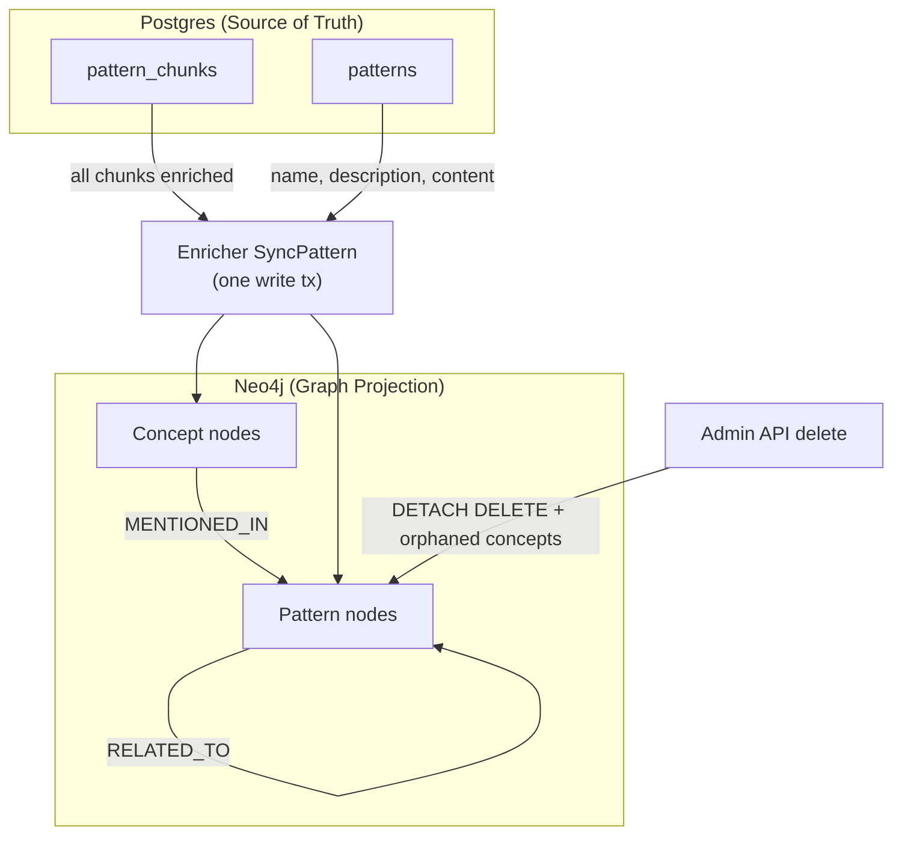
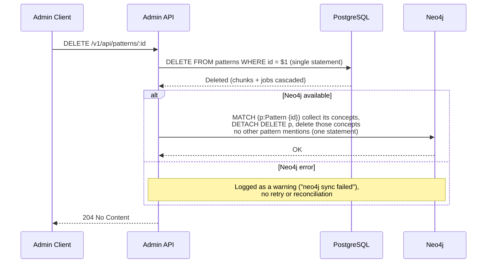
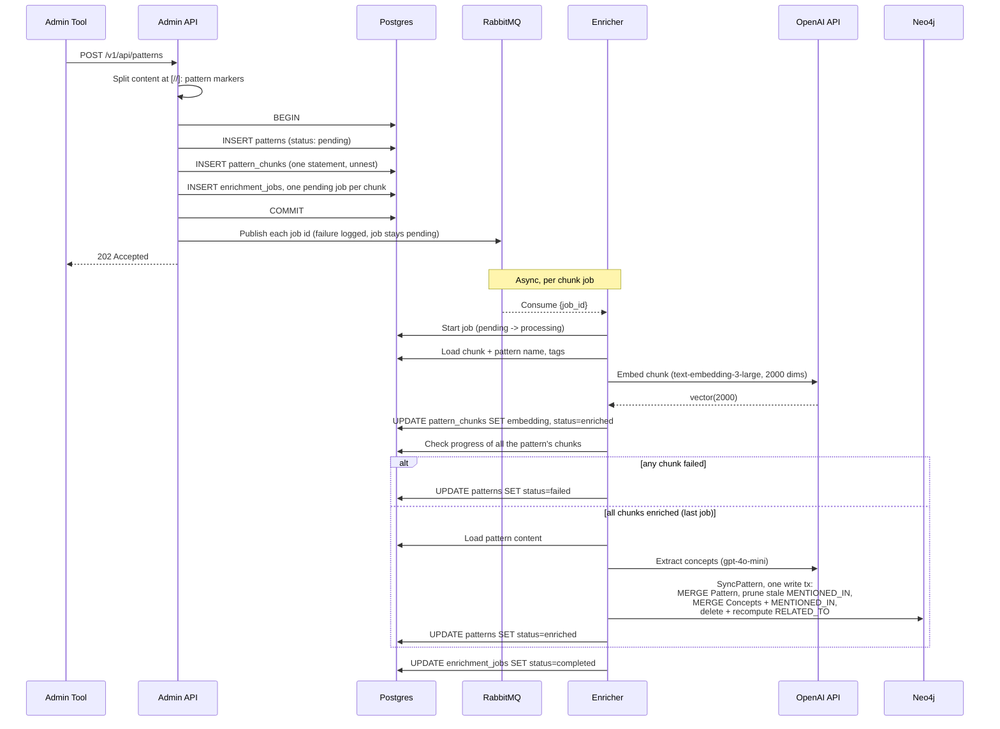
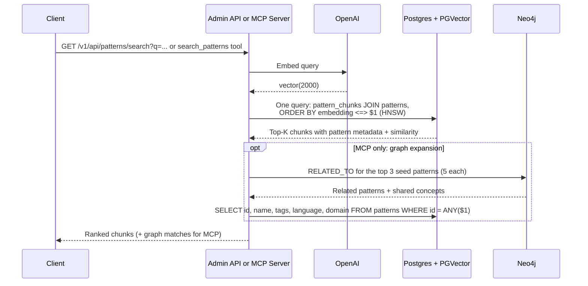
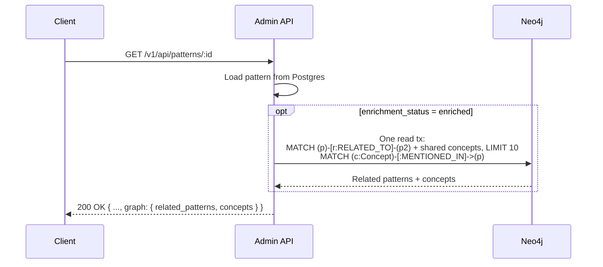

# Data Architecture

> Back to [System Architecture](README.md) | [Project README](../../../README.md)

## Table of Contents

- [MVP](#mvp)
  - [Overview](#overview)
  - [Database Technology Stack](#database-technology-stack)
    - [PostgreSQL](#postgresql)
    - [PGVector](#pgvector)
    - [Neo4j](#neo4j)
  - [Data Model Design](#data-model-design)
    - [Entity Relationship Diagram](#entity-relationship-diagram)
    - [Agents](#agents)
    - [Patterns](#patterns)
    - [Skills](#skills)
    - [Enrichment Jobs](#enrichment-jobs)
  - [Storage Architecture](#storage-architecture)
    - [PostgreSQL Schema](#postgresql-schema)
    - [PGVector Configuration](#pgvector-configuration)
    - [Neo4j Graph Model](#neo4j-graph-model)
  - [Data Flow Patterns](#data-flow-patterns)
    - [Write Paths](#write-paths)
    - [Read Paths](#read-paths)
  - [Consistency and Integrity](#consistency-and-integrity)
    - [Transaction Handling](#transaction-handling)
    - [Cross-Database Consistency](#cross-database-consistency)
    - [Constraint Enforcement](#constraint-enforcement)
  - [Migration Strategy](#migration-strategy)
    - [Schema Versioning](#schema-versioning)
    - [Forward-Compatible Migrations](#forward-compatible-migrations)
    - [Rollback Procedures](#rollback-procedures)
  - [Performance Considerations](#performance-considerations)
    - [Index Strategies](#index-strategies)
    - [Query Optimization](#query-optimization)
    - [Connection Pool Configuration](#connection-pool-configuration)
  - [Key Takeaways](#key-takeaways)
- [Post-MVP](#post-mvp)
  - [Data Lifecycle Management](#data-lifecycle-management)
    - [Data Retention Policies](#data-retention-policies)
    - [Archival Strategies](#archival-strategies)
    - [Cleanup Procedures](#cleanup-procedures)
  - [Backup and Recovery](#backup-and-recovery)
  - [Security Enhancements](#security-enhancements)
    - [Encryption at Rest](#encryption-at-rest)
    - [Access Patterns](#access-patterns)
    - [Audit Logging](#audit-logging)
  - [Advanced Consistency](#advanced-consistency)

## MVP

### Overview

[Back to Table of Contents](#table-of-contents)

> **Architecture Reference:** [System Architecture - Mnemonic](02-system-architecture.md#mnemonic-server) | [ADR-001: Team Knowledge Graph](00-architectural-decisions.md#adr-001) | [ADR-003: Entity Storage](00-architectural-decisions.md#adr-003) | [ADR-004: Pattern Storage](00-architectural-decisions.md#adr-004)

Mnemonic uses a polyglot persistence strategy where each database technology is chosen for its strengths:

- **PostgreSQL** for relational data and ACID transactions
- **PGVector** for vector embeddings and semantic search
- **Neo4j** for knowledge graph relationships

All three services (MCP Server, Admin API, Enricher) are stateless; all persistent state lives in these external databases. This separation enables horizontal scaling of each service independently while maintaining data consistency.

The diagram shows what each service's repository code actually reads and writes:



| Service | PostgreSQL | Neo4j |
| --- | --- | --- |
| Admin API (`mnemonic-api`) | CRUD on `patterns`; insert/delete `pattern_chunks`; insert `enrichment_jobs`; chunk similarity search | Reads concepts and `RELATED_TO`; `DeletePattern` removes the node and its now-orphaned concepts. Never creates nodes or edges. |
| Enricher (`mnemonic-enricher`) | Claims and updates `enrichment_jobs`; writes chunk embeddings and status; writes pattern enrichment status; deletes old completed/failed jobs | `SyncPattern`: merges `Pattern`, `Concept`, `MENTIONED_IN` and recomputes `RELATED_TO` in a single write transaction |
| MCP Server (`mnemonic-mcp`) | Read-only: chunk similarity search, pattern lookups | Read-only: concepts and `RELATED_TO` |

### Database Technology Stack

[Back to Table of Contents](#table-of-contents)

#### PostgreSQL

**Purpose:** Primary relational database for structured data with ACID guarantees.

**Stores (used by the services):**

- Patterns: knowledge units (documentation, design decisions, examples)
- Pattern chunks: sections of each pattern, split at `[//]: pattern` markers (used for embedding and semantic search)
- Enrichment jobs: durable queue state for chunk embedding and graph sync

**Also in the schema, not used by any current service:** `agents`, `skills`, `skill_files`, `pattern_agent_associations`. These tables are created by the `mnemonic-dbs` image for planned agent/skill features; no repository in `mnemonic-api`, `mnemonic-mcp` or `mnemonic-enricher` reads or writes them.

**Constraint Level:** ACID transactions, foreign keys with CASCADE deletes, NOT NULL constraints on required columns.

**Connection:** pgx v5 (`github.com/jackc/pgx/v5`, `pgxpool`) with connection pooling and explicit transaction boundaries where a write spans several statements. See [Connection Pool Configuration](#connection-pool-configuration).

#### PGVector

**Purpose:** Vector similarity search and semantic search by embeddings.

**Stores:**

- Chunk embeddings: 2000-dimensional vectors generated from OpenAI text-embedding-3-large (Matryoshka truncation), stored in `pattern_chunks.embedding`. `openai.embedding_dimensions` defaults to 2000 in all three services.

**Index Type:** HNSW on `pattern_chunks.embedding` (`vector_cosine_ops`), per the [mnemonic-dbs schema reference](../dbs/08-data-architecture.md#indexes).

**Query Layer:** Native SQL with the `<=>` operator for cosine distance.

#### Neo4j

**Purpose:** Knowledge graph for relationship traversal across patterns and concepts.

**Stores:**

- Patterns: projection of patterns from Postgres (source of truth), keyed by the pattern UUID
- Concepts: entities extracted during enrichment (technologies, practices, domains)
- Relationships: concept mentions (`MENTIONED_IN`) and pattern-pattern similarity (`RELATED_TO`)

The schema also declares an `Agent` label and a `RELEVANT_FOR` index, but no current service creates `Agent` nodes or `RELEVANT_FOR` relationships.

**Consistency Model:** Eventual consistency. Postgres is always written first. The enricher writes the graph only after every chunk of a pattern is embedded; a failed graph write fails the job, which is retried. The Admin API's graph delete on pattern delete is best-effort (logged on failure).

**Connection:** Go driver (`github.com/neo4j/neo4j-go-driver/v5`) with connection pooling. Each service verifies connectivity at startup.

### Data Model Design

[Back to Table of Contents](#table-of-contents)

#### Entity Relationship Diagram

The three tables the services use, with the columns their SQL reads and writes. For the reserved agent/skill tables see the [mnemonic-dbs ER diagram](../dbs/08-data-architecture.md#entity-relationship-diagram).



#### Agents

**Status:** Not implemented. The `agents` table exists in the schema (see [mnemonic-dbs Data Architecture](../dbs/08-data-architecture.md#tables) and [Data Storage Implementation](../../design/data-storage.md#migration-002-agents-table)), but no current service has an agent repository, endpoint, or query against it. Agent storage is a planned feature.

#### Patterns

**Purpose:** Core knowledge units (design decisions, documentation, examples, code snippets).

**Schema (as used by the services' SQL):**

| Column | Type | Nullable | Notes |
| --- | --- | --- | --- |
| `id` | UUID | NO | PK; generated by the Admin API on insert |
| `name` | VARCHAR | NO | Unique (duplicate insert/update returns 409); kebab-case `^[a-z][a-z0-9-]*$`, max 128 |
| `description` | VARCHAR(500) | YES | Optional, max 500 chars |
| `content` | TEXT | NO | Full markdown content; API caps it at 100,000 bytes |
| `tags` | JSONB | NO | JSON array of strings, max 20; empty array when none |
| `entity_type` | VARCHAR | NO | Kebab-case category, e.g. `go-pattern`, `e2e-testing` |
| `language` | VARCHAR | NO | Must be in the API's `vocabulary.languages` list, e.g. `go`, `agnostic` |
| `domain` | VARCHAR | NO | Must be in the API's `vocabulary.domains` list, e.g. `backend`, `testing` |
| `version` | VARCHAR | YES | Optional target version string, e.g. `Go 1.21+` |
| `related_patterns` | JSONB | NO | JSON array of related pattern names; empty array when none |
| `enrichment_status` | VARCHAR | NO | `pending`, `enriched`, `failed` |
| `enrichment_error` | TEXT | YES | Error message when `failed` |
| `enriched_at` | TIMESTAMPTZ | YES | Set when the pattern becomes `enriched` |
| `created_at` | TIMESTAMPTZ | NO | Application set |
| `updated_at` | TIMESTAMPTZ | NO | Application set |

**Indexes:** See [Index Strategies](#index-strategies). Semantic search filters on the *chunk's* `enrichment_status = 'enriched'`, not the pattern's.

**Status lifecycle:** Insert sets `pending`. Every update also resets `enrichment_status` to `pending` and clears `enrichment_error` and `enriched_at`. The enricher sets `failed` as soon as any chunk fails, and `enriched` once all chunks are embedded and the graph sync succeeds.

#### Skills

**Status:** Not implemented. The `skills` and `skill_files` tables exist in the schema, but no current service reads or writes them. See [Data Storage Implementation](../../design/data-storage.md#migration-007-create-skills-table) for the planned design.

#### Pattern Chunks

**Purpose:** Sections of each pattern, used for semantic search and embedding.

The Admin API splits content when a pattern is created or updated: a line `[//]: pattern` followed by a Markdown heading starts a chunk, whose `section_title` is the heading text and whose `content` is the text up to the next marker. Content outside marked sections is not chunked, and a pattern with no markers gets no chunks (and so no enrichment jobs). On update, the API deletes all of the pattern's chunks and inserts the new set in the same transaction.

**Schema:**

| Column | Type | Nullable | Notes |
| --- | --- | --- | --- |
| `id` | UUID | NO | PK; generated by the Admin API |
| `pattern_id` | UUID | NO | FK to patterns(id); CASCADE delete |
| `chunk_index` | INT | NO | 0-based section order |
| `section_title` | VARCHAR | NO | Heading text after the `[//]: pattern` marker |
| `content` | TEXT | NO | Markdown text of this section (heading not included) |
| `embedding` | VECTOR(2000) | YES | Set by the enricher; NULL until embedded |
| `enrichment_status` | VARCHAR | NO | `pending` (database default), `enriched`, `failed` |
| `enrichment_error` | TEXT | YES | Error message when `failed` |
| `enriched_at` | TIMESTAMPTZ | YES | Set when the chunk is embedded |
| `created_at` | TIMESTAMPTZ | NO | Database default on insert |
| `updated_at` | TIMESTAMPTZ | NO | Database default on insert; enricher sets `now()` |

The enricher embeds `"<pattern name> | <tags> | <section title>\n\n<content>"` (tags omitted when empty), so pattern-level context is part of every chunk vector.

**Partitioning:** None for MVP; consider range partitioning by `created_at` if table exceeds 10M rows.

#### Enrichment Jobs

**Purpose:** Durable job state for chunk embedding and Neo4j sync. RabbitMQ carries only the job ID; Postgres is the source of truth for job status.

**Schema (columns used by the services' SQL):**

| Column | Type | Nullable | Notes |
| --- | --- | --- | --- |
| `id` | UUID | NO | PK; generated by the Admin API |
| `pattern_id` | UUID | YES | Set only on legacy pattern-level jobs |
| `chunk_id` | UUID | YES | FK to `pattern_chunks(id)`; set on every job the API creates today |
| `status` | VARCHAR | NO | `pending`, `processing`, `completed`, `failed` |
| `attempts` | INT | NO | Starts at 0; incremented on each failure or timeout |
| `max_attempts` | INT | NO | 3 for jobs the API creates |
| `last_error` | TEXT | YES | Error from the most recent failed attempt; `job timed out` when reclaim exhausts attempts |
| `scheduled_for` | TIMESTAMPTZ | NO | When the job is due; pushed forward by `enrichment.retry_delay` on retry |
| `started_at` | TIMESTAMPTZ | YES | Set when claimed; cleared on retry |
| `completed_at` | TIMESTAMPTZ | YES | Set on success |
| `created_at`, `updated_at` | TIMESTAMPTZ | NO | Application set |

**Constraints (from mnemonic-dbs):** `enrichment_jobs_target_exclusive` requires exactly one of `pattern_id` and `chunk_id`; both FKs cascade on delete; a partial unique index rejects a second pending/processing job for the same chunk (the API maps that unique violation to `ErrJobAlreadyPending`).

**Lifecycle:**



- **Start (message path):** `UPDATE ... SET status='processing', started_at=now() WHERE id=$1 AND status='pending' AND scheduled_for <= now()`. If no row matches (already taken, finished, or waiting for a retry), the message is acked and dropped.
- **ClaimDue (retry sweep, every 15s):** claims up to the number of free workers with `UPDATE ... WHERE id IN (SELECT id ... WHERE status='pending' AND ((attempts > 0 AND scheduled_for <= now()) OR scheduled_for <= now() - '2 minutes') ORDER BY scheduled_for LIMIT $n FOR UPDATE SKIP LOCKED)`. The 2-minute grace leaves never-attempted jobs to their RabbitMQ message and only picks them up if the publish was lost.
- **MarkFailed:** fixed delay retry (`enrichment.retry_delay`, default 30s), not exponential backoff.
- **Maintenance (every 5 min):** `ReclaimStale` returns jobs stuck in `processing` longer than `enrichment.job_timeout` (default 5m) to `pending` (or `failed` when out of attempts), and old `completed`/`failed` jobs are deleted.

### Storage Architecture

[Back to Table of Contents](#table-of-contents)

#### PostgreSQL Schema

The schema is owned by `mnemonic-dbs` and baked into the `mnemonic-postgres` image; see [mnemonic-dbs Data Architecture](../dbs/08-data-architecture.md) and [Data Storage Implementation](../../design/data-storage.md#postgresql-migrations) for the DDL.

**Note:** Application manages `updated_at` timestamps on write. No database triggers.

**Note:** For future JSONB schema validation, the pg_jsonschema extension can be used.

#### PGVector Configuration

**Index:** `idx_pattern_chunks_embedding`, HNSW with `vector_cosine_ops` on `pattern_chunks.embedding`. HNSW was chosen over IVFFlat because it builds correctly on an empty table (IVFFlat needs existing rows for its centroids). 2000 dimensions is the maximum pgvector indexes support for the `vector` type.

**Similarity Search Query:**

The Admin API (`GET /v1/api/patterns/search`) and the MCP `search_patterns` tool both run this query from their chunk repositories. The API's version selects the extra columns shown; the MCP version selects `pattern_id, name, tags, section_title, content, similarity`.

```sql
-- Fixed parameters:
--   $1 = query embedding vector (2000 dims)
--   $2 = minimum similarity (MCP default 0.5)
--   $3 = language filter ('' disables)
--   $4 = domain filter ('' disables)
SELECT pc.id, pc.pattern_id, p.name, p.entity_type, p.language, p.domain, p.tags,
       pc.section_title, pc.chunk_index, pc.content,
       1 - (pc.embedding <=> $1) AS similarity
FROM pattern_chunks pc
JOIN patterns p ON p.id = pc.pattern_id
WHERE pc.embedding IS NOT NULL
  AND pc.enrichment_status = 'enriched'
  AND 1 - (pc.embedding <=> $1) >= $2
  AND ($3::text = '' OR p.language = $3)
  AND ($4::text = '' OR p.domain = $4)
  -- optional, appended only when set:
  --   AND pc.pattern_id = ANY($n)      (API only)
  --   AND p.tags @> $n::jsonb          (all requested tags)
ORDER BY pc.embedding <=> $1
LIMIT $n;  -- default 10
```

#### Neo4j Graph Model

**Node Labels:**

| Label | Properties | Written by |
| --- | --- | --- |
| Pattern | `id` (UUID string), `name`, `description`, `updatedAt` | Enricher (`MERGE` on `id`); deleted by the Admin API on pattern delete |
| Concept | `name` (lowercase, trimmed), `type` (technology/practice/domain), `createdAt` | Enricher (`MERGE` on `name`; `type` is overwritten on every merge) |
| Agent | `name` | Nobody; label reserved in the schema |

**Relationship Types:**

| Type | From | To | Properties |
| --- | --- | --- | --- |
| `MENTIONED_IN` | Concept | Pattern | -- |
| `RELATED_TO` | Pattern | Pattern | `similarity` (float, from shared concepts), `updatedAt` |
| `RELEVANT_FOR` | Pattern | Agent | Reserved; not created by any service |

The enrichment pipeline assigns one of three concept types to each extracted entity: `technology` (tools, languages, frameworks), `practice` (methodologies, patterns, approaches), or `domain` (problem areas, business contexts). Type assignment is performed by the LLM (`openai.extraction_model`, default `gpt-4o-mini`) during the entity extraction step, which runs on the full pattern content.

`RELATED_TO` edges are created in one direction (from the pattern being enriched) and always read without direction. `similarity = sharedConcepts / max(conceptsA, conceptsB)`, and only edges with `similarity >= enrichment.related_to_min_similarity` (default 0.3) are created.

**Constraints and Indexes:**

| Constraint/Index | Label | Property | Type |
| --- | --- | --- | --- |
| `pattern_id_unique` | Pattern | `id` | Uniqueness |
| `agent_name_unique` | Agent | `name` | Uniqueness |
| `concept_name_unique` | Concept | `name` | Uniqueness |
| `pattern_name_index` | Pattern | `name` | Property |
| `concept_type_index` | Concept | `type` | Property |
| `pattern_content_fulltext` | Pattern | `name`, `description` | Full-text |
| `concept_name_fulltext` | Concept | `name` | Full-text |

The services' Cypher does not use the full-text indexes today.

**Graph Data Flow:**



### Data Flow Patterns

[Back to Table of Contents](#table-of-contents)

#### Write Paths

##### Agent Create/Update

Not implemented. There is no agents endpoint or agent repository in any current service, and nothing writes `Agent` nodes to Neo4j.

##### Pattern Delete (Admin API)



The Postgres CASCADE removes the pattern's `pattern_chunks` and `enrichment_jobs` rows automatically. The Neo4j cleanup only touches the deleted pattern's own concepts, not a graph-wide orphan sweep.

##### Pattern Create with Enrichment



If the embedding, the concept extraction or the graph sync fails, the job is marked failed and retried after `enrichment.retry_delay` until `max_attempts`; a failed embedding also marks the chunk and the pattern `failed`. Update follows the same path, except the API first resets the pattern to `pending` and replaces all chunks.

#### Read Paths

**Pattern Semantic Search:**



**Pattern Relationship Traversal (Neo4j):**

`GET /v1/api/patterns/:id` adds a graph context when the pattern is `enriched`; the MCP server's `find_related_patterns` and `get_pattern` tools use the same queries.



If the graph query fails, the pattern is returned without `graph` and a warning is logged.

### Consistency and Integrity

[Back to Table of Contents](#table-of-contents)

#### Transaction Handling

**Postgres:** Multi-statement writes use explicit transactions: pattern create and update (pattern row, chunks and jobs commit together). Single-statement writes (pattern delete, every enricher update) run on the pool without an explicit transaction. Each service maintains its own `pgxpool` connection pool.

**Neo4j:** The enricher's `SyncPattern` runs all its statements in one managed write transaction, so a pattern's graph is never left half-synced. The Admin API reads in managed read transactions and deletes with one auto-committed statement.

**Application:** Database calls are not retried in the request path; the Neo4j driver's managed transactions retry transient errors. Enrichment failures are retried through the job table.

#### Cross-Database Consistency

**Write Ordering:**

1. **Postgres first** (source of truth). If Postgres fails, the caller gets an error and Neo4j is unchanged.
2. **Neo4j second.** For enrichment, a graph failure fails the job and is retried; the pattern stays non-`enriched` until the graph sync succeeds. For pattern delete, a graph failure is logged and not retried.

**Failure Modes:**

| Scenario | Outcome |
| --- | --- |
| Enricher: Postgres succeeds, Neo4j unavailable | Job marked failed and retried after `retry_delay`; after `max_attempts` the job stays `failed` |
| API delete: Postgres succeeds, Neo4j unavailable | Pattern gone from Postgres; its `Pattern` node and concepts remain in Neo4j (stale until manually cleaned) |
| RabbitMQ publish fails after commit | Job stays `pending`; the enricher's retry sweep claims it after the 2-minute grace |
| Postgres fails | Entire request fails; Neo4j unchanged |

**Reconciliation:** Not implemented. There is no background job comparing Postgres and Neo4j; see [Advanced Consistency](#advanced-consistency) for the planned design.

**Known drift:** `SyncPattern` removes `MENTIONED_IN` edges to concepts a pattern no longer mentions but does not delete concepts left with no edges, so orphaned `Concept` nodes can accumulate after re-enrichment.

#### Constraint Enforcement

**PostgreSQL:**

- Foreign keys with CASCADE delete enforce referential integrity (`pattern_chunks` and `enrichment_jobs` cascade from `patterns`; jobs cascade from chunks).
- NOT NULL constraints on required columns; `tags` and `related_patterns` must be JSON arrays.
- UNIQUE constraint on `patterns.name`.
- `enrichment_jobs_target_exclusive`: a job targets exactly one of a pattern or a chunk.
- Partial unique indexes prevent duplicate pending/processing enrichment jobs per pattern and per chunk.

**Application (Admin API handler validation):**

- `name` and `entity_type`: required, kebab-case `^[a-z][a-z0-9-]*$`, max 128 and 100 chars.
- `language` and `domain`: required, kebab-case, max 64 chars, and must appear in `vocabulary.languages` / `vocabulary.domains`.
- `content`: required, max 100,000 bytes. `description`: max 500 chars. `tags`: max 20.

**Neo4j:**

- Uniqueness constraints on Pattern.id, Agent.name, Concept.name enforce node identity.
- `Pattern`, `Concept` and `MENTIONED_IN` are written with `MERGE`; `RELATED_TO` edges are deleted and re-created with `CREATE` on every sync.
- The enricher rejects a nil pattern ID or empty name before writing (property existence constraints are Enterprise-only and not applied).

### Migration Strategy

[Back to Table of Contents](#table-of-contents)

#### Schema Versioning

**Migration Tool:** Docker entrypoint scripts. PostgreSQL migrations are `.up.sql` files applied via `docker-entrypoint-initdb.d` when the `mnemonic-postgres` container first starts. Neo4j migrations are `.cypher` files applied via `cypher-shell` during image build. Mnemonic services never manage DDL or run migrations. See [dbs ADR-001](../dbs/02-architectural-decisions.md) for the rationale behind this approach.

**Location:** The migration files live in the separate `mnemonic-dbs` repository (`src/postgres/000001_*.up.sql` to `000010_*.up.sql`, `src/neo4j/001_*.cypher` to `003_*.cypher`). There are no `.down.sql` files. See [mnemonic-dbs Deployment Architecture](../dbs/05-deployment-architecture.md).

**Version Tracking:**

Migration state is implicit in the Docker image tag — each image version contains a known set of migrations. The services currently pin `mnemonic-postgres:v1.0.0-dev` and `mnemonic-neo4j:v1.0.0-dev`. Rollback is accomplished by pulling a prior image tag.

#### Forward-Compatible Migrations

**Migration Safety Rules:**

1. **Add columns as nullable or with defaults**

   ```sql
   -- Good: New column is nullable
   ALTER TABLE patterns ADD COLUMN source_url TEXT;

   -- Good: New column has default
   ALTER TABLE patterns ADD COLUMN priority INTEGER DEFAULT 0;
   ```

2. **Never rename columns directly**

   ```sql
   -- Bad: Breaks running application
   ALTER TABLE patterns RENAME COLUMN name TO pattern_name;

   -- Good: Add new column, migrate data, deprecate old
   ALTER TABLE patterns ADD COLUMN pattern_name VARCHAR(255);
   UPDATE patterns SET pattern_name = name;
   -- Later migration: DROP old column
   ```

3. **Add indexes concurrently**

   ```sql
   -- Good: Non-blocking index creation
   CREATE INDEX CONCURRENTLY idx_patterns_name ON patterns(name);
   ```

#### Rollback Procedures

No down migrations are maintained. To roll back, point the services at a prior `mnemonic-postgres` / `mnemonic-neo4j` image tag:

```bash
docker pull ghcr.io/twistingmercury/mnemonic-postgres:<previous-tag>
docker pull ghcr.io/twistingmercury/mnemonic-neo4j:<previous-tag>
```

**Rollback Safety:**

- The images initialize a fresh schema; rolling back an existing data volume to an older image does not undo applied DDL. Treat schema rollback on live data as a restore from backup.
- Test rollback in staging before production.
- Data migrations may require manual intervention.

### Performance Considerations

[Back to Table of Contents](#table-of-contents)

#### Index Strategies

**PostgreSQL Indexes** (defined in mnemonic-dbs; the "Used by" column says which service query benefits):

| Index | Table | Column(s) | Type | Used by |
| --- | --- | --- | --- | --- |
| `idx_pattern_chunks_embedding` | pattern_chunks | `embedding` | HNSW (`vector_cosine_ops`) | Chunk similarity search (API, MCP) |
| `idx_pattern_chunks_pattern_id` | pattern_chunks | `pattern_id` | btree | Chunk list/delete by pattern; enricher progress check |
| `idx_patterns_language` | patterns | `language` | btree | List filter |
| `idx_patterns_domain` | patterns | `domain` | btree | List filter |
| `idx_patterns_entity_type` | patterns | `entity_type` | btree | List filter |
| `idx_patterns_enriched` | patterns | `id` WHERE status='enriched' | btree (partial) | None today: the repository supports a status filter but the list endpoint does not expose it |
| `idx_patterns_tags` | patterns | `tags` | GIN | Tag filters (`?&` in list, `@>` in search) |
| `idx_patterns_search` | patterns | `to_tsvector(name \|\| description)` | GIN | Full-text `search` filter in list |
| `idx_enrichment_jobs_pending` | enrichment_jobs | `scheduled_for` WHERE status='pending' | btree (partial) | Retry sweep (`ClaimDue`) |
| `idx_enrichment_jobs_processing` | enrichment_jobs | `started_at` WHERE status='processing' | btree (partial) | Stale reclaim |
| `idx_enrichment_jobs_unique_pending_chunk` | enrichment_jobs | `chunk_id` WHERE status IN ('pending','processing') | unique (partial) | Prevent duplicate jobs per chunk |
| `idx_enrichment_jobs_unique_pending` | enrichment_jobs | `pattern_id` WHERE status IN ('pending','processing') | unique (partial) | Prevent duplicate legacy jobs per pattern |
| `idx_enrichment_jobs_pattern` | enrichment_jobs | `pattern_id` | btree | FK lookups |
| `idx_agents_definition`, `idx_skills_definition`, `idx_skill_files_skill_id`, `idx_pattern_agent_assoc_agent` | agents, skills, skill_files, pattern_agent_associations | various | GIN / btree | Reserved tables; unused |

#### Query Optimization

**Chunk Similarity Query:**

```sql
-- HNSW search breadth (pgvector default 40); raise for better recall
SET hnsw.ef_search = 100;

EXPLAIN ANALYZE
SELECT pc.id, pc.pattern_id, pc.section_title, pc.content,
       1 - (pc.embedding <=> $1) AS similarity
FROM pattern_chunks pc
JOIN patterns p ON p.id = pc.pattern_id
WHERE pc.embedding IS NOT NULL
  AND pc.enrichment_status = 'enriched'
ORDER BY pc.embedding <=> $1
LIMIT 5;

-- Expected: Index Scan using idx_pattern_chunks_embedding
```

The services do not set `hnsw.ef_search`; the pgvector default applies. Because the similarity threshold and metadata filters are applied after the index scan, heavy filtering can return fewer than `LIMIT` rows.

**Pattern List Query:** The API's list query selects every column except `content` and uses `COUNT(*) OVER()` for the total, so one round trip returns a page plus the total count.

#### Connection Pool Configuration

**PostgreSQL Connection Pool Settings** (defaults in all three services' `config/defaults.go`):

| Setting | Config key | Default | Description |
| --- | --- | --- | --- |
| Max Connections | `database.postgres.max_open_conns` | 25 | `pgxpool` `MaxConns` |
| Min Connections | `database.postgres.max_idle_conns` | 5 | Mapped to `pgxpool` `MinConns` |
| Max Connection Lifetime | `database.postgres.conn_max_lifetime` | 5m | Recycle connections |

**Neo4j Connection Pool Settings:**

| Setting | Config key | Default | Description |
| --- | --- | --- | --- |
| Max Pool Size | `database.neo4j.max_connection_pool_size` | 50 | Maximum concurrent connections |
| Acquisition Timeout | `database.neo4j.connection_acquisition_timeout` | 60s | Maximum wait time for available connection |

**Pool Sizing Guidelines:**

| Deployment | Postgres Pool | Neo4j Pool | Rationale |
| --- | --- | --- | --- |
| Development | 5 | 10 | Minimal resources |
| Single Pod | 25 | 25 | Balanced for typical load |
| Multi-Pod (3) | 15 per pod | 15 per pod | Total 45, below database max |

### Key Takeaways

[Back to Table of Contents](#table-of-contents)

- **Polyglot persistence** - Each database chosen for specific strengths (Postgres for ACID, PGVector for vectors, Neo4j for graphs)
- **Postgres is source of truth** - All primary data lives in Postgres; Neo4j holds a projection built by the enricher
- **Clear write ownership** - The API writes patterns, chunks and jobs; the enricher writes embeddings, statuses and the graph; the MCP server only reads
- **Enrichment is asynchronous and durable** - Jobs live in Postgres; RabbitMQ is a delivery hint, and the retry sweep recovers lost messages
- **Stateless services** - All state in external databases enables independent horizontal scaling of MCP Server, Admin API, and Enricher
- **Forward-compatible migrations** - Schema changes designed for zero-downtime deployments
- **Defense in depth** - Constraints at database level, validation at application level

## Post-MVP

### Data Lifecycle Management

[Back to Table of Contents](#table-of-contents)

The retention policies below apply to the data model defined in [MVP: Data Model Design](#data-model-design).

#### Data Retention Policies

| Data Type | Retention | Rationale |
| --- | --- | --- |
| Agents | Indefinite | Active configuration, rarely deleted |
| Patterns | Indefinite | Knowledge base grows over time |
| Skills | Indefinite | Reusable tooling definitions |
| Enrichment Jobs (completed) | 7 days | Debugging, can be recreated (implemented: `enrichment.completed_retention`, default 168h) |
| Enrichment Jobs (failed) | 30 days | Root cause analysis (implemented: `enrichment.failed_retention`, default 720h) |

#### Archival Strategies

**Enrichment Jobs Cleanup:**

Already implemented: the enricher's maintenance loop (every 5 minutes) runs the equivalent of these statements, with the cutoffs taken from `enrichment.completed_retention` and `enrichment.failed_retention`:

```sql
-- Delete completed jobs older than 7 days
DELETE FROM enrichment_jobs
WHERE status = 'completed'
  AND completed_at < NOW() - INTERVAL '7 days';

-- Keep failed jobs for 30 days
DELETE FROM enrichment_jobs
WHERE status = 'failed'
  AND updated_at < NOW() - INTERVAL '30 days';
```

**Pattern Versioning:**

For audit requirements, implement a pattern_history table:

```sql
CREATE TABLE pattern_history (
    id UUID PRIMARY KEY DEFAULT gen_random_uuid(),
    pattern_id UUID NOT NULL,
    name VARCHAR(128) NOT NULL,
    content TEXT NOT NULL,
    changed_by VARCHAR(128),  -- X-User-ID header
    changed_at TIMESTAMPTZ NOT NULL DEFAULT NOW(),
    change_type VARCHAR(20) NOT NULL  -- 'create', 'update', 'delete'
);
```

#### Cleanup Procedures

**Orphaned Graph Nodes:**

Not implemented as a sweep. The Admin API already deletes a deleted pattern's orphaned concepts; a periodic sweep would also catch concepts orphaned by re-enrichment and `Pattern` nodes left behind when the API's Neo4j delete failed.

```cypher
// Remove Concept nodes with no relationships
MATCH (c:Concept)
WHERE NOT (c)-[:MENTIONED_IN]->()
DELETE c;

// Remove stale Pattern nodes not in Postgres
MATCH (p:Pattern)
WHERE NOT EXISTS {
    CALL {
        WITH p
        RETURN 1 WHERE p.id IN $postgres_pattern_ids
    }
}
DELETE p;
```

**Stale Chunk Embeddings:**

```sql
-- Remove chunk data for failed enrichment (allow retry)
DELETE FROM pattern_chunks
WHERE pattern_id IN (
    SELECT id FROM patterns
    WHERE enrichment_status = 'failed'
      AND updated_at < NOW() - INTERVAL '24 hours'
);

UPDATE patterns
SET enrichment_status = 'pending',
    enrichment_error = NULL
WHERE enrichment_status = 'failed'
  AND updated_at < NOW() - INTERVAL '24 hours';
```

### Backup and Recovery

[Back to Table of Contents](#table-of-contents)

<!-- Backup and Recovery: See database-operations.md in mnemonic/docs/operations/ for backup strategies and recovery procedures. -->

### Security Enhancements

[Back to Table of Contents](#table-of-contents)

> **Architecture Reference:** [Security Architecture](01-security-architecture.md)

These enhancements extend the basic connection security in place for MVP. The databases being secured are described in [MVP: Database Technology Stack](#database-technology-stack).

#### Encryption at Rest

| Database   | Encryption Method                 | Configuration                      |
| ---------- | --------------------------------- | ---------------------------------- |
| PostgreSQL | Transparent Data Encryption (TDE) | Cloud provider managed or pgcrypto |
| Neo4j      | Enterprise Edition encryption     | Or encrypted volume mounts         |

**Volume-Level Encryption (Kubernetes):**

```yaml
# StorageClass with encryption
apiVersion: storage.k8s.io/v1
kind: StorageClass
metadata:
  name: encrypted-fast
provisioner: ebs.csi.aws.com
parameters:
  type: gp3
  encrypted: "true"
  kmsKeyId: arn:aws:kms:...
```

#### Access Patterns

**Database Credentials:**

- Stored in Kubernetes Secrets or cloud secret managers
- Rotated on schedule (90 days recommended)
- Separate read/write users for principle of least privilege

**Connection Security:**

```yaml
# Mnemonic database configuration
database:
  postgres:
    sslmode: require
    sslrootcert: /etc/ssl/certs/rds-ca-cert.pem
  neo4j:
    encryption: true
    trust_strategy: TRUST_SYSTEM_CA_SIGNED_CERTIFICATES
```

#### Audit Logging

**Database-Level Audit (PostgreSQL):**

```sql
-- Enable pgaudit extension
CREATE EXTENSION IF NOT EXISTS pgaudit;

-- Configure audit logging
ALTER SYSTEM SET pgaudit.log = 'write, ddl';
ALTER SYSTEM SET pgaudit.log_catalog = off;
SELECT pg_reload_conf();
```

**Application-Level Audit:**

All write operations log:

- User ID (from X-User-ID header)
- Team ID (from X-Team-ID header)
- Operation (create, update, delete)
- Resource type and identifier
- Timestamp
- Request ID (for correlation)

### Advanced Consistency

[Back to Table of Contents](#table-of-contents)

This section extends the [MVP: Cross-Database Consistency](#cross-database-consistency) model with automated reconciliation.

**Background Reconciliation Job:**

When a Postgres write succeeds but the Neo4j sync fails (as described in [Cross-Database Consistency](#cross-database-consistency)), a background reconciliation job periodically detects and repairs drift between Postgres (source of truth) and Neo4j. The job:

1. Queries Postgres for patterns modified since the last reconciliation run
2. Compares against corresponding Neo4j nodes
3. Re-applies any missing MERGE operations for out-of-sync entities
4. Logs a reconciliation report for observability

---

**Next:** [Database Integration Flow](05-database-integration-flow.md)

---

See also:

- [System Architecture](02-system-architecture.md) for component details
- <!-- Pattern Processing: design docs remain in mnemonic/docs/design/ -->
- [Deployment Architecture](06-deployment-architecture.md) for scaling patterns

---

Copyright (c) 2025-2026 Jeremy K. Johnson. All rights reserved.
