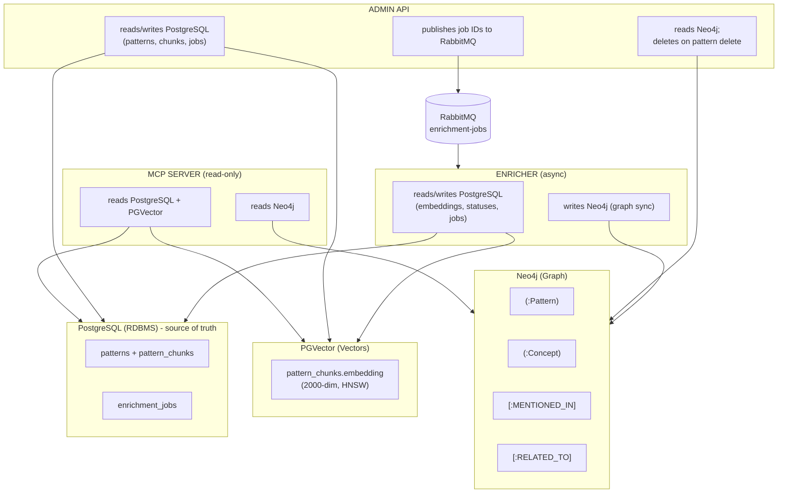
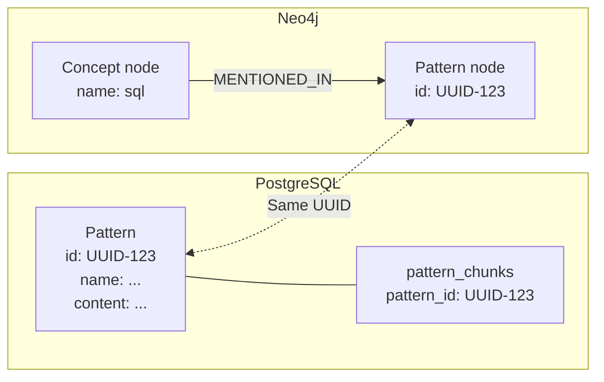
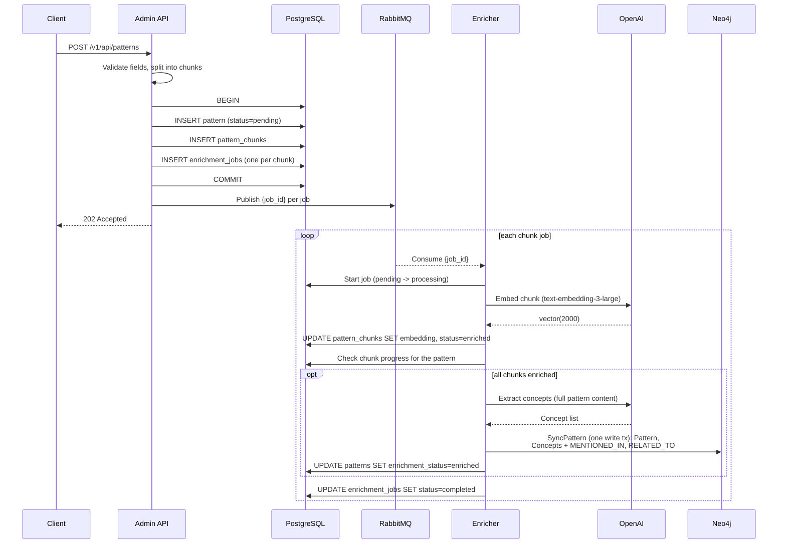
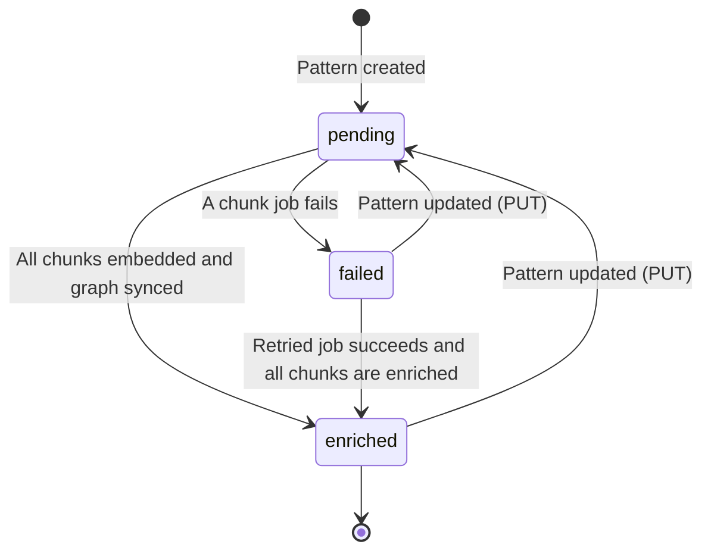
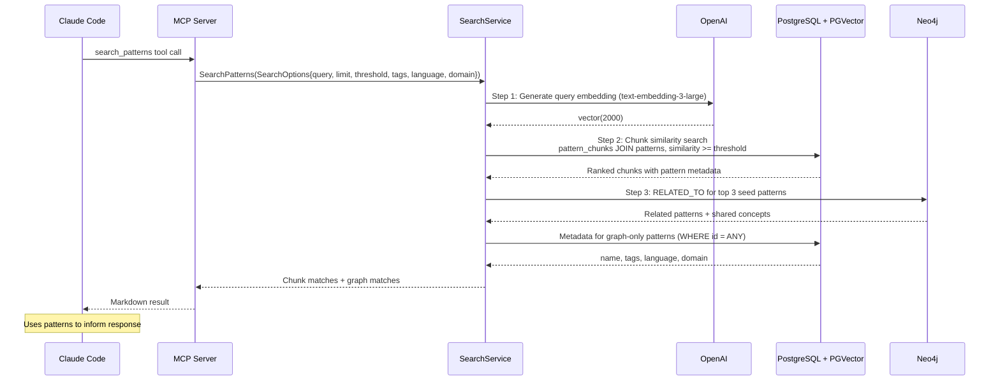

# Database Integration Flow

> Back to [System Architecture](README.md) | [Project README](../../../README.md)

## Table of Contents

- [Overview](#overview)
- [The Three Storage Layers](#the-three-storage-layers)
- [The Pattern UUID: The Universal Key](#the-pattern-uuid-the-universal-key)
- [Data Flow: Pattern Creation and Enrichment](#data-flow-pattern-creation-and-enrichment)
- [Query Flow: Pattern Search Pipeline](#query-flow-pattern-search-pipeline)
- [Query Sequence Diagram](#query-sequence-diagram)
- [Summary Table](#summary-table)
- [Post-MVP: Visualization](#post-mvp-visualization)
- [Post-MVP: Admin Tooling](#post-mvp-admin-tooling)
- [Key Takeaways](#key-takeaways)

## Overview

Mnemonic uses a polyglot persistence strategy where three complementary databases work together to provide team knowledge graph storage, semantic search, and relationship traversal. This document explains how data flows between PostgreSQL, PGVector, and Neo4j during pattern creation and query processing.

## The Three Storage Layers

Each database serves a distinct purpose in the Mnemonic architecture:

### PostgreSQL (RDBMS): Structured Data Storage

**Role:** Source of truth for all structured data with ACID transaction guarantees.

**Stores (used by the services):**

- Patterns (name, description, content, tags, entity_type, language, domain, version, related_patterns, enrichment status)
- Pattern chunks (section title, chunk text, per-chunk embedding and enrichment status)
- Enrichment jobs (durable job state; RabbitMQ only carries the job ID)

These are the only tables. `agents`, `skills`, `skill_files` (JSONB definitions with `crc64` change detection) and `pattern_agent_associations` are planned for agent/skill features but have no schema in `mnemonic-dbs` yet.

**Why PostgreSQL:** Mature ecosystem, excellent Go driver support, JSONB for flexible storage, and transactional consistency across entities.

### PGVector: Semantic Similarity Search

**Role:** Enable semantic search through vector embeddings.

**Stores:**

- Pattern chunk embeddings (2000 dimensions, OpenAI text-embedding-3-large truncated), stored in `pattern_chunks.embedding`
- An HNSW index on that column (`idx_pattern_chunks_embedding`, cosine distance)

**Why PGVector:** Single database deployment (no separate vector service), transactional consistency with metadata, and sufficient performance for expected pattern counts.

### Neo4j: Relationship Traversal

**Role:** Knowledge graph for entity relationships and pattern connections.

**Stores:**

- Pattern nodes (mirrored from PostgreSQL with id, name, description)
- Concept nodes (extracted during enrichment; lowercase `name`, `type` of technology, practice or domain)
- Relationships:
  - `(:Concept)-[:MENTIONED_IN]->(:Pattern)`
  - `(:Pattern)-[:RELATED_TO {similarity: 0.85}]->(:Pattern)` (stored one way, queried undirected)

**Why Neo4j:** Native graph model for relationship-heavy queries, expressive Cypher query language, and built-in graph algorithms.

### Diagram: Three Storage Layers

Who reads and writes each store, as implemented in the services' repository code:



The pattern UUID connects a pattern across PostgreSQL and Neo4j.

## The Pattern UUID: The Universal Key

Every pattern has a UUID that serves as the universal identifier across both PostgreSQL and Neo4j. This UUID is the key that connects structured data, vector embeddings, and graph relationships.

### PostgreSQL Storage

```text
-- patterns table (columns the services use)
id: UUID (Primary Key, generated by the Admin API)
name: VARCHAR(255) (unique; API requires kebab-case, max 128)
description: VARCHAR(500) (nullable)
content: TEXT (API caps it at 100,000 bytes)
tags: JSONB (array)
entity_type: VARCHAR(100); language, domain: VARCHAR(50)
version: VARCHAR(50) (nullable)
related_patterns: JSONB (array of pattern names)
enrichment_status: VARCHAR(20) ('pending' | 'enriched' | 'failed')
enrichment_error: TEXT, enriched_at: TIMESTAMPTZ
created_at, updated_at: TIMESTAMPTZ

-- pattern_chunks table (embeddings stored per chunk)
id: UUID (Primary Key)
pattern_id: UUID (Foreign Key -> patterns.id, ON DELETE CASCADE)
section_title: VARCHAR(255)
chunk_index: INT
content: TEXT
embedding: vector(2000) (NULL until enriched)
enrichment_status, enrichment_error, enriched_at, created_at, updated_at
```

**Example patterns Row:**

```text
id: 550e8400-e29b-41d4-a716-446655440001
name: "sql-query-optimization"
content: "[//]: pattern\n## Use EXPLAIN ANALYZE\nRun EXPLAIN ANALYZE to identify slow queries..."
enrichment_status: 'enriched'
```

### Neo4j Storage

```cypher
// Pattern node in Neo4j
(:Pattern {
  id: "550e8400-e29b-41d4-a716-446655440001",
  name: "sql-query-optimization",
  description: "Database query optimization techniques",
  updatedAt: datetime()
})
```

### Cross-Database Connections

The same UUID enables queries like:

1. Find chunks similar to a query (PGVector search, joined to `patterns` for metadata)
2. Use the matched pattern UUIDs to look up graph relationships (Neo4j traversal)
3. Retrieve pattern details for graph-only results (PostgreSQL lookup by ID)



## Data Flow: Pattern Creation and Enrichment

Pattern enrichment is an asynchronous pipeline that transforms raw content into searchable, connected knowledge. The Admin API handles synchronous intake and publishes work to RabbitMQ; the Enricher processes it independently.

### Step-by-Step Flow

**Step 1: Admin API receives POST /v1/api/patterns**

```http
POST /v1/api/patterns
{
  "name": "sql-optimization",
  "content": "[//]: pattern\n## Use EXPLAIN ANALYZE\nUse EXPLAIN ANALYZE to identify slow queries...",
  "tags": ["database", "performance"],
  "entity_type": "sql-pattern",
  "language": "sql",
  "domain": "backend"
}
```

**Step 2: Admin API validates pattern fields**

`name`, `content`, `entity_type`, `language` and `domain` are required; `language` and `domain` must be in the configured vocabulary (`vocabulary.languages`, `vocabulary.domains`), and length/format limits are checked before any writes occur. Invalid requests are rejected with 400 Bad Request; a duplicate name returns 409 Conflict.

**Step 3: Admin API inserts the pattern, its chunks and their jobs in one transaction**

The content is split at `[//]: pattern` markers (each marker followed by a heading starts a chunk). Then, inside one Postgres transaction:

```sql
INSERT INTO patterns (id, name, description, content, tags,
                      entity_type, language, domain, version, related_patterns,
                      enrichment_status, created_at, updated_at)
VALUES ($1, ..., 'pending', $12, $13);

-- one statement for all chunks
INSERT INTO pattern_chunks (id, pattern_id, section_title, chunk_index, content)
SELECT u.id, $1, u.section_title, u.chunk_index, u.content
FROM unnest($2::uuid[], $3::text[], $4::int[], $5::text[])
     AS u(id, section_title, chunk_index, content);

-- one pending job per chunk
INSERT INTO enrichment_jobs (id, chunk_id, status, attempts, max_attempts,
                             scheduled_for, created_at, updated_at)
SELECT u.id, u.chunk_id, 'pending', 0, 3, now(), now(), now()
FROM unnest($1::uuid[], $2::uuid[]) AS u(id, chunk_id);
```

A pattern with no `[//]: pattern` markers (or only empty marked sections) is stored as one chunk holding the whole trimmed content, titled by its first heading or `Content`, so it gets one job like any other chunk.

**Step 4: Admin API publishes one message per job to RabbitMQ**

After the commit, each job ID is published to the `enrichment-jobs` queue, with the W3C trace context in the AMQP headers:

```json
{
  "job_id": "7c9e6679-7425-40de-944b-e07fc1f90ae7"
}
```

A failed publish is logged and does not fail the request; the job stays `pending` in Postgres and the enricher's retry sweep claims it after a 2-minute grace.

**Step 5: Admin API returns 202 Accepted to client**

The pattern record exists in PostgreSQL at this point but embeddings and graph nodes are not yet populated.

**Step 6 (Async): Enricher consumes a job message and starts the job**

The Enricher is a separate service that subscribes to the enrichment queue. It moves the job from `pending` to `processing` with a conditional update (`WHERE id = $1 AND status = 'pending' AND scheduled_for <= now()`); if no row matches, the message is acked and dropped. Separately, every 15 seconds it claims due jobs with `FOR UPDATE SKIP LOCKED`, so retries and lost messages are processed without RabbitMQ.

**Step 7 (Async): Enricher embeds the chunk via OpenAI text-embedding-3-large**

```go
// One embedding call per chunk job. The input carries pattern-level context:
//   "<pattern name> | <tags> | <section title>\n\n<chunk content>"
embedding, err := embeddingSvc.Embed(ctx, embedText)
// Returns: []float32 of length 2000
```

**Step 8 (Async): Enricher stores the embedding in `pattern_chunks`**

```sql
UPDATE pattern_chunks SET
    embedding = $2,
    enrichment_status = 'enriched',
    enrichment_error = NULL,
    enriched_at = now(),
    updated_at = now()
WHERE id = $1;
```

It then checks the pattern's chunks: if any chunk is `failed`, the pattern is set to `failed`; if all are `enriched`, this job also runs steps 9 to 11. Otherwise the job just completes.

**Step 9 (Async, last chunk only): Enricher extracts concepts via OpenAI**

```go
// LLM (openai.extraction_model, default gpt-4o-mini) extracts concepts
// from the full pattern content; names are lowercased and trimmed.
concepts, err := extractionSvc.Extract(ctx, pattern.Content)
// Returns: [
//   {Name: "sql", Type: "technology"},
//   {Name: "query-optimization", Type: "practice"},
//   {Name: "performance-tuning", Type: "domain"}
// ]
```

**Step 10 (Async, last chunk only): Enricher syncs the graph in one write transaction**

`SyncPattern` runs these statements in a single Neo4j managed write transaction:

```cypher
// 1. Create or update the Pattern node
MERGE (p:Pattern {id: $patternId})
SET p.name = $patternName,
    p.description = $patternDescription,
    p.updatedAt = datetime()

// 2. Drop MENTIONED_IN edges to concepts the pattern no longer mentions
MATCH (c:Concept)-[r:MENTIONED_IN]->(p:Pattern {id: $patternId})
WHERE NOT c.name IN $conceptNames
DELETE r

// 3. Create concepts and MENTIONED_IN edges (skipped when no concepts)
UNWIND $concepts AS concept
MERGE (c:Concept {name: concept.name})
ON CREATE SET c.type = concept.type, c.createdAt = datetime()
ON MATCH SET c.type = concept.type
WITH c
MATCH (p:Pattern {id: $patternId})
MERGE (c)-[:MENTIONED_IN]->(p)

// 4. Delete this pattern's existing RELATED_TO edges
MATCH (p:Pattern {id: $patternId})-[r:RELATED_TO]-()
DELETE r

// 5. Recompute RELATED_TO from shared concepts (see below)
```

**Step 11 (Async, last chunk only): RELATED_TO edges between patterns sharing concepts**

Step 5 of the transaction computes `similarity = sharedConcepts / max(conceptsA, conceptsB)` for every pattern sharing at least one concept, and creates an edge only when it reaches `enrichment.related_to_min_similarity` (default 0.3). These edges are what `find_related_patterns` and the MCP search graph expansion read.

```cypher
MATCH (p1:Pattern {id: $patternId})<-[:MENTIONED_IN]-(c:Concept)-[:MENTIONED_IN]->(p2:Pattern)
WHERE p1 <> p2
WITH p1, p2, count(DISTINCT c) AS sharedCount
OPTIONAL MATCH (c1:Concept)-[:MENTIONED_IN]->(p1)
WITH p1, p2, sharedCount, count(DISTINCT c1) AS totalA
OPTIONAL MATCH (c2:Concept)-[:MENTIONED_IN]->(p2)
WITH p1, p2, sharedCount, totalA, count(DISTINCT c2) AS totalB
WITH p1, p2, sharedCount,
     CASE WHEN totalA > totalB THEN totalA ELSE totalB END AS maxTotal
WITH p1, p2, sharedCount,
     CASE WHEN maxTotal = 0 THEN 0.0
          ELSE toFloat(sharedCount) / toFloat(maxTotal)
     END AS similarity
WHERE similarity >= $minSimilarity
CREATE (p1)-[:RELATED_TO {similarity: similarity, updatedAt: datetime()}]->(p2)
```

**Step 12 (Async): Enricher updates statuses**

```sql
-- last chunk only, after the graph sync succeeds
UPDATE patterns SET
    enrichment_status = 'enriched',
    enrichment_error = NULL,
    enriched_at = $4,
    updated_at = $5
WHERE id = $1;

-- every job
UPDATE enrichment_jobs SET status = 'completed', completed_at = now(),
    last_error = NULL, updated_at = now()
WHERE id = $1;
```

If embedding, extraction or the graph sync fails, the job is marked failed and rescheduled after `enrichment.retry_delay` (default 30s) until `max_attempts` (3).

### Creation and Enrichment Sequence



### Enrichment State Transitions

Pattern `enrichment_status`:



## Query Flow: Pattern Search Pipeline

This is the core operation: turning an MCP tool call into a knowledge graph query that returns ranked pattern results.

### MCP Tool Call

```json
{
  "method": "tools/call",
  "params": {
    "name": "search_patterns",
    "arguments": {
      "query": "How do I optimize SQL queries?",
      "limit": 5
    }
  }
}
```

`search_patterns` also accepts `threshold` (default 0.5), `tags`, `language` and `domain`.

### Internal Processing Steps

**Step 1: Query Embedding (OpenAI)**

```go
// Generate embedding for search query (text-embedding-3-large, 2000 dims)
embedding, err := embeddingSvc.Embed(ctx, "How do I optimize SQL queries?")
```

**Step 2: Semantic Search (PGVector Similarity Search)**

```sql
-- Find pattern chunks semantically similar to query
SELECT pc.pattern_id, p.name, p.tags, pc.section_title, pc.content,
       1 - (pc.embedding <=> $1) AS similarity
FROM pattern_chunks pc
JOIN patterns p ON p.id = pc.pattern_id
WHERE pc.embedding IS NOT NULL
  AND pc.enrichment_status = 'enriched'
  AND 1 - (pc.embedding <=> $1) >= $2      -- threshold, default 0.5
  AND ($3::text = '' OR p.language = $3)
  AND ($4::text = '' OR p.domain = $4)
  -- AND p.tags @> $n::jsonb  when tags are given
ORDER BY pc.embedding <=> $1
LIMIT $5;
```

**Results:**

```text
pattern_id: 550e8400-...001, name: sql-optimization, section: Use EXPLAIN ANALYZE, similarity: 0.94
pattern_id: 550e8400-...002, name: database-indexing, section: B-tree indexes, similarity: 0.82
pattern_id: 550e8400-...001, name: sql-optimization, section: Avoid N+1, similarity: 0.78
```

One pattern can appear several times, once per matching chunk.

**Step 3: Graph Expansion (Neo4j)**

The top 3 distinct patterns from step 2 are used as seeds. For each seed, the service reads up to 5 `RELATED_TO` neighbours (concurrently), drops patterns already in the vector results, keeps the highest similarity per pattern, and fetches the remaining candidates' metadata from Postgres (`SELECT id, name, tags, language, domain FROM patterns WHERE id = ANY($1)`) to apply the same language/domain/tags filters. At most 5 graph matches are returned. If Neo4j fails, search returns the vector results only.

**Step 4: Response Assembly**

The MCP server returns Markdown text for the model, not JSON:

```text
Found 3 sections across 2 patterns matching 'How do I optimize SQL queries?':

---

## sql-optimization (94% match)

**Section:** Use EXPLAIN ANALYZE

**Tags:** database, performance

Use EXPLAIN ANALYZE to identify slow queries...

---

### Related Patterns (via graph)

## query-caching (similarity: 0.50)

**Found via:** sql-optimization
**Shared concepts:** sql, performance-tuning
```

The MCP server returns these ranked patterns to Claude Code, which uses them to inform its responses.

Post-MVP: search_patterns will incorporate graph scores into the ranking via `relevance = (0.7 × vector_similarity) + (0.3 × graph_score)`; today graph matches are listed separately and do not change the vector ranking. <!-- design docs remain in mnemonic/docs/design/ -->

## Query Sequence Diagram



## Summary Table

This table shows how each database contributes to pattern search:

| Step | Database | Question Asked | Query Type | Returns |
| --- | --- | --- | --- | --- |
| 1 | PGVector + PostgreSQL | "Which chunks match?" | Vector similarity joined to `patterns` | Ranked chunks with pattern name, tags and similarity |
| 2 | Neo4j | "What is related to the top matches?" | `RELATED_TO` traversal | Related patterns with similarity and shared concepts |
| 3 | PostgreSQL | "Do the related patterns pass the filters?" | Lookup by ID | Name, tags, language, domain |

**Data Flow Pattern:**

1. PGVector finds and ranks candidate chunks via vector similarity, with pattern metadata from the same query
2. Neo4j expands the top results through pre-computed `RELATED_TO` edges
3. PostgreSQL supplies metadata to filter the graph-only results

Post-MVP: search_patterns will blend Neo4j graph scores into the ranking via `relevance = (0.7 × vector_similarity) + (0.3 × graph_score)`.

## Post-MVP: Visualization

While not part of the MVP, there's an interesting opportunity to visualize the embedding space and cluster structure.

**The Idea:**

Use dimensionality reduction techniques (t-SNE, UMAP) to project the 2000-dimensional chunk embeddings down to 3D space for interactive visualization.

**What You Could See:**

- Centroids as large spheres showing cluster centers
- Chunks as smaller points colored by pattern, tag or domain
- Distance between points representing semantic similarity
- Neighbourhood structure showing how the HNSW graph connects related chunks

**Potential Benefits:**

- Debug search results (why did this pattern match?)
- Find knowledge gaps (sparse areas in the embedding space)
- Validate cluster configuration (are related patterns grouping together?)
- Visual exploration of the knowledge graph

**Tools:**

- TensorBoard Embedding Projector (3D visualization with metadata)
- Plotly (interactive 3D scatter plots)
- Three.js (custom WebGL visualizations)

This would be particularly useful for understanding and tuning the HNSW `m`, `ef_construction` and `ef_search` parameters, or identifying when patterns are poorly distributed in the embedding space.

## Post-MVP: Admin Tooling

Managing the knowledge graph in production requires admin tools beyond the core MCP interface.

Already available: `DELETE /v1/api/patterns/{id}` removes a single pattern (chunks and jobs cascade; the Neo4j node is removed best-effort), `GET /v1/api/patterns` shows each pattern's `enrichment_status` (there is no status filter parameter yet), and `PUT /v1/api/patterns/{id}` re-chunks and re-enriches a pattern.

**Potential API endpoints:**

```text
POST   /v1/patterns/prune              - Bulk cleanup (by age, tags, etc.)
GET    /v1/patterns/orphans            - Find patterns with no concept connections
POST   /v1/patterns/{id}/re-enrich    - Re-trigger failed enrichment

DELETE /v1/agents/{name}               - Remove agent definition
DELETE /v1/skills/{name}               - Remove skill definition
```

**Potential CLI commands:**

```bash
mnemonic admin patterns delete <id>
mnemonic admin patterns prune --older-than 90d
mnemonic admin patterns list --status failed
mnemonic admin patterns re-enrich <id>
```

**Potential admin UI features:**

- Browse patterns with search/filter
- View enrichment status and errors
- Delete/archive outdated patterns
- Re-trigger enrichment for failed patterns
- View the 3D embedding visualization (see [Post-MVP: Visualization](#post-mvp-visualization))
- Manage agent/skill definitions

This is a post-MVP feature. The database-level operations work; admin tooling adds a usability layer for operators.

## Key Takeaways

- **Three complementary databases** - Each chosen for specific strengths: PostgreSQL (ACID), PGVector (semantic search), Neo4j (relationships)
- **Pattern UUID is the universal key** - Same identifier connects data across PostgreSQL and Neo4j
- **Enrichment is asynchronous** - The Admin API publishes to RabbitMQ and returns immediately; the Enricher processes independently to avoid write-path latency
- **Pattern search uses vector similarity plus graph expansion** - PGVector ranks chunks by cosine similarity in one query joined to `patterns`; the MCP server adds related patterns from Neo4j `RELATED_TO` edges. Blended scoring is planned post-MVP.
- **PostgreSQL is source of truth** - Other databases contain projections and derived data
- **One writer per store** - The Admin API writes patterns, chunks and jobs; the Enricher writes embeddings, statuses and the graph; the MCP server only reads
- **Graph relationships add context** - Neo4j expands beyond similarity to include explicit knowledge connections

**Next Steps:**

- Review [Data Architecture](04-data-architecture.md) for detailed schemas and configurations

---

See also:

- [System Architecture](02-system-architecture.md) for component overview
- [Deployment Architecture](06-deployment-architecture.md) for scaling patterns

**Next:** [Deployment Architecture](06-deployment-architecture.md)

---

Copyright (c) 2025-2026 Jeremy K. Johnson. All rights reserved.
