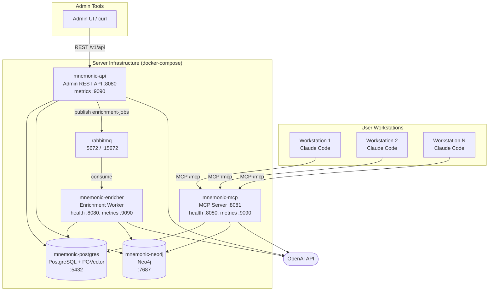
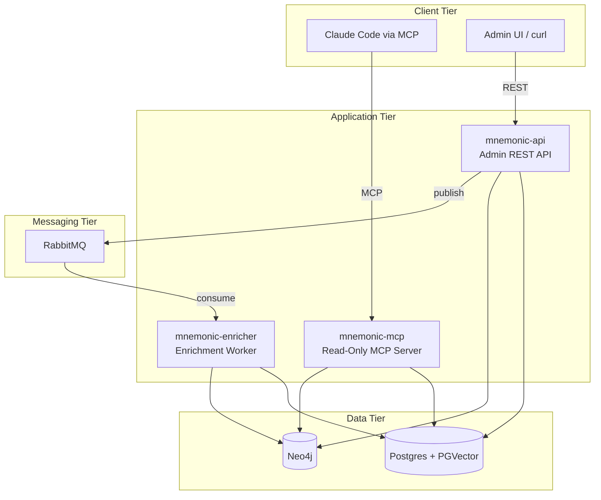
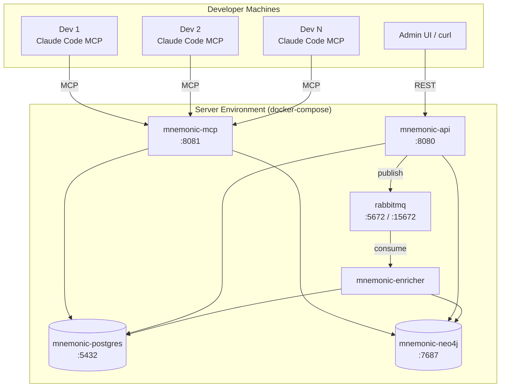
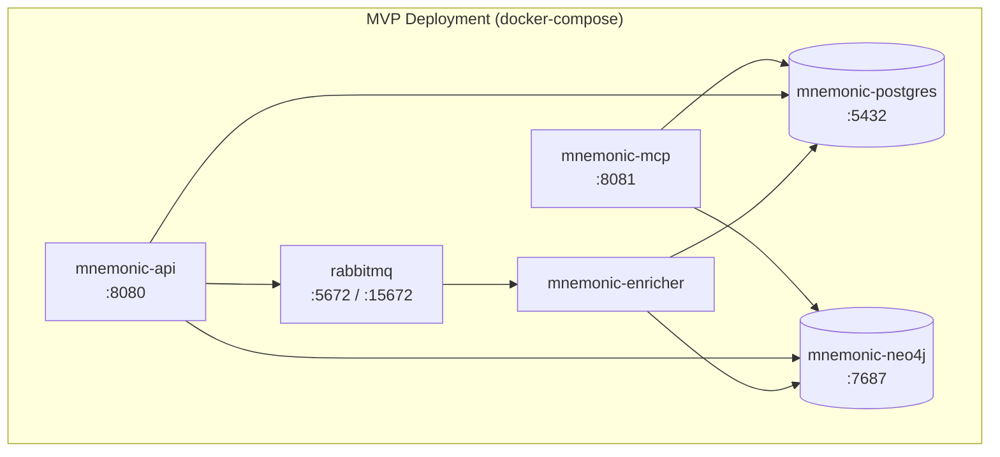
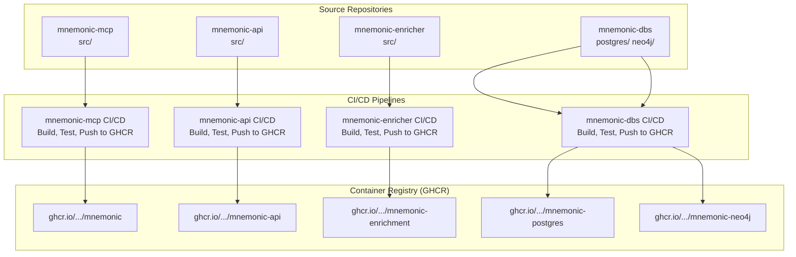

# Deployment Architecture

> Back to [System Architecture](README.md) | [Project README](../../../README.md)

## Table of Contents

- [MVP](#mvp)
  - [Deployment Overview](#deployment-overview)
  - [Deployment Topology](#deployment-topology)
  - [Component Deployment](#component-deployment)
  - [Infrastructure Requirements](#infrastructure-requirements)
  - [Operational Considerations](#operational-considerations)
  - [Independent Deployment Pipelines](#independent-deployment-pipelines)
- [Post-MVP](#post-mvp)
  - [MVP 3: Managed Infrastructure](#mvp-3-managed-infrastructure)
  - [MVP 4: Kubernetes Deployment](#mvp-4-kubernetes-deployment)
  - [MVP 5: Cloud-Native Production](#mvp-5-cloud-native-production)

## MVP

### Deployment Overview

Mnemonic deploys as six containers orchestrated by docker-compose. Three application services handle distinct responsibilities: read-only MCP serving, admin CRUD, and asynchronous enrichment. RabbitMQ decouples write-path operations from enrichment processing. The services call the OpenAI API for embeddings and concept extraction; Claude Code's own inference and tool execution happen on user workstations.

The full six-container local stack is defined in `mnemonic-api`'s root `docker-compose.yaml`. Compose files in the repositories:

| File                                                        | Contents                                                                                                                                                            |
| ----------------------------------------------------------- | ------------------------------------------------------------------------------------------------------------------------------------------------------------------- |
| `mnemonic-api/docker-compose.yaml`                          | Local development: postgres, neo4j, rabbitmq, api (locally built `:latest`, host port 3000), mcp (`latest-dev`, host ports 8090/8091/9091), enricher (`latest-dev`) |
| `mnemonic-mcp/docker-compose.yaml`                          | Local development: postgres, neo4j, rabbitmq, mcp (locally built, host ports 8081 and 9090), api (`latest-dev`, host port 8080); no enricher                        |
| `<repo>/src/tests/docker-compose.yaml` (api, mcp, enricher) | Each service's E2E suite, run by `src/build/build.sh`, with an OpenAI stub in place of api.openai.com                                                               |
| `mnemonic-integration-tests/docker-compose.yaml`            | Cross-service black-box tests: all three published `latest-dev` images, postgres, neo4j, rabbitmq and an OpenAI stub (`MNEMONIC_OPENAI_BASE_URL`)                   |

`mnemonic-enricher` has no root `docker-compose.yaml`.



| Container         | Image                                                                                                  | Container ports                                                        | Role                   |
| ----------------- | ------------------------------------------------------------------------------------------------------ | ---------------------------------------------------------------------- | ---------------------- |
| mnemonic-mcp      | ghcr.io/twistingmercury/mnemonic                                                                       | 8081 (`/mcp`), 8080 (`/health`, `/version`), 9090 (`/metrics`)         | MCP server (read-only) |
| mnemonic-api      | ghcr.io/twistingmercury/mnemonic-api                                                                   | 8080 (`/v1/api`, `/swagger`, `/health`, `/version`), 9090 (`/metrics`) | Admin REST API         |
| mnemonic-enricher | ghcr.io/twistingmercury/mnemonic-enrichment                                                            | 8080 (`/health`, `/version`), 9090 (`/metrics`)                        | Enrichment worker      |
| rabbitmq          | rabbitmq:3-management-alpine (api and integration-tests compose; mcp compose uses 4-management-alpine) | 5672/15672                                                             | Message queue          |
| mnemonic-postgres | ghcr.io/twistingmercury/mnemonic-postgres:v1.0.0-dev                                                   | 5432                                                                   | PostgreSQL + PGVector  |
| mnemonic-neo4j    | ghcr.io/twistingmercury/mnemonic-neo4j:v1.0.0-dev                                                      | 7687                                                                   | Neo4j                  |

The application images are built `FROM scratch` and tagged from `develop`: `latest-dev` and `vX.Y.Z-dev` (for example `v0.4.0-dev`). Health checks run the binary with `--health`, which calls its own `/health`: the api image declares this as a Docker `HEALTHCHECK`, and the compose files declare it for all three services. Host port mappings differ per compose file (see the table above).

### Deployment Topology

#### Logical View



#### Physical View

All six containers run on a single host via docker-compose.



### Component Deployment

#### Mnemonic MCP Server

**Deployment Location:** Server infrastructure (docker-compose)

**Characteristics:**

- Read-only MCP interface for Claude Code pattern searches
- Connects to Postgres (PGVector semantic search), Neo4j (graph traversal) and the OpenAI embeddings API (query vectors)
- Stateless; horizontally scalable
- No write operations; safe to run multiple instances behind a load balancer

**Resource Requirements:**

| Resource | Expectation                                    |
| -------- | ---------------------------------------------- |
| CPU      | Low (pattern queries, MCP serving)             |
| Memory   | Moderate (connection pools, response assembly) |
| Storage  | None (reads from external databases)           |
| Network  | Moderate (all MCP client traffic)              |

#### Mnemonic Admin API

**Deployment Location:** Server infrastructure (docker-compose)

**Characteristics:**

- REST API for pattern CRUD and search
- Connects to Postgres for persistent storage, RabbitMQ for enrichment dispatch, and the OpenAI embeddings API for search queries
- Reads Neo4j for pattern graph context; deletes a pattern's graph node best-effort on `DELETE` (the enricher builds the graph)
- Startup fails if RabbitMQ is unreachable at that moment; later broker outages only degrade `/health` to Warning
- Stateless; horizontally scalable

**Resource Requirements:**

| Resource | Expectation                               |
| -------- | ----------------------------------------- |
| CPU      | Low (CRUD operations, message publishing) |
| Memory   | Low to moderate (connection pools)        |
| Storage  | None (writes to external databases)       |
| Network  | Low (admin traffic only)                  |

#### Mnemonic Enricher

**Deployment Location:** Server infrastructure (docker-compose)

**Characteristics:**

- Consumes enrichment messages from the RabbitMQ `enrichment-jobs` queue, and every 15 seconds claims due retries and undelivered jobs from Postgres
- Connects to Postgres (read/write embeddings and job state), Neo4j (write graph relationships), and the OpenAI API (embeddings and concept extraction)
- Horizontally scalable; multiple workers can consume from the same queue (`SKIP LOCKED` claims, conditional job start)
- Inbound HTTP only for `/health` and `/version` (:8080) and `/metrics` (:9090)

**Resource Requirements:**

| Resource | Expectation                                        |
| -------- | -------------------------------------------------- |
| CPU      | Low to moderate (embedding requests are I/O-bound) |
| Memory   | Low to moderate (message processing)               |
| Storage  | None (writes to external databases)                |
| Network  | Moderate (OpenAI API calls, database writes)       |

#### RabbitMQ

**Deployment Location:** Server infrastructure (docker-compose)

**Characteristics:**

- Message queue for async enrichment dispatch between Admin API and Enricher
- Management UI available on port 15672
- Uses the stock `rabbitmq` management image (no custom build); the api compose file uses `rabbitmq:3-management-alpine`
- The API declares the `enrichment-jobs` queue as durable and publishes persistent messages

**Resource Requirements:**

| Resource | Expectation                                                                                                                                                                                                          |
| -------- | -------------------------------------------------------------------------------------------------------------------------------------------------------------------------------------------------------------------- |
| CPU      | Low (message routing)                                                                                                                                                                                                |
| Memory   | Low (small queue depth expected)                                                                                                                                                                                     |
| Storage  | Low; the compose files mount no RabbitMQ volume except the mcp one, so queued messages can be lost when the container is recreated. PostgreSQL job rows remain the source of truth and the retry sweep recovers them |
| Network  | Low (internal container traffic only)                                                                                                                                                                                |

### Infrastructure Requirements

#### Server Infrastructure

The server-side deployment consists of six containers running via docker-compose, suitable for small teams.



#### Client Requirements

| Requirement       | MVP Local Deployment  |
| ----------------- | --------------------- |
| Claude Code       | Required              |
| MCP Support       | Required              |
| Anthropic API key | Via Claude Code       |
| Network access    | To mnemonic-mcp :8081 |

#### Admin Requirements

| Requirement    | MVP Local Deployment        |
| -------------- | --------------------------- |
| HTTP client    | Required (Admin UI or curl) |
| Network access | To mnemonic-api :8080       |
| Authentication | None (trusted network)      |

### Operational Considerations

#### Monitoring

Key metrics to monitor:

| Component         | Metrics                                                                                                                                 |
| ----------------- | --------------------------------------------------------------------------------------------------------------------------------------- |
| mnemonic-mcp      | `mnemonic.http.request.*`, `mnemonic.mcp.tool_calls`, `mnemonic.mcp.tool_duration`, `mnemonic.patterns.query_latency` / `returned`      |
| mnemonic-api      | `mnemonic.http.request.*`, `mnemonic.db.query_latency` / `query_errors`, `mnemonic.patterns.*`, `mnemonic.queue.publish_failures_total` |
| mnemonic-enricher | `mnemonic.enrichment.jobs`, `mnemonic.enrichment.job_duration`, pending job age in `enrichment_jobs`                                    |
| RabbitMQ          | Queue depth, message rates, consumer count                                                                                              |
| Postgres          | Connection count, query latency, storage usage                                                                                          |
| Neo4j             | Query latency, memory usage, connection count                                                                                           |

#### Logging

All application services emit structured logs with trace correlation via OpenTelemetry (see [Observability Architecture](07-observability-architecture.md)).

| Component         | Log Focus                                       |
| ----------------- | ----------------------------------------------- |
| mnemonic-mcp      | Pattern searches, errors                        |
| mnemonic-api      | CRUD operations, message publishing, errors     |
| mnemonic-enricher | Enrichment processing, OpenAI API calls, errors |

### Independent Deployment Pipelines

Each application service and the database images have independent CI/CD pipelines. Database migrations and application code are versioned and deployed independently.



Each Go service has one workflow in `.github/workflows` (`mnemonic-api-ci.yaml`, `mnemonic-enrichment-ci.yaml`, `mnemonic-ci.yaml` for mcp) that follows the pattern documented in the [Go CI/CD diagram](../../diagrams/example-go-ci-cd-diagram.md): `src/build/build.sh` builds the Docker image, runs quality gates and unit tests inside the build stage, and runs the E2E suite against `src/tests/docker-compose.yaml`. On a push to `develop` the workflow then pushes `latest-dev` and `<tag>-dev` (the latest git tag, for example `v0.4.0-dev`) to GHCR. Pull request builds run the same build and tests but never push, so `latest-dev` always matches `develop`. There is no `main` branch yet; `develop` is the trunk. Dependabot opens weekly grouped updates (gomod, docker, actions) against `develop`.

`mnemonic-integration-tests` (`integration-tests.yaml`) runs on pushes and PRs to `develop`, nightly, and on demand, against the published `latest-dev` images.

**Pipeline Summary:**

| Pipeline             | Repository                 | Triggers On                                              | Produces                                      |
| -------------------- | -------------------------- | -------------------------------------------------------- | --------------------------------------------- |
| mnemonic-mcp CI      | mnemonic-mcp               | `src/` changes (code, build, tests), workflow file       | `ghcr.io/twistingmercury/mnemonic`            |
| mnemonic-api CI      | mnemonic-api               | `src/` changes, root compose and Makefile, workflow file | `ghcr.io/twistingmercury/mnemonic-api`        |
| mnemonic-enricher CI | mnemonic-enricher          | `src/` changes (code, build, tests), workflow file       | `ghcr.io/twistingmercury/mnemonic-enrichment` |
| Integration Tests    | mnemonic-integration-tests | push/PR to `develop`, nightly                            | Pass/fail only (no image)                     |
| mnemonic-dbs CI/CD   | mnemonic-dbs               | `postgres/` or `neo4j/` changes                          | Database images                               |

**Why Independent Pipelines?**

| Scenario           | Without Separation              | With Separation                |
| ------------------ | ------------------------------- | ------------------------------ |
| MCP query bug fix  | Rebuilds all services           | Only mnemonic-mcp deploys      |
| New admin endpoint | Rebuilds MCP and enricher too   | Only mnemonic-api deploys      |
| Schema migration   | Rebuilds all application images | Only database images rebuild   |
| Enricher tuning    | Touches unrelated services      | Only mnemonic-enricher deploys |

**Deployment Order for Breaking Changes:**

```text
1. Deploy database images (forward-compatible: nullable/default values)
2. Verify schema changes succeeded
3. Deploy application services (use new schema)
4. (Optional) Deploy tightening migration (add NOT NULL, remove old columns)
```

This separation ensures:

- Faster deployments (only deploy what changed)
- Safer rollbacks (can rollback one service without touching others)
- Clear audit trail (which pipeline changed what)

## Post-MVP

### MVP 3: Managed Infrastructure

Move stateful infrastructure to AWS managed services while keeping application services running locally:

- Replace local PostgreSQL + PGVector with AWS RDS PostgreSQL + PGVector
- Replace local Neo4j with AWS Neptune
- Replace local RabbitMQ with AWS SQS

Application services (mnemonic-mcp, mnemonic-api, mnemonic-enricher) remain local. This validates cloud data-tier connectivity without changing the application runtime.

See [MVP 3 concept diagram](../../diagrams/03-concept-local-iteration.md).

### MVP 4: Kubernetes Deployment

Deploy application services to local Kubernetes (minikube or equivalent single-node cluster):

- Add Envoy proxy as the ingress and authN layer for MCP and Admin API traffic
- Add OPA policies as the authZ checkpoint before requests reach service handlers
- Begin Helm chart development for repeatable local cluster deployment
- Keep data and queue infrastructure on managed AWS services (from MVP 3)

See [MVP 4 concept diagram](../../diagrams/04-concept-local-iteration.md).

### MVP 5: Cloud-Native Production

Deploy the full stack to AWS:

- Move application services from local Kubernetes to AWS Fargate
- Envoy + OPA remain in the request path for authN/authZ
- Provision all AWS infrastructure (networking, compute, managed services) with Terraform
- Use SSM Parameter Store and Secrets Manager for runtime configuration and secrets

See [MVP 5 concept diagram](../../diagrams/05-concept-cloud-iteration.md).

**Next:** [Observability Architecture](07-observability-architecture.md)

---

Copyright (c) 2025-2026 Jeremy K. Johnson. All rights reserved.
