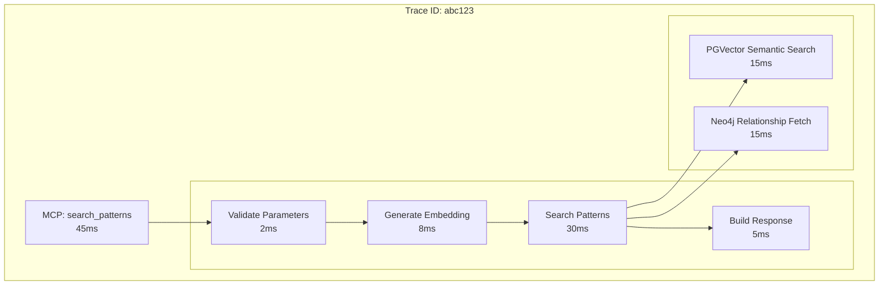
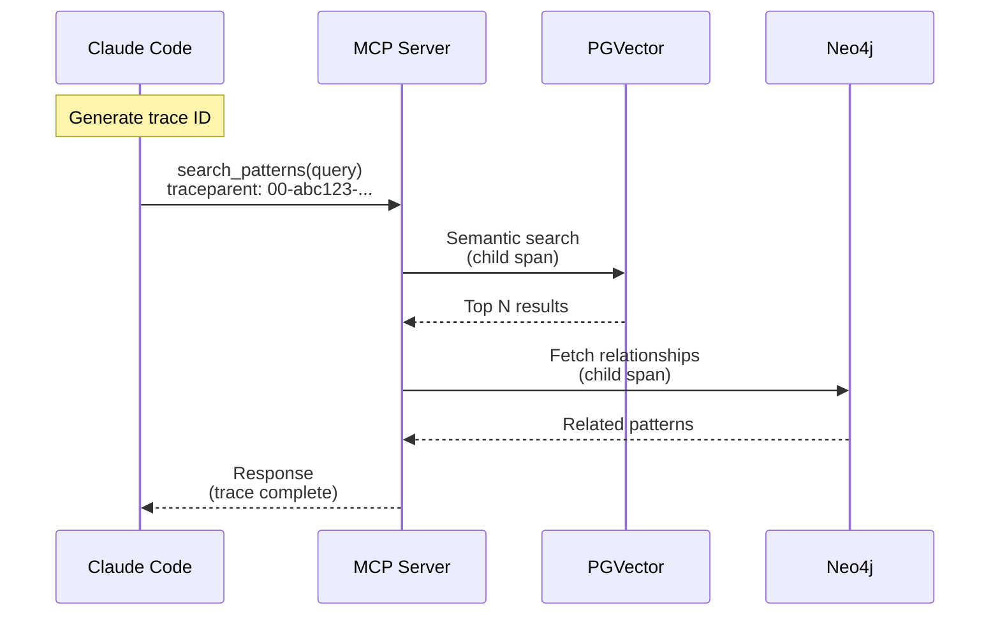
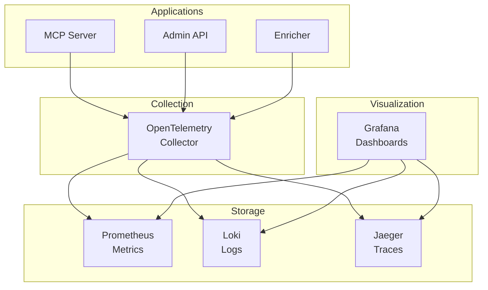

# Observability Architecture

> Back to [System Architecture](README.md) | [Project README](../../../README.md)

## Table of Contents

- [MVP](#mvp)
  - [Overview](#overview)
  - [Metrics](#metrics)
  - [Structured Logging](#structured-logging)
  - [Distributed Tracing](#distributed-tracing)
  - [Health Check Endpoint](#health-check-endpoint)
  - [Key Takeaways](#key-takeaways)
- [Post-MVP](#post-mvp)
  - [Collection and Storage](#collection-and-storage)
  - [Observability Stack](#observability-stack)
  - [Alerting Strategy](#alerting-strategy)
  - [Dashboards](#dashboards)
  - [SLOs](#slos)
  - [Runbooks](#runbooks)
  - [Sampling Strategy](#sampling-strategy)

## MVP

### Overview

Observability enables understanding system behavior through external outputs. For Mnemonic, observability focuses on the server-side components (the three services and their storage layer) since LLM execution happens locally on user workstations via Claude Code.

**Scope:**

| Component           | Observability Scope                        |
| ------------------- | ------------------------------------------ |
| MCP Server          | Full observability (metrics, logs, traces) |
| Admin API           | Full observability (metrics, logs, traces) |
| Enricher            | Full observability (metrics, logs, traces) |
| Postgres + PGVector | Database metrics and query logging         |
| Neo4j               | Query metrics and performance              |
| RabbitMQ            | Queue depth, consumer connectivity         |

**Key Characteristic:** All three services are lightweight (no LLM inference), so observability focuses on pattern search performance, MCP tool serving, admin API operations, enrichment pipeline throughput, and database health rather than compute-intensive operations.

MVP focuses on instrumenting each service to emit telemetry data via OpenTelemetry. This establishes the foundation for observability without requiring external infrastructure.

**In scope:**

- OpenTelemetry SDK integration in all three services
- Structured logging with trace correlation
- Metrics emission (counters, histograms, gauges) with a `service` label to distinguish sources
- Distributed tracing with span creation
- OTLP export configuration (exporters can be disabled or pointed to stdout/file for development)

**Why this first:** Proper instrumentation is the foundation. Once the application emits telemetry correctly, the collection and visualization infrastructure can be added without code changes.

### Metrics

[Back to Table of Contents](#table-of-contents)

Each service emits metrics via OpenTelemetry. All metrics include a `service` label (`mcp-server`, `admin-api`, or `enricher`) to distinguish sources across the shared collection pipeline.

**Request metrics** (MCP Server and Admin API) - Track HTTP requests including:

- MCP tool invocations by tool name (MCP Server)
- Admin API operations by endpoint and status code (Admin API)
- Request duration histograms (for percentile calculations)
- In-flight request count

**Pattern metrics** (MCP Server) - Track pattern operations:

- Pattern search latency (semantic search via PGVector)
- Pattern query latency (Neo4j relationship traversal)
- Patterns returned per search request
- Pattern cache effectiveness

**Admin write metrics** (Admin API) - Track pattern management operations:

- Write operations (create, update, delete) by resource type
- Validation failures by reason
- RabbitMQ publish latency (time to enqueue enrichment jobs)

**Enrichment job metrics** (Enricher) - Track background enrichment pipeline:

- Jobs consumed, completed, and failed (counters)
- Job processing duration (histogram from consume to completion)
- Retry attempt counts (per pattern and overall)
- Enrichment failure rate and failure reasons
- RabbitMQ consumer connectivity status

**Database metrics** (all services) - Track storage layer health:

- Connection pool utilization
- Query latency by type
- Error rates by database

For implementation details including specific metric names and labels, see operations documentation (TBD).

### Structured Logging

[Back to Table of Contents](#table-of-contents)

Each service emits structured logs with trace correlation. All logs use structured JSON format for consistent parsing and querying. Every log entry includes:

**Standard fields:**

- Timestamp, log level, service name
- Trace and span IDs for correlation
- Human-readable message

**Context fields:**

- Request ID for request correlation
- Agent name (from pattern association)
- Any relevant domain data

**What We Log**

**Request events** (MCP Server and Admin API):

- MCP tool invoked (tool name, parameters, request ID)
- Admin API operation (method, path, request ID)
- Pattern search executed (query, results count)
- Request completed (status, duration)

**Admin write events** (Admin API):

- Pattern created, updated, or deleted (pattern ID, operation)
- Enrichment job enqueued (pattern ID, queue name)
- RabbitMQ publish succeeded or failed

**Enrichment job events** (Enricher):

- Job consumed from queue (pattern ID, worker ID)
- Embedding generated (pattern ID, duration)
- Concepts extracted (pattern ID, concept count)
- Graph nodes created (pattern ID)
- Job completed (pattern ID, total duration)
- Job failed (pattern ID, error, attempt count)
- Job retried (pattern ID, attempt number, next scheduled time)

**System events** (all services):

- Service started/stopped
- Configuration loaded
- Health check status changes
- Database connection events
- RabbitMQ connection events (Admin API, Enricher)

**Error events:**

- Validation failures
- Database errors
- Unexpected exceptions

### Distributed Tracing

[Back to Table of Contents](#table-of-contents)

Each service creates spans and propagates trace context. **W3C Trace Context** headers propagate trace IDs across service boundaries.

**Trace Structure**

A pattern search request trace shows the journey through the MCP Server:



**Trace Propagation**

Traces flow from Claude Code through the MCP Server:



### Health Check Endpoint

[Back to Table of Contents](#table-of-contents)

Each service exposes its own `GET /health` endpoint. Health checks are used by container orchestration, load balancers, and monitoring infrastructure to determine service availability.

**MCP Server** (`:8081`) — checks Postgres and Neo4j connectivity:

```json
{
  "status": "healthy",
  "postgres": "reachable",
  "neo4j": "reachable"
}
```

**Admin API** (`:8080`) — checks Postgres, Neo4j, and RabbitMQ publisher connectivity:

```json
{
  "status": "healthy",
  "postgres": "reachable",
  "neo4j": "reachable",
  "rabbitmq": "reachable"
}
```

**Enricher** — checks RabbitMQ consumer connectivity:

```json
{
  "status": "healthy",
  "rabbitmq": "reachable"
}
```

**Health determination:** All declared dependencies must be reachable for a service to report healthy. A failure of any dependency results in an HTTP 503 unhealthy response. Checks perform a lightweight connectivity probe; they do not execute business logic.

**Logging:** Health check status changes (healthy to unhealthy, unhealthy to healthy) are logged as system events. Repeated healthy checks are not logged to avoid log noise.

### Key Takeaways

[Back to Table of Contents](#table-of-contents)

- **OpenTelemetry** - Standard collection layer for metrics, logs, and traces; the MVP foundation across all three services
- **Service label** - Every metric carries a `service` label so signals from MCP Server, Admin API, and Enricher remain distinguishable in shared dashboards
- **Correlation** - Trace IDs connect signals for root cause analysis
- **Lightweight focus** - Observability focuses on knowledge graph query performance, MCP serving efficiency, and enrichment pipeline throughput, not LLM costs
- **Foundation first** - MVP instruments each service; collection and operational tooling are added in Post-MVP without code changes

## Post-MVP

### Collection and Storage

[Back to Table of Contents](#table-of-contents)

After MVP, deploy the observability stack to collect and store the telemetry the three services already emit (see [Metrics](#metrics), [Structured Logging](#structured-logging), and [Distributed Tracing](#distributed-tracing) above).

**In scope:**

- OpenTelemetry Collector deployment
- Prometheus for metrics storage
- Loki for log aggregation
- Jaeger for trace storage

### Observability Stack

[Back to Table of Contents](#table-of-contents)

The observability stack uses industry-standard open-source tools. The full stack connects the instrumented application (see [MVP](#mvp)) to collection, storage, and visualization layers:



**Stack Components:**

| Component     | Purpose              | Why This Choice                                  |
| ------------- | -------------------- | ------------------------------------------------ |
| OpenTelemetry | Telemetry collection | Vendor-neutral standard, Go native support       |
| Prometheus    | Metrics storage      | Pull-based, excellent for container environments |
| Loki          | Log aggregation      | Label-based, integrates with Grafana             |
| Jaeger        | Distributed tracing  | OpenTelemetry native, good UI                    |
| Grafana       | Visualization        | Unified dashboards across all signals            |

### Alerting Strategy

[Back to Table of Contents](#table-of-contents)

Alerting is implemented after the observability stack is deployed. Alerts operate on the metrics described in [Metrics](#metrics).

We alert on conditions that require attention:

**Critical alerts** (immediate response required):

- Any service unavailable (health check failing on MCP Server, Admin API, or Enricher)
- High error rate (>5% of requests failing over 5 minutes)
- Database unreachable (Postgres or Neo4j connection failures)
- RabbitMQ unreachable (Admin API publisher or Enricher consumer connectivity lost)

**Warning alerts** (investigate soon):

- Elevated latency (P95 > 200ms for pattern searches)
- Connection pool saturation (>80% utilization)
- High cache miss rate (pattern search efficiency degraded)

**Alert routing:**

- Critical alerts: PagerDuty for on-call response
- Warning alerts: Slack notification to team channel

For alert rule definitions, see operations documentation (TBD).

### Dashboards

[Back to Table of Contents](#table-of-contents)

Grafana provides unified visualization across all telemetry signals collected in [Collection and Storage](#collection-and-storage).

**System Health Dashboard**

Answers: "Is the system healthy right now?"

**What it shows:**

- Request throughput over time
- Error rate percentage
- Latency percentiles (P50, P95, P99)
- Service availability (up/down status)
- Database connection health

This is the first dashboard to check during incidents.

**Pattern Search Dashboard**

Answers: "How is pattern search behaving?"

**What it shows:**

- Pattern searches over time (search volume)
- Top search queries (what users search for)
- Search result quality (patterns returned per query)
- Cache hit rates (are we efficiently caching?)
- Pattern search performance (semantic search latency)

This dashboard helps understand pattern usage and search optimization opportunities.

**Database Dashboard**

Answers: "How are the storage backends performing?"

**What it shows:**

- Query latency by database (Postgres, PGVector, Neo4j)
- Connection pool utilization
- Query volume by type
- Error rates by database

This dashboard helps identify database bottlenecks.

For dashboard configuration and queries, see operations documentation (TBD).

### SLOs

[Back to Table of Contents](#table-of-contents)

SLO monitoring requires the collection and storage infrastructure described in [Collection and Storage](#collection-and-storage). The targets below define what we measure once that infrastructure is in place.

For the Mnemonic services (lightweight, no LLM inference):

**Availability SLO:** 99.9%

```text
successful requests / total requests >= 0.999
```

**Latency SLO:** 99% under 100ms

```text
requests completing < 100ms / total requests >= 0.99
```

Note: These are aggressive targets because the services do no LLM inference. Knowledge graph queries and MCP serving should be fast.

### Runbooks

[Back to Table of Contents](#table-of-contents)

Runbooks are implemented alongside the alerting described in [Alerting Strategy](#alerting-strategy). Every alert links to a runbook.

**Required runbooks:**

| Alert                    | Runbook Focus                                         |
| ------------------------ | ----------------------------------------------------- |
| Service unavailable      | Check container health, database and queue connectivity |
| High error rate          | Identify error types, check recent deployments        |
| Elevated latency         | Check database performance, pattern cache             |
| Database unreachable     | Connection strings, network, database health          |
| RabbitMQ unreachable     | Queue connectivity for Admin API publisher and Enricher consumer |

Runbooks live in operations documentation and are linked directly from alert annotations.

For runbook templates and content, see operations documentation (TBD).

### Sampling Strategy

[Back to Table of Contents](#table-of-contents)

Sampling configuration is applied to the trace collection infrastructure in [Collection and Storage](#collection-and-storage). For lightweight services like the Mnemonic components, we can trace more aggressively:

**Always captured:**

- Errors - All failed requests for debugging
- Slow requests - Requests exceeding latency threshold (e.g., >100ms)

**Sampled:**

- Successful requests - 10-20% sampling for baseline understanding

This provides visibility without excessive storage costs.

For sampling configuration, see operations documentation (TBD).

**Next:** [MCP Tools](../mnemonic/08-mcp-tools.md)

---

Copyright (c) 2025-2026 Jeremy K. Johnson. All rights reserved.
