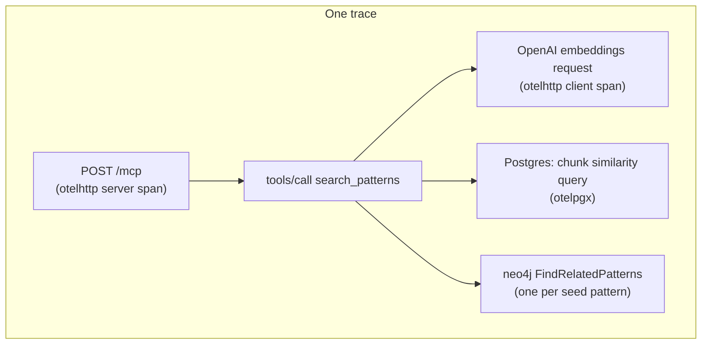
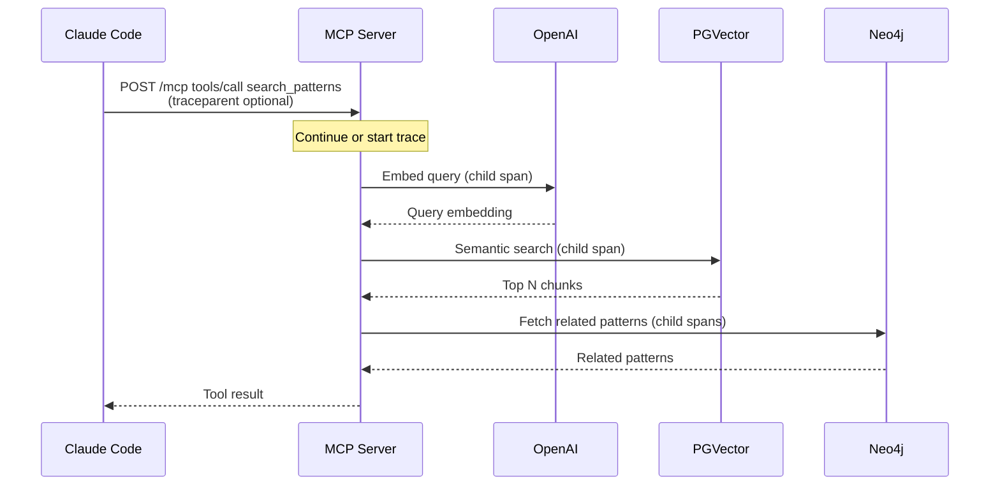
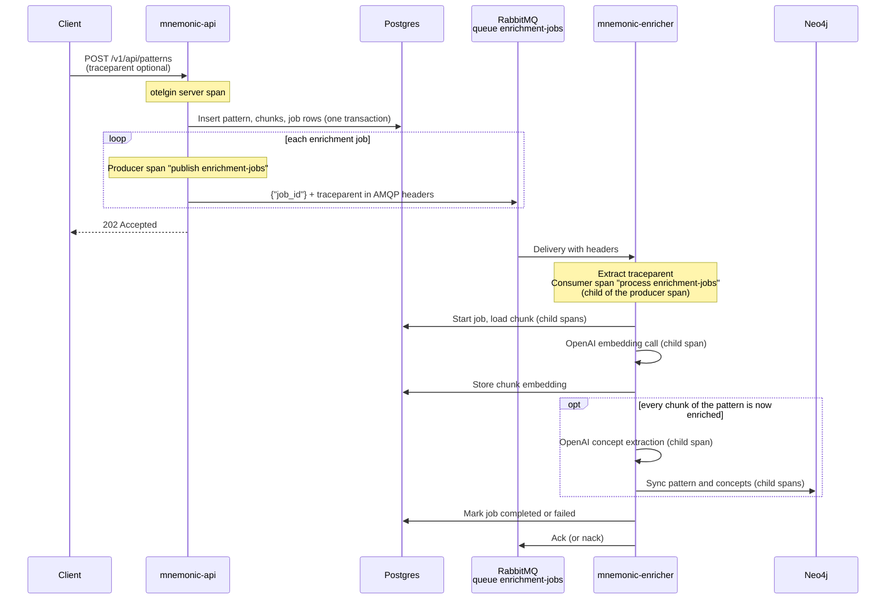
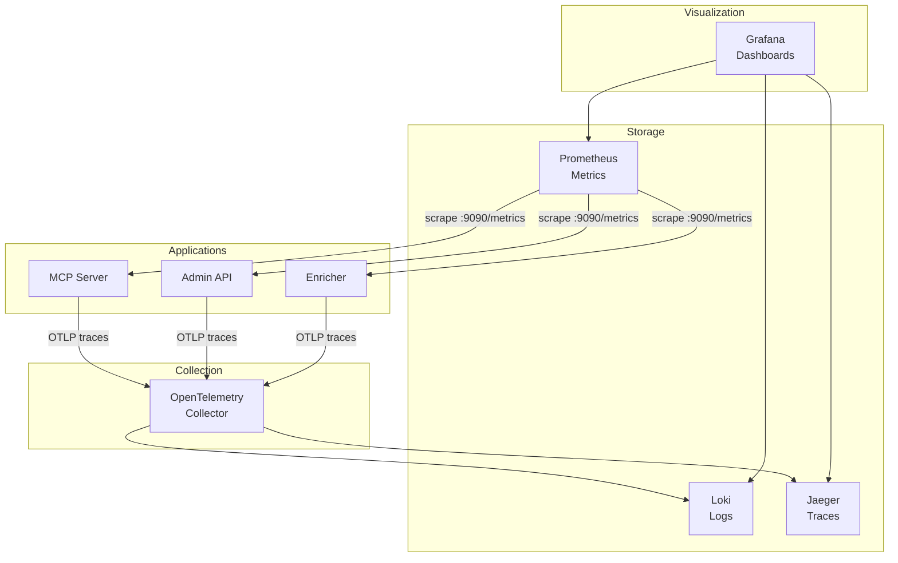

# Observability Architecture

> Back to [System Architecture](README.md) | [Project README](../../../README.md)

## Table of Contents

- [MVP](#mvp)
  - [Overview](#overview)
  - [Metrics](#metrics)
  - [Structured Logging](#structured-logging)
  - [Distributed Tracing](#distributed-tracing)
  - [Health Check Endpoint](#health-check-endpoint)
  - [Key Takeaways](#key-takeaways)
- [Post-MVP](#post-mvp)
  - [Collection and Storage](#collection-and-storage)
  - [Observability Stack](#observability-stack)
  - [Alerting Strategy](#alerting-strategy)
  - [Dashboards](#dashboards)
  - [SLOs](#slos)
  - [Runbooks](#runbooks)
  - [Sampling Strategy](#sampling-strategy)

## MVP

### Overview

Observability enables understanding system behavior through external outputs. For Mnemonic, observability focuses on the server-side components (the three services and their storage layer) since LLM execution happens locally on user workstations via Claude Code.

**Scope:**

| Component           | Observability Scope                                                 |
| ------------------- | ------------------------------------------------------------------- |
| MCP Server          | Metrics, logs, traces                                               |
| Admin API           | Metrics, logs, traces                                               |
| Enricher            | Metrics, logs, traces                                               |
| Postgres + PGVector | Client-side query spans and pool metrics (otelpgx); query latency   |
| Neo4j               | Client-side query spans and latency/error metrics from each service |
| RabbitMQ            | Producer/consumer spans; API publisher connectivity on `/health`    |

**Key Characteristic:** All three services are lightweight (no LLM inference), so observability focuses on pattern search performance, MCP tool serving, admin API operations, enrichment pipeline throughput, and database health rather than compute-intensive operations.

MVP instruments each service with OpenTelemetry through the [`otelx`](https://github.com/twistingmercury/otelx) v2 library. This establishes the foundation for observability without requiring external infrastructure: nothing in the MVP needs a collector to run.

**In scope (implemented):**

- OpenTelemetry SDK integration in all three services via otelx
- Structured JSON logging (zerolog) with trace and span IDs
- Metrics (counters, histograms, gauges) served in Prometheus format on `:9090/metrics`
- Distributed tracing with W3C Trace Context, including across RabbitMQ
- OTLP gRPC trace export, off by default (`observability.tracing.enabled: false`)

**Why this first:** Proper instrumentation is the foundation. Once the application emits telemetry correctly, the collection and visualization infrastructure can be added without code changes.

For the Go implementation (packages, middleware order, exact attributes), see [Observability Implementation Design](../../design/observability-implementation.md). For the configuration keys, see [Configuration](../../design/configuration.md#configuration-reference).

### Metrics

[Back to Table of Contents](#table-of-contents)

Each service serves its metrics in Prometheus format on a separate port (`observability.metrics.port`, default `9090`, path `/metrics`), alongside Go runtime and process metrics. Metrics are pulled; there is no OTLP metrics push.

**Telling services apart:** Each service sets the OpenTelemetry resource attribute `service.name` to its own name: `mnemonic-api`, `mnemonic-enricher` or `mnemonic-mcp`. The Prometheus exporter puts resource attributes on `target_info` rather than on every series, so there is no `service` label on the metrics. Distinguish services by scrape target (Prometheus `job`/`instance`) or by joining on `target_info`.

Names below are the OpenTelemetry instrument names. In Prometheus, dots become underscores and unit or `_total` suffixes are added, for example `mnemonic_http_request_count_total` and `mnemonic_http_request_duration_milliseconds`.

| Metric                                  | Type          | Unit    | Attributes                                                            | Services |
| --------------------------------------- | ------------- | ------- | --------------------------------------------------------------------- | -------- |
| `mnemonic.http.request.count`           | counter       | request | `http.method`, `http.route`, `http.status_code`                       | all      |
| `mnemonic.http.request.duration`        | histogram     | ms      | `http.method`, `http.route`, `http.status_code`                       | all      |
| `mnemonic.http.request.in_flight`       | up-down gauge | request | none                                                                  | all      |
| `mnemonic.db.query_latency`             | histogram     | ms      | `database`, `operation`                                               | all      |
| `mnemonic.db.query_errors`              | counter       | error   | `database`, `operation`                                               | all      |
| `mnemonic.patterns.query_latency`       | histogram     | ms      | `database`                                                            | API, MCP |
| `mnemonic.patterns.returned`            | histogram     | pattern | `database`                                                            | API, MCP |
| `mnemonic.queue.publish_failures_total` | counter       | failure | none                                                                  | API      |
| `mnemonic.enrichment.jobs`              | counter       | job     | `outcome` (`completed`, `failed`, `error`, `rejected`)                | Enricher |
| `mnemonic.enrichment.job_duration`      | histogram     | ms      | `outcome`                                                             | Enricher |
| `mnemonic.mcp.tool_calls`               | counter       | call    | `tool`, `outcome` (`ok`, `invalid_input`, `not_found`, `unavailable`) | MCP      |
| `mnemonic.mcp.tool_duration`            | histogram     | ms      | `tool`, `outcome`                                                     | MCP      |

Notes:

- **Request metrics** cover the Gin routers only (the API's REST routes and every service's `/version`); `/health` and `/metrics` are skipped. The MCP endpoint (`/mcp` on port 8081) is not a Gin route: per-tool metrics come from `mnemonic.mcp.tool_*`, and the `otelhttp` wrapper adds the standard OpenTelemetry `http.server.*` metrics.
- **Database metrics** (`mnemonic.db.*`) are recorded for Neo4j operations (`database="neo4j"`). Postgres is covered by otelpgx connection-pool metrics and query spans rather than these instruments.
- **Pattern metrics** are recorded for the semantic search step (`database="pgvector"`).
- **Publish failures** count enrichment jobs the API could not publish after one reconnect and retry. The job row stays `pending` in Postgres and the enricher's retry sweep picks it up, so this is a delay signal rather than data loss.

**Not implemented:** cache metrics (there is no pattern cache), validation-failure counters by reason, RabbitMQ publish latency, retry-attempt histograms and consumer connectivity gauges. Retry state lives on the `enrichment_jobs` rows in Postgres.

### Structured Logging

[Back to Table of Contents](#table-of-contents)

Each service writes structured JSON logs (zerolog via otelx) to stdout. Logs are not sent through the OpenTelemetry logs signal; they are joined to traces through `trace_id` and `span_id` fields.

**Standard fields:**

- Timestamp, log level, message
- `service`, `version` and `environment` (from `MNEMONIC_ENV`) added by otelx; the caller location is added at `debug` level
- `trace_id` and `span_id` when the event happens inside a recording span

**Context fields:**

- `request_id` from the `X-Request-ID` header (the API generates one if the header is missing or malformed and echoes it in the response)
- `job_id`, `pattern_id`, `chunk_id` on enrichment logs
- Method, status and duration on request logs; the API logs the route template, the MCP server and enricher log the path

**What We Log**

**Request events** (all services):

- Request completed: one line per Gin request. The API uses its own completion logger (`info`, or `error` for 5xx), which records the route template and a bounded, redacted error diagnostic and never logs request bodies or query strings. The MCP server and enricher use the otelx Gin logging middleware (`info`, `warn` for 4xx, `error` for 5xx, with `latency_ms`, `client_ip`, `request_id`, `correlation_id`). `/health` and `/metrics` are skipped (the API still logs them when they fail with 5xx). Requests to `/mcp` do not pass through Gin and get no request-completed line.

**MCP tool events** (MCP Server):

- Tool logs carry the trace and span IDs of the `tools/call` span.

**Admin write events** (Admin API):

- Failure to publish an enrichment job (warn, with `job_id` and `pattern_id`; the job remains pending in Postgres)

**Enrichment job events** (Enricher):

- Processing enrichment job (job, pattern or chunk ID)
- Job completed
- Job failed with the failure recorded for retry (warn)
- Job failed with an unrecoverable error, delivery nacked (error)
- Job not available to start, delivery acked (a redelivery or a job owned by the retry sweep)
- Unparseable delivery, nacked

**System events** (all services):

- Service started and listening (ports, whether metrics and tracing are enabled)
- Shutdown of each HTTP server
- Database and RabbitMQ connection errors

**Not logged:** request and response bodies, raw upstream error bodies, credentials. Health check status changes are not logged; read `/health` instead.

### Distributed Tracing

[Back to Table of Contents](#table-of-contents)

Tracing is off by default. When `observability.tracing.enabled` is `true`, each service exports spans over OTLP gRPC to `observability.tracing.endpoint` and propagates **W3C Trace Context** (plus Baggage). Sampling is `ParentBased(TraceIDRatioBased(sample_rate))`: a sampled incoming parent is always continued, and new traces are sampled at `sample_rate` (default `0.1`).

**Where spans come from:**

| Source                      | Spans                                                         | Services |
| --------------------------- | ------------------------------------------------------------- | -------- |
| `otelgin` middleware        | One server span per Gin request (skips `/health`, `/metrics`) | all      |
| `otelhttp` handler          | Server span for each `/mcp` request                           | MCP      |
| MCP tool middleware         | `tools/call <tool>` with `mcp.tool.name`, `mcp.tool.outcome`  | MCP      |
| `otelhttp` client transport | Client span for each OpenAI API call                          | all      |
| `otelpgx`                   | Postgres query spans                                          | all      |
| Graph repository            | `neo4j <operation>`                                           | all      |
| RabbitMQ publisher          | `publish enrichment-jobs` (producer)                          | API      |
| Enrichment worker           | `process enrichment-jobs` (consumer), `retry enrichment job`  | Enricher |

**Trace Structure**

A `search_patterns` call to the MCP Server produces this span tree:



**Trace Propagation: MCP**

The MCP endpoint continues an incoming `traceparent` header if the client sends one; otherwise it starts a new trace.



**Trace Propagation: API to Enricher**

Writing a pattern produces one trace that crosses RabbitMQ. The API commits the pattern, its chunks and their enrichment job rows in one transaction, then publishes each job ID with the trace context injected into the AMQP message headers. The enricher extracts that context, so its consumer span is a child of the API's producer span.



Jobs that the enricher's retry sweep claims from Postgres (failed jobs whose retry delay has passed, or jobs that were never published) are processed under a new root span, `retry enrichment job`, because no message carries their original trace context. The span has the `mnemonic.job_id` attribute, which links it to the original request by job ID.

### Health Check Endpoint

[Back to Table of Contents](#table-of-contents)

Each service exposes `GET /health` on `server.port` (default `8080`; the MCP endpoint on `8081` has no health route). The handler comes from [`heartbeat`](https://github.com/twistingmercury/heartbeat) v2, which runs every dependency check concurrently with a 3-second timeout each. Health checks are used by container orchestration, load balancers and monitoring infrastructure to determine service availability; each binary's `--health` flag calls the endpoint for the container `HEALTHCHECK`.

**Dependency checks:**

| Service   | Dependency (`name`)       | Probe                                                        | Severity on failure |
| --------- | ------------------------- | ------------------------------------------------------------ | ------------------- |
| all       | `PostgreSQL`              | Pool ping                                                    | Critical            |
| all       | `Neo4j`                   | Driver `VerifyConnectivity`                                  | Critical            |
| all       | `OpenAI embedding model`  | `GET {openai.base_url}/models/{embedding_model}` (free call) | Warning             |
| Enricher  | `OpenAI extraction model` | `GET {openai.base_url}/models/{extraction_model}`            | Warning             |
| Admin API | `RabbitMQ`                | Publisher connection and channel open                        | Warning             |

The Enricher does not report its RabbitMQ consumer connection on `/health`.

**Response** (example from the Admin API with OpenAI unreachable):

```json
{
  "status": "Warning",
  "name": "mnemonic-api",
  "resource": "mnemonic-api",
  "machine": "a1b2c3d4e5f6",
  "utc_date_time": "2026-10-15T12:00:00.123456Z",
  "request_duration_ms": 41.2,
  "dependencies": [
    { "status": "OK", "name": "PostgreSQL", "resource": "PostgreSQL", "request_duration_ms": 1.8, "http_status_code": 0, "message": "ok" },
    { "status": "OK", "name": "Neo4j", "resource": "Neo4j", "request_duration_ms": 4.1, "http_status_code": 0, "message": "ok" },
    { "status": "Warning", "name": "OpenAI embedding model", "resource": "text-embedding-3-large", "request_duration_ms": 40.9, "http_status_code": 0, "message": "request failed" },
    { "status": "OK", "name": "RabbitMQ", "resource": "RabbitMQ", "request_duration_ms": 0.01, "http_status_code": 0, "message": "ok" }
  ]
}
```

**Health determination:** The overall `status` is the most severe dependency status: `OK`, `Warning` or `Critical`. `OK` and `Warning` return HTTP 200; `Critical` returns HTTP 503. A Warning means degraded but serving: an OpenAI outage blocks new embeddings but not reads of existing data, and a disconnected API publisher reconnects on the next publish while unpublished jobs wait in Postgres. Checks perform a lightweight connectivity probe; they do not execute business logic. Concurrent requests share one run of the checks.

**Logging and tracing:** `/health` is excluded from tracing, request metrics and request logging. Status changes are not logged.

### Key Takeaways

[Back to Table of Contents](#table-of-contents)

- **OpenTelemetry via otelx** - One initialization per service for logs, Prometheus metrics and OTLP traces; tracing is opt-in
- **Service identity** - Each service reports its own `service.name` (`mnemonic-api`, `mnemonic-enricher`, `mnemonic-mcp`) on traces, logs, `/health` and `/version`
- **Correlation** - Trace IDs connect logs and spans, and a pattern write is one trace from the API through RabbitMQ to the enricher
- **Lightweight focus** - Observability focuses on knowledge graph query performance, MCP serving efficiency, and enrichment pipeline throughput, not LLM costs
- **Degraded, not down** - OpenAI and RabbitMQ problems are Warnings on `/health`; only the databases are Critical
- **Foundation first** - MVP instruments each service; collection and operational tooling are added in Post-MVP without code changes

## Post-MVP

### Collection and Storage

[Back to Table of Contents](#table-of-contents)

After MVP, deploy the observability stack to collect and store the telemetry the three services already emit (see [Metrics](#metrics), [Structured Logging](#structured-logging), and [Distributed Tracing](#distributed-tracing) above).

**In scope:**

- OpenTelemetry Collector deployment
- Prometheus for metrics storage
- Loki for log aggregation
- Jaeger for trace storage

### Observability Stack

[Back to Table of Contents](#table-of-contents)

The observability stack uses industry-standard open-source tools. The full stack connects the instrumented application (see [MVP](#mvp)) to collection, storage, and visualization layers. Traces are pushed to the collector over OTLP; metrics are scraped from each service's `/metrics` endpoint; logs are collected from container stdout.



**Stack Components:**

| Component     | Purpose              | Why This Choice                                  |
| ------------- | -------------------- | ------------------------------------------------ |
| OpenTelemetry | Telemetry collection | Vendor-neutral standard, Go native support       |
| Prometheus    | Metrics storage      | Pull-based, excellent for container environments |
| Loki          | Log aggregation      | Label-based, integrates with Grafana             |
| Jaeger        | Distributed tracing  | OpenTelemetry native, good UI                    |
| Grafana       | Visualization        | Unified dashboards across all signals            |

### Alerting Strategy

[Back to Table of Contents](#table-of-contents)

Alerting is implemented after the observability stack is deployed. Alerts operate on the metrics described in [Metrics](#metrics).

We alert on conditions that require attention:

**Critical alerts** (immediate response required):

- Any service unavailable (`/health` returning 503 on MCP Server, Admin API, or Enricher)
- High error rate (>5% of requests failing over 5 minutes)
- Database unreachable (Postgres or Neo4j connection failures)

**Warning alerts** (investigate soon):

- `/health` reporting `Warning` (OpenAI unreachable or key invalid, API publisher disconnected)
- Elevated latency (P95 > 200ms for pattern searches)
- Connection pool saturation (>80% utilization)
- Enrichment jobs failing (`mnemonic.enrichment.jobs` with `outcome` `failed` or `error`) or publish failures (`mnemonic.queue.publish_failures_total`)
- Enrichment backlog: `pending` jobs older than 10 minutes in `enrichment_jobs` (a SQL check; no metric exists for it)

**Alert routing:**

- Critical alerts: PagerDuty for on-call response
- Warning alerts: Slack notification to team channel

For alert rule definitions, see operations documentation (TBD).

### Dashboards

[Back to Table of Contents](#table-of-contents)

Grafana provides unified visualization across all telemetry signals collected in [Collection and Storage](#collection-and-storage).

**System Health Dashboard**

Answers: "Is the system healthy right now?"

**What it shows:**

- Request throughput over time
- Error rate percentage
- Latency percentiles (P50, P95, P99)
- Service availability (up/down status)
- Database connection health

This is the first dashboard to check during incidents.

**Pattern Search Dashboard**

Answers: "How is pattern search behaving?"

**What it shows:**

- Pattern searches over time (search volume, from `mnemonic.mcp.tool_calls`)
- Search result quality (patterns returned per query)
- Pattern search performance (semantic search latency)
- Tool outcomes (`invalid_input`, `not_found`, `unavailable`)

Query text is not recorded in metrics or logs, so a "top queries" view would need new instrumentation.

This dashboard helps understand pattern usage and search optimization opportunities.

**Database Dashboard**

Answers: "How are the storage backends performing?"

**What it shows:**

- Query latency by database (Postgres, PGVector, Neo4j)
- Connection pool utilization
- Query volume by type
- Error rates by database

This dashboard helps identify database bottlenecks.

For dashboard configuration and queries, see operations documentation (TBD).

### SLOs

[Back to Table of Contents](#table-of-contents)

SLO monitoring requires the collection and storage infrastructure described in [Collection and Storage](#collection-and-storage). The targets below define what we measure once that infrastructure is in place.

For the Mnemonic services (lightweight, no LLM inference):

**Availability SLO:** 99.9%

```text
successful requests / total requests >= 0.999
```

**Latency SLO:** 99% under 100ms

```text
requests completing < 100ms / total requests >= 0.99
```

Note: These are aggressive targets because the services do no LLM inference. Knowledge graph queries and MCP serving should be fast. Searches embed the query through OpenAI (`GET /v1/api/patterns/search` and the `search_patterns` tool), so their latency includes an OpenAI call and may need a separate target.

### Runbooks

[Back to Table of Contents](#table-of-contents)

Runbooks are implemented alongside the alerting described in [Alerting Strategy](#alerting-strategy). Every alert links to a runbook.

**Required runbooks:**

| Alert                | Runbook Focus                                                                         |
| -------------------- | ------------------------------------------------------------------------------------- |
| Service unavailable  | Check container health, database and queue connectivity                               |
| High error rate      | Identify error types, check recent deployments                                        |
| Elevated latency     | Check database performance and OpenAI latency                                         |
| Database unreachable | Connection strings, network, database health                                          |
| RabbitMQ unreachable | Queue connectivity for Admin API publisher and Enricher consumer; pending job backlog |

Runbooks live in operations documentation and are linked directly from alert annotations.

For runbook templates and content, see operations documentation (TBD).

### Sampling Strategy

[Back to Table of Contents](#table-of-contents)

The services already apply head sampling at `observability.tracing.sample_rate` (default 10%) while honoring a sampled parent. The strategy below is applied to the trace collection infrastructure in [Collection and Storage](#collection-and-storage) (tail sampling in the collector). For lightweight services like the Mnemonic components, we can trace more aggressively:

**Always captured:**

- Errors - All failed requests for debugging
- Slow requests - Requests exceeding latency threshold (e.g., >100ms)

**Sampled:**

- Successful requests - 10-20% sampling for baseline understanding

Tail sampling only sees spans the services export, so capturing all errors requires raising `sample_rate` (up to `1.0`) and letting the collector drop the rest.

This provides visibility without excessive storage costs.

For sampling configuration, see operations documentation (TBD).

**Next:** [MCP Tools](../mnemonic/08-mcp-tools.md)

---

Copyright (c) 2025-2026 Jeremy K. Johnson. All rights reserved.
