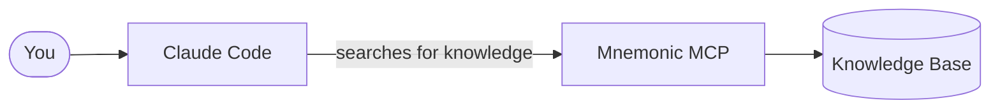
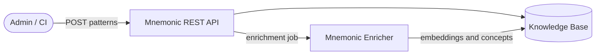
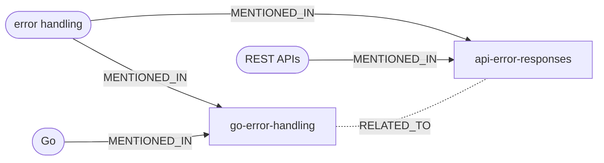

# What Is Mnemonic?

> Back to [Project README](../README.md)

## The problem it solves

When a team adopts Claude Code, something quietly goes wrong. Each person builds up their own
agents and skills, discovers their own tricks, and figures out their own workflows. Over time,
the team is running a dozen slightly different setups. New people start from scratch. Useful
patterns live in one person's head or one person's config.

Mnemonic exists to fix that. It gives the whole team a shared place to store knowledge.

## What Mnemonic actually is

Mnemonic is a service — a small server you run for your team. It holds one thing:

**A shared knowledge base.** Your team curates a collection of patterns: coding conventions,
architectural decisions, how we do things around here. When Claude Code needs context about
your team's approach to something, it can ask Mnemonic and get a real answer instead of
guessing.

That is the whole idea. Shared memory for your team.

## The user is still in charge

Mnemonic does not route requests, make decisions, or orchestrate workflows. That is the user's
job — and deliberately so. You know your work better than any routing engine does.

Think of Mnemonic as a well-organized shelf. It holds things your team has agreed are valuable.
Claude Code can reach for them when it needs them. But Claude Code does not do that on its own —
you ask it to, or you set up a skill that does.

## How Claude Code talks to Mnemonic

Claude Code connects to Mnemonic using MCP (Model Context Protocol). MCP is the native way
Claude Code talks to external services — no extra CLI, no scripts, no glue code needed.

Once Mnemonic is configured as an MCP server, Claude Code can call it directly during a
conversation. It can search the knowledge base for patterns, find related patterns, or pull up a
specific pattern by ID. These three pattern search operations are the full MCP tool surface.

All MCP access is read-only. Claude Code can look things up, but it cannot write to Mnemonic.
That keeps things predictable.

## How knowledge gets in

Someone on the team — an admin, a CI pipeline, a script — pushes content into Mnemonic through
a REST API. That is the write path. You POST a pattern, Mnemonic stores it, generates
semantic embeddings for each of its sections in the background, and it becomes searchable
within a few moments.

## Embeddings explained

When Mnemonic stores a pattern, it splits the pattern into sections and generates a semantic embedding for each one in the background. That embedding is what makes search work. Here is what that means in practice.

### What is an embedding?

An embedding is a numeric representation of text that captures its semantic meaning. Think of it as a "fingerprint" that represents the concept and context of the content.

- Generated by OpenAI's text-embedding-3-large model (Matryoshka truncation at 2000 dimensions)
- 2000 floating-point numbers per embedding
- Each dimension captures different aspects of meaning
- Similar concepts produce similar vector patterns

### Why 2000 dimensions?

OpenAI's `text-embedding-3-large` model outputs 3072 dimensions, but PGVector's HNSW index type has a maximum supported dimension of 2000. Mnemonic uses Matryoshka truncation to reduce the full 3072-dimension embedding to 2000 dimensions, preserving most of the quality while staying within PGVector's index limits.

If Mnemonic moves to a dedicated vector database in the future, the full 3072 dimensions could be used without truncation.

For reference, other common embedding dimensions:

- OpenAI `text-embedding-3-small`: 1536
- OpenAI `text-embedding-3-large`: 3072 (Mnemonic truncates to 2000)
- Cohere `embed-english-v3.0`: 1024
- Sentence Transformers `all-MiniLM-L6-v2`: 384

## How patterns connect to each other

Embeddings are great at finding patterns that *sound like* what you asked for. But sometimes two patterns are related for reasons that have nothing to do with how similar their text is. A pattern about Go error handling and a pattern about API error responses might use completely different language, but they clearly connect — they both deal with error handling.

Mnemonic captures those connections explicitly using a knowledge graph stored in Neo4j.

### Concepts: the dots on the map

During enrichment, Mnemonic does not just generate embeddings. Once every section is embedded, it also asks an OpenAI model (`gpt-4o-mini` by default) to extract **concepts** from each pattern — the technologies, practices, and domains the pattern touches. A pattern about Go error handling might produce concepts like "error handling", "Go", and "sentinel errors". A pattern about API error responses might produce "error handling", "REST APIs", and "HTTP status codes".

These concepts become nodes in a graph. Each concept is linked to the patterns that mention it, and patterns that share enough concepts get a `RELATED_TO` edge — not because their text is similar, but because they genuinely deal with the same ideas. The edge's similarity is the number of shared concepts divided by the larger of the two patterns' concept counts, and only edges at or above `enrichment.related_to_min_similarity` (default 0.3) are kept.

### What the graph looks like

The `go-error-handling` and `api-error-responses` patterns are both linked from the "error handling" concept. That shared concept creates a relationship between the two patterns — even though their embeddings might point in quite different directions.

### Why this matters for search

This is what powers the `find_related_patterns` MCP tool. Given a pattern, Mnemonic follows its `RELATED_TO` edges in the graph rather than relying on vector similarity alone, and reports the concepts each related pattern shares: this pattern is about these concepts, what other patterns share them? `search_patterns` uses the same edges to add a short "related via graph" list after its vector matches.

That catches relationships embeddings miss. Two patterns might discuss completely different topics but both mention the same internal service, the same deployment strategy, or the same compliance requirement. Embeddings won't see the connection. The graph will.

Think of it this way: embeddings find "sounds like" matches. The graph finds "connects to" matches. Together, they cover both kinds of relevance.

## What lives where

| What                      | Where it lives          | Who owns it                           |
| ------------------------- | ----------------------- | ------------------------------------- |
| Patterns (team knowledge) | Mnemonic                | Your team, via the REST API           |
| Workflow decisions        | You                     | Always                                |
| Answering your prompts    | Claude Code / Anthropic | Mnemonic never answers prompts        |
| Embeddings and concepts   | OpenAI API              | Called by Mnemonic; it hosts no model |

---

The architecture docs go deeper on each of these pieces. Start with the
[System Architecture](architecture/system/02-system-architecture.md) if you want to understand how
Mnemonic is built, or the [Communication Patterns](architecture/system/03-communication-patterns.md)
if you want to understand the MCP and REST surfaces in detail.

---

Copyright (c) 2025-2026 Jeremy K. Johnson. All rights reserved.
