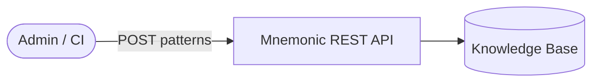
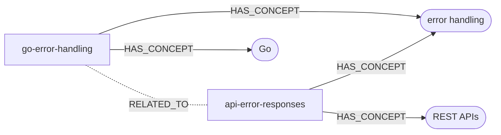

# What Is Mnemonic?

> Back to [Project README](../README.md)

## The problem it solves

When a team adopts Claude Code, something quietly goes wrong. Each person builds up their own
agents and skills, discovers their own tricks, and figures out their own workflows. Over time,
the team is running a dozen slightly different setups. New people start from scratch. Useful
patterns live in one person's head or one person's config.

Mnemonic exists to fix that. It gives the whole team a shared place to store knowledge.

## What Mnemonic actually is

Mnemonic is a service — a small server you run for your team. It holds one thing:

**A shared knowledge base.** Your team curates a collection of patterns: coding conventions,
architectural decisions, how we do things around here. When Claude Code needs context about
your team's approach to something, it can ask Mnemonic and get a real answer instead of
guessing.

That is the whole idea. Shared memory for your team.

## The user is still in charge

Mnemonic does not route requests, make decisions, or orchestrate workflows. That is the user's
job — and deliberately so. You know your work better than any routing engine does.

Think of Mnemonic as a well-organized shelf. It holds things your team has agreed are valuable.
Claude Code can reach for them when it needs them. But Claude Code does not do that on its own —
you ask it to, or you set up a skill that does.

## How Claude Code talks to Mnemonic

Claude Code connects to Mnemonic using MCP (Model Context Protocol). MCP is the native way
Claude Code talks to external services — no extra CLI, no scripts, no glue code needed.

Once Mnemonic is configured as an MCP server, Claude Code can call it directly during a
conversation. It can search the knowledge base for patterns, find related patterns, or pull up a
specific pattern by ID. These three pattern search operations are the full MCP tool surface.

All MCP access is read-only. Claude Code can look things up, but it cannot write to Mnemonic.
That keeps things predictable.


## How knowledge gets in

Someone on the team — an admin, a CI pipeline, a script — pushes content into Mnemonic through
a REST API. That is the write path. You POST a pattern, Mnemonic stores it, generates a
semantic embedding in the background, and it becomes searchable within a few moments.



## Embeddings explained

When Mnemonic stores a pattern, it generates a semantic embedding in the background. That embedding is what makes search work. Here is what that means in practice.

### What is an embedding?

An embedding is a numeric representation of text that captures its semantic meaning. Think of it as a "fingerprint" that represents the concept and context of the content.

- Generated by OpenAI's text-embedding-3-large model (Matryoshka truncation at 2000 dimensions)
- 2000 floating-point numbers per embedding
- Each dimension captures different aspects of meaning
- Similar concepts produce similar vector patterns

### Why 2000 dimensions?

Mnemonic uses OpenAI's text-embedding-3-large model with Matryoshka truncation at 2000 dimensions. The full model outputs 3072 dimensions, but Matryoshka embeddings allow truncating to a shorter prefix while preserving most of the quality. 2000 dimensions is a sweet spot balancing quality, cost, and performance for our use case.

Different embedding models have different native dimensions:

- OpenAI text-embedding-3-small: 1536
- OpenAI text-embedding-3-large: 3072 (Mnemonic truncates to 2000)
- Cohere embed-english-v3.0: 1024
- Sentence Transformers all-MiniLM-L6-v2: 384

### How similarity works: the arrow analogy

Think of embeddings like arrows pointing in a direction. Each arrow has 2000 components, but conceptually it's pointing somewhere in meaning-space.

When two pieces of text have similar meanings, their embeddings are like arrows pointing in roughly the same direction. When texts are unrelated, their arrows point in very different directions.

Cosine similarity measures the angle between these arrows:

- Small angle = Arrows point the same way = High similarity
- Large angle = Arrows point different directions = Low similarity

**Similarity scores:**

- 1.0 = Identical direction (same meaning)
- 0.7-1.0 = Small angle (highly relevant, typical threshold for pattern matching)
- 0.5-0.7 = Medium angle (somewhat related)
- 0.0-0.5 = Large angle (unrelated or opposite meaning)

**Example:**

```text
Query: "Help me optimize this SQL query"
Embedding: [0.023, -0.145, 0.087, ..., 0.034] (2000 values)

Pattern 1: "Database query optimization techniques"
Embedding: [0.025, -0.142, 0.091, ..., 0.036] (2000 values)
Similarity: 0.94 (arrows pointing nearly the same direction)

Pattern 2: "Go error handling best practices"
Embedding: [-0.081, 0.234, -0.052, ..., -0.123] (2000 values)
Similarity: 0.31 (arrows pointing in different directions)
```

### Who calculates what?

- **OpenAI API**: Generates the embedding (turns text into 2000 numbers)
- **PGVector**: Stores the embedding and calculates similarity using the `<=>` operator
- **Mnemonic**: Orchestrates everything (calls APIs, queries databases, assembles responses)

Mnemonic never touches vector arithmetic directly. It just asks PGVector "which patterns are similar to this embedding?" and PGVector does the math.

### How IVFFlat indexes speed things up

When you have thousands of patterns, comparing against every single one is slow. That's where IVFFlat indexes come in.

IVFFlat uses k-means clustering to create "buckets" of similar patterns. Think of it like organizing a library into sections. When someone asks for a book about SQL, you don't search the entire library. You go to the database section first, then search there.

During index creation, k-means finds "centroids" (bucket centers) and each pattern gets assigned to its nearest centroid. At query time, Mnemonic compares the query embedding to centroids first, then searches only the nearest buckets — skipping distant ones that won't be relevant.

The default configuration searches roughly 10% of patterns per query, which dramatically improves performance while maintaining accuracy. The key insight is that relevant patterns cluster together in embedding space, so searching nearby buckets catches what we need.

## How patterns connect to each other

Embeddings are great at finding patterns that *sound like* what you asked for. But sometimes two patterns are related for reasons that have nothing to do with how similar their text is. A pattern about Go error handling and a pattern about API error responses might use completely different language, but they clearly connect — they both deal with error handling.

Mnemonic captures those connections explicitly using a knowledge graph stored in Neo4j.

### Concepts: the dots on the map

During enrichment, Mnemonic does not just generate an embedding. It also uses AI to extract **concepts** from each pattern — the technologies, practices, and domains the pattern touches. A pattern about Go error handling might produce concepts like "error handling", "Go", and "sentinel errors". A pattern about API error responses might produce "error handling", "REST APIs", and "HTTP status codes".

These concepts become nodes in a graph. Each pattern gets linked to its concepts, and patterns that share a concept become connected — not because their text is similar, but because they genuinely deal with the same ideas.

### What the graph looks like



The `go-error-handling` and `api-error-responses` patterns both link to the "error handling" concept. That shared concept creates a relationship between the two patterns — even though their embeddings might point in quite different directions.

### Why this matters for search

This is what powers the `find_related_patterns` MCP tool. Given a pattern, Mnemonic walks the graph to find connected patterns rather than relying on vector similarity alone. It follows the concept links outward: this pattern is about these concepts, what other patterns share them?

That catches relationships embeddings miss. Two patterns might discuss completely different topics but both mention the same internal service, the same deployment strategy, or the same compliance requirement. Embeddings won't see the connection. The graph will.

Think of it this way: embeddings find "sounds like" matches. The graph finds "connects to" matches. Together, they cover both kinds of relevance.

## What lives where

| What | Where it lives | Who owns it |
| --- | --- | --- |
| Patterns (team knowledge) | Mnemonic | Your team, via the REST API |
| Workflow decisions | You | Always |
| AI inference | Claude Code / Anthropic | Mnemonic never does inference |

---

The architecture docs go deeper on each of these pieces. Start with the
[System Architecture](architecture/system/02-system-architecture.md) if you want to understand how
Mnemonic is built, or the [Communication Patterns](architecture/system/03-communication-patterns.md)
if you want to understand the MCP and REST surfaces in detail.
