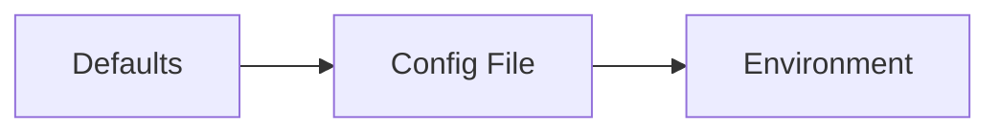
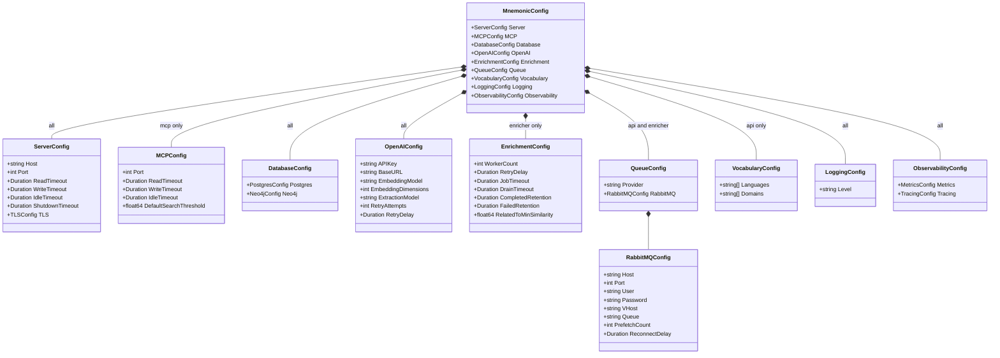

# Mnemonic Server Configuration

> Back to [Design Documents](README.md) | [Project README](../../README.md)

## Table of Contents

- [Overview](#overview)
- [Configuration Loading Order](#configuration-loading-order)
  - [Precedence Rules](#precedence-rules)
  - [Loading Behavior](#loading-behavior)
- [Configuration File](#configuration-file)
  - [MCP Server](#mcp-server-mnemonic-mcp)
  - [Admin API](#admin-api-mnemonic-api)
  - [Enricher](#enricher-mnemonic-enricher)
- [Environment Variables](#environment-variables)
- [OpenTelemetry Standard Variables](#opentelemetry-standard-variables)
- [otelx Dependency](#otelx-dependency)
- [RabbitMQ Configuration](#rabbitmq-configuration)
- [Configuration Reference](#configuration-reference)
- [Environment Variable Naming Conventions](#environment-variable-naming-conventions)
- [File Discovery Order](#file-discovery-order)
- [Viper Initialization](#viper-initialization)
- [Security Considerations](#security-considerations)
  - [Secrets Handling](#secrets-handling)
  - [Environment Variable Security](#environment-variable-security)
  - [Configuration Validation](#configuration-validation)
  - [Embedding Dimension Validation](#embedding-dimension-validation)
- [Configuration Model](#configuration-model)
  - [Go Struct Definitions](#go-struct-definitions)
  - [Class Diagram](#class-diagram)
- [References](#references)

## Overview

[Table of Contents](#table-of-contents)

> **Architecture Reference:** [System Architecture - Component Breakdown](../architecture/system/02-system-architecture.md#component-breakdown) | [Deployment Architecture - Component Deployment](../architecture/system/06-deployment-architecture.md#component-deployment)

Each Mnemonic service (`mnemonic-mcp`, `mnemonic-api`, `mnemonic-enricher`) uses the same layered configuration system built on Viper, but each service has its own `internal/config` package (`config.go` and `defaults.go`) that defines only the settings relevant to that service.

The configuration system is built on [`github.com/spf13/viper`](https://github.com/spf13/viper). Viper provides unified support for multiple configuration sources with well-defined precedence. This design enables:

- **Sensible defaults**: Work out of the box with minimal configuration (via `viper.SetDefault()`)
- **File-based configuration**: Persistent settings in YAML format (via `viper.ReadInConfig()`)
- **Environment overrides**: Container and CI/CD friendly (via `viper.AutomaticEnv()` with the `MNEMONIC_` prefix)

| Service             | Config Prefix | Config File                 | Service-specific sections             |
| ------------------- | ------------- | --------------------------- | ------------------------------------- |
| `mnemonic-mcp`      | `MNEMONIC_`   | `/etc/mnemonic/config.yaml` | `mcp.*` (MCP endpoint on port 8081)   |
| `mnemonic-api`      | `MNEMONIC_`   | `/etc/mnemonic/config.yaml` | `queue.*` (publisher), `vocabulary.*` |
| `mnemonic-enricher` | `MNEMONIC_`   | `/etc/mnemonic/config.yaml` | `queue.*` (consumer), `enrichment.*`  |

All three share `server.*` (health/version HTTP server), `database.*`, `openai.*`, `logging.*` and `observability.*`.

Admin operations use curl or similar HTTP clients against the REST API. No separate CLI is planned for MVP.

## Configuration Loading Order

[Table of Contents](#table-of-contents)

### Precedence Rules

Configuration values are loaded in the following order, with later sources overriding earlier ones:

```text
1. Compiled defaults (lowest priority)
2. Configuration file
3. Environment variables (highest priority)
```



### Loading Behavior

Viper's `MergeInConfig()` is NOT used. Configuration is loaded with `ReadInConfig()`, which replaces the entire file layer. Environment variables are bound via `AutomaticEnv()` with key replacement (`.` becomes `_`), so `MNEMONIC_QUEUE_RABBITMQ_HOST` maps to the Viper key `queue.rabbitmq.host`.

**Merge vs Replace**:

- Scalar values (strings, numbers, booleans): Later sources replace earlier values
- Arrays: Later sources replace entire array (no merging). From the environment, a list such as `vocabulary.languages` is given comma-separated.
- Maps/Objects: Keys are merged; later sources override individual keys

**Missing or broken files** (differs slightly per service):

| Service             | No file found  | Selected file cannot be read or parsed                                                                  |
| ------------------- | -------------- | ------------------------------------------------------------------------------------------------------- |
| `mnemonic-api`      | Defaults + env | Always fatal, whether the file came from `--config`, `MNEMONIC_CONFIG_FILE` or discovery                |
| `mnemonic-enricher` | Defaults + env | Fatal only when set explicitly via `--config` or `MNEMONIC_CONFIG_FILE`; a discovered file is ignored   |
| `mnemonic-mcp`      | Defaults + env | Fatal only when set explicitly via `MNEMONIC_CONFIG_FILE`; a discovered file is ignored                 |

After loading, every service validates the result and refuses to start if validation fails (see [Configuration Validation](#configuration-validation)).

## Configuration File

[Table of Contents](#table-of-contents)

> **Architecture Reference:** [System Architecture - Component Breakdown](../architecture/system/02-system-architecture.md#component-breakdown) | [Deployment Architecture](../architecture/system/06-deployment-architecture.md#component-deployment)

Each Mnemonic service reads configuration from its own YAML file. Each file contains only the settings relevant to that service. Every key is optional; the examples below show the compiled defaults (secrets left empty).

**Default location**: `/etc/mnemonic/config.yaml` (production) or `./config.yaml` (development)

### MCP Server (`mnemonic-mcp`)

```yaml
server:                     # health/version HTTP server
  host: "0.0.0.0"
  port: 8080
  read_timeout: "30s"
  write_timeout: "30s"
  idle_timeout: "120s"
  shutdown_timeout: "5s"
  tls:
    enabled: false
    cert_file: ""
    key_file: ""
mcp:                        # Streamable HTTP MCP endpoint at /mcp
  port: 8081
  read_timeout: "30s"
  write_timeout: "30s"
  idle_timeout: "120s"
  default_search_threshold: 0.5
database:
  postgres:
    host: "localhost"
    port: 5432
    database: "mnemonic"
    username: "mnemonic"
    password: ""
    ssl_mode: "prefer"
    max_open_conns: 25
    min_conns: 5
    conn_max_lifetime: "5m"
  neo4j:
    uri: "bolt://localhost:7687"
    username: "neo4j"
    password: ""
    database: "neo4j"
    max_connection_pool_size: 50
    connection_acquisition_timeout: "60s"
openai:
  api_key: ""
  base_url: "https://api.openai.com/v1"
  embedding_model: "text-embedding-3-large"
  embedding_dimensions: 2000
  retry_attempts: 3
  retry_delay: "1s"
logging:
  level: "info"
observability:
  metrics:
    enabled: true
    path: "/metrics"
    port: 9090
  tracing:
    enabled: false
    endpoint: ""            # OTLP gRPC host:port, required when enabled
    sample_rate: 0.1
    otlp_insecure: true
```

### Admin API (`mnemonic-api`)

The `database` section is the same as for the MCP server. The API's `server` section has no `tls` block.

```yaml
server:
  host: "0.0.0.0"
  port: 8080                # REST API (/v1/api), /health, /version, /swagger
  read_timeout: "30s"
  write_timeout: "30s"
  idle_timeout: "120s"
  shutdown_timeout: "5s"
database:
  # ... same keys and defaults as mnemonic-mcp
queue:
  rabbitmq:
    host: "localhost"
    port: 5672
    user: "guest"
    password: ""
    vhost: "/"
    queue: "enrichment-jobs"
    reconnect_delay: "5s"
openai:
  api_key: ""
  base_url: "https://api.openai.com/v1"
  embedding_model: "text-embedding-3-large"
  embedding_dimensions: 2000
  retry_attempts: 3
  retry_delay: "1s"
vocabulary:
  languages: ["agnostic", "bash", "c", "go", "python", "..."]  # 42 values by default, see defaults.go
  domains: ["api-design", "backend", "frontend", "testing", "..."]  # 14 values by default
logging:
  level: "info"
observability:
  metrics:
    enabled: true
    path: "/metrics"
    port: 9090
  tracing:
    enabled: false
    endpoint: ""
    sample_rate: 0.1
    otlp_insecure: true
```

### Enricher (`mnemonic-enricher`)

The `server` section matches `mnemonic-mcp` (including `tls`), and `database` matches both other services.

```yaml
server:
  # ... same keys and defaults as mnemonic-mcp, port 8080 serves /health and /version
database:
  # ... same keys and defaults as mnemonic-mcp
queue:
  provider: "rabbitmq"      # only supported value
  rabbitmq:
    host: "localhost"
    port: 5672
    user: "guest"
    password: ""
    vhost: "/"
    queue: "enrichment-jobs"
    prefetch_count: 5
    reconnect_delay: "5s"
openai:
  api_key: ""
  base_url: "https://api.openai.com/v1"
  embedding_model: "text-embedding-3-large"
  embedding_dimensions: 2000
  extraction_model: "gpt-4o-mini"
  retry_attempts: 3
  retry_delay: "1s"
enrichment:
  worker_count: 2
  retry_delay: "30s"
  job_timeout: "5m"
  drain_timeout: "30s"
  completed_retention: "168h"   # 7 days
  failed_retention: "720h"      # 30 days
  related_to_min_similarity: 0.3
logging:
  level: "info"
observability:
  metrics:
    enabled: true
    path: "/metrics"
    port: 9090
  tracing:
    enabled: false
    endpoint: ""
    sample_rate: 0.1
    otlp_insecure: true
```

## Environment Variables

[Table of Contents](#table-of-contents)

All Mnemonic configuration options can be set via environment variables using the `MNEMONIC_` prefix. Two further variables are read directly rather than through Viper keys:

| Variable               | Services | Purpose                                                                                |
| ---------------------- | -------- | -------------------------------------------------------------------------------------- |
| `MNEMONIC_CONFIG_FILE` | all      | Explicit config file path (see [File Discovery Order](#file-discovery-order))          |
| `MNEMONIC_ENV`         | all      | Value of the `deployment.environment.name` telemetry attribute (default `development`) |

```bash
# Server and MCP endpoint
export MNEMONIC_SERVER_PORT="8080"
export MNEMONIC_MCP_PORT="8081"                 # mnemonic-mcp only

# Database credentials (recommended for secrets)
export MNEMONIC_DATABASE_POSTGRES_PASSWORD="secret"
export MNEMONIC_DATABASE_NEO4J_PASSWORD="secret"

# RabbitMQ (Admin API and Enricher)
export MNEMONIC_QUEUE_RABBITMQ_HOST="rabbitmq"
export MNEMONIC_QUEUE_RABBITMQ_USER="mnemonic"
export MNEMONIC_QUEUE_RABBITMQ_PASSWORD="secret"
export MNEMONIC_QUEUE_RABBITMQ_QUEUE="enrichment-jobs"

# OpenAI (all three services embed text; the enricher also extracts concepts)
export MNEMONIC_OPENAI_API_KEY="sk-..."
export MNEMONIC_OPENAI_BASE_URL="http://openai-stub:8080/v1"   # e.g. the integration-test stub

# Logging and tracing
export MNEMONIC_LOGGING_LEVEL="debug"
export MNEMONIC_OBSERVABILITY_TRACING_ENABLED="true"
export MNEMONIC_OBSERVABILITY_TRACING_ENDPOINT="otel-collector:4317"
```

## OpenTelemetry Standard Variables

[Table of Contents](#table-of-contents)

In addition to `MNEMONIC_` prefixed variables, the otelx library reads the standard OpenTelemetry environment variables. How they interact with Mnemonic's own keys:

| Variable                                                                                 | Effect in Mnemonic                                                                                                                                   |
| ---------------------------------------------------------------------------------------- | ---------------------------------------------------------------------------------------------------------------------------------------------------- |
| `OTEL_SERVICE_NAME`                                                                      | Overrides the `service.name` resource attribute (the code sets `mnemonic-api`, `mnemonic-enricher` or `mnemonic-mcp`)                                |
| `OTEL_RESOURCE_ATTRIBUTES`                                                               | Adds resource attributes and overrides the code's values                                                                                             |
| `OTEL_EXPORTER_OTLP_HEADERS`, `OTEL_EXPORTER_OTLP_TIMEOUT`, other `OTEL_EXPORTER_OTLP_*` | Read by the OTLP gRPC trace exporter for anything the service does not set itself                                                                    |
| `OTEL_EXPORTER_OTLP_ENDPOINT`, `OTEL_EXPORTER_OTLP_TRACES_ENDPOINT`                      | Overridden by `observability.tracing.endpoint`, which is required whenever tracing is enabled                                                        |
| `OTEL_EXPORTER_OTLP_INSECURE`                                                            | Overridden when `observability.tracing.otlp_insecure` is `true` (the default); set the key to `false` to let TLS settings from the environment apply |
| `OTEL_TRACES_SAMPLER`, `OTEL_TRACES_SAMPLER_ARG`                                         | Ignored: the services always set `ParentBased(TraceIDRatioBased(observability.tracing.sample_rate))`                                                 |

otelx v2 no longer has endpoint or insecure settings in its own config. Each service therefore builds the OTLP gRPC trace exporter itself from `observability.tracing.endpoint` and `otlp_insecure` and hands it to otelx, so the `MNEMONIC_` keys keep working (see `src/internal/telemetry/telemetry.go` in each service).

## otelx Dependency

[Table of Contents](#table-of-contents)

Mnemonic uses the `github.com/twistingmercury/otelx/v2` package (v2.0.0) to simplify OpenTelemetry integration. This library provides:

- **Unified initialization**: Single `Initialize()` call for logging, metrics, and tracing
- **Zerolog-based structured logging**: JSON lines with trace correlation helpers (trace_id, span_id in log entries)
- **Prometheus metrics exporter**: Its own registry and HTTP server on a configurable address and path, including Go runtime and process metrics
- **Trace provider**: OTLP gRPC by default, or a supplied exporter (Mnemonic supplies one, see above); sets the W3C Trace Context and Baggage propagator globally
- **Gin middleware** (`github.com/twistingmercury/otelx/middleware/gin/v2`): Request logging with trace correlation, used by `mnemonic-mcp` and `mnemonic-enricher`

The otelx package handles the complexity of OpenTelemetry SDK setup, allowing Mnemonic to focus on emitting telemetry rather than configuring exporters. For detailed implementation patterns using otelx, see [Observability Implementation Design](observability-implementation.md).

## RabbitMQ Configuration

[Table of Contents](#table-of-contents)

RabbitMQ is used for asynchronous communication between the Admin API (publisher) and the Enricher (consumer). The Admin API publishes each enrichment job as a persistent JSON message (`{"job_id": "..."}`) through the default exchange directly to the durable queue `enrichment-jobs`, with the W3C trace context in the message headers. The Enricher consumes from the same queue. There is no named exchange, routing key, publisher confirms setting or consumer tag setting.

The keys live under `queue.rabbitmq` in both services. Credentials are sent via SASL PLAIN and are never embedded in a URL.

| Key                              | Type     | Default           | Env Var                                   | Services      | Description                                                             |
| -------------------------------- | -------- | ----------------- | ----------------------------------------- | ------------- | ----------------------------------------------------------------------- |
| `queue.provider`                 | string   | `rabbitmq`        | `MNEMONIC_QUEUE_PROVIDER`                 | enricher      | Queue backend; the enricher rejects any other value                     |
| `queue.rabbitmq.host`            | string   | `localhost`       | `MNEMONIC_QUEUE_RABBITMQ_HOST`            | api, enricher | Broker host                                                             |
| `queue.rabbitmq.port`            | int      | `5672`            | `MNEMONIC_QUEUE_RABBITMQ_PORT`            | api, enricher | Broker AMQP port                                                        |
| `queue.rabbitmq.user`            | string   | `guest`           | `MNEMONIC_QUEUE_RABBITMQ_USER`            | api, enricher | Broker user                                                             |
| `queue.rabbitmq.password`        | string   | `""`              | `MNEMONIC_QUEUE_RABBITMQ_PASSWORD`        | api, enricher | Broker password                                                         |
| `queue.rabbitmq.vhost`           | string   | `/`               | `MNEMONIC_QUEUE_RABBITMQ_VHOST`           | api, enricher | Virtual host                                                            |
| `queue.rabbitmq.queue`           | string   | `enrichment-jobs` | `MNEMONIC_QUEUE_RABBITMQ_QUEUE`           | api, enricher | Queue name (declared durable by both sides)                             |
| `queue.rabbitmq.prefetch_count`  | int      | `5`               | `MNEMONIC_QUEUE_RABBITMQ_PREFETCH_COUNT`  | enricher      | Consumer QoS prefetch                                                   |
| `queue.rabbitmq.reconnect_delay` | duration | `5s`              | `MNEMONIC_QUEUE_RABBITMQ_RECONNECT_DELAY` | api, enricher | Wait before reconnecting after a broker failure                         |

## Configuration Reference

[Table of Contents](#table-of-contents)

The Services column shows which services define each key: **A** = `mnemonic-api`, **E** = `mnemonic-enricher`, **M** = `mnemonic-mcp`. Queue keys are listed under [RabbitMQ Configuration](#rabbitmq-configuration).

| Setting                                         | Type     | Default                     | Environment Variable                                     | Services | Description                                                                                 |
| ----------------------------------------------- | -------- | --------------------------- | -------------------------------------------------------- | -------- | ------------------------------------------------------------------------------------------- |
| `server.host`                                   | string   | `0.0.0.0`                   | `MNEMONIC_SERVER_HOST`                                   | A, E, M  | HTTP listen address (also used by the MCP endpoint)                                         |
| `server.port`                                   | int      | `8080`                      | `MNEMONIC_SERVER_PORT`                                   | A, E, M  | HTTP port: REST API (A) and `/health`, `/version` (all)                                     |
| `server.read_timeout`                           | duration | `30s`                       | `MNEMONIC_SERVER_READ_TIMEOUT`                           | A, E, M  | Read timeout                                                                                |
| `server.write_timeout`                          | duration | `30s`                       | `MNEMONIC_SERVER_WRITE_TIMEOUT`                          | A, E, M  | Write timeout                                                                               |
| `server.idle_timeout`                           | duration | `120s`                      | `MNEMONIC_SERVER_IDLE_TIMEOUT`                           | A, E, M  | Idle timeout                                                                                |
| `server.shutdown_timeout`                       | duration | `5s`                        | `MNEMONIC_SERVER_SHUTDOWN_TIMEOUT`                       | A, E, M  | Graceful shutdown timeout                                                                   |
| `server.tls.enabled`                            | bool     | `false`                     | `MNEMONIC_SERVER_TLS_ENABLED`                            | E, M     | Serve the health/version server over TLS (not the MCP endpoint)                             |
| `server.tls.cert_file`                          | string   | `""`                        | `MNEMONIC_SERVER_TLS_CERT_FILE`                          | E, M     | TLS certificate path; must exist when TLS is enabled                                        |
| `server.tls.key_file`                           | string   | `""`                        | `MNEMONIC_SERVER_TLS_KEY_FILE`                           | E, M     | TLS key path; must exist when TLS is enabled                                                |
| `mcp.port`                                      | int      | `8081`                      | `MNEMONIC_MCP_PORT`                                      | M        | MCP endpoint port (`/mcp`); must differ from `server.port`                                  |
| `mcp.read_timeout`                              | duration | `30s`                       | `MNEMONIC_MCP_READ_TIMEOUT`                              | M        | MCP endpoint read timeout                                                                   |
| `mcp.write_timeout`                             | duration | `30s`                       | `MNEMONIC_MCP_WRITE_TIMEOUT`                             | M        | MCP endpoint write timeout                                                                  |
| `mcp.idle_timeout`                              | duration | `120s`                      | `MNEMONIC_MCP_IDLE_TIMEOUT`                              | M        | MCP endpoint idle timeout                                                                   |
| `mcp.default_search_threshold`                  | float    | `0.5`                       | `MNEMONIC_MCP_DEFAULT_SEARCH_THRESHOLD`                  | M        | Similarity threshold (0.0-1.0) for `search_patterns` when the caller gives none             |
| `database.postgres.host`                        | string   | `localhost`                 | `MNEMONIC_DATABASE_POSTGRES_HOST`                        | A, E, M  | PostgreSQL host                                                                             |
| `database.postgres.port`                        | int      | `5432`                      | `MNEMONIC_DATABASE_POSTGRES_PORT`                        | A, E, M  | PostgreSQL port                                                                             |
| `database.postgres.database`                    | string   | `mnemonic`                  | `MNEMONIC_DATABASE_POSTGRES_DATABASE`                    | A, E, M  | Database name                                                                               |
| `database.postgres.username`                    | string   | `mnemonic`                  | `MNEMONIC_DATABASE_POSTGRES_USERNAME`                    | A, E, M  | Database username                                                                           |
| `database.postgres.password`                    | string   | `""`                        | `MNEMONIC_DATABASE_POSTGRES_PASSWORD`                    | A, E, M  | Database password                                                                           |
| `database.postgres.ssl_mode`                    | string   | `prefer`                    | `MNEMONIC_DATABASE_POSTGRES_SSL_MODE`                    | A, E, M  | SSL mode                                                                                    |
| `database.postgres.max_open_conns`              | int32    | `25`                        | `MNEMONIC_DATABASE_POSTGRES_MAX_OPEN_CONNS`              | A, E, M  | Pool maximum (pgxpool `MaxConns`)                                                           |
| `database.postgres.min_conns`                   | int32    | `5`                         | `MNEMONIC_DATABASE_POSTGRES_MIN_CONNS`                   | A, E, M  | Pool minimum kept open (pgxpool `MinConns`); must not exceed `max_open_conns`               |
| `database.postgres.conn_max_lifetime`           | duration | `5m`                        | `MNEMONIC_DATABASE_POSTGRES_CONN_MAX_LIFETIME`           | A, E, M  | Connection max lifetime                                                                     |
| `database.neo4j.uri`                            | string   | `bolt://localhost:7687`     | `MNEMONIC_DATABASE_NEO4J_URI`                            | A, E, M  | Neo4j URI (`bolt`, `neo4j` or their `+s`/`+ssc` variants)                                   |
| `database.neo4j.username`                       | string   | `neo4j`                     | `MNEMONIC_DATABASE_NEO4J_USERNAME`                       | A, E, M  | Neo4j username                                                                              |
| `database.neo4j.password`                       | string   | `""`                        | `MNEMONIC_DATABASE_NEO4J_PASSWORD`                       | A, E, M  | Neo4j password                                                                              |
| `database.neo4j.database`                       | string   | `neo4j`                     | `MNEMONIC_DATABASE_NEO4J_DATABASE`                       | A, E, M  | Neo4j database                                                                              |
| `database.neo4j.max_connection_pool_size`       | int      | `50`                        | `MNEMONIC_DATABASE_NEO4J_MAX_CONNECTION_POOL_SIZE`       | A, E, M  | Neo4j max connection pool size                                                              |
| `database.neo4j.connection_acquisition_timeout` | duration | `60s`                       | `MNEMONIC_DATABASE_NEO4J_CONNECTION_ACQUISITION_TIMEOUT` | A, E, M  | Neo4j connection acquisition timeout                                                        |
| `openai.api_key`                                | string   | `""`                        | `MNEMONIC_OPENAI_API_KEY`                                | A, E, M  | OpenAI API key (not checked at startup; a bad key shows as a Warning on `/health`)          |
| `openai.base_url`                               | string   | `https://api.openai.com/v1` | `MNEMONIC_OPENAI_BASE_URL`                               | A, E, M  | OpenAI-compatible API root; must be an absolute URL. Integration tests point it at a stub   |
| `openai.embedding_model`                        | string   | `text-embedding-3-large`    | `MNEMONIC_OPENAI_EMBEDDING_MODEL`                        | A, E, M  | Embedding model                                                                             |
| `openai.embedding_dimensions`                   | int      | `2000`                      | `MNEMONIC_OPENAI_EMBEDDING_DIMENSIONS`                   | A, E, M  | Requested embedding dimensions                                                              |
| `openai.extraction_model`                       | string   | `gpt-4o-mini`               | `MNEMONIC_OPENAI_EXTRACTION_MODEL`                       | E        | Concept extraction model                                                                    |
| `openai.retry_attempts`                         | int      | `3`                         | `MNEMONIC_OPENAI_RETRY_ATTEMPTS`                         | A, E, M  | Retries per OpenAI call                                                                     |
| `openai.retry_delay`                            | duration | `1s`                        | `MNEMONIC_OPENAI_RETRY_DELAY`                            | A, E, M  | Delay between OpenAI retries                                                                |
| `vocabulary.languages`                          | []string | 42 built-in values          | `MNEMONIC_VOCABULARY_LANGUAGES` (comma-separated)        | A        | Allowed pattern `language` values; must not be empty                                        |
| `vocabulary.domains`                            | []string | 14 built-in values          | `MNEMONIC_VOCABULARY_DOMAINS` (comma-separated)          | A        | Allowed pattern `domain` values; must not be empty                                          |
| `enrichment.worker_count`                       | int      | `2`                         | `MNEMONIC_ENRICHMENT_WORKER_COUNT`                       | E        | Concurrent workers                                                                          |
| `enrichment.retry_delay`                        | duration | `30s`                       | `MNEMONIC_ENRICHMENT_RETRY_DELAY`                        | E        | Delay before a failed job is due for retry                                                  |
| `enrichment.job_timeout`                        | duration | `5m`                        | `MNEMONIC_ENRICHMENT_JOB_TIMEOUT`                        | E        | Maximum time for a single enrichment job; stuck jobs are reclaimed after this duration      |
| `enrichment.drain_timeout`                      | duration | `30s`                       | `MNEMONIC_ENRICHMENT_DRAIN_TIMEOUT`                      | E        | How long shutdown waits for in-flight jobs before cancelling them                           |
| `enrichment.completed_retention`                | duration | `168h`                      | `MNEMONIC_ENRICHMENT_COMPLETED_RETENTION`                | E        | Retention period for completed enrichment jobs (default 7 days); older jobs are deleted     |
| `enrichment.failed_retention`                   | duration | `720h`                      | `MNEMONIC_ENRICHMENT_FAILED_RETENTION`                   | E        | Retention period for failed enrichment jobs (default 30 days); older jobs are deleted       |
| `enrichment.related_to_min_similarity`          | float    | `0.3`                       | `MNEMONIC_ENRICHMENT_RELATED_TO_MIN_SIMILARITY`          | E        | Minimum concept-overlap similarity (0.0-1.0) for creating RELATED_TO edges between patterns |
| `logging.level`                                 | string   | `info`                      | `MNEMONIC_LOGGING_LEVEL`                                 | A, E, M  | Log level (`debug`, `info`, `warn`, `error`)                                                |
| `observability.metrics.enabled`                 | bool     | `true`                      | `MNEMONIC_OBSERVABILITY_METRICS_ENABLED`                 | A, E, M  | Serve Prometheus metrics                                                                    |
| `observability.metrics.path`                    | string   | `/metrics`                  | `MNEMONIC_OBSERVABILITY_METRICS_PATH`                    | A, E, M  | Metrics endpoint path                                                                       |
| `observability.metrics.port`                    | int      | `9090`                      | `MNEMONIC_OBSERVABILITY_METRICS_PORT`                    | A, E, M  | Metrics server port; must differ from `server.port`                                         |
| `observability.tracing.enabled`                 | bool     | `false`                     | `MNEMONIC_OBSERVABILITY_TRACING_ENABLED`                 | A, E, M  | Enable distributed tracing                                                                  |
| `observability.tracing.endpoint`                | string   | `""`                        | `MNEMONIC_OBSERVABILITY_TRACING_ENDPOINT`                | A, E, M  | OTLP gRPC collector `host:port`; required when tracing is enabled                           |
| `observability.tracing.sample_rate`             | float    | `0.1`                       | `MNEMONIC_OBSERVABILITY_TRACING_SAMPLE_RATE`             | A, E, M  | Ratio (0.0-1.0) of new traces sampled; incoming sampled parents are always honored          |
| `observability.tracing.otlp_insecure`           | bool     | `true`                      | `MNEMONIC_OBSERVABILITY_TRACING_OTLP_INSECURE`           | A, E, M  | Use insecure OTLP connection (local development only; production should use TLS)            |

> **Not implemented:** Rate limiting (`rate_limit.*`), a statement-logging switch (`observability.log_db_statements`), MCP session timeouts and enricher polling settings (`poll_interval`, `max_attempts`) appeared in earlier drafts of this document. None of them exist in code.
>
> **Removed from the API:** `logging.format`, `logging.include_caller`, `observability.health.enabled`, `observability.health.path`, `openai.extraction_model`, `openai.max_requests_per_minute` and `queue.provider` were validated by `mnemonic-api` but never used, and have been removed from it. Viper ignores them if they are still set. The health route is fixed at `/health`. The enricher still reads `openai.extraction_model` and `queue.provider`.

## Environment Variable Naming Conventions

[Table of Contents](#table-of-contents)

All Mnemonic environment variables use the `MNEMONIC_` prefix with the following conventions:

| Convention   | Example                    |
| ------------ | -------------------------- |
| Prefix       | `MNEMONIC_`                |
| Separator    | `_` (underscore)           |
| Case         | SCREAMING_SNAKE_CASE       |
| Nested paths | Flattened with underscores |

**Examples**:

| YAML Path                    | Environment Variable                  |
| ---------------------------- | ------------------------------------- |
| `server.port`                | `MNEMONIC_SERVER_PORT`                |
| `mcp.port`                   | `MNEMONIC_MCP_PORT`                   |
| `database.postgres.password` | `MNEMONIC_DATABASE_POSTGRES_PASSWORD` |
| `queue.rabbitmq.host`        | `MNEMONIC_QUEUE_RABBITMQ_HOST`        |
| `openai.base_url`            | `MNEMONIC_OPENAI_BASE_URL`            |

**Special Cases**:

- Boolean values: `true`, `false`, `1`, `0` (Go `strconv.ParseBool` forms)
- Duration values: Go duration format (`30s`, `5m`, `1h`)
- List values: comma-separated (`go,python,rust`)

## File Discovery Order

[Table of Contents](#table-of-contents)

Configuration files are searched in the following order; the first match wins:

```text
1. --config flag (mnemonic-api and mnemonic-enricher)
2. $MNEMONIC_CONFIG_FILE (if set)
3. /etc/mnemonic/config.yaml (production)
4. ./config.yaml (development)
```

`mnemonic-enricher` takes `--config <path>`, which takes precedence over `MNEMONIC_CONFIG_FILE`, along with `--version` and `--health`. `mnemonic-mcp` has no `--config` flag; its only command-line flags are `--version` and `--health`. `--version` prints to stdout. All three binaries support `--health`, which calls `http://localhost:<server.port>/health` and exits 0 only on HTTP 200 (overall status OK or Warning); it is used as the container `HEALTHCHECK`. Each service resolves `server.port` for `--health` from the same sources as the server, including the config file (the MCP server honours `MNEMONIC_CONFIG_FILE` and the discovered files). The API and MCP server fail the probe if the port is outside 1-65535.

## Viper Initialization

[Table of Contents](#table-of-contents)

The following is a condensed version of the loading code in `mnemonic-api/src/internal/config/config.go` (`Resolve` and `LoadWithFlags`). The enricher and MCP server do the same with `Resolve` and `Load`, differing only in the file-error handling described in [Loading Behavior](#loading-behavior). All config structs use `mapstructure` tags (not `yaml`, `json`, or `env` tags) because Viper's `Unmarshal()` delegates to the `mapstructure` library.

```go
func Resolve(flags *pflag.FlagSet) (*viper.Viper, error) {
    v := viper.New()
    SetDefaults(v) // 1. compiled defaults from defaults.go

    // 2. configuration file: --config, $MNEMONIC_CONFIG_FILE, /etc/mnemonic, ./
    if configPath := findConfigFile(flags); configPath != "" {
        v.SetConfigFile(configPath)
        if err := v.ReadInConfig(); err != nil {
            return nil, fmt.Errorf("failed to read config file %s: %w", configPath, err)
        }
    }

    // 3. environment variables (highest priority)
    v.SetEnvPrefix(EnvPrefix) // "MNEMONIC"
    v.SetEnvKeyReplacer(strings.NewReplacer(".", "_"))
    v.AutomaticEnv()
    return v, nil
}

func LoadWithFlags(flags *pflag.FlagSet) (*MnemonicConfig, error) {
    v, err := Resolve(flags)
    if err != nil {
        return nil, err
    }
    cfg := &MnemonicConfig{}
    if err := v.Unmarshal(cfg); err != nil {
        return nil, fmt.Errorf("failed to unmarshal config: %w", err)
    }
    if errs := cfg.Validate(); len(errs) > 0 {
        return nil, fmt.Errorf("configuration validation failed:\n%w", errors.Join(errs...))
    }
    return cfg, nil
}
```

`SetDefaults` registers a default for every key, including empty strings for secrets. This matters: `AutomaticEnv()` only affects keys Viper already knows, so a key without a default could not be set from the environment alone. Defaults live as constants in each service's `defaults.go`.

**Key Viper details:**

- `SetEnvPrefix("MNEMONIC")` causes all env var lookups to be prefixed with `MNEMONIC_`
- `SetEnvKeyReplacer(strings.NewReplacer(".", "_"))` maps nested keys (e.g., `queue.rabbitmq.host`) to env vars (e.g., `MNEMONIC_QUEUE_RABBITMQ_HOST`)
- `AutomaticEnv()` enables automatic binding of all Viper keys to their corresponding env vars
- `Unmarshal(&cfg)` uses the `mapstructure` library under the hood, so config structs MUST use `mapstructure:"..."` tags (not `yaml` or `json` tags)

## Security Considerations

[Table of Contents](#table-of-contents)

> **Architecture Reference:** [Security Architecture - Token Storage](../architecture/system/01-security-architecture.md#token-storage) | [Communication Patterns - Security Considerations](../architecture/system/03-communication-patterns.md#security-considerations)

### Secrets Handling

**Never store secrets in configuration files.** Use environment variables or secret management systems.

| Secret             | Storage Method                         |
| ------------------ | -------------------------------------- |
| Database passwords | Environment variable or secret manager |
| RabbitMQ password  | Environment variable or secret manager |
| OpenAI API key     | Environment variable or secret manager |
| TLS private keys   | File with restricted permissions       |

The services log only masked connection strings (`SafeDSN()`, `SafeURI()` in the config package). The API and MCP server show a password as `xxxxx` and log an unparseable Neo4j URI as `[unparseable neo4j uri]`; the enricher shows a password as `*****`.

**Recommended patterns**:

```yaml
# Bad: Secret in config file
database:
  postgres:
    password: my-secret-password

# Good: Reference environment variable
database:
  postgres:
    password: ""  # Set via MNEMONIC_DATABASE_POSTGRES_PASSWORD
```

```bash
# Set secrets via environment
export MNEMONIC_DATABASE_POSTGRES_PASSWORD="secure-password"
export MNEMONIC_OPENAI_API_KEY="sk-openai-key"
```

**Secret management integrations** (Post-MVP; see [Deployment Architecture](../architecture/system/06-deployment-architecture.md)):

- AWS Secrets Manager
- HashiCorp Vault
- Kubernetes Secrets

### Environment Variable Security

**Best practices**:

1. **Container deployments**: Use secrets management

   ```yaml
   # Kubernetes secret
   apiVersion: v1
   kind: Secret
   metadata:
     name: mnemonic-secrets
   type: Opaque
   stringData:
     postgres-password: "secure-password"
     openai-api-key: "sk-..."
   ```

   ```yaml
   # Pod environment from secret
   env:
     - name: MNEMONIC_DATABASE_POSTGRES_PASSWORD
       valueFrom:
         secretKeyRef:
           name: mnemonic-secrets
           key: postgres-password
   ```

2. **CI/CD pipelines**: Use pipeline secret variables, not hardcoded values

### Configuration Validation

Each service validates its configuration after loading (`Validate()` in `config.go`) and exits with all errors listed if any check fails.

**Validation checks**:

| Check                    | Services | Description                                                                                   |
| ------------------------ | -------- | --------------------------------------------------------------------------------------------- |
| Ports in range           | A, E, M  | `server.port`, `mcp.port`, `observability.metrics.port` (when metrics are enabled) in 1-65535 |
| Port conflicts           | A, E, M  | `observability.metrics.port` and (M) `mcp.port` must differ from `server.port`                |
| Positive durations       | A, E, M  | Server, MCP and enrichment timeouts; Neo4j acquisition timeout                                |
| Required database fields | A, E, M  | Postgres host and database; Neo4j URI scheme `bolt://`, `bolt+s://`, `bolt+ssc://`, `neo4j://`, `neo4j+s://` or `neo4j+ssc://` |
| Pool sizes               | A, E, M  | `max_open_conns` >= 1, `0 <= min_conns <= max_open_conns`, Neo4j pool >= 1                    |
| OpenAI values            | A, E, M  | `embedding_dimensions` >= 1, non-negative retries/delay, `base_url` absolute when set         |
| TLS files exist          | E, M     | When `server.tls.enabled`, cert and key paths must be set and readable                        |
| Tracing                  | A, E, M  | When enabled, `endpoint` set and `sample_rate` in 0-1                                         |
| Ranges                   | E, M     | `related_to_min_similarity` (E) and `default_search_threshold` (M) in 0-1                     |
| Log level                | A, E, M  | One of `debug`, `info`, `warn`, `error`                                                       |
| Vocabulary               | A        | `vocabulary.languages` and `vocabulary.domains` non-empty                                     |

Secrets (database passwords, `openai.api_key`) are not required by validation; an empty value fails later at connection time or, for OpenAI, shows up as a Warning on `/health`. Database connectivity is checked when the service starts and connects, not by `Validate()`.

```text
# Example validation error
failed to load configuration: configuration validation failed:
server.port: must be between 1 and 65535, got 0
observability.tracing.endpoint: required when tracing is enabled
```

### Embedding Dimension Validation

**Warning**: The `openai.embedding_dimensions` configuration must match the PGVector column schema. Mismatched dimensions will cause runtime failures when embeddings are stored or searched. The value is sent as the `dimensions` parameter of the embeddings request, so `text-embedding-3-large` returns 2000-dimension vectors by default.

**No startup check:** The services do not compare `embedding_dimensions` with the PGVector `embedding` column at startup; the only check is that the value is at least 1. A mismatch fails at runtime with a Postgres error such as:

```text
ERROR: expected 2000 dimensions, not 3072 (SQLSTATE 22000)
```

This error occurs when the enricher stores chunk embeddings or when the API or MCP server searches, making it difficult to diagnose as a configuration issue. Keep the value identical in all three services.

**Schema migration required**: Changing the `embedding_dimensions` setting requires a database schema migration:

1. Update the PGVector column definition to match the new dimensions
2. Re-generate embeddings for all existing patterns
3. Rebuild vector indexes

See [Pattern Processing - PGVector Configuration](pattern-processing.md#pgvector-configuration) for the schema definition and index configuration details.

**Common embedding model dimensions** (native sizes; the `text-embedding-3-*` models can return fewer via the `dimensions` parameter):

| Model                    | Dimensions |
| ------------------------ | ---------- |
| `text-embedding-ada-002` | 1536       |
| `text-embedding-3-small` | 1536       |
| `text-embedding-3-large` | 3072       |

## Configuration Model

[Table of Contents](#table-of-contents)

The following Go struct definitions and class diagram show the configuration structure. All structs use `mapstructure` tags for Viper compatibility. Each service has its own copy of these types; the shared parts are identical apart from small differences noted in comments.

### Go Struct Definitions

```go
package config

// MnemonicConfig is the top-level configuration struct. Fields marked with a
// service letter exist only in that service (A = api, E = enricher, M = mcp).
type MnemonicConfig struct {
    Server        ServerConfig        `mapstructure:"server"`
    MCP           MCPConfig           `mapstructure:"mcp"`        // M
    Database      DatabaseConfig      `mapstructure:"database"`
    OpenAI        OpenAIConfig        `mapstructure:"openai"`
    Enrichment    EnrichmentConfig    `mapstructure:"enrichment"` // E
    Queue         QueueConfig         `mapstructure:"queue"`      // A, E
    Vocabulary    VocabularyConfig    `mapstructure:"vocabulary"` // A
    Logging       LoggingConfig       `mapstructure:"logging"`
    Observability ObservabilityConfig `mapstructure:"observability"`
}

type ServerConfig struct {
    Host            string        `mapstructure:"host"`
    Port            int           `mapstructure:"port"`
    ReadTimeout     time.Duration `mapstructure:"read_timeout"`
    WriteTimeout    time.Duration `mapstructure:"write_timeout"`
    IdleTimeout     time.Duration `mapstructure:"idle_timeout"`
    ShutdownTimeout time.Duration `mapstructure:"shutdown_timeout"`
    TLS             TLSConfig     `mapstructure:"tls"` // E, M
}

type TLSConfig struct {
    Enabled  bool   `mapstructure:"enabled"`
    CertFile string `mapstructure:"cert_file"`
    KeyFile  string `mapstructure:"key_file"`
}

type MCPConfig struct {
    Port                   int           `mapstructure:"port"`
    ReadTimeout            time.Duration `mapstructure:"read_timeout"`
    WriteTimeout           time.Duration `mapstructure:"write_timeout"`
    IdleTimeout            time.Duration `mapstructure:"idle_timeout"`
    DefaultSearchThreshold float64       `mapstructure:"default_search_threshold"`
}

type DatabaseConfig struct {
    Postgres PostgresConfig `mapstructure:"postgres"`
    Neo4j    Neo4jConfig    `mapstructure:"neo4j"`
}

type PostgresConfig struct {
    Host            string        `mapstructure:"host"`
    Port            int           `mapstructure:"port"`
    Database        string        `mapstructure:"database"`
    Username        string        `mapstructure:"username"`
    Password        string        `mapstructure:"password"`
    SSLMode         string        `mapstructure:"ssl_mode"`
    MaxOpenConns    int32         `mapstructure:"max_open_conns"`
    MinConns        int32         `mapstructure:"min_conns"`
    ConnMaxLifetime time.Duration `mapstructure:"conn_max_lifetime"`
}

type Neo4jConfig struct {
    URI                          string        `mapstructure:"uri"`
    Username                     string        `mapstructure:"username"`
    Password                     string        `mapstructure:"password"`
    Database                     string        `mapstructure:"database"`
    MaxConnectionPoolSize        int           `mapstructure:"max_connection_pool_size"`
    ConnectionAcquisitionTimeout time.Duration `mapstructure:"connection_acquisition_timeout"`
}

type OpenAIConfig struct {
    APIKey              string        `mapstructure:"api_key"`
    BaseURL             string        `mapstructure:"base_url"`
    EmbeddingModel      string        `mapstructure:"embedding_model"`
    EmbeddingDimensions int           `mapstructure:"embedding_dimensions"`
    ExtractionModel     string        `mapstructure:"extraction_model"` // E
    RetryAttempts       int           `mapstructure:"retry_attempts"`
    RetryDelay          time.Duration `mapstructure:"retry_delay"`
}

type EnrichmentConfig struct {
    WorkerCount            int           `mapstructure:"worker_count"`
    RetryDelay             time.Duration `mapstructure:"retry_delay"`
    JobTimeout             time.Duration `mapstructure:"job_timeout"`
    DrainTimeout           time.Duration `mapstructure:"drain_timeout"`
    CompletedRetention     time.Duration `mapstructure:"completed_retention"`
    FailedRetention        time.Duration `mapstructure:"failed_retention"`
    RelatedToMinSimilarity float64       `mapstructure:"related_to_min_similarity"`
}

type QueueConfig struct {
    Provider string         `mapstructure:"provider"` // E
    RabbitMQ RabbitMQConfig `mapstructure:"rabbitmq"`
}

type RabbitMQConfig struct {
    Host           string        `mapstructure:"host"`
    Port           int           `mapstructure:"port"`
    User           string        `mapstructure:"user"`
    Password       string        `mapstructure:"password"`
    VHost          string        `mapstructure:"vhost"`
    Queue          string        `mapstructure:"queue"`
    PrefetchCount  int           `mapstructure:"prefetch_count"` // E
    ReconnectDelay time.Duration `mapstructure:"reconnect_delay"`
}

type VocabularyConfig struct {
    Languages []string `mapstructure:"languages"`
    Domains   []string `mapstructure:"domains"`
}

type LoggingConfig struct {
    Level string `mapstructure:"level"`
}

type ObservabilityConfig struct {
    Metrics MetricsConfig `mapstructure:"metrics"`
    Tracing TracingConfig `mapstructure:"tracing"`
}

type MetricsConfig struct {
    Enabled bool   `mapstructure:"enabled"`
    Path    string `mapstructure:"path"`
    Port    int    `mapstructure:"port"`
}

type TracingConfig struct {
    Enabled      bool    `mapstructure:"enabled"`
    Endpoint     string  `mapstructure:"endpoint"`
    SampleRate   float64 `mapstructure:"sample_rate"`
    OTLPInsecure bool    `mapstructure:"otlp_insecure"`
}
```

### Class Diagram

Leaf structs (`PostgresConfig`, `Neo4jConfig`, `TLSConfig` and the observability sub-structs) are omitted for readability; their fields are listed above.



## References

[Table of Contents](#table-of-contents)

- [Architecture Overview](../architecture/system/README.md) - System context
- [System Architecture](../architecture/system/02-system-architecture.md) - Component layout
- [Deployment Architecture](../architecture/system/06-deployment-architecture.md) - Deployment environments
- [Pattern Processing](pattern-processing.md) - OpenAI configuration for enrichment
- [Observability Implementation](observability-implementation.md) - otelx integration details
- [Viper](https://github.com/spf13/viper) - Configuration library used by Mnemonic
- [Data Storage - Connection Configuration](data-storage.md#connection-configuration) - PostgresConfig and Neo4jConfig struct definitions

---

Copyright (c) 2025-2026 Jeremy K. Johnson. All rights reserved.
