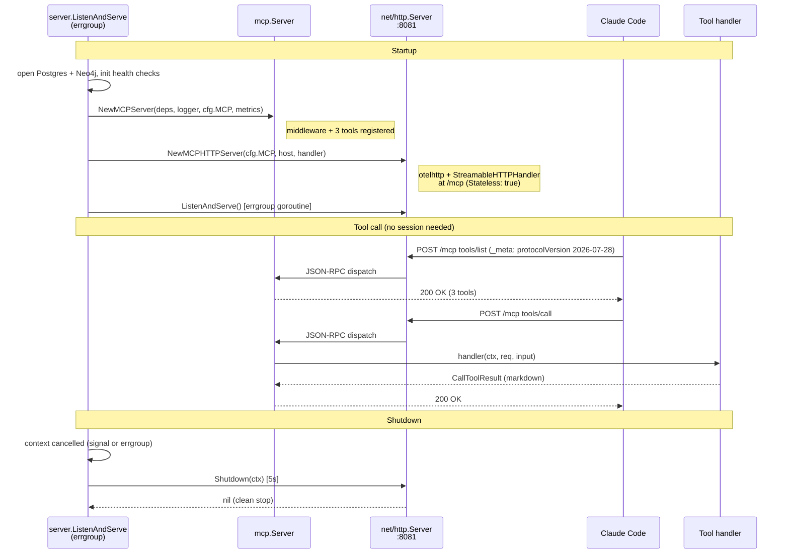
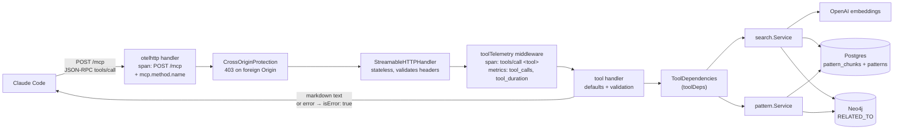

# MCP Server Implementation Design

> Back to [Design Documents](README.md) | [Project README](../../README.md)

## Table of Contents

- [Overview](#overview)
- [Server Setup](#server-setup)
  - [MCP Server Creation](#mcp-server-creation)
  - [Streamable HTTP Handler](#streamable-http-handler)
  - [HTTP Server Lifecycle](#http-server-lifecycle)
  - [Server Lifecycle Diagram](#server-lifecycle-diagram)
  - [Request Path](#request-path)
- [Tool Registration](#tool-registration)
- [Tool Handler Signatures](#tool-handler-signatures)
  - [search_patterns](#search_patterns)
  - [find_related_patterns](#find_related_patterns)
  - [get_pattern](#get_pattern)
- [Error Handling](#error-handling)
  - [SDK Error Wrapping](#sdk-error-wrapping)
  - [Application Error Types](#application-error-types)
  - [Transport-Level Errors](#transport-level-errors)
- [Observability Integration](#observability-integration)
  - [Receiving Middleware](#receiving-middleware)
  - [Tracing](#tracing)
  - [Metrics](#metrics)
  - [Logging](#logging)
- [Package Structure](#package-structure)
- [Design Decisions](#design-decisions)
- [Architecture References](#architecture-references)

## Overview

> **Architecture Reference:** [System Architecture - Mnemonic MCP Server](../architecture/system/02-system-architecture.md#mnemonic-mcp-server) | [MCP Tools](../architecture/mnemonic/08-mcp-tools.md) | [Communication Patterns - Claude Code to MCP Server](../architecture/system/03-communication-patterns.md#claude-code-to-mcp-server-communication)

The `mnemonic-mcp` service exposes 3 read-only pattern search tools over the Model Context Protocol (MCP). The MCP server listens on port 8081 (`mcp.port`) and serves JSON-RPC 2.0 over Streamable HTTP at `/mcp`. Claude Code discovers tools via `tools/list` and invokes them via `tools/call`.

All 3 tools are stateless: each invocation is a standalone request/response with no session state carried between calls. The tools return markdown-formatted text content.

The server speaks MCP protocol version 2026-07-28 (sessionless, no `initialize`, per-request `_meta`), and 2025-11-25 and earlier for older clients. The SDK handles `server/discover`, header validation and version negotiation; see [MCP Tools: Tool Discovery](../architecture/mnemonic/08-mcp-tools.md#tool-discovery) for the wire format.

**Authentication:** none. The MCP endpoint is unauthenticated in the current local, single-user phase. Do not expose port 8081 beyond localhost.

**SDK:** `github.com/modelcontextprotocol/go-sdk/mcp` v1.8.0 (see `src/go.mod`). The Go module path of the service is `github.com/twistingmercury/mnemonic`.

**Scope:** There are only 3 MCP tools, all for pattern search. The MCP service has no write paths: patterns are created, updated and deleted through the REST API (`mnemonic-api`) and enriched by `mnemonic-enricher`.

**Tools:**

| Tool                    | Purpose                                                           | Databases Queried                                          |
| ----------------------- | ----------------------------------------------------------------- | ---------------------------------------------------------- |
| `search_patterns`       | Chunk-level semantic search, plus graph expansion of the top hits | PGVector + Neo4j (+ Postgres for graph-candidate metadata) |
| `find_related_patterns` | Graph traversal from a given pattern                              | Postgres (source name) + Neo4j                             |
| `get_pattern`           | Single pattern retrieval by UUID                                  | Postgres + Neo4j                                           |

The service also runs the operations server on `server.port` (8080: `GET /health`, `GET /version`) and the Prometheus scrape endpoint on `:9090/metrics`. Those are described in [Observability Implementation](observability-implementation.md).

## Server Setup

All server construction lives in `src/internal/mcpserver/server.go`; `src/internal/server/server.go` wires it.

### MCP Server Creation

`NewMCPServer` creates the MCP server with Mnemonic's implementation metadata, attaches the tool telemetry middleware and registers the 3 tools. The version string comes from the `internal/version` package (set from the git tag at build time). A `SchemaCache` avoids repeated reflection on tool input structs. `Capabilities` advertises only `tools`, with no `listChanged` because the tool set is fixed (the SDK would otherwise also advertise the deprecated `logging` capability). `SetCacheable` gives `tools/list` and `server/discover` a one-hour `ttlMs` with `cacheScope: "public"`.

```go
// NewMCPServer creates a configured MCP server with all 3 pattern search
// tools registered.
func NewMCPServer(deps ToolDependencies, logger zerolog.Logger, mcpCfg config.MCPConfig, toolMetrics *metrics.Tools) *mcp.Server {
    server := mcp.NewServer(&mcp.Implementation{
        Name:    "mnemonic",
        Version: version.Version(),
    }, &mcp.ServerOptions{
        SchemaCache:  mcp.NewSchemaCache(),
        Capabilities: &mcp.ServerCapabilities{Tools: &mcp.ToolCapabilities{}},
        SetCacheable: func(_ context.Context, _ mcp.Request, c *mcp.Cacheable) {
            c.TTLMs = int(toolListTTL.Milliseconds()) // 1 hour
            c.CacheScope = "public"
        },
    })

    server.AddReceivingMiddleware(toolTelemetry(toolMetrics))
    mcp.AddTool(server, searchPatternsTool, handleSearchPatterns(deps, logger, mcpCfg.DefaultSearchThreshold))
    mcp.AddTool(server, findRelatedPatternsTool, handleFindRelatedPatterns(deps, logger))
    mcp.AddTool(server, getPatternTool, handleGetPattern(deps, logger))

    return server
}
```

The `SchemaCache` stores JSON Schemas inferred from handler input structs. Since the tool schemas are static (registered once at startup), caching is safe; for a fixed set of 3 tools the memory footprint is negligible.

### Streamable HTTP Handler

`NewMCPHTTPHandler` wraps the MCP server in a `StreamableHTTPHandler`, which implements `http.Handler` and serves JSON-RPC 2.0 over HTTP POST. `Stateless` mode is enabled because all 3 tools are stateless.

```go
func NewMCPHTTPHandler(server *mcp.Server) *mcp.StreamableHTTPHandler {
    return mcp.NewStreamableHTTPHandler(func(_ *http.Request) *mcp.Server {
        return server
    }, &mcp.StreamableHTTPOptions{
        Stateless: true,
    })
}
```

The factory always returns the same shared server instance. With `Stateless: true` the SDK does not create, read or echo `Mcp-Session-Id`, and answers `GET` and `DELETE` with 405. A 2026-07-28 client never sends `initialize`; an older client may, and may also send `tools/call` without it. Clients should send `Accept: application/json, text/event-stream`; the response body may be framed as a single SSE `data:` event.

There is no session timeout or session configuration: `MCPConfig` has only `port`, `read_timeout`, `write_timeout`, `idle_timeout` and `default_search_threshold`.

### HTTP Server Lifecycle

`NewMCPHTTPServer` mounts the handler at `/mcp` on a dedicated `net/http.Server`. From the outside in:

1. `otelhttp` gives every request a server span (continuing any incoming W3C trace context) and the standard `http.server.*` metrics.
2. `withMCPHeaders` copies the `Mcp-Method` and `MCP-Protocol-Version` headers onto that span as `mcp.method.name` and `mcp.protocol.version`.
3. `http.CrossOriginProtection` rejects cross-origin browser requests with 403, since the spec requires servers to validate `Origin`. Requests without `Origin` or `Sec-Fetch-Site` (non-browser clients) pass.

```go
func NewMCPHTTPServer(mcpCfg config.MCPConfig, host string, mcpHandler http.Handler) *http.Server {
    mux := http.NewServeMux()
    mux.Handle("/mcp", otelhttp.NewHandler(withMCPHeaders(http.NewCrossOriginProtection().Handler(mcpHandler)), "/mcp"))

    return &http.Server{
        Addr:         mcpCfg.Address(host), // server.host + mcp.port, default 0.0.0.0:8081
        Handler:      mux,
        ReadTimeout:  mcpCfg.ReadTimeout,   // default 30s
        WriteTimeout: mcpCfg.WriteTimeout,  // default 30s
        IdleTimeout:  mcpCfg.IdleTimeout,   // default 120s
    }
}
```

`server.ListenAndServe` (in `internal/server`) runs the operations server and the MCP server in one `errgroup`. `runMCPServer` calls `ListenAndServe()` and, when the group context is cancelled (SIGINT/SIGTERM or a sibling failure), calls `Shutdown` with a fixed 5-second timeout (`mcpShutdownTimeout`), independent of `server.shutdown_timeout`.

### Server Lifecycle Diagram



### Request Path

How one `tools/call` travels through the service:



## Tool Registration

The 3 tools are registered inside `NewMCPServer` (there is no separate `RegisterTools` function). Each call to `mcp.AddTool` associates a `mcp.Tool` definition with a typed handler. The SDK infers `InputSchema` from the handler's input struct.

Tool definitions (`tools.go`):

```go
var searchPatternsTool = &mcp.Tool{
    Name:        "search_patterns",
    Description: "Semantic search over the team knowledge graph. Returns patterns ranked by vector similarity, with optional tag/language/domain filters.",
}

var findRelatedPatternsTool = &mcp.Tool{
    Name:        "find_related_patterns",
    Description: "Find patterns related to a given pattern via the knowledge graph. Traverses RELATED_TO edges in Neo4j and returns patterns ranked by concept overlap strength.",
}

var getPatternTool = &mcp.Tool{
    Name:        "get_pattern",
    Description: "Retrieve a specific pattern by ID. Returns full pattern content, metadata, related patterns, and extracted concepts. Graph relationships are omitted when enrichment is still pending.",
}
```

## Tool Handler Signatures

Each handler is an `mcp.ToolHandlerFor[In, any]`:

```go
func(ctx context.Context, req *mcp.CallToolRequest, input In) (*mcp.CallToolResult, any, error)
```

`In` is the tool's input struct; the structured output value is always `nil` because the tools return only text content. A successful call returns a `*mcp.CallToolResult` with a single `*mcp.TextContent` holding the markdown response.

The SDK validates the incoming arguments against the schema inferred from `In` (types and required fields) before calling the handler. Range checks (limits, threshold) and UUID parsing happen in the handler (`handlers.go`) and return `ErrInvalidInput`.

**Dependency injection:** each handler closure captures `ToolDependencies` and the logger; `search_patterns` also captures the configured default threshold. See [service-layer.md#tooldependencies-mcp-facade](service-layer.md#tooldependencies-mcp-facade).

**`jsonschema` struct tag convention:** the `jsonschema` tag value is the field's description in its entirety. Required/optional status comes from the `json` tag: fields without `omitempty` are required, fields with `omitempty` are optional. Pointer types (`*int`, `*float64`) distinguish "omitted" (apply default) from an explicit zero (validated, and rejected where 0 is out of range).

### search_patterns

**Input struct** (`input.go`):

```go
type SearchPatternsInput struct {
    Query     string   `json:"query"               jsonschema:"Natural language search query"`
    Limit     *int     `json:"limit,omitempty"     jsonschema:"Maximum number of results to return (default 10, max 50)"`
    Threshold *float64 `json:"threshold,omitempty" jsonschema:"Minimum cosine similarity score 0.0-1.0 (default 0.5)"`
    Tags      []string `json:"tags,omitempty"      jsonschema:"Conjunctive (AND) filter by tag. Pattern must contain ALL specified tags."`
    Language  string   `json:"language,omitempty"  jsonschema:"Optional: filter results by pattern language (e.g. 'go', 'python')"`
    Domain    string   `json:"domain,omitempty"    jsonschema:"Optional: filter results by pattern domain (e.g. 'backend', 'testing')"`
}
```

There is no `agent` filter (agents are not implemented).

**Handler behavior:**

1. Defaults: `limit` = 10; `threshold` = `mcp.default_search_threshold` (default 0.5).
2. Validation: `limit` must be 1–50 and `threshold` 0.0–1.0, else `ErrInvalidInput`. `query` is required by the schema but is not checked for emptiness or length.
3. Log `mcp tool invoked` with `query_preview` (first 100 bytes).
4. `search.Service.SearchPatterns`:
   1. Embed the query text as-is via OpenAI (failure → `ErrServiceUnavailable`).
   2. pgvector search over `pattern_chunks` (only `enrichment_status = 'enriched'` chunks with an embedding), `1 - (embedding <=> query) >= threshold`, exact `language` / `domain` match when set, `tags @> $tags::jsonb` when set, ordered by distance, `LIMIT limit`.
   3. **Graph expansion** (best-effort): take the top 3 distinct patterns from the vector hits as seeds, query Neo4j `RELATED_TO` for up to 5 related patterns per seed (concurrently), de-duplicate across seeds keeping the highest similarity, drop patterns already in the vector results, batch-load their metadata from Postgres, post-filter by `domain`, `tags` and `language` (here a pattern with language `agnostic` also passes), sort by similarity and cap at 5. Any Neo4j or metadata failure is logged at Warn and yields vector-only results.
5. Format as markdown.

**Markdown response format** (`format.go`):

> **Score format note:** `search_patterns` shows vector similarity as a percentage (e.g., "92% match"). `find_related_patterns`, `get_pattern` and the graph-expansion section use a two-decimal concept-overlap similarity (e.g., "similarity: 0.85").

```text
Found 3 sections across 2 patterns matching 'error wrapping':

---

## go-error-handling (92% match)

**Section:** Wrapping Errors

**Tags:** go, errors

Chunk content here...

---

## go-error-handling (85% match)

**Section:** Sentinel Errors

**Tags:** go, errors

Chunk content here...

---

## go-logging (71% match)

**Section:** Structured Fields

Chunk content here...

---

### Related Patterns (via graph)

## go-retry-patterns (similarity: 0.60)

**Found via:** go-error-handling
**Shared concepts:** error handling, retry logic

```

`**Section:**` and `**Tags:**` lines are omitted when empty, as is `**Shared concepts:**`. The graph section appears only when expansion found something. When no chunk matches, the response is (graph expansion is skipped):

```text
No patterns found matching 'query'.
```

### find_related_patterns

**Input struct:**

```go
type FindRelatedPatternsInput struct {
    PatternID string `json:"pattern_id"      jsonschema:"UUID of the pattern to find relations for"`
    Limit     *int   `json:"limit,omitempty" jsonschema:"Maximum number of related patterns to return (default 5, max 20)"`
}
```

**Handler behavior:**

1. Parse `pattern_id` as a UUID, else `ErrInvalidInput`.
2. Default `limit` = 5; must be 1–20, else `ErrInvalidInput`.
3. `pattern.Service.FindRelatedPatterns` runs two queries concurrently: `SELECT name FROM patterns` for the source pattern (missing → `ErrPatternNotFound`) and the Neo4j `RELATED_TO` traversal (edges in either direction, ordered by `r.similarity` descending, with shared concept names collected). A Neo4j error → `ErrServiceUnavailable`.
4. Format as markdown. Pattern content is not included.

**Markdown response format:**

```text
Found 2 patterns related to 'source-pattern-name':

---

## related-pattern-name (similarity: 0.85)

**Relationship:** RELATED_TO
**Shared concepts:** error handling, retry logic

---

## another-related (similarity: 0.72)

**Relationship:** RELATED_TO
**Shared concepts:** observability
```

When the source pattern has no `RELATED_TO` edges (including a pattern that is not enriched yet):

```text
No related patterns found for 'source-pattern-name'.
```

### get_pattern

**Input struct:**

```go
type GetPatternInput struct {
    ID string `json:"id" jsonschema:"Pattern UUID to fetch"`
}
```

**Handler behavior:**

1. Parse `id` as a UUID, else `ErrInvalidInput`.
2. `pattern.Service.GetPatternWithGraph` reads `id, name, content, tags, enrichment_status, enrichment_error, enriched_at` from Postgres (missing → `ErrPatternNotFound`).
3. Only if `enrichment_status = 'enriched'`: fetch up to 10 related patterns and all `MENTIONED_IN` concepts from Neo4j concurrently. A Neo4j failure is logged at Warn and the pattern is returned without graph context.
4. Format as markdown.

**Markdown response format:**

```text
## pattern-name

**ID:** 550e8400-e29b-41d4-a716-446655440001
**Tags:** go, errors, best-practices
**Enrichment:** enriched (2025-01-10T08:05:00Z)

## Content

Full pattern content here...

### Related Patterns

- **related-pattern-name** (RELATED_TO, similarity: 0.85)
- **another-related** (RELATED_TO, similarity: 0.72)

### Extracted Concepts

- **error handling**
- **sentinel errors**
```

Concepts are listed by name only (lowercase, as extracted); Concept nodes have no description. The "Related Patterns" and "Extracted Concepts" sections are each omitted when empty, and both are omitted when the pattern is not enriched or Neo4j is unavailable. When enrichment is pending the status line reads `**Enrichment:** pending`. When it failed, the line includes the stored error:

```text
## pattern-name

**ID:** 550e8400-e29b-41d4-a716-446655440001
**Tags:** go, errors
**Enrichment:** failed -- one or more chunks failed enrichment

## Content

Full pattern content here...
```

## Error Handling

### SDK Error Wrapping

When a typed tool handler returns a non-nil error, the SDK converts it into a `CallToolResult` with `IsError: true` and the error message as text content. The JSON-RPC response is a normal success response (HTTP 200) carrying the error flag.

```go
// Handler returns a regular Go error -- SDK wraps it as isError: true
return nil, nil, fmt.Errorf("%w: invalid UUID %q", ErrInvalidInput, input.ID)

// SDK produces:
// {"content": [{"type": "text", "text": "invalid input: invalid UUID \"abc\""}], "isError": true}
```

Handlers never return `*jsonrpc.Error`; protocol-level JSON-RPC errors are left to the SDK.

### Application Error Types

`errors.go` defines 3 sentinels, matching [08-mcp-tools.md](../architecture/mnemonic/08-mcp-tools.md#application-level-errors):

```go
var ErrPatternNotFound = errors.New("pattern not found")       // get_pattern, find_related_patterns
var ErrInvalidInput = errors.New("invalid input")              // all 3 tools
var ErrServiceUnavailable = errors.New("service unavailable")  // all 3 tools
```

Handlers produce `ErrInvalidInput` themselves. Service errors go through `mapServiceError`:

```go
func mapServiceError(err error) error {
    if errors.Is(err, service.ErrNotFound) {
        return fmt.Errorf("%w: %v", ErrPatternNotFound, err)
    }
    return fmt.Errorf("%w: %v", ErrServiceUnavailable, err)
}
```

So every non-not-found service failure (OpenAI embedding failure, Postgres or Neo4j error) surfaces as "service unavailable". The telemetry middleware uses `errors.Is` on these sentinels to pick the `outcome` attribute.

### Transport-Level Errors

Transport-level errors are produced by the MCP SDK and the HTTP server, not by tool handlers. They use standard JSON-RPC 2.0 error codes, as documented in [08-mcp-tools.md](../architecture/mnemonic/08-mcp-tools.md#transport-level-errors):

| Code   | Meaning          | Handled By |
| ------ | ---------------- | ---------- |
| -32700 | Parse error      | SDK        |
| -32600 | Invalid request  | SDK        |
| -32601 | Method not found | SDK        |
| -32602 | Invalid params   | SDK        |
| -32603 | Internal error   | SDK        |

No custom implementation exists for transport-level errors.

## Observability Integration

> **Architecture Reference:** [Observability Implementation](observability-implementation.md) | [Observability Architecture](../architecture/system/07-observability-architecture.md)

### Receiving Middleware

`telemetry.go` defines `toolTelemetry`, added with `server.AddReceivingMiddleware`. It passes every method other than `tools/call` straight through. For `tools/call` it:

1. Starts a span `tools/call <tool>` with attribute `mcp.tool.name`, as a child of the `/mcp` HTTP span, or of the client span named by a `traceparent` in the request `_meta` (with a link to the HTTP span) when that is in a different trace.
2. Calls the next handler.
3. Derives the tool error from the returned error or, since the SDK turns handler errors into results, from a `CallToolResult` with `IsError` set.
4. Maps it to an outcome: `ok`, `invalid_input`, `not_found` or `unavailable`; sets `mcp.tool.outcome` on the span and records the error. Only `unavailable` marks the span status as Error, because invalid input and unknown patterns are caller mistakes.
5. Records `mnemonic.mcp.tool_calls` and `mnemonic.mcp.tool_duration` by `tool` and `outcome` (when the metrics registry is non-nil).

### Tracing

The MCP server runs on plain `net/http`, not Gin. Spans per request:

| Span                         | Source                     | Attributes                                                                         |
| ---------------------------- | -------------------------- | ---------------------------------------------------------------------------------- |
| `POST /mcp` (server)         | `otelhttp.NewHandler`      | standard HTTP server attributes, `mcp.method.name`, `mcp.protocol.version`; continues incoming W3C `traceparent`/`tracestate` |
| `tools/call <tool>`          | `toolTelemetry` middleware | `mcp.tool.name`, `mcp.tool.outcome`; parented from `_meta.traceparent` when present |
| `neo4j <Operation>` (client) | graph repository           | `db.system.name`, `db.namespace`, `db.operation.name`                              |
| PostgreSQL query spans       | otelpgx                    | otelpgx defaults                                                                   |
| OpenAI embedding HTTP span   | `otelhttp.NewTransport`    | retries add an `openai.embed.retry` span event                                     |

When the caller sends no trace context, the `/mcp` span is the trace root.

The 2026-07-28 spec also lets a client put `traceparent`, `tracestate` and `baggage` in a request's `_meta`. When a `tools/call` carries a valid `_meta.traceparent` from a different trace than the HTTP span, the `tools/call <tool>` span joins that trace as a child of the client's span and gets a span link back to the `/mcp` HTTP span. When the `_meta` and header contexts are in the same trace, the HTTP span stays the parent.

### Metrics

| Metric                                                          | Type           | Attributes        | Description                                                               |
| --------------------------------------------------------------- | -------------- | ----------------- | ------------------------------------------------------------------------- |
| `mnemonic.mcp.tool_calls`                                       | Counter        | `tool`, `outcome` | Number of MCP tool calls                                                  |
| `mnemonic.mcp.tool_duration`                                    | Histogram (ms) | `tool`, `outcome` | Tool call latency; buckets 5, 10, 25, 50, 100, 250, 500, 1000, 2500, 5000 |
| `mnemonic.patterns.query_latency`, `mnemonic.patterns.returned` | Histogram      |                   | Recorded for every pgvector search                                        |
| `http.server.*`                                                 | otelhttp       |                   | Standard HTTP server metrics for `/mcp`                                   |

There are no session metrics (stateless mode). See `src/internal/metrics/tools.go` and [Observability Implementation](observability-implementation.md#mcp-server-metrics).

### Logging

Handlers use the zerolog logger injected at construction. Each tool call logs one Info line, tagged with `trace_id` and `span_id` when a span is active:

```go
withTrace(ctx, logger).Info().
    Str("tool", "search_patterns").
    Str("query_preview", truncate(input.Query, 100)).
    Msg("mcp tool invoked")
```

| Event                                                     | Level | Fields                                                         |
| --------------------------------------------------------- | ----- | -------------------------------------------------------------- |
| Tool invoked                                              | Info  | `tool`, `query_preview` or `pattern_id`, `trace_id`, `span_id` |
| Graph expansion failed for a seed / metadata fetch failed | Warn  | `seed_pattern_id`, error                                       |
| Graph context unavailable in `get_pattern`                | Warn  | `pattern_id`, error                                            |

There are no per-call "completed" or "error" log lines; outcomes and latency are captured by the span and metrics.

## Package Structure

MCP server code lives in `src/internal/mcpserver/`. The name `mcpserver` avoids colliding with the SDK's `mcp` package.

```text
src/internal/mcpserver/
    server.go       -- NewMCPServer, NewMCPHTTPHandler, NewMCPHTTPServer
    tools.go        -- Tool definitions (mcp.Tool vars)
    handlers.go     -- Handlers for all 3 tools, mapServiceError
    input.go        -- Input structs
    format.go       -- Markdown formatting
    errors.go       -- Sentinel errors
    deps.go         -- ToolDependencies interface and toolDeps implementation
    telemetry.go    -- toolTelemetry receiving middleware, withTrace
```

**File responsibilities:**

| File           | Contents                                                                                                                                                                                 |
| -------------- | ---------------------------------------------------------------------------------------------------------------------------------------------------------------------------------------- |
| `server.go`    | `NewMCPServer` (creates `mcp.Server`, adds middleware, registers tools), `NewMCPHTTPHandler` (stateless Streamable HTTP), `NewMCPHTTPServer` (`net/http.Server` with otelhttp at `/mcp`) |
| `tools.go`     | `searchPatternsTool`, `findRelatedPatternsTool`, `getPatternTool`                                                                                                                        |
| `handlers.go`  | `handleSearchPatterns`, `handleFindRelatedPatterns`, `handleGetPattern`, limit constants, `mapServiceError`                                                                              |
| `input.go`     | `SearchPatternsInput`, `FindRelatedPatternsInput`, `GetPatternInput`                                                                                                                     |
| `format.go`    | `formatSearchResults`, `formatRelatedPatterns`, `formatPattern`                                                                                                                          |
| `errors.go`    | `ErrPatternNotFound`, `ErrInvalidInput`, `ErrServiceUnavailable`                                                                                                                         |
| `deps.go`      | `ToolDependencies`, `toolDeps`, `NewToolDependencies`                                                                                                                                    |
| `telemetry.go` | `toolTelemetry`, `toolOutcome`, `withTrace`                                                                                                                                              |

Other packages in the service: `internal/service/search` and `internal/service/pattern` (read-side services), `internal/service/openai` (embedding client only), `internal/repository/{chunk,pattern,graph}` (read-only repositories), plus `config`, `database`, `health`, `handlers/operations`, `metrics`, `middleware`, `server`, `telemetry` and `version`.

## Design Decisions

### Explicit InputSchema for richer validation (deferred)

The SDK infers `InputSchema` from Go struct tags, and the inferred schema carries no `minimum`, `maximum`, `maxLength` or `pattern` constraints. An explicit `InputSchema` on the `Tool` struct would let the SDK enforce them before calling the handler.

This is deferred because:

1. Handler-level validation already covers the constraints (limit range, threshold range, UUID format).
2. The SDK's schema validation rejects structurally invalid arguments (wrong types, missing required fields).
3. Handler errors are more descriptive than generic schema violations.
4. Explicit schemas would have to be kept in sync with the Go structs.

Explicit schemas can be added later if MCP clients benefit from seeing parameter constraints during tool discovery.

## Architecture References

- [MCP Tools](../architecture/mnemonic/08-mcp-tools.md) -- tool definitions, parameters, response formats, error handling
- [System Architecture](../architecture/system/02-system-architecture.md) -- component breakdown and data flow
- [Communication Patterns](../architecture/system/03-communication-patterns.md) -- MCP protocol overview and request flow
- [Configuration Design](configuration.md) -- `mcp.*` settings and defaults
- [Observability Implementation](observability-implementation.md) -- span naming, MCP metrics, structured logging

---

Copyright (c) 2025-2026 Jeremy K. Johnson. All rights reserved.
