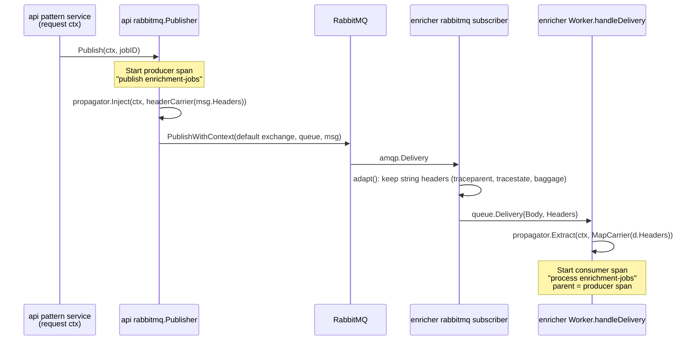

# Observability Implementation Design

> Back to [Design Documents](README.md) | [Project README](../../README.md)

**Note:** This document describes the observability code as implemented in `mnemonic-api` and `mnemonic-enricher` (v0.4.1) and `mnemonic-mcp` (v0.5.0). Earlier versions of this page carried long, hypothetical code listings (handler dependency structs, instrumented repository wrappers, cache and tooling metrics, otelx v1 APIs) that never matched the code; they have been replaced with the actual design and short excerpts. File paths are relative to each service's `src/` directory.

## Table of Contents

- [Overview](#overview)
- [otelx Package Integration](#otelx-package-integration)
- [Initialization and Configuration](#initialization-and-configuration)
- [Distributed Tracing Implementation](#distributed-tracing-implementation)
- [Metrics Implementation](#metrics-implementation)
- [Enrichment Worker Observability](#enrichment-worker-observability)
- [Metrics Registry](#metrics-registry)
- [Structured Logging Implementation](#structured-logging-implementation)
- [Handler Instrumentation Patterns](#handler-instrumentation-patterns)
- [Database Instrumentation](#database-instrumentation)
- [Health Check Implementation](#health-check-implementation)
- [Gaps and Additional Implementation](#gaps-and-additional-implementation)
- [Implementation Checklist](#implementation-checklist)

## Overview

> **Architecture Reference:** [Observability Architecture](../architecture/system/07-observability-architecture.md) | [Requirements](../requirements.md)

This document provides the Go implementation design for MVP observability in Mnemonic, as defined in the [Observability Architecture](../architecture/system/07-observability-architecture.md). The architecture page lists every metric, span and health check; this page explains where in the code they come from and how they fit together.

**MVP Scope (implemented):**

- OpenTelemetry SDK integration via `otelx` v2
- Structured JSON logging with trace correlation
- Metrics (counters, histograms, gauges) served in Prometheus format
- Distributed tracing with W3C Trace Context, across HTTP and RabbitMQ
- OTLP gRPC trace export (off by default)

**Primary Package:** `github.com/twistingmercury/otelx/v2` (v2.0.0)

> **Note:** The patterns described here apply to all three Mnemonic services. Each service initializes its own telemetry independently and reports its own `service.name` (`mnemonic-api`, `mnemonic-enricher` or `mnemonic-mcp`, the constant `version.Service`).

### Service Codebase Layout

Each service repo follows the same `src/` layout. Observability-related packages:

```text
src/
├── cmd/main/main.go           # Flags (--version, --health), config load, server.ListenAndServe
└── internal/
    ├── config/                # Viper config incl. observability.* keys
    ├── telemetry/telemetry.go # otelx wrapper: builds otelx.Config, OTLP exporter, metrics registry
    ├── metrics/               # Domain instruments + Registry
    ├── middleware/            # tracing.go (otelgin), metrics.go (HTTP request metrics)
    │                          # api only: observability.go (completion logging, redaction)
    ├── health/health.go       # heartbeat dependency checks
    ├── handlers/operations/   # GET /health, GET /version
    ├── repository/graph/      # Neo4j spans + db metrics
    ├── database/              # pgx pool with otelpgx tracer and pool stats
    ├── queue/rabbitmq/        # api: publisher (inject); enricher: subscriber (headers)
    ├── enricher/              # enricher only: worker spans + job metrics
    └── mcpserver/             # mcp only: otelhttp-wrapped /mcp, tool telemetry middleware
```

**Key Integration Points (per service):**

1. `internal/server/server.go` - Telemetry initialization and shutdown, middleware registration, wiring of instruments into repositories and services
2. `internal/telemetry/telemetry.go` - The only place that talks to otelx
3. `internal/metrics/` - All domain-specific instruments

## otelx Package Integration

> **Architecture Reference:** [Observability Architecture - Observability Stack](../architecture/system/07-observability-architecture.md#observability-stack)

### Package Capabilities

| Capability                 | Provided by                                   | Notes                                                                  |
| -------------------------- | --------------------------------------------- | ---------------------------------------------------------------------- |
| Unified initialization     | otelx v2 `Initialize()`                       | Logger, meter provider, trace provider                                 |
| Zerolog logging            | otelx v2                                      | JSON to stdout; `LoggerWithSpan` adds `trace_id`/`span_id`             |
| Prometheus metrics         | otelx v2                                      | Own registry and HTTP server on `MetricsAddr`, plus Go runtime/process |
| Trace provider             | otelx v2                                      | Uses the exporter Mnemonic supplies; sets W3C TraceContext + Baggage   |
| Gin logging middleware     | `otelx/middleware/gin/v2` `LoggingMiddleware` | Used by mcp and enricher; the API has its own                          |
| Gin tracing middleware     | `otelgin` (contrib)                           | `internal/middleware/tracing.go`                                       |
| net/http tracing           | `otelhttp` (contrib)                          | `/mcp` handler and the OpenAI HTTP client transport                    |
| Request metrics middleware | Mnemonic                                      | `internal/middleware/metrics.go`                                       |
| Database instrumentation   | `otelpgx` (Postgres), Mnemonic (Neo4j)        | See [Database Instrumentation](#database-instrumentation)              |

### Required Dependencies

From the services' `go.mod` (api and enricher v0.4.1, mcp v0.5.0):

```go
require (
    github.com/twistingmercury/otelx/v2 v2.0.0
    github.com/twistingmercury/otelx/middleware/gin/v2 v2.0.0 // mcp, enricher
    github.com/twistingmercury/heartbeat/v2 v2.0.0
    github.com/exaring/otelpgx v0.13.0
    go.opentelemetry.io/otel v1.47.0
    go.opentelemetry.io/otel/exporters/otlp/otlptrace/otlptracegrpc v1.47.0
    go.opentelemetry.io/contrib/instrumentation/github.com/gin-gonic/gin/otelgin v0.72.0
    go.opentelemetry.io/contrib/instrumentation/net/http/otelhttp v0.72.0
)
```

## Initialization and Configuration

### Configuration Package

The observability keys (`logging.level`, `observability.metrics.*`, `observability.tracing.*`) and their defaults are documented in [Configuration - Configuration Reference](configuration.md#configuration-reference). Summary of defaults: metrics on at `:9090/metrics`, tracing off, `sample_rate` 0.1, `otlp_insecure` true, `endpoint` empty (required when tracing is enabled).

### Telemetry Initialization

`telemetry.Initialize(ctx, cfg)` maps the Mnemonic config onto an `otelx.Config`, calls `otelx.Initialize`, and builds the [metrics registry](#metrics-registry) from the resulting meter (or the global no-op meter when metrics are disabled). The mapping, condensed from `internal/telemetry/telemetry.go`:

```go
otelCfg := otelx.Config{
    ServiceName:    version.Service,       // "mnemonic-api", "mnemonic-enricher" or "mnemonic-mcp"
    ServiceVersion: version.Version(),
    Environment:    getEnvironment(),      // $MNEMONIC_ENV, default "development"
    LogLevel:       cfg.Logging.Level,
}

if cfg.Observability.Metrics.Enabled {
    otelCfg.MetricsAddr = fmt.Sprintf(":%d", cfg.Observability.Metrics.Port)
    otelCfg.MetricsPath = cfg.Observability.Metrics.Path
}

if cfg.Observability.Tracing.Enabled {
    otelCfg.Tracing = true
    otelCfg.Sampler = sdktrace.ParentBased(
        sdktrace.TraceIDRatioBased(cfg.Observability.Tracing.SampleRate))

    // otelx v2 reads the OTLP endpoint from OTEL_EXPORTER_OTLP_* variables.
    // Build the exporter here so the mnemonic config keeps working.
    var opts []otlptracegrpc.Option
    if cfg.Observability.Tracing.Endpoint != "" {
        opts = append(opts, otlptracegrpc.WithEndpoint(cfg.Observability.Tracing.Endpoint))
    }
    if cfg.Observability.Tracing.OTLPInsecure {
        opts = append(opts, otlptracegrpc.WithInsecure())
    }
    exporter, err := otlptracegrpc.New(ctx, opts...)
    // ...
    otelCfg.TraceExporter = exporter
}
```

Consequences:

- Options passed in code win over `OTEL_EXPORTER_OTLP_ENDPOINT` and `OTEL_EXPORTER_OTLP_INSECURE`; other `OTEL_EXPORTER_OTLP_*` variables (headers, timeout, certificates) still apply. `OTEL_TRACES_SAMPLER` is ignored because a sampler is always set. See [Configuration - OpenTelemetry Standard Variables](configuration.md#opentelemetry-standard-variables).
- When tracing is disabled, otelx does not install a trace provider or a propagator, so the global no-op tracer and no-op propagator are used: spans are not recorded and no `traceparent` is injected into outgoing requests or messages.
- The `Telemetry` wrapper exposes `Logger()`, `Meter(name)`, `MetricsRegistry()`, `Otelx()` and `Shutdown(ctx)` (the API also has `Tracer`, `TracerProvider` and `MeterProvider`).

### Server Lifecycle and Telemetry

`server.ListenAndServe(cfg)` in each service:

1. Calls `telemetry.Initialize`; on a later startup error it shuts telemetry down before returning.
2. Opens the Postgres pool and Neo4j driver, passing instruments from the registry into repositories and services.
3. Creates `middleware.NewRequestMetrics(tel.Meter("mnemonic/http"))` and the Gin router (see [Structured Logging Implementation](#structured-logging-implementation) for the middleware order).
4. Initializes health checks and registers `/health` and `/version`.
5. Runs the HTTP server(s) (and, in the enricher, the worker) until the context is cancelled, then shuts them down and finally calls `tel.Shutdown`, which flushes spans and stops the metrics server.

## Distributed Tracing Implementation

> **Architecture Reference:** [Observability Architecture - Distributed Tracing](../architecture/system/07-observability-architecture.md#distributed-tracing)

### Trace Structure

Spans and tracer names in use:

| Tracer / instrumentation | Span name                                    | Kind     | Key attributes                                                                                                                  | Where                                        |
| ------------------------ | -------------------------------------------- | -------- | ------------------------------------------------------------------------------------------------------------------------------- | -------------------------------------------- |
| `otelgin` (service name) | route template, e.g. `POST /v1/api/patterns` | server   | HTTP semantic conventions                                                                                                       | `internal/middleware/tracing.go`             |
| `otelhttp`               | `/mcp`                                       | server   | HTTP semantic conventions                                                                                                       | `internal/mcpserver/server.go` (mcp)         |
| `mnemonic/mcp`           | `tools/call <tool>`                          | internal | `mcp.tool.name`, `mcp.tool.outcome`                                                                                             | `internal/mcpserver/telemetry.go` (mcp)      |
| `otelhttp` transport     | HTTP client span                             | client   | HTTP semantic conventions                                                                                                       | `internal/service/openai/*.go`               |
| `otelpgx`                | per query                                    | client   | database semantic conventions                                                                                                   | `internal/database/`                         |
| `mnemonic/neo4j`         | `neo4j <Operation>`                          | client   | `db.system.name=neo4j`, `db.namespace`, `db.operation.name`                                                                     | `internal/repository/graph/repository.go`    |
| `mnemonic/queue`         | `publish enrichment-jobs`                    | producer | `messaging.system=rabbitmq`, `messaging.operation.type=send`, `messaging.destination.name`, `mnemonic.job_id`                   | `internal/queue/rabbitmq/publisher.go` (api) |
| `mnemonic/enricher`      | `process enrichment-jobs`                    | consumer | `messaging.operation.type=process`, `messaging.destination.name`, `mnemonic.job_id`, `mnemonic.pattern_id`, `mnemonic.chunk_id` | `internal/enricher/enrichment.go`            |
| `mnemonic/enricher`      | `retry enrichment job`                       | internal | `mnemonic.job_id`, `mnemonic.pattern_id`, `mnemonic.chunk_id`                                                                   | `internal/enricher/enrichment.go`            |

A failing operation records the error on its span and sets status `Error`. MCP tool calls only set `Error` for the `unavailable` outcome; `invalid_input` and `not_found` are caller mistakes and are recorded as span events only.

### Tracing Middleware

`internal/middleware/tracing.go` wraps `otelgin.Middleware` with a filter that skips `DefaultSkipPaths` (`/health`, `/metrics`):

```go
var DefaultSkipPaths = []string{"/health", "/metrics"}

func TracingMiddlewareWithSkipPaths(serviceName string, skipPaths []string) gin.HandlerFunc {
    return otelgin.Middleware(serviceName,
        otelgin.WithFilter(func(req *http.Request) bool {
            return !slices.Contains(skipPaths, req.URL.Path)
        }),
    )
}
```

All three services register it as `TracingMiddlewareWithSkipPaths(version.Service, middleware.DefaultSkipPaths)`. The MCP endpoint is a separate `net/http` server on `mcp.port`; its only route is `mux.Handle("/mcp", otelhttp.NewHandler(mcpHandler, "/mcp"))`, which continues any incoming W3C trace context.

### Creating Child Spans in Handlers

Handlers do not create their own spans. Child spans come from the instrumented clients underneath them (OpenAI HTTP transport, otelpgx, the Neo4j repository, the RabbitMQ publisher) as long as the request context is passed down, which every service and repository method does. The two pieces of Mnemonic code that start spans around business logic are the MCP tool middleware and the enrichment worker.

The MCP tool middleware (`internal/mcpserver/telemetry.go`) is registered as an MCP SDK middleware, so every `tools/call` request gets a span and metrics without touching individual tool handlers:

```go
ctx, span := tracer.Start(ctx, "tools/call "+tool,
    trace.WithAttributes(attribute.String("mcp.tool.name", tool)))
defer span.End()

res, err := next(ctx, method, req)
// an IsError tool result counts as a failure too
outcome := toolOutcome(toolErr) // ok | invalid_input | not_found | unavailable
span.SetAttributes(attribute.String("mcp.tool.outcome", outcome))
if toolMetrics != nil {
    toolMetrics.Record(ctx, tool, outcome, time.Since(start))
}
```

### Trace Propagation Across RabbitMQ

The API injects the producer span's context into the AMQP message headers; the enricher extracts it before starting the consumer span, so one trace covers the HTTP request, the publish and the enrichment. The end-to-end flow is drawn in [Observability Architecture - Distributed Tracing](../architecture/system/07-observability-architecture.md#distributed-tracing); the code-level hand-off is:



Producer side (`mnemonic-api/src/internal/queue/rabbitmq/publisher.go`):

```go
msg := amqp.Publishing{
    Headers:      amqp.Table{},
    DeliveryMode: amqp.Persistent,
    ContentType:  "application/json",
    Body:         body, // {"job_id": "..."}
}
otel.GetTextMapPropagator().Inject(ctx, headerCarrier(msg.Headers))
```

`headerCarrier` adapts `amqp.Table` to `propagation.TextMapCarrier`. On a publish error the publisher waits `queue.rabbitmq.reconnect_delay`, reconnects once and retries with the same headers.

Consumer side (`mnemonic-enricher/src/internal/enricher/enrichment.go`):

```go
ctx := otel.GetTextMapPropagator().Extract(drainCtx, propagation.MapCarrier(d.Headers))
ctx, span := tracer.Start(ctx, "process "+w.sub.Name(),
    trace.WithSpanKind(trace.SpanKindConsumer),
    trace.WithAttributes(
        attribute.String("messaging.operation.type", "process"),
        attribute.String("messaging.destination.name", w.sub.Name()),
    ),
)
```

Jobs claimed by the retry sweep have no message, so `handleRetry` starts a new root span (`retry enrichment job`) carrying `mnemonic.job_id`.

### Span Naming Conventions

| Pattern               | Example                                                                     |
| --------------------- | --------------------------------------------------------------------------- |
| HTTP server (otelgin) | `GET /v1/api/patterns/:id` (route template)                                 |
| Messaging             | `<operation> <queue>`: `publish enrichment-jobs`, `process enrichment-jobs` |
| Database (Neo4j)      | `neo4j <RepositoryMethod>`: `neo4j FindRelatedPatterns`                     |
| MCP tool              | `tools/call <tool>`: `tools/call search_patterns`                           |

Attributes follow OpenTelemetry semantic conventions where they exist (`messaging.*`, `db.*`). Mnemonic-specific attributes use the `mnemonic.` prefix (`mnemonic.job_id`, `mnemonic.pattern_id`, `mnemonic.chunk_id`) or `mcp.` for tool attributes.

## Metrics Implementation

> **Architecture Reference:** [Observability Architecture - Metrics](../architecture/system/07-observability-architecture.md#metrics)

### Metrics Categories

| Category        | Instruments                                                     | Defined in                             | Services |
| --------------- | --------------------------------------------------------------- | -------------------------------------- | -------- |
| HTTP requests   | `mnemonic.http.request.count`, `.duration`, `.in_flight`        | `internal/middleware/metrics.go`       | all      |
| Database        | `mnemonic.db.query_latency`, `mnemonic.db.query_errors`         | `internal/metrics/database.go`         | all      |
| Pattern queries | `mnemonic.patterns.query_latency`, `mnemonic.patterns.returned` | `internal/metrics/patterns.go`         | api, mcp |
| Queue publish   | `mnemonic.queue.publish_failures_total`                         | `internal/queue/rabbitmq/publisher.go` | api      |
| Enrichment jobs | `mnemonic.enrichment.jobs`, `mnemonic.enrichment.job_duration`  | `internal/metrics/jobs.go`             | enricher |
| MCP tools       | `mnemonic.mcp.tool_calls`, `mnemonic.mcp.tool_duration`         | `internal/metrics/tools.go`            | mcp      |
| Postgres pool   | otelpgx pool stats (`RecordStats`)                              | `internal/database/`                   | all      |
| Runtime         | Go runtime and process collectors                               | otelx                                  | all      |

All latency histograms are in milliseconds with explicit bucket boundaries (for example `1, 5, 10, 25, 50, 100, 250, 500, 1000` for HTTP and database). Attribute values are fixed, bounded sets; no user input becomes an attribute value.

**Prometheus names:** the OpenTelemetry Prometheus exporter replaces dots with underscores and appends unit and counter suffixes: `mnemonic_http_request_count_total`, `mnemonic_http_request_duration_milliseconds`, `mnemonic_http_request_in_flight`, `mnemonic_patterns_returned`, `mnemonic_queue_publish_failures_total`. Instrument scope (`mnemonic`, `mnemonic/http`, `mnemonic/queue`) appears as `otel_scope_name`.

### Request Metrics Middleware

`middleware.RequestMetrics` creates the three HTTP instruments; `MiddlewareWithSkipPaths(DefaultSkipPaths)` records them for every Gin request except `/health` and `/metrics`:

```go
m.requestInFlight.Add(ctx, 1)
defer m.requestInFlight.Add(context.Background(), -1)

c.Next()

route := c.FullPath()
if route == "" {
    route = "unknown" // unmatched paths, keeps cardinality bounded
}
attrs := []attribute.KeyValue{
    attribute.String("http.method", c.Request.Method),
    attribute.String("http.route", route),
    attribute.String("http.status_code", strconv.Itoa(c.Writer.Status())),
}
m.requestCount.Add(context.Background(), 1, metric.WithAttributes(attrs...))
m.requestDuration.Record(context.Background(), duration, metric.WithAttributes(attrs...))
```

The API measures duration as fractional milliseconds; the MCP server and enricher currently truncate to whole milliseconds. `in_flight` has no attributes.

### MCP Server Metrics

The MCP endpoint is not served by Gin, so it is not covered by the request metrics above. It has:

- **Tool metrics** (`internal/metrics/tools.go`): `mnemonic.mcp.tool_calls` (counter, unit `{call}`) and `mnemonic.mcp.tool_duration` (histogram, ms, buckets `5 ... 5000`), both with `tool` (`search_patterns`, `find_related_patterns`, `get_pattern`) and `outcome` (`ok`, `invalid_input`, `not_found`, `unavailable`). Recorded by the tool telemetry middleware shown in [Creating Child Spans in Handlers](#creating-child-spans-in-handlers).
- **otelhttp metrics**: the `otelhttp` handler on `/mcp` records the standard `http.server.*` instruments through the global meter provider.

The MCP server runs in stateless Streamable HTTP mode, so there are no session metrics.

### Pattern Metrics

`metrics.Pattern` (`internal/metrics/patterns.go`, api and mcp) has `mnemonic.patterns.query_latency` (ms) and `mnemonic.patterns.returned` (count per query, buckets `0, 1, 5, 10, 25, 50, 100`), both with a `database` attribute. The search service records them once per search for the semantic similarity step:

```go
s.metrics.RecordQuery(ctx, "pgvector", time.Since(searchStart), len(matches))
```

### Tooling Metrics

Not implemented. Agent and skill tooling metrics belonged to the pre-pivot design; there is no `metrics/tooling.go`. MCP tool usage is covered by [MCP Server Metrics](#mcp-server-metrics).

### Database Metrics

`metrics.Database` (`internal/metrics/database.go`, all services) has `mnemonic.db.query_latency` (ms) and `mnemonic.db.query_errors` (counter), both with `database` and `operation`. They are recorded by the Neo4j repository for every operation (`database="neo4j"`, `operation` = repository method name); see [Database Instrumentation](#database-instrumentation). Postgres queries are not recorded in these instruments; they are traced by otelpgx, and pool usage comes from otelpgx pool stats.

## Enrichment Worker Observability

> **Architecture Reference:** [Observability Architecture - Metrics](../architecture/system/07-observability-architecture.md#metrics) | [Pattern Processing](pattern-processing.md)

The enricher's `Worker` (`internal/enricher/enrichment.go`) gives every unit of work, whether a queue delivery or a job claimed by the retry sweep, exactly one span and one metrics record. Both paths end in `finish()`:

```go
func (w *Worker) finish(ctx context.Context, span trace.Span, err error, outcome string, start time.Time) {
    if err != nil {
        span.RecordError(err)
        span.SetStatus(codes.Error, err.Error())
    }
    span.End()
    if w.jobMetrics != nil {
        w.jobMetrics.Record(ctx, outcome, time.Since(start))
    }
}
```

### Enrichment Metrics

`metrics.Jobs` (`internal/metrics/jobs.go`):

| Instrument                         | Type      | Unit    | Attributes | Buckets (ms)                                                   |
| ---------------------------------- | --------- | ------- | ---------- | -------------------------------------------------------------- |
| `mnemonic.enrichment.jobs`         | counter   | `{job}` | `outcome`  | n/a                                                            |
| `mnemonic.enrichment.job_duration` | histogram | ms      | `outcome`  | `10, 50, 100, 250, 500, 1000, 2500, 5000, 10000, 30000, 60000` |

| `outcome`   | Meaning                                                                                               | Delivery                        |
| ----------- | ----------------------------------------------------------------------------------------------------- | ------------------------------- |
| `completed` | Pipeline succeeded                                                                                    | ack                             |
| `failed`    | A step failed and the failure was recorded on the job, which the sweep retries later                  | ack                             |
| `error`     | A step failed and the failure could not be recorded                                                   | nack (no requeue)               |
| `rejected`  | Message unreadable, job could not be started, or job not available (redelivery or owned by the sweep) | nack, or ack when not available |

Failure reasons, attempt counts and next retry times are stored on the `enrichment_jobs` rows, not in metrics.

### Enrichment Tracing Spans

| Span                      | Started by       | Parent                                  |
| ------------------------- | ---------------- | --------------------------------------- |
| `process enrichment-jobs` | `handleDelivery` | API producer span, from message headers |
| `retry enrichment job`    | `handleRetry`    | none (new trace)                        |

Child spans come from the instrumented clients: Postgres (otelpgx) for starting, loading and updating the job, chunk and pattern; OpenAI (otelhttp transport) for the chunk embedding and, once every chunk of a pattern is enriched, concept extraction; and `neo4j SyncPattern` for the graph write. The job, pattern and chunk IDs are set as `mnemonic.*` attributes on the worker span.

### Enrichment Structured Logging

The worker tags its logger with the span's `trace_id` and `span_id` (`spanLogger`) and adds `job_id` (and `retry=true` for sweep jobs):

| Event                                                   | Level |
| ------------------------------------------------------- | ----- |
| `processing enrichment job` (+ `pattern_id`/`chunk_id`) | info  |
| `enrichment job completed`                              | info  |
| `job not available to start; acking`                    | info  |
| `enrichment job failed; failure recorded`               | warn  |
| Parse, start or unrecoverable failure, then nack        | error |
| `ack failed` / `nack failed`                            | error |

## Metrics Registry

`internal/metrics/registry.go` creates every domain instrument from one meter (scope `mnemonic`) at startup and hands them out to the code that records them:

| Service  | Registry fields                 |
| -------- | ------------------------------- |
| api      | `Patterns`, `Database`          |
| enricher | `Jobs`, `Database`              |
| mcp      | `Patterns`, `Database`, `Tools` |

```go
func NewRegistry(meter metric.Meter) (*Registry, error) {
    patterns, err := NewPattern(meter)
    if err != nil {
        return nil, fmt.Errorf("pattern metrics: %w", err)
    }
    database, err := NewDatabase(meter)
    if err != nil {
        return nil, fmt.Errorf("database metrics: %w", err)
    }
    return &Registry{Patterns: patterns, Database: database}, nil
}
```

Instruments that are not domain-specific are created next to their use: the HTTP request instruments in `middleware.NewRequestMetrics` (scope `mnemonic/http`) and the publish failures counter inside the RabbitMQ publisher (scope `mnemonic/queue`).

## Structured Logging Implementation

> **Architecture Reference:** [Observability Architecture - Structured Logging](../architecture/system/07-observability-architecture.md#structured-logging)

### Using otelx Gin Middleware

The MCP server and enricher use the otelx Gin logging middleware. From `internal/server/server.go` (mnemonic-mcp; the enricher is the same):

```go
func setupRouter(tel *telemetry.Telemetry, requestMetrics *middleware.RequestMetrics) *gin.Engine {
    router := gin.New()
    router.Use(gin.Recovery())

    // Echo X-Request-ID from request to response.
    router.Use(func(c *gin.Context) {
        if rid := c.GetHeader("X-Request-ID"); rid != "" {
            c.Header("X-Request-ID", rid)
        }
        c.Next()
    })

    skipPaths := middleware.DefaultSkipPaths
    router.Use(middleware.TracingMiddlewareWithSkipPaths(version.Service, skipPaths))
    router.Use(otelxgin.LoggingMiddleware(tel.Otelx(),
        otelxgin.WithSkipPaths("/health", "/metrics"),
        otelxgin.WithRequestHeaders("X-Request-ID", "X-Correlation-ID"),
    ))
    router.Use(requestMetrics.MiddlewareWithSkipPaths(skipPaths))
    return router
}
```

`otelxgin` is `github.com/twistingmercury/otelx/middleware/gin/v2`. It logs `request completed` at `info`, `warn` for 4xx and `error` for 5xx, with `method`, `path`, `status`, `latency_ms`, `client_ip`, `bytes`, `request_id`, `correlation_id` and Gin errors.

**The API is different.** It does not use the otelx logging middleware. Its router, in order:

1. Request ID: accepts `X-Request-ID` only if it is 1-128 characters of `[A-Za-z0-9._-]`, otherwise generates a UUID; always echoes it.
2. `TracingMiddlewareWithSkipPaths(version.Service, DefaultSkipPaths)`.
3. `middleware.CompletionLogging(logger, skipPaths)` (`internal/middleware/observability.go`): one `request completed` line with `method`, the route template as `route`, `status`, `duration_ms`, `request_id`, `trace_id`, `span_id` and a single redacted `error`. `info` normally, `error` for 5xx; skip paths are still logged when they fail with 5xx. For 5xx it also records the redacted error on the request span.
4. Request metrics.
5. A custom panic recovery that responds through the normal error handler (Gin's default recovery is avoided because it prints raw panic values and headers).

Error diagnostics are passed through `safeDiagnostic`, which truncates them to 512 bytes and redacts URLs, quoted values, bearer tokens, upstream response bodies and fields such as `password`, `token`, `api_key`, `content`, `body` and `query`. `handlers.RespondError` attaches the error for logging with `middleware.RecordFailure(c, err)`.

### Handler Logging

Handlers do not log per request; the completion middleware does. Services receive the base logger at construction and log notable events themselves, for example the API pattern service when a publish fails:

```go
s.logger.Warn().
    Err(err).
    Str("job_id", jobID.String()).
    Str("pattern_id", patternID.String()).
    Msg("failed to publish enrichment job — job remains pending in postgres")
```

Code that runs inside a span and wants trace IDs on its lines adds them explicitly (`withTrace` in mcpserver, `spanLogger` in the enricher worker) or, inside Gin handlers in the MCP server and enricher, uses the logger the otelx middleware stores in the Gin context.

### Log Entry Structure

Every line has the fields otelx adds (`service`, `version`, `environment`, `time`; `caller` at debug level). An API request line:

```json
{
  "level": "info",
  "service": "mnemonic-api",
  "version": "v0.4.1",
  "environment": "development",
  "method": "POST",
  "route": "/v1/api/patterns",
  "status": 202,
  "duration_ms": 45.2,
  "request_id": "8f0c2c1e-6c9b-4d55-9a57-2f1f4b6a9c3d",
  "trace_id": "4bf92f3577b34da6a3ce929d0e0e4736",
  "span_id": "00f067aa0ba902b7",
  "time": "2026-10-15T10:30:00Z",
  "message": "request completed"
}
```

`trace_id` and `span_id` are present only when the request has a valid span context, which requires tracing to be enabled.

### Log Levels by Event Type

| Event Type                    | Level                            | Example                                   |
| ----------------------------- | -------------------------------- | ----------------------------------------- |
| Request completed (2xx/3xx)   | Info                             | `request completed`                       |
| Request completed (4xx)       | Info (api), Warn (mcp, enricher) | Validation error, not found               |
| Request completed (5xx)       | Error                            | Server error                              |
| Service lifecycle             | Info                             | Server listening, shutting down           |
| Enrichment job completed      | Info                             | `enrichment job completed`                |
| Enrichment failure recorded   | Warn                             | `enrichment job failed; failure recorded` |
| Publish failed (job pending)  | Warn                             | `failed to publish enrichment job ...`    |
| Unrecoverable job or DB error | Error                            | Nack after unrecorded failure             |

## Handler Instrumentation Patterns

> **Architecture Reference:** [System Architecture - Component Breakdown](../architecture/system/02-system-architecture.md#component-breakdown) | [Observability Architecture - Key Takeaways](../architecture/system/07-observability-architecture.md#key-takeaways)

### Handler Dependencies

Handlers get services, not telemetry. Instruments are injected one level down, where the work happens:

| Instrument                    | Injected into                                                              |
| ----------------------------- | -------------------------------------------------------------------------- |
| `Registry.Database`           | Neo4j graph repository (`graphrepo.NewRepository(..., registry.Database)`) |
| `Registry.Patterns`           | Search service (`searchsvc.New(..., registry.Patterns, logger)`)           |
| `Registry.Tools`              | MCP server (`mcpserver.NewMCPServer(..., tel.MetricsRegistry().Tools)`)    |
| `Registry.Jobs`               | Enrichment worker (`enricher.New(..., jobMetrics)`)                        |
| `tel.Meter("mnemonic/queue")` | RabbitMQ publisher (API)                                                   |

### Instrumented Handler Pattern

A handler only has to pass `c.Request.Context()` to the service and report failures:

```go
pattern, err := h.patternSvc.Create(c.Request.Context(), input)
if err != nil {
    handlers.RespondError(c, err) // maps service errors to status codes, records the diagnostic
    return
}
c.JSON(http.StatusAccepted, resp)
```

The HTTP span, request metrics and completion log come from middleware; database, OpenAI and queue spans and metrics come from the instrumented clients that receive the same context.

### Handler Registration Update

No per-handler registration is needed. Middleware is attached once in `setupRouter`, and the API's REST routes are registered under `/v1/api` by `RegisterAPIRoutes(router, svc, cfg.Vocabulary)` after the middleware, so every route is covered.

## Database Instrumentation

> **Architecture Reference:** [Observability Architecture - Metrics](../architecture/system/07-observability-architecture.md#metrics)

### Postgres/PGVector Instrumentation

All three services configure the pgx pool with the [otelpgx](https://github.com/exaring/otelpgx) tracer and register its pool statistics (from `internal/database/`):

```go
poolCfg.MaxConns = cfg.MaxOpenConns
poolCfg.MinConns = cfg.MaxIdleConns
poolCfg.MaxConnLifetime = cfg.ConnMaxLifetime
poolCfg.ConnConfig.Tracer = otelpgx.NewTracer()

pool, err := pgxpool.NewWithConfig(ctx, poolCfg)
// ... ping ...
if err := otelpgx.RecordStats(pool); err != nil {
    pool.Close()
    return nil, fmt.Errorf("recording postgres pool stats: %w", err)
}
```

Every query, including pgvector similarity searches, becomes a client span. There is no custom Postgres wrapper and no `mnemonic.db.*` recording for Postgres.

### Neo4j Instrumentation

The Neo4j graph repository (`internal/repository/graph/repository.go`) wraps every operation with `instrument`, which starts a client span and, when the operation finishes, records the latency and any error:

```go
func (r *neo4jRepository) instrument(ctx context.Context, op string) (context.Context, func(error)) {
    start := time.Now()
    ctx, span := tracer.Start(ctx, "neo4j "+op,
        trace.WithSpanKind(trace.SpanKindClient),
        trace.WithAttributes(
            attribute.String("db.system.name", "neo4j"),
            attribute.String("db.namespace", r.database),
            attribute.String("db.operation.name", op),
        ),
    )
    return ctx, func(err error) {
        if err != nil {
            span.RecordError(err)
            span.SetStatus(codes.Error, err.Error())
        }
        span.End()
        if r.dbMetrics != nil {
            r.dbMetrics.RecordQueryWithError(ctx, "neo4j", op, time.Since(start), err)
        }
    }
}
```

Methods use it as `ctx, done := r.instrument(ctx, "FindRelatedPatterns")` and defer `done(err)` before closing the session, so session close errors are counted too. Cypher text is not recorded.

### Connection Pool Monitoring

Postgres pool metrics come from `otelpgx.RecordStats` (acquired, idle and total connections, acquire counts and wait time, through the global meter provider). Neo4j driver pool metrics are not collected.

## Health Check Implementation

> **Architecture Reference:** [Observability Architecture - Health Check Endpoint](../architecture/system/07-observability-architecture.md#health-check-endpoint)

Mnemonic uses [`github.com/twistingmercury/heartbeat/v2`](https://github.com/twistingmercury/heartbeat) for health checks. Every service registers `GET /health` and `GET /version` on its main HTTP server (`server.port`, default 8080). The response shape (`status`, `name`, `resource`, `machine`, `utc_date_time`, `request_duration_ms`, `dependencies`) and the per-service checks are shown in the [architecture page](../architecture/system/07-observability-architecture.md#health-check-endpoint).

### Heartbeat Integration

From `internal/handlers/operations/operations.go`:

```go
func SetupHandlers(r *gin.Engine, deps []heartbeat.DependencyDescriptor) {
    r.GET("/health", gin.WrapH(heartbeat.Handler(version.Service, deps...)))
    r.GET("/version", GetVersion)
}
```

`heartbeat.Handler` returns an `http.Handler`, so it is wrapped with `gin.WrapH`. It validates the descriptors at startup (panicking on a misconfigured one), runs all checks concurrently, coalesces concurrent probes into one run, and returns HTTP 200 for `OK` or `Warning` and 503 for `Critical`.

### Dependency Registration

`health.Initialize(health.Dependencies{...})` in `internal/health/health.go` is called after the database connections are open. It builds `heartbeat.DependencyDescriptor` values with a `CheckFunc` and a 3-second `Timeout` each (condensed from mnemonic-api):

```go
descriptors = []heartbeat.DependencyDescriptor{
    {Name: "PostgreSQL", Type: "database", Timeout: checkTimeout, CheckFunc: checkPostgreSQLHealth},
    {Name: "Neo4j", Type: "database", Timeout: checkTimeout, CheckFunc: checkNeo4jHealth},
    {Name: "OpenAI embedding model", Type: "external_api", Timeout: checkTimeout,
        CheckFunc: openAIModelCheck(openAIBaseURL, deps.OpenAI.APIKey, deps.OpenAI.EmbeddingModel)},
}
if deps.Queue != nil {
    descriptors = append(descriptors, heartbeat.DependencyDescriptor{
        Name: "RabbitMQ", Type: "queue", Timeout: checkTimeout, CheckFunc: queueCheck(deps.Queue)})
}
```

| Check                     | Probe                                                                                           | Failure severity |
| ------------------------- | ----------------------------------------------------------------------------------------------- | ---------------- |
| `PostgreSQL`              | `pool.Ping`                                                                                     | Critical         |
| `Neo4j`                   | `driver.VerifyConnectivity`                                                                     | Critical         |
| `OpenAI embedding model`  | `GET {base_url}/models/{embedding_model}` with the API key; non-200 or no response is a failure | Warning          |
| `OpenAI extraction model` | Same for `extraction_model` (enricher only)                                                     | Warning          |
| `RabbitMQ`                | `Publisher.Connected()` (API only)                                                              | Warning          |

OpenAI failures report only a fixed message ("request failed", "request timed out" or the HTTP status), never the underlying error, which can contain internal addresses. `health.CheckHealth()` runs the same checks and returns an error only for Critical results.

The `--health` command-line flag does not call `CheckHealth`; it makes an HTTP request to the running server's `/health` and exits 0 on HTTP 200, for use as a Docker `HEALTHCHECK` in scratch images.

### Health Check in Middleware Skip Paths

`/health` (and `/metrics`) are in `DefaultSkipPaths`, which excludes them from tracing, request metrics and request logging, avoiding noise from frequent probe requests by container orchestration and load balancers.

## Gaps and Additional Implementation

### What otelx Provides

| Capability                   | Status   | Notes                                   |
| ---------------------------- | -------- | --------------------------------------- |
| Unified initialization       | Provided | Single `Initialize()` call              |
| Structured logging (zerolog) | Provided | `LoggerWithSpan` for trace correlation  |
| Prometheus metrics endpoint  | Provided | Configurable address/path, own registry |
| Trace provider + propagator  | Provided | Exporter supplied by Mnemonic           |
| Gin logging middleware       | Provided | Used by mcp and enricher                |
| Gin correlation middleware   | Provided | Logger in Gin context                   |

### What Mnemonic Implements

| Capability                   | Status      | Where                                         |
| ---------------------------- | ----------- | --------------------------------------------- |
| Gin tracing middleware       | Implemented | `middleware/tracing.go` (otelgin)             |
| Request metrics middleware   | Implemented | `middleware/metrics.go`                       |
| Application-specific metrics | Implemented | `metrics/*.go`                                |
| Neo4j instrumentation        | Implemented | `repository/graph` `instrument()`             |
| Postgres instrumentation     | Implemented | otelpgx tracer + `RecordStats`                |
| RabbitMQ trace propagation   | Implemented | api publisher inject, enricher worker extract |
| MCP tool telemetry           | Implemented | `mcpserver/telemetry.go`                      |
| OTLP exporter from config    | Implemented | `telemetry/telemetry.go`                      |

### Known Gaps

| Gap                                                                          | Impact                                                                                                 |
| ---------------------------------------------------------------------------- | ------------------------------------------------------------------------------------------------------ |
| No `/mcp` request-completed log line                                         | MCP request failures show only in spans, tool metrics and tool logs                                    |
| Enricher RabbitMQ consumer not on `/health`                                  | Consumer disconnects are visible only in logs                                                          |
| No pending-job backlog metric                                                | Backlog alerts need a SQL check on `enrichment_jobs`                                                   |
| Neo4j driver pool not monitored                                              | Only Postgres pool stats are exported                                                                  |
| Duration rounding differs                                                    | mcp and enricher record whole milliseconds in `mnemonic.http.request.duration`                         |

## Implementation Checklist

Status at api and enricher v0.4.1, mcp v0.5.0.

### Foundation

- [x] `internal/config` with observability configuration
- [x] `internal/telemetry/telemetry.go` wrapping otelx v2, building the OTLP exporter from config
- [x] `server.ListenAndServe()` initializes and shuts down telemetry

### Middleware

- [x] `internal/middleware/tracing.go` using otelgin
- [x] `internal/middleware/metrics.go` for request metrics
- [x] Middleware registered in `internal/server/server.go` with `/health` and `/metrics` skipped
- [x] Request logging: otelx middleware (mcp, enricher), redacting completion logger (api)

### Application Metrics

- [x] `internal/metrics/registry.go`
- [x] `internal/metrics/patterns.go` (api, mcp)
- [x] `internal/metrics/database.go`
- [x] `internal/metrics/jobs.go` (enricher)
- [x] `internal/metrics/tools.go` (mcp)
- [x] Publish failures counter (api)

### Handler Instrumentation

- [x] Context propagated from handlers through services to clients
- [x] MCP tool spans and metrics via SDK middleware
- [x] Enrichment worker spans, metrics and trace-tagged logs

### Database Instrumentation

- [x] otelpgx tracer and pool stats on every Postgres pool
- [x] Neo4j spans and latency/error metrics for every repository operation
- [ ] Neo4j driver pool metrics

### Testing and Verification

- [x] Unit tests for metric instruments, middleware and tool telemetry
- [x] Trace propagation across RabbitMQ (api publisher and enricher worker tests)
- [x] Distinct `service.name` per service

---

Copyright (c) 2025-2026 Jeremy K. Johnson. All rights reserved.
