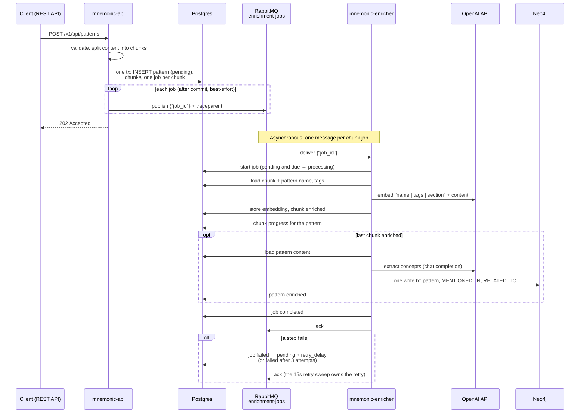
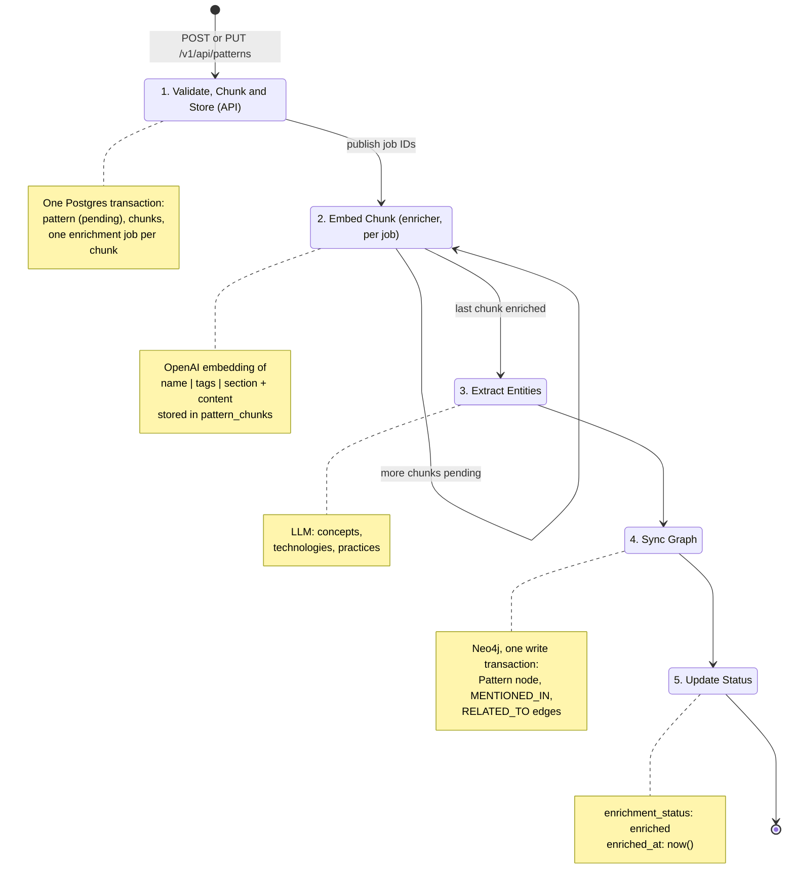
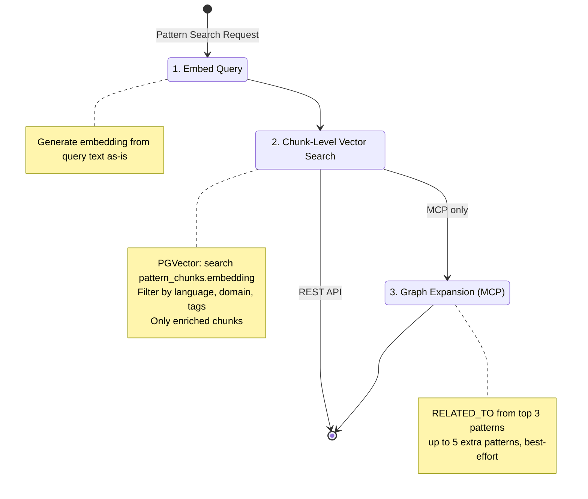
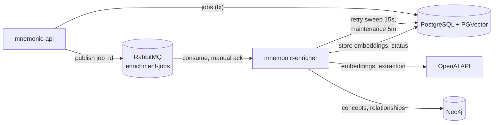
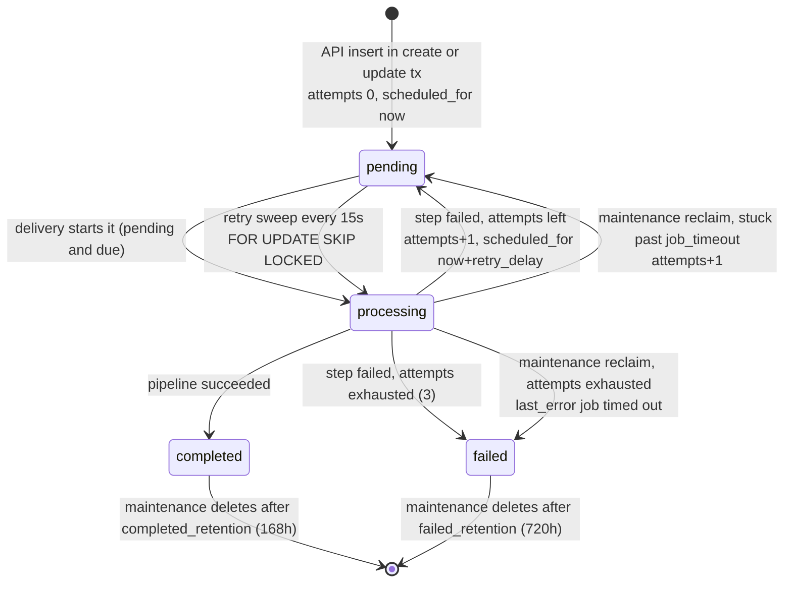

# Pattern Enrichment

> Back to [Design Documents](README.md) | [Project README](../../README.md)

## Table of Contents

- [Overview](#overview)
- [Enrichment Model](#enrichment-model)
- [Automatic Enrichment Flow](#automatic-enrichment-flow)
- [Enrichment Pipeline](#enrichment-pipeline)
- [Enrichment Worker Deployment](#enrichment-worker-deployment)
- [External Service Dependencies](#external-service-dependencies)
- [Configuration Requirements](#configuration-requirements)
- [Cost and Latency](#cost-and-latency)
- [Deployment Requirements](#deployment-requirements)
- [Internal Dependencies](#internal-dependencies)
- [References](#references)

## Overview

> **Architecture Reference:** [System Architecture - Mnemonic Enricher](../architecture/system/02-system-architecture.md#mnemonic-enricher) | [ADR-004: Pattern Storage and Enrichment Pipeline](../architecture/system/00-architectural-decisions.md#adr-004)

Pattern enrichment transforms raw pattern content into searchable, interconnected knowledge. When a pattern is created or updated, Mnemonic automatically enriches it to enable:

1. **Semantic search** - Find pattern sections by meaning, not just keywords, via the MCP `search_patterns` tool and the REST `GET /v1/api/patterns/search` endpoint
2. **Relationship discovery** - Connect related patterns through shared concepts in the knowledge graph

Enrichment data feeds all three MCP tools: `search_patterns` (chunk embeddings plus graph expansion), `find_related_patterns` (graph traversal), and `get_pattern` (full pattern with graph context).

The work is split across two services:

- **`mnemonic-api`** validates the pattern, splits it into chunks, and writes the pattern, its chunks and one enrichment job per chunk in a single Postgres transaction. After commit it publishes each job ID to RabbitMQ.
- **`mnemonic-enricher`** consumes the job IDs, embeds each chunk, and, when the last chunk of a pattern is embedded, extracts concepts from the whole pattern and syncs the Neo4j graph.

This design is inspired by Cognee's cognify pipeline (chunk, classify, extract, integrate, summarize) but adapted for Mnemonic's simpler use case: patterns are already curated documents, not raw data requiring extensive preprocessing.

**Note:** Following the architectural pivot (see 2026-02-14-mnemonic-pivot-knowledge-sync.md (in source repository)), enriched patterns are consumed by the MCP server's search tools and the Admin API search endpoint, not by a routing engine.

## Enrichment Model

> **Architecture Reference:** [Communication Patterns - Response Structure](../architecture/system/03-communication-patterns.md#response-structure)

Patterns include enrichment status fields to track processing state:

```yaml
Pattern:
  type: object
  properties:
    # ... existing fields (id, name, description, content, tags, etc.)

    # Enrichment status fields
    enrichment_status:
      type: string
      enum: [pending, enriched, failed]
      description: Aggregate enrichment state across all chunks
    enrichment_error:
      type: string
      description: Error message if enrichment_status is "failed"
    enriched_at:
      type: string
      format: date-time
      description: Timestamp of last successful enrichment
```

Status is tracked at three levels:

| Level   | Column                             | Values                                         | Set by                                                                                                                                                               |
| ------- | ---------------------------------- | ---------------------------------------------- | -------------------------------------------------------------------------------------------------------------------------------------------------------------------- |
| Pattern | `patterns.enrichment_status`       | `pending`, `enriched`, `failed`                | API sets `pending` on create and on every update; enricher sets `enriched` once every chunk is enriched and the graph sync succeeded, or `failed` when a chunk fails |
| Chunk   | `pattern_chunks.enrichment_status` | `pending`, `enriched`, `failed`                | Enricher, per chunk job                                                                                                                                              |
| Job     | `enrichment_jobs.status`           | `pending`, `processing`, `completed`, `failed` | Enricher (see [Job Lifecycle](#job-lifecycle))                                                                                                                       |

The pattern is `enriched` only when ALL its `pattern_chunks` rows are `enriched`. It becomes `failed` (error `one or more chunks failed enrichment`, or the chunk's own error) as soon as any chunk fails, and can return to `enriched` if a retry of that chunk later succeeds. The `processing` state exists only on jobs. A job in `failed` state has exhausted its attempts; a failure with attempts left puts the job back to `pending`.

## Automatic Enrichment Flow

> **Architecture Reference:** [System Architecture - Data Flow](../architecture/system/02-system-architecture.md#data-flow)

Enrichment is triggered automatically when a pattern is created or updated. The API responds immediately while enrichment processes asynchronously in the background.



Key characteristics:

- **Automatic**: Users do not invoke enrichment separately; it triggers on create/update
- **Non-blocking**: `POST` returns 202 Accepted (and `PUT` returns 204 No Content) immediately; enrichment happens asynchronously
- **Status tracking**: The pattern's `enrichment_status` field reflects current state; `GET /v1/api/patterns/{id}/chunks` shows per-chunk status
- **Idempotent**: Re-enrichment on update replaces previous chunks and embeddings; the Neo4j sync replaces the pattern's concepts and RELATED_TO edges
- **Durable**: the job rows are committed before anything is published, so a lost or failed publish only delays enrichment (see [Job Dispatch Design](#job-dispatch-design))

**Why 202 Accepted instead of 201 Created?** The pattern resource is accepted for processing but not immediately usable. Chunks that are not yet enriched are excluded from search results. HTTP 202 accurately signals that the request was accepted but processing is not yet complete.

### Create, Update and Delete in the API

All three are in `mnemonic-api/src/internal/service/pattern/service.go`.

| Operation                        | Postgres (one transaction)                                                                                                                                                         | After commit                                                                                           |
| -------------------------------- | ---------------------------------------------------------------------------------------------------------------------------------------------------------------------------------- | ------------------------------------------------------------------------------------------------------ |
| Create (`POST /patterns`)        | INSERT pattern (`pending`); INSERT chunks (one statement); INSERT one `pending` job per chunk (one statement). Duplicate name → 409                                                | Publish each job ID (best-effort)                                                                      |
| Update (`PUT /patterns/{id}`)    | UPDATE pattern, resetting `enrichment_status = 'pending'`, `enrichment_error` and `enriched_at`; DELETE all its chunks (cascades their jobs); re-split, INSERT new chunks and jobs | Publish each new job ID (best-effort). Neo4j is not touched until re-enrichment completes              |
| Delete (`DELETE /patterns/{id}`) | DELETE pattern (cascades chunks and jobs)                                                                                                                                          | Best-effort Neo4j `DETACH DELETE` of the Pattern node and of concepts left with no `MENTIONED_IN` edge |

Every update re-chunks and re-enriches the whole pattern, even when only metadata (name, tags, description) changed; there is no content-change detection.

## Enrichment Pipeline

> **Architecture Reference:** [System Architecture - Mnemonic Enricher](../architecture/system/02-system-architecture.md#mnemonic-enricher) | [Concept](../concept.md)

### Write-time Enrichment



#### Step 1: Validate and Store Metadata

The REST handler validates the request (`name` kebab-case, 1–128 chars; `content` required, at most 100,000 bytes; `description` at most 500 chars; at most 20 `tags`; `entity_type` kebab-case, at most 100 chars; `language` and `domain` required and in the configured `vocabulary.languages` / `vocabulary.domains`). The service then stores in Postgres:

- `id` (UUID, generated)
- `name`, `description`, `content`
- `tags` (JSON array)
- `entity_type`, `language`, `domain`, `version`, `related_patterns`
- `enrichment_status` (initially "pending")
- `enrichment_error` (null initially)
- `enriched_at` (null initially)
- `created_at`, `updated_at`

#### Step 2: Generate Embeddings

**Chunking (in the API).** `splitIntoChunks` does not split at every heading. A chunk starts at a line that is exactly `[//]: pattern` (a markdown comment decorator); the next heading line (any level, `#`…`######`) becomes the chunk's `section_title`, and every following line up to the next decorator (or end of file) is the chunk body. Lines outside decorated sections are discarded, and sections with an empty body are dropped. If that leaves no chunks (no decorator, or only empty decorated sections), the whole trimmed content becomes one chunk, titled by its first heading (`firstHeading`) or `Content` if there is none. Chunks are numbered from 0 in document order (`chunk_index`).

```markdown
# go-error-handling

Intro text here is not indexed.

[//]: pattern
## Wrapping Errors

Use fmt.Errorf with %w ...

[//]: pattern
## Sentinel Errors

Declare package-level error values ...
```

The example yields two chunks, "Wrapping Errors" and "Sentinel Errors".

> **Note:** Content with no `[//]: pattern` decorator is indexed as a single whole-content chunk, so it gets one enrichment job and becomes searchable, but search cannot point at a specific section. The decorator must match exactly (a trailing space or a CRLF line ending breaks it); a file whose decorators all fail to match is indexed as one whole-content chunk.

**Embedding (in the enricher).** Each chunk job embeds one chunk and stores the vector and `enrichment_status = 'enriched'` on its `pattern_chunks` row in one statement:

```go
// Simplified from service/enrichment.processChunkJob
chunk := chunkRepo.Get(ctx, *job.ChunkID)                // chunk + pattern name and tags
embedding := embeddingSvc.Embed(ctx, embedText(chunk))   // see format below
chunkRepo.MarkEnriched(ctx, chunk.ID, embedding)
progress := chunkRepo.PatternProgress(ctx, chunk.PatternID)
```

##### Enriched Text Format for Embeddings

When generating embeddings during enrichment, each chunk is prefixed with metadata before being sent to the embedding model. This enrichment happens at embedding time only and does not modify the stored chunk content.

**Format:**

```text
{pattern.Name} | {tags joined by ", "} | {chunk.SectionTitle}

{chunk.Content}
```

When the pattern has no tags, the tags segment is left out: `{pattern.Name} | {chunk.SectionTitle}`.

**Example:**

```text
go-error-handling | go, patterns, error-handling | Recovery Strategies

When an operation fails, consider whether retry logic is appropriate...
```

This enriched format is sent to the embedding model to generate the vector. The query text submitted by users, by contrast, is embedded as-is without metadata enrichment. This asymmetry (rich document vectors, plain query vectors) is intentional and standard practice in information retrieval: document vectors benefit from contextual metadata, while user queries remain simple and natural.

**Operational Constraint — Format Changes Require Re-enrichment:**

If this enriched text format ever changes, ALL existing chunk embeddings in the database become semantically stale relative to new ones. A format change requires a complete re-enrichment pass over all pattern chunks to regenerate their vectors. This is a breaking change at the data level and should be approached as a major version upgrade for the enrichment pipeline.

Examples that would require re-enrichment:

- Adding new metadata fields to the prefix (e.g., domain, language)
- Changing the delimiter or separator format
- Removing existing fields from the prefix
- Modifying the order of prefix fields

Plan accordingly if enrichment format changes are needed.

**Progress check.** After storing the embedding the job checks the pattern's chunks in one query:

- any chunk `failed` → set the pattern `failed` ("one or more chunks failed enrichment") and complete this job;
- all chunks `enriched` → this is the last chunk: run steps 3–5 for the pattern;
- otherwise → complete this job and wait for the other chunks.

Two chunk jobs finishing at the same moment can both see "all enriched" and both run the graph sync; the sync is idempotent, so this only costs a second extraction call.

#### Step 3: Extract Entities

The enricher sends the whole pattern content to the chat completions API (see [Entity Extraction Prompt](#entity-extraction-prompt)) and expects JSON like:

```json
{
  "concepts": ["error handling", "retry logic", "exponential backoff"],
  "technologies": ["Go", "context package"],
  "practices": ["defensive programming", "graceful degradation"]
}
```

These categories map to Concept nodes with `type` = `"domain"`, `"technology"`, and `"practice"` respectively. Names are trimmed and lowercased; a non-JSON reply fails the step.

This LLM call adds 1-5 seconds of processing time per pattern, which is why enrichment runs asynchronously. It runs once per pattern (on its last chunk), not once per chunk.

#### Step 4: Create Relationships

`GraphRepository.SyncPattern` (`mnemonic-enricher/src/internal/repository/graph/repository.go`) runs all graph writes for the pattern in **one Neo4j write transaction**, so a failure part way leaves the graph unchanged:

```cypher
// 1. Create/update the pattern node
MERGE (p:Pattern {id: $patternId})
SET p.name = $patternName, p.description = $patternDescription, p.updatedAt = datetime()

// 2. Remove MENTIONED_IN edges for concepts no longer extracted
MATCH (c:Concept)-[r:MENTIONED_IN]->(p:Pattern {id: $patternId})
WHERE NOT c.name IN $conceptNames
DELETE r

// 3. Merge concepts and MENTIONED_IN edges (skipped when no concepts)
UNWIND $concepts AS concept
MERGE (c:Concept {name: concept.name})
ON CREATE SET c.type = concept.type, c.createdAt = datetime()
ON MATCH SET c.type = concept.type
WITH c
MATCH (p:Pattern {id: $patternId})
MERGE (c)-[:MENTIONED_IN]->(p)

// 4. Delete this pattern's RELATED_TO edges
MATCH (p:Pattern {id: $patternId})-[r:RELATED_TO]-()
DELETE r

// 5. Recompute RELATED_TO edges (see below)
```

Agent nodes and `RELEVANT_FOR` edges are not written: agents are not implemented in any service.

### RELATED_TO Edge Computation

RELATED_TO is a symmetric relationship. Edges are created in one direction only (from the pattern being enriched), and queries use direction-agnostic traversal (`MATCH (a)-[:RELATED_TO]-(b)`, no arrow). This is the standard Neo4j pattern for symmetric relationships.

As the last statement of the sync transaction, the enricher computes direct RELATED_TO edges between the pattern and every other pattern that shares at least one concept:

1. Find other patterns sharing concepts via `MENTIONED_IN` traversal
2. Compute a similarity score (0.0-1.0) based on concept overlap only:

   ```text
   similarity = sharedConcepts / max(totalConceptsA, totalConceptsB)
   ```

3. Create `RELATED_TO {similarity, updatedAt}` edges for pairs with `similarity >= enrichment.related_to_min_similarity` (default 0.3, see [configuration.md](configuration.md))

Because step 4 deletes every RELATED_TO edge touching the pattern (both directions) before recreating them, edges reflect the latest enrichment of either endpoint.

#### Step 5: Update Status

On success, the enricher sets the pattern `enriched` and marks the job completed:

```sql
UPDATE patterns
SET enrichment_status = 'enriched',
    enriched_at = NOW(),
    enrichment_error = NULL
WHERE id = $patternId;
```

On a chunk failure (embedding or storing it), the chunk and the pattern are both set `failed` with the error message, and the job is marked failed for retry (see [Job Lifecycle](#job-lifecycle)). A failure in extraction or graph sync marks only the job failed; the pattern stays `pending` with all chunks enriched until a retry succeeds.

### Query-time Processing

When patterns are retrieved via MCP `search_patterns` tool or Admin API `GET /v1/api/patterns/search`:



Both paths query `pattern_chunks.embedding` and return chunk matches. Each result includes `section_title`, `chunk_index` (REST), and parent pattern metadata (`pattern_name`, `entity_type`, `language`, `domain`, `tags`). Only chunks with `enrichment_status = 'enriched'` appear in results.

Defaults differ: the REST endpoint uses threshold 0.7 (limit 1–50, default 10); the MCP tool uses `mcp.default_search_threshold` (0.5). The MCP tool additionally expands the results through the graph and lists the extra patterns in a separate section; see [MCP Server - search_patterns](mcp-server.md#search_patterns).

#### Relevance Scoring

**Current**: chunk results are ranked by pgvector cosine similarity only. Graph-expanded patterns in the MCP response are listed separately, ranked by their RELATED_TO similarity; the two scores are not combined.

**Planned (not implemented)**: blended scoring combining vector similarity with graph context:

```text
relevance = (0.7 × vector_similarity) + (0.3 × graph_score)
```

Where `graph_score` would consider hop distance from matched patterns and shared concept count. The algorithm for computing `graph_score` will be designed when this enhancement is prioritized.

## Enrichment Worker Deployment

> **Architecture Reference:** [Deployment Architecture - Component Deployment](../architecture/system/06-deployment-architecture.md#component-deployment) | [Deployment Architecture - Post-MVP](../architecture/system/06-deployment-architecture.md#post-mvp)

### Standalone Enrichment Service

The enricher runs as an independent service (`mnemonic-enricher`) consuming messages from RabbitMQ. It is decoupled from the Admin API and MCP server; the only shared state is the databases.



The enricher connects to RabbitMQ, Postgres, Neo4j, and the OpenAI API, and serves `/health` and `/version` on `server.port` (8080) and metrics on `:9090/metrics`. Inside, the `enricher.Worker` (`src/internal/enricher/enrichment.go`) runs three activities until shutdown:

| Activity          | Trigger                                        | What it does                                                                      |
| ----------------- | ---------------------------------------------- | --------------------------------------------------------------------------------- |
| Delivery handling | each RabbitMQ message (`{"job_id": "<uuid>"}`) | Start the job, run the pipeline, ack/nack                                         |
| Retry sweep       | every 15 s                                     | Claim due jobs from Postgres (up to the number of free worker slots) and run them |
| Maintenance       | every 5 min                                    | Reclaim stale `processing` jobs, delete old completed and failed jobs             |

Delivery and sweep jobs share one semaphore of `enrichment.worker_count` slots (default 2). The subscriber sets RabbitMQ prefetch to `queue.rabbitmq.prefetch_count` (default 5) and uses manual acknowledgement; it reconnects after `queue.rabbitmq.reconnect_delay` (5 s) when the channel drops.

**Message handling:**

| Situation                                                                     | Job row                                             | Message                                                          |
| ----------------------------------------------------------------------------- | --------------------------------------------------- | ---------------------------------------------------------------- |
| Body is not valid JSON                                                        | unchanged                                           | Nack, no requeue                                                 |
| Job missing, already started, or waiting out a retry delay (`ErrUnavailable`) | unchanged                                           | Ack (the sweep owns it)                                          |
| Starting the job fails (database error)                                       | unchanged (`pending`)                               | Nack, no requeue; the sweep picks it up after the 2-minute grace |
| Pipeline succeeded                                                            | `completed`                                         | Ack                                                              |
| Pipeline step failed and the failure was recorded                             | `pending` with a later `scheduled_for`, or `failed` | Ack                                                              |
| Failure could not be recorded (unrecoverable)                                 | left `processing`                                   | Nack, no requeue; maintenance reclaims it after `job_timeout`    |

Each delivery gets a consumer span that continues the producer's trace from the W3C `traceparent` in the AMQP headers, so one trace spans API → RabbitMQ → enricher. Sweep jobs get a `retry enrichment job` span. Every handled job is recorded in `mnemonic.enrichment.jobs` and `mnemonic.enrichment.job_duration`.

**Shutdown:** on SIGINT/SIGTERM the subscriber stops delivering, in-flight jobs get up to `enrichment.drain_timeout` (30 s) to finish, then their contexts are cancelled. Jobs cut off this way stay `processing` and are reclaimed by maintenance later.

### Job Dispatch Design

**Primary dispatch:** a RabbitMQ message published by the API after the create/update transaction commits: JSON `{"job_id": "<uuid>"}`, persistent delivery mode, default exchange, routing key = queue name (`queue.rabbitmq.queue`, default `enrichment-jobs`), with the trace context injected into the headers. On a publish error the publisher waits `reconnect_delay`, reconnects once and retries; a final failure is logged at Warn and counted in `mnemonic.queue.publish_failures_total`. The HTTP request still succeeds.

**Recovery mechanism:** the `enrichment_jobs` table is the source of truth (per ADR-009), so a lost message never loses work. The enricher's **retry sweep** runs every 15 seconds and claims jobs with `FOR UPDATE SKIP LOCKED`:

```sql
-- enricher repository/enrichmentjob.ClaimDue
UPDATE enrichment_jobs SET
    status = 'processing', started_at = now(), updated_at = now()
WHERE id IN (
    SELECT id FROM enrichment_jobs
    WHERE status = 'pending'
      AND (
        (attempts > 0 AND scheduled_for <= now())        -- waiting for a retry
        OR scheduled_for <= now() - interval '120 seconds' -- never delivered (2-min grace)
      )
    ORDER BY scheduled_for
    LIMIT $free_worker_slots
    FOR UPDATE SKIP LOCKED
)
RETURNING id, pattern_id, chunk_id;
```

The 2-minute grace keeps the sweep from racing a message that is merely in flight. A delivered message starts its job with a conditional update instead (`WHERE id = $1 AND status = 'pending' AND scheduled_for <= now()`), so a redelivered message, a job the sweep already took, and a job waiting out its retry delay are all no-ops.

Job columns used by the pipeline: `id`, `chunk_id` (set for chunk jobs, which the API creates), `pattern_id` (set only for legacy pattern-level jobs, which the enricher still processes with steps 3–5 only), `status`, `attempts`, `max_attempts` (3, set by the API at insert), `last_error`, `scheduled_for`, `started_at`, `completed_at`, `created_at`, `updated_at`. See [Data Storage - Migration 000003](data-storage.md#migration-000003-enrichment-jobs-table) (and 000005, which adds `chunk_id`) for the table definition.

### Job Lifecycle



Notes:

- `MarkFailed` increments `attempts` and, in the same `UPDATE`, sets `status` back to `pending` with `scheduled_for = now() + enrichment.retry_delay` (30 s) while `attempts + 1 < max_attempts`, otherwise to `failed`. With `max_attempts = 3` a job runs at most 3 times.
- A reclaimed job keeps its old `scheduled_for` and has `attempts > 0`, so the next sweep picks it up immediately.
- Deleting a chunk (pattern update or delete) cascades its job away in any state.
- A `failed` job is terminal: its chunk stays `failed` and the pattern stays `failed` until the pattern is updated with `PUT`, which re-chunks and creates fresh jobs.

### Scaling

Multiple `mnemonic-enricher` instances can run concurrently:

- RabbitMQ distributes messages across connected consumers automatically
- Each instance processes jobs independently, up to `worker_count` at a time
- The conditional start and `FOR UPDATE SKIP LOCKED` in the sweep prevent two instances from running the same job

| Instances   | Behavior                                                |
| ----------- | ------------------------------------------------------- |
| 1 instance  | Up to `worker_count` jobs at a time                     |
| 2 instances | Messages distributed across both; ~2x throughput        |
| N instances | Messages distributed across N instances; ~Nx throughput |

**Throughput limits:**

- OpenAI API rate limits (shared across all instances)
- Postgres connection pool exhaustion
- Neo4j write capacity

## External Service Dependencies

> **Architecture Reference:** [Requirements - Scope Boundaries](../requirements.md#scope-boundaries) | [System Architecture - Boundary Definitions](../architecture/system/02-system-architecture.md#boundary-definitions)

Pattern enrichment requires external API calls for embedding generation and entity extraction. All three services read `openai.base_url` (default `https://api.openai.com/v1`); the clients append `/embeddings` or `/chat/completions`. Pointing it elsewhere is how the integration tests use an OpenAI stub.

### OpenAI API (Embeddings)

Embedding generation (enricher for chunks; API and MCP for search queries):

| Requirement        | Details                                                                                 |
| ------------------ | --------------------------------------------------------------------------------------- |
| **Service**        | OpenAI API                                                                              |
| **Endpoint**       | `{openai.base_url}/embeddings` (default `https://api.openai.com/v1/embeddings`)         |
| **Model**          | `text-embedding-3-large` (`openai.embedding_model`)                                     |
| **Dimensions**     | 2000 (`openai.embedding_dimensions`, must match the PGVector column)                    |
| **Authentication** | API key required (`MNEMONIC_OPENAI_API_KEY`)                                            |
| **Client**         | 30 s HTTP timeout; `openai.retry_attempts` (3) retries `openai.retry_delay` (1 s) apart |
| **Cost**           | ~$0.0001 per pattern (~$0.00002 per 1K tokens)                                          |
| **Rate limits**    | 3,000 RPM / 1,000,000 TPM (tier 1), higher for paid tiers                               |

**Why OpenAI?**

- Industry-standard embedding quality
- Simple API integration
- Predictable costs at scale
- No infrastructure to maintain

Additional embedding providers (Azure OpenAI, self-hosted models) can be added post-MVP if needed.

### OpenAI API (Entity Extraction)

Entity extraction (enricher only):

| Requirement        | Details                                               |
| ------------------ | ----------------------------------------------------- |
| **Service**        | OpenAI API                                            |
| **Endpoint**       | `{openai.base_url}/chat/completions`                  |
| **Model**          | `gpt-4o-mini` (`openai.extraction_model`)             |
| **Authentication** | API key required (same key used for embeddings)       |
| **Client**         | 60 s HTTP timeout; same retry settings as embeddings  |
| **Cost**           | ~$0.01-0.05 per pattern                               |
| **Rate limits**    | 500 RPM / 200,000 TPM (tier 1), higher for paid tiers |

Additional LLM providers (Anthropic, Azure OpenAI) can be added post-MVP if needed.

## Configuration Requirements

> **Architecture Reference:** [Deployment Architecture - Operational Considerations](../architecture/system/06-deployment-architecture.md#operational-considerations)

### Required Environment Variables

```bash
# Required for embedding generation and entity extraction
MNEMONIC_OPENAI_API_KEY=sk-...
```

### Application Configuration

Configuration follows the patterns established in [configuration.md](configuration.md). Enricher settings relevant to enrichment, with their defaults (`mnemonic-enricher/src/internal/config/defaults.go`):

```yaml
openai:
  # API key should be set via MNEMONIC_OPENAI_API_KEY
  api_key: ""
  base_url: https://api.openai.com/v1
  embedding_model: text-embedding-3-large
  embedding_dimensions: 2000 # Must match PGVector column size
  extraction_model: gpt-4o-mini
  retry_attempts: 3
  retry_delay: 1s

enrichment:
  worker_count: 2                  # concurrent jobs per instance
  retry_delay: 30s                 # delay before a failed job is retried
  job_timeout: 5m                  # processing longer than this is reclaimed
  drain_timeout: 30s               # shutdown grace for in-flight jobs
  completed_retention: 168h        # delete completed jobs after 7 days
  failed_retention: 720h           # delete failed jobs after 30 days
  related_to_min_similarity: 0.3   # minimum RELATED_TO similarity

queue:
  provider: rabbitmq
  rabbitmq:
    host: localhost
    port: 5672
    user: guest
    # password via MNEMONIC_QUEUE_RABBITMQ_PASSWORD
    vhost: /
    queue: enrichment-jobs
    prefetch_count: 5
    reconnect_delay: 5s

database:
  neo4j:
    uri: bolt://localhost:7687
    username: neo4j
    # password via MNEMONIC_DATABASE_NEO4J_PASSWORD
    database: neo4j
```

`max_attempts` is not configurable: the API inserts every job with `max_attempts = 3`. The retry sweep (15 s), the never-delivered grace (2 min) and the maintenance interval (5 min) are constants in the enricher. The API uses the same `queue.rabbitmq.*` keys except `prefetch_count`.

Changing the embedding model requires re-embedding all existing patterns - the dimensions must match across all stored vectors. Additional embedding providers can be supported post-MVP if needed.

## Cost and Latency

### Per-Pattern Processing

| Operation             | Time                    | Cost            |
| --------------------- | ----------------------- | --------------- |
| Embedding generation  | 100-200ms per chunk     | ~$0.0001        |
| Entity extraction     | 1-5s (once per pattern) | ~$0.01-0.05     |
| Neo4j writes          | 50-100ms                | N/A             |
| **Total per pattern** | **1-5s**                | **~$0.01-0.05** |

The 1-5 second processing time per pattern reinforces why enrichment runs asynchronously. Users should not wait for this during API calls.

### Projected Monthly Costs

| Patterns/month | Embedding Cost | LLM Cost | Total    |
| -------------- | -------------- | -------- | -------- |
| 100            | $0.01          | $1-5     | $1-5     |
| 1,000          | $0.10          | $10-50   | $10-50   |
| 10,000         | $1.00          | $100-500 | $100-500 |

Query embeddings also incur costs (~$0.0001 per query). For high-volume query scenarios, consider caching strategies.

### Rate Limit Considerations

OpenAI enforces rate limits that affect burst processing:

- **Tier 1 (default)**: 3,000 requests/minute, 1M tokens/minute
- **Tier 2+**: Higher limits available with usage history

The enricher bounds concurrency with `worker_count` and retries failed calls `retry_attempts` times, then retries the whole job after `enrichment.retry_delay`. There is no client-side rate limiter. For bulk pattern imports, consider:

- Lowering `worker_count` or pacing the imports
- Rate limit monitoring and alerting

## Deployment Requirements

> **Architecture Reference:** [Deployment Architecture - Infrastructure Requirements](../architecture/system/06-deployment-architecture.md#infrastructure-requirements) | [Deployment Architecture - Deployment Topology](../architecture/system/06-deployment-architecture.md#deployment-topology)
>
> **Observability Reference:** [Enrichment Worker Observability](observability-implementation.md#enrichment-worker-observability) — metrics, tracing spans, and structured logging for the enrichment pipeline

### Infrastructure Checklist

Before deploying pattern enrichment, verify:

- [ ] OpenAI API key provisioned and tested
- [ ] API key stored securely (secrets manager, not in code)
- [ ] Environment variables configured in deployment
- [ ] Rate limits appropriate for expected load
- [ ] Cost monitoring/alerting configured
- [ ] Network egress to `api.openai.com` (or `openai.base_url`) allowed
- [ ] PGVector dimensions match configured embedding dimensions (2000)
- [ ] Enrichment job table created in Postgres
- [ ] RabbitMQ instance provisioned and accessible (the API declares the durable `enrichment-jobs` queue on startup; the enricher only consumes it, so its consume fails and retries until the queue exists)
- [ ] Neo4j instance provisioned and accessible
- [ ] Neo4j credentials configured

### Failure Modes

| Failure                                    | Impact                                                           | Mitigation                                                                            |
| ------------------------------------------ | ---------------------------------------------------------------- | ------------------------------------------------------------------------------------- |
| Invalid/missing API key                    | All enrichment jobs fail                                         | `/health` OpenAI model checks (Warning severity)                                      |
| Rate limit exceeded                        | Temporary failures, 429 responses                                | Client retries, then job retry after `retry_delay` (3 attempts)                       |
| OpenAI outage                              | Embedding/extraction unavailable                                 | Job retries; exhausted jobs need a pattern `PUT`                                      |
| RabbitMQ unavailable at publish            | Message not sent; job row stays `pending`                        | Retry sweep claims it after the 2-minute grace (ADR-009)                              |
| Neo4j unavailable                          | Graph sync fails; pattern stays `pending`                        | Job retry (the sync is one transaction, so no partial graph)                          |
| Dimension mismatch                         | Vectors unusable for similarity search                           | Validate config at startup                                                            |
| Network blocked                            | Cannot reach external APIs                                       | Verify egress rules                                                                   |
| Enricher crash                             | Unacked messages redelivered; started jobs stuck in `processing` | Redelivery is a no-op for started jobs; maintenance reclaims them after `job_timeout` |

### Health Check Endpoint

`GET /health` on the enricher (`src/internal/health/health.go`) checks PostgreSQL, Neo4j, and the OpenAI embedding and extraction models (the OpenAI checks have Warning severity). RabbitMQ is not part of the enricher's health check.

## Internal Dependencies

> **Architecture Reference:** [System Architecture - Mnemonic Enricher](../architecture/system/02-system-architecture.md#mnemonic-enricher)

### PGVector Configuration

Vector embeddings are stored in `pattern_chunks.embedding`, not `patterns.embedding`. The `patterns` table no longer has an `embedding` column.

```sql
-- mnemonic-dbs 000006_update_embedding_dimensions.up.sql (000005 created the
-- column as vector(1536) with the same HNSW index)
drop index if exists idx_pattern_chunks_embedding;

alter table pattern_chunks
    alter column embedding type vector(2000);

create index idx_pattern_chunks_embedding
    on pattern_chunks using hnsw (embedding vector_cosine_ops);
```

The index uses pgvector's default build parameters (`m = 16`, `ef_construction = 64`). The column dimension must match `openai.embedding_dimensions` (default 2000); changing it needs a new migration in `mnemonic-dbs`.

### Neo4j Schema

```cypher
// mnemonic-dbs src/neo4j/001_create_constraints.cypher
CREATE CONSTRAINT pattern_id_unique IF NOT EXISTS
FOR (p:Pattern) REQUIRE p.id IS UNIQUE;

CREATE CONSTRAINT concept_name_unique IF NOT EXISTS
FOR (c:Concept) REQUIRE c.name IS UNIQUE;

// mnemonic-dbs src/neo4j/003_create_indexes.cypher
CREATE INDEX pattern_name_index IF NOT EXISTS
FOR (p:Pattern) ON (p.name);

// Full-text indexes for search
CREATE FULLTEXT INDEX pattern_content_fulltext IF NOT EXISTS
FOR (p:Pattern) ON EACH [p.name, p.description];

CREATE FULLTEXT INDEX concept_name_fulltext IF NOT EXISTS
FOR (c:Concept) ON EACH [c.name];

// Property index for concept type filtering
CREATE INDEX concept_type_index IF NOT EXISTS
FOR (c:Concept) ON (c.type);
```

There is no `Agent` constraint or index: the planned agent feature has no graph schema yet. The Enterprise-only `002_create_existence_constraints.cypher` (not applied by the Community image) adds `pattern_name_exists` and `concept_name_exists`.

### Entity Extraction Prompt

The enricher (`src/internal/service/openai/extraction.go`) sends a system message and a user message:

```text
[system]
Extract key concepts from this pattern document.

Return JSON with:
- concepts: General programming concepts
- technologies: Languages, frameworks, tools
- practices: Best practices, patterns, methodologies

Return ONLY valid JSON with no additional text. Example format:
{"concepts": ["error handling"], "technologies": ["Go"], "practices": ["defensive programming"]}

[user]
Pattern content:
{content}
```

## References

- [Architecture Overview](../architecture/system/README.md)
- [System Architecture](../architecture/system/02-system-architecture.md) - Storage stack details
- [Service Layer](service-layer.md) - Service and repository interfaces behind this pipeline
- Mnemonic OpenAPI Spec (mnemonic-v1.yaml, in source repository) - Full API definition

---

Copyright (c) 2025-2026 Jeremy K. Johnson. All rights reserved.
