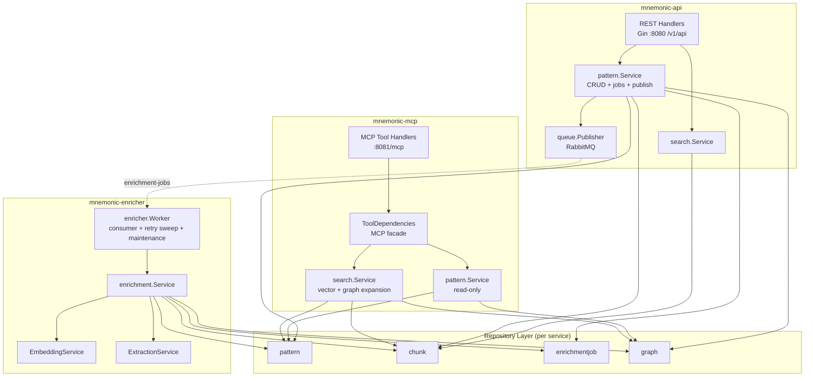
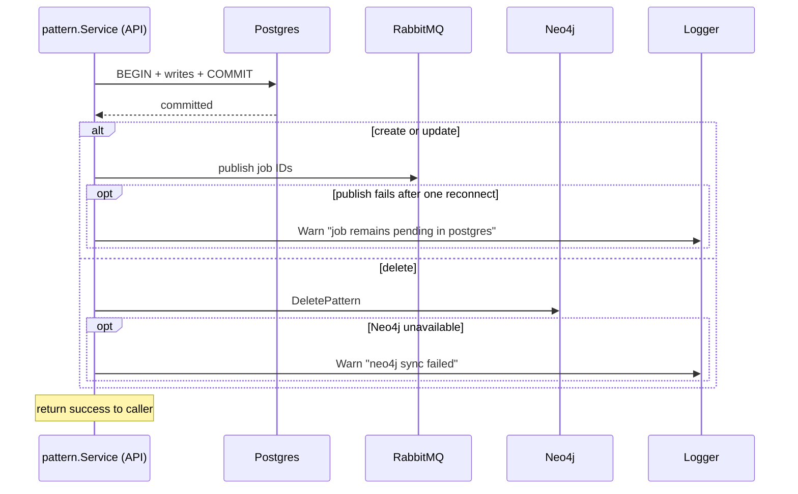
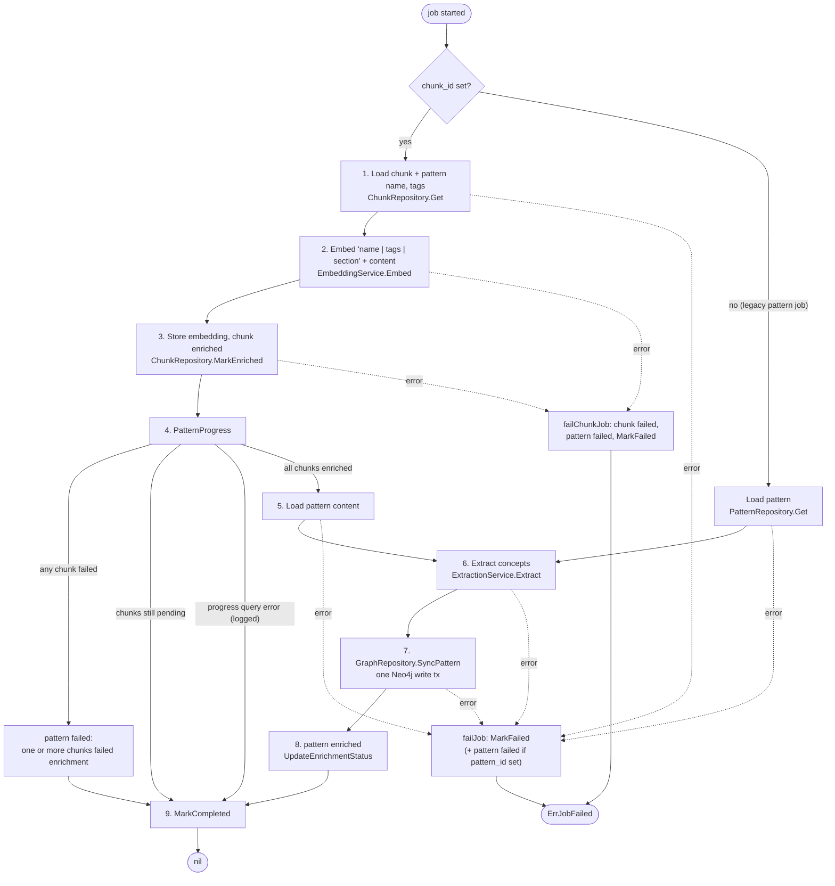

# Service Layer Design

> Back to [Design Documents](README.md) | [Project README](../../README.md)

## Table of Contents

- [Overview](#overview)
- [Package Layout](#package-layout)
- [External Service Interfaces](#external-service-interfaces)
  - [EmbeddingService](#embeddingservice)
  - [ExtractionService](#extractionservice)
- [Domain Service Interfaces](#domain-service-interfaces)
  - [PatternService](#patternservice)
  - [SearchService](#searchservice)
  - [MCP Read Services](#mcp-read-services)
  - [EnrichmentService](#enrichmentservice)
  - [Queue Interfaces](#queue-interfaces)
  - [Planned: Agent and Skill Services](#planned-agent-and-skill-services)
- [ToolDependencies: MCP Facade](#tooldependencies-mcp-facade)
  - [Interface Definition](#interface-definition)
  - [Concrete Implementation](#concrete-implementation)
  - [MCP Handler Wiring](#mcp-handler-wiring)
- [Resolving the find_related_patterns Data Gap](#resolving-the-find_related_patterns-data-gap)
  - [RelatedPattern Struct](#relatedpattern-struct)
  - [Cypher Query](#cypher-query)
  - [Service Layer Mapping](#service-layer-mapping)
- [Transaction Boundaries](#transaction-boundaries)
  - [Pattern Create](#pattern-create)
  - [Pattern Update](#pattern-update)
  - [Pattern Delete](#pattern-delete)
  - [Transaction Helper](#transaction-helper)
- [Cross-Database Coordination](#cross-database-coordination)
  - [Coordination Pattern](#coordination-pattern)
  - [Failure Scenarios](#failure-scenarios)
  - [Neo4j Sync Helper](#neo4j-sync-helper)
- [Error Mapping](#error-mapping)
  - [Service-Level Sentinel Errors](#service-level-sentinel-errors)
  - [REST Error Mapping](#rest-error-mapping)
  - [MCP Error Mapping](#mcp-error-mapping)
  - [Mapping Implementation](#mapping-implementation)
- [Enrichment Job Lifecycle](#enrichment-job-lifecycle)
  - [Pipeline Steps](#pipeline-steps)
  - [RELATED_TO Edge Computation](#related_to-edge-computation)
  - [Enrichment Service Interface Usage](#enrichment-service-interface-usage)
- [Cursor-Based Pagination](#cursor-based-pagination)
  - [Cursor Encoding](#cursor-encoding)
  - [Handler-Layer Responsibility](#handler-layer-responsibility)
  - [Service Layer Contract](#service-layer-contract)
- [Dependency Wiring](#dependency-wiring)
- [Related Changes in Other Design Docs](#related-changes-in-other-design-docs)
- [Key Takeaways](#key-takeaways)
- [References](#references)

## Overview

[Table of Contents](#table-of-contents)

> **Architecture Reference:** [System Architecture - Component Breakdown](../architecture/system/02-system-architecture.md#component-breakdown) | [Data Architecture - Data Flow Patterns](../architecture/system/04-data-architecture.md#data-flow-patterns)

The service layer pattern is shared across all three Mnemonic services (`mnemonic-mcp`, `mnemonic-api`, `mnemonic-enricher`), but each service contains only the services and repositories its job needs. There is no shared Go module; each repository carries its own copy of the packages it uses.

| Service             | Services                                                                                                             | Repositories                                                                                   |
| ------------------- | -------------------------------------------------------------------------------------------------------------------- | ---------------------------------------------------------------------------------------------- |
| `mnemonic-api`      | `pattern.Service` (CRUD, chunking, job creation, publish), `search.Service` (REST search), `openai.EmbeddingService` | pattern, chunk, enrichmentjob (insert only), graph (read + `DeletePattern`); `queue.Publisher` |
| `mnemonic-mcp`      | `search.Service` (vector search + graph expansion), `pattern.Service` (read-only), `openai.EmbeddingService`         | pattern, chunk, graph (all read-only)                                                          |
| `mnemonic-enricher` | `enrichment.Service` (job processing), `openai.EmbeddingService`, `openai.ExtractionService`                         | pattern, chunk, enrichmentjob, graph (`SyncPattern` only); `queue.Subscriber`                  |

The service layer sits between the transport handlers (REST, MCP, queue worker) and the data repositories. It is responsible for:

- **Business logic** -- chunking pattern content, enrichment status transitions, retry scheduling
- **Multi-store coordination** -- ordering writes across Postgres, RabbitMQ and Neo4j within a defined consistency model
- **Enrichment orchestration** -- creating enrichment jobs when patterns change (API), running the enrichment pipeline (enricher)
- **Query composition** -- combining data from multiple repositories to fulfill a single request (e.g., `get_pattern` reads from Postgres and Neo4j)
- **Error translation** -- mapping repository-level errors to service-level errors that handlers can translate to HTTP/MCP responses

The service layer does NOT:

- Parse HTTP requests or MCP tool inputs (that is the handler layer)
- Format HTTP responses or MCP markdown output (that is the handler layer)
- Manage database connections (pools and drivers are created in `internal/server` and injected)
- Run the enrichment worker goroutines (that is `internal/enricher.Worker`)



## Package Layout

[Table of Contents](#table-of-contents)

Service interfaces and implementations live under `src/internal/service/` in each repo. Each domain gets its own sub-package to keep repository type imports unambiguous. Sentinel errors live in `internal/service/errors.go`.

```text
mnemonic-api/src/internal/
    handlers/            # respond.go (errors, cursors), patterns/ (REST), operations/ (/health, /version)
    queue/               # Publisher interface; rabbitmq/ implementation
    repository/          # chunk, enrichmentjob, graph, pattern; DBTX, TxBeginner
    service/             # errors.go; pattern, search, openai (embedding)
    server/              # wiring, routes, HTTP servers

mnemonic-mcp/src/internal/
    mcpserver/           # MCP server, tools, handlers, ToolDependencies
    repository/          # chunk, graph, pattern (read-only)
    service/             # errors.go; pattern (read-only), search, openai (embedding)
    handlers/operations/ # /health, /version
    server/              # wiring, HTTP servers

mnemonic-enricher/src/internal/
    enricher/            # Worker: consumer, retry sweep, maintenance
    queue/               # Subscriber interface; rabbitmq/ implementation
    repository/          # chunk, enrichmentjob, graph (SyncPattern), pattern
    service/             # enrichment, openai (embedding + extraction)
    handlers/operations/ # /health, /version
    server/              # wiring, HTTP server
```

All three also have `config`, `database` (api: `database/graphdb`, `database/vectordb`), `health`, `metrics`, `middleware`, `telemetry` and `version`. The Go module paths are `github.com/twistingmercury/mnemonic-api`, `github.com/twistingmercury/mnemonic` (the MCP service) and `github.com/twistingmercury/mnemonic-enricher`.

The `internal/mcpserver/deps.go` file (in `mnemonic-mcp`) defines the `ToolDependencies` interface and its implementation (`toolDeps`), which composes the MCP services.

## External Service Interfaces

[Table of Contents](#table-of-contents)

> **Architecture Reference:** [Pattern Processing - External Service Dependencies](pattern-processing.md#external-service-dependencies) | [Configuration - OpenAI](configuration.md#configuration-file)

External AI service calls are abstracted behind interfaces so they can be mocked in tests and swapped for different providers post-MVP.

### EmbeddingService

Present in all three services (`internal/service/openai/embedding.go`).

```go
// Package: internal/service/openai

// ErrEmbeddingFailed is returned when embedding generation fails after all retries.
var ErrEmbeddingFailed = errors.New("embedding generation failed")

// EmbeddingService generates vector embeddings from text.
// MVP implementation calls OpenAI text-embedding-3-large.
type EmbeddingService interface {
    // Embed generates a vector embedding for the given text.
    // Returns a float32 slice of length matching the configured dimensions.
    // Returns ErrEmbeddingFailed if the API call fails after retries.
    Embed(ctx context.Context, text string) ([]float32, error)
}
```

`NewEmbeddingService(cfg config.OpenAIConfig)` posts to `{openai.base_url}/embeddings` with `openai.embedding_model` and `openai.embedding_dimensions` (default 2000), through an `otelhttp` transport with a 30-second timeout. It makes up to `openai.retry_attempts + 1` calls, `openai.retry_delay` apart, adding an `openai.embed.retry` span event per retry. (The MCP copy does not retry 4xx responses other than 429.)

### ExtractionService

Enricher only (`internal/service/openai/extraction.go`).

```go
// Concept represents an entity extracted from pattern content.
type Concept struct {
    Name string `json:"name"` // Normalized to lowercase.
    Type string `json:"type"` // "technology", "practice", or "domain".
}

// ExtractionService extracts structured concepts from text using an LLM.
// MVP implementation calls OpenAI gpt-4o-mini chat completions.
type ExtractionService interface {
    Extract(ctx context.Context, text string) ([]Concept, error)
}

var ErrExtractionFailed = errors.New("concept extraction failed")
```

The implementation posts to `{openai.base_url}/chat/completions` (60-second timeout, same retry settings) with the prompt from [Pattern Processing - Entity Extraction Prompt](pattern-processing.md#entity-extraction-prompt), parses the JSON reply (`concepts`, `technologies`, `practices`) and maps the three lists to `Type` `domain`, `technology` and `practice`, trimming and lowercasing names.

## Domain Service Interfaces

[Table of Contents](#table-of-contents)

Each domain service defines the operations that handlers call. Service methods accept and return domain types, not HTTP request/response types.

### PatternService

`mnemonic-api/src/internal/service/pattern/service.go`:

```go
// Service defines the operations for managing pattern lifecycle.
type Service interface {
    // Create stores a pattern with its chunks and one pending enrichment job
    // per chunk, atomically, then publishes the jobs (best-effort).
    // Returns service.ErrConflict if the pattern name already exists.
    Create(ctx context.Context, input CreateInput) (*patternRepo.Pattern, error)

    // Get retrieves a pattern by ID. Returns service.ErrNotFound if not found.
    Get(ctx context.Context, id uuid.UUID) (*patternRepo.Pattern, error)

    // GetWithGraph retrieves a pattern and, if enriched, its graph context
    // (related patterns and concepts). Neo4j failures degrade gracefully,
    // returning (pattern, nil, nil) instead of an error.
    GetWithGraph(ctx context.Context, id uuid.UUID) (*patternRepo.Pattern, *GraphContext, error)

    // Update rewrites the pattern, replaces all chunks and jobs in one
    // transaction, then publishes the new jobs.
    Update(ctx context.Context, id uuid.UUID, input UpdateInput) (*patternRepo.Pattern, error)

    // Delete removes a pattern from Postgres (CASCADE handles chunks and
    // jobs) and best-effort cleans up Neo4j.
    Delete(ctx context.Context, id uuid.UUID) error

    // List retrieves patterns with filtering and pagination.
    List(ctx context.Context, filter patternRepo.Filter, opts ListOptions) ([]*patternRepo.Pattern, int64, error)

    // FindRelated finds patterns related to the given pattern via the Neo4j
    // knowledge graph. Returns service.ErrNotFound if the pattern does not exist.
    FindRelated(ctx context.Context, patternID uuid.UUID, limit int) ([]RelatedPatternResult, error)

    // ListChunks retrieves chunk summaries (no content) for a pattern, ordered
    // by chunk_index. It does not check that the pattern exists.
    ListChunks(ctx context.Context, patternID uuid.UUID) ([]*chunkrepo.Chunk, error)
}

// CreateInput and UpdateInput have the same fields.
type CreateInput struct {
    Name            string
    Description     *string
    Content         string
    Tags            []string
    EntityType      string   // kebab-case, e.g. "best-practice"
    Language        string   // one of vocabulary.languages
    Domain          string   // one of vocabulary.domains
    Version         *string
    RelatedPatterns []string
}

type GraphContext struct {
    RelatedPatterns []RelatedPatternResult
    Concepts        []ConceptResult
}

type RelatedPatternResult struct {
    ID             uuid.UUID
    Name           string
    Relationship   string   // always "RELATED_TO"
    Similarity     float64  // concept-overlap score (0.0-1.0)
    SharedConcepts []string
}

type ConceptResult struct {
    Name string
    Type string
}

type ListOptions struct {
    Offset int
    Limit  int
}
```

`FindRelated` is part of the interface but no REST route calls it today; the MCP service has its own read-side copy (see [MCP Read Services](#mcp-read-services)).

**Handler composition (`GET /v1/api/patterns/{id}`):**

1. `GetWithGraph(ctx, id)` -- the pattern and, when enriched, graph context (up to 10 related patterns and all concepts, read in one Neo4j session via `GraphRepository.GetPatternGraph`)
2. `ListChunks(ctx, id)` -- chunk summaries (`chunk_index`, `section_title`, `enrichment_status`); on failure the handler returns the pattern without chunks and sets `X-Warning: chunks unavailable`

**REST serialization notes for `GraphContext`:** the handler maps `Similarity` to `strength`, omits `SharedConcepts`, and emits concepts with `name` only (`description` is always omitted; `Type` is not exposed).

**Pattern-to-PatternSummary projection:** `GET /v1/api/patterns` projects `List` results to `PatternSummary` (`id`, `name`, `description`, `tags`, `enrichment_status`, timestamps). The repository's `List` does not select `content`.

**Status codes:** `POST` returns 202 Accepted with the created pattern (`enrichment_status: pending`) and a `Location` header; `PUT` returns 204 No Content; `DELETE` returns 204. These are handler-layer choices.

### SearchService

`mnemonic-api/src/internal/service/search/service.go` (REST `GET /v1/api/patterns/search`):

```go
type Service interface {
    // SearchPatterns generates a query embedding and performs vector similarity search.
    SearchPatterns(ctx context.Context, opts SearchOptions) (*SearchResult, error)
}

type SearchOptions struct {
    Query     string   // Natural language query text
    Limit     int      // Max results (handler: default 10, 1-50)
    Threshold float64  // Min similarity (handler: default 0.7)
    Tags      []string // Conjunctive tag filter
    Language  string   // Optional language filter
    Domain    string   // Optional domain filter
}

type ChunkMatch struct {
    PatternID    uuid.UUID
    PatternName  string
    EntityType   string
    Language     string
    Domain       string
    Tags         []string
    SectionTitle string
    ChunkIndex   int
    Content      string
    Similarity   float64
}

type SearchResult struct {
    Matches          []*ChunkMatch
    Query            string // Echo of the original query text
    TotalCandidates  int    // Number of matches returned (after threshold filtering)
    SearchDurationMs int64  // Wall-clock search time in milliseconds
}
```

Steps: embed the query (`ErrServiceUnavailable` on failure), call `ChunkRepository.FindSimilar` (enriched chunks only, threshold, language/domain/tags filters, ordered by cosine distance), record `mnemonic.patterns.query_latency` / `returned`, map to `ChunkMatch`. There is no agent filter and no graph expansion on the REST path.

### MCP Read Services

`mnemonic-mcp` has concrete service structs (no interfaces; `ToolDependencies` is the seam for tests):

```go
// internal/service/search
func New(embeddingSvc openaisvc.EmbeddingService, patternRepo patternrepo.Repository,
    chunkRepo chunkrepo.Repository, graphRepo graphrepo.Repository,
    patternMetrics *metrics.Pattern, logger zerolog.Logger) *Service

func (s *Service) SearchPatterns(ctx context.Context, opts SearchOptions) (*SearchResult, error)

type SearchResult struct {
    Matches      []*ChunkMatch  // ChunkMatch = chunkrepo.Match
    GraphMatches []*GraphMatch  // graph-expanded results (nil if none or unavailable)
    Query        string
}

type GraphMatch struct {
    PatternID       uuid.UUID
    PatternName     string
    Similarity      float64  // from the RELATED_TO edge
    ConceptNames    []string
    SeedPatternName string
}

// internal/service/pattern
func New(patternRepo patternrepo.Repository, graphRepo graphrepo.Repository, logger zerolog.Logger) *Service

// GetPatternWithGraph: pattern + (if enriched) up to 10 related patterns and
// concepts, fetched concurrently; Neo4j failure degrades to (pattern, nil, nil).
func (s *Service) GetPatternWithGraph(ctx context.Context, id uuid.UUID) (*patternrepo.Pattern, *GraphContext, error)

// FindRelatedPatterns: source pattern name (SELECT name) and RELATED_TO
// traversal, run concurrently. Returns service.ErrNotFound for an unknown ID.
func (s *Service) FindRelatedPatterns(ctx context.Context, patternID uuid.UUID, limit int) (string, []RelatedPatternResult, error)
```

`search.Service.SearchPatterns` adds graph expansion after the vector search: the top 3 distinct patterns seed concurrent `FindRelatedPatterns` calls (5 per seed); results are de-duplicated, patterns already in the vector results are dropped, metadata is batch-loaded with `PatternRepository.GetByIDs`, the language (also accepting `agnostic`), domain and tag filters are reapplied, and at most 5 are returned, sorted by similarity. Any failure in expansion is logged at Warn and yields `GraphMatches = nil`. Details: [MCP Server - search_patterns](mcp-server.md#search_patterns).

### EnrichmentService

`mnemonic-enricher/src/internal/service/enrichment/service.go`. Only the enricher has an enrichment service; the API creates jobs directly through its `enrichmentjob` repository inside `pattern.Service`.

```go
// ErrJobFailed is returned by ProcessJob when a pipeline step failed and the
// failure was recorded on the job for retry. The worker acks the message.
var ErrJobFailed = errors.New("enrichment job failed; failure recorded")

type Service interface {
    // StartJob marks a pending, due job as processing and returns it.
    // Returns enrichmentjob.ErrUnavailable if the job is missing, already
    // started, or waiting out its retry delay.
    StartJob(ctx context.Context, jobID uuid.UUID) (*enrichmentjob.Job, error)

    // ClaimDueJobs marks up to limit jobs that are due for a retry, or that
    // no queue delivery started within 2 minutes, as processing and returns them.
    ClaimDueJobs(ctx context.Context, limit int) ([]*enrichmentjob.Job, error)

    // ProcessJob runs the pipeline for a started job. A chunk job embeds its
    // chunk; the last chunk of a pattern to finish also extracts the pattern's
    // concepts and syncs them to Neo4j. A legacy pattern job (pattern_id set,
    // chunk_id nil) does only the extraction and graph sync.
    //
    // Returns nil on success, an error wrapping ErrJobFailed when a step failed
    // and was recorded, and any other error when the failure could not be
    // recorded (unrecoverable).
    ProcessJob(ctx context.Context, job *enrichmentjob.Job) error

    // ReclaimStaleJobs resets jobs stuck in processing past job_timeout.
    ReclaimStaleJobs(ctx context.Context) (int64, error)

    // CleanupCompletedJobs removes completed jobs older than completed_retention.
    CleanupCompletedJobs(ctx context.Context) (int64, error)

    // CleanupFailedJobs removes failed jobs older than failed_retention.
    CleanupFailedJobs(ctx context.Context) (int64, error)
}
```

### Queue Interfaces

```go
// mnemonic-api/src/internal/queue
type Publisher interface {
    // Publish enqueues a job identified by jobID.
    Publish(ctx context.Context, jobID uuid.UUID) error
    Close() error
}

// mnemonic-enricher/src/internal/queue
type Delivery struct {
    Body    []byte
    Headers map[string]string // string headers, incl. W3C trace context
    Ack     func() error
    Nack    func(requeue bool) error
}

type Subscriber interface {
    Subscribe(ctx context.Context) (<-chan Delivery, error) // closed when ctx is cancelled
    Name() string                                           // queue name, for logs/metrics
    Close() error
}
```

Both have RabbitMQ implementations under `queue/rabbitmq`. The publisher sends `{"job_id": "<uuid>"}` as a persistent JSON message to the default exchange with the queue name as routing key, injects the trace context into the headers, and on failure reconnects once after `reconnect_delay` and retries; final failures increment `mnemonic.queue.publish_failures_total`. The subscriber consumes with manual ack, applies `prefetch_count`, and reconnects on its own.

### Planned: Agent and Skill Services

> **Status: planned, not implemented.** No service has agent, skill or skill-file code, tables are not read or written by any service, and there are no REST routes for them.

Earlier versions of this document specified `AgentService` (agent CRUD with CRC64 change detection and best-effort Neo4j `Agent` node sync), `SkillService` and `SkillFileService` (Postgres-only skill definitions and child files, addressed by name), pattern-agent associations (`PUT /v1/api/patterns/{id}/agents`, `RELEVANT_FOR` edges), and an `agent` filter on `search_patterns`. If these are built, they should follow the same conventions as `pattern.Service`: sentinel-error translation, one Postgres transaction per write, best-effort Neo4j sync after commit.

## ToolDependencies: MCP Facade

[Table of Contents](#table-of-contents)

> **Architecture Reference:** [MCP Server Design - Tool Handler Signatures](mcp-server.md#tool-handler-signatures)

The MCP server's `ToolDependencies` interface provides a narrow facade over the MCP read services. MCP handlers call these methods; the facade delegates to the appropriate service. Handlers never import repository packages except for the `Pattern` type.

### Interface Definition

```go
// Package: internal/mcpserver (module github.com/twistingmercury/mnemonic)

// ToolDependencies defines what the MCP tool handlers require, so they can be
// tested without databases. Each method maps 1:1 to an MCP tool.
type ToolDependencies interface {
    SearchPatterns(ctx context.Context, opts searchsvc.SearchOptions) (*searchsvc.SearchResult, error)
    FindRelatedPatterns(ctx context.Context, patternID uuid.UUID, limit int) (string, []patternsvc.RelatedPatternResult, error)
    GetPatternWithGraph(ctx context.Context, id uuid.UUID) (*patternrepo.Pattern, *patternsvc.GraphContext, error)
}
```

`FindRelatedPatterns` also returns the source pattern's name, which the response header shows.

### Concrete Implementation

```go
type toolDeps struct {
    search  *searchsvc.Service
    pattern *patternsvc.Service
}

func NewToolDependencies(search *searchsvc.Service, pattern *patternsvc.Service) ToolDependencies {
    return toolDeps{search: search, pattern: pattern}
}

func (t toolDeps) SearchPatterns(ctx context.Context, opts searchsvc.SearchOptions) (*searchsvc.SearchResult, error) {
    return t.search.SearchPatterns(ctx, opts)
}

func (t toolDeps) FindRelatedPatterns(ctx context.Context, patternID uuid.UUID, limit int) (string, []patternsvc.RelatedPatternResult, error) {
    return t.pattern.FindRelatedPatterns(ctx, patternID, limit)
}

func (t toolDeps) GetPatternWithGraph(ctx context.Context, id uuid.UUID) (*patternrepo.Pattern, *patternsvc.GraphContext, error) {
    return t.pattern.GetPatternWithGraph(ctx, id)
}
```

### MCP Handler Wiring

`NewMCPServer` in `internal/mcpserver/server.go` receives a `ToolDependencies` value and registers each handler closure:

```go
server.AddReceivingMiddleware(toolTelemetry(toolMetrics))
mcp.AddTool(server, searchPatternsTool, handleSearchPatterns(deps, logger, mcpCfg.DefaultSearchThreshold))
mcp.AddTool(server, findRelatedPatternsTool, handleFindRelatedPatterns(deps, logger))
mcp.AddTool(server, getPatternTool, handleGetPattern(deps, logger))
```

Handlers call `deps.SearchPatterns(...)`, `deps.FindRelatedPatterns(...)` or `deps.GetPatternWithGraph(...)` and format the results as markdown text content.

## Resolving the find_related_patterns Data Gap

[Table of Contents](#table-of-contents)

> **Architecture Reference:** [Data Storage - GraphRepository](data-storage.md#graphrepository) | [MCP Server - find_related_patterns](mcp-server.md#find_related_patterns)

**Status: resolved.** The original `GraphRepository.FindRelatedPatterns` returned only a shared-concept count, but the MCP `find_related_patterns` response needs a `similarity` score and the shared concept names. The decision was to read pre-computed similarity from `RELATED_TO` edges and collect concept names in the same query; this is what the API and MCP graph repositories do.

### RelatedPattern Struct

```go
// Package: internal/repository/graph (mnemonic-api and mnemonic-mcp)
type RelatedPattern struct {
    ID             uuid.UUID
    Name           string
    SharedConcepts int      // Count of shared concepts
    Similarity     float64  // Pre-computed RELATED_TO similarity (0.0-1.0)
    ConceptNames   []string // Names of the shared concepts
}
```

### Cypher Query

```cypher
// Use pre-computed RELATED_TO edges (either direction) with similarity scores
MATCH (p1:Pattern {id: $patternId})-[r:RELATED_TO]-(p2:Pattern)
WITH p1, p2, r.similarity AS similarity

// Also collect shared concept names
OPTIONAL MATCH (p1)<-[:MENTIONED_IN]-(c:Concept)-[:MENTIONED_IN]->(p2)
WITH p2, similarity, collect(c.name) AS conceptNames, count(c) AS sharedConcepts

ORDER BY similarity DESC
LIMIT $limit
RETURN p2.id AS id, p2.name AS name, sharedConcepts, similarity, conceptNames
```

Using stored similarity avoids recomputing it at query time and is consistent with [Pattern Processing - RELATED_TO Edge Computation](pattern-processing.md#related_to-edge-computation), where the enricher writes the edges.

### Service Layer Mapping

Both services map `RelatedPattern` to `RelatedPatternResult` with `Relationship: "RELATED_TO"` and `SharedConcepts: r.ConceptNames`. The MCP version checks existence by reading the pattern name concurrently with the graph query:

```go
func (s *Service) FindRelatedPatterns(ctx context.Context, patternID uuid.UUID, limit int) (string, []RelatedPatternResult, error) {
    var (
        name    string
        related []graphrepo.RelatedPattern
    )

    g, gCtx := errgroup.WithContext(ctx)
    g.Go(func() error {
        var err error
        name, err = s.patternRepo.GetName(gCtx, patternID)
        if errors.Is(err, patternrepo.ErrNotFound) {
            return fmt.Errorf("%w: pattern %s", service.ErrNotFound, patternID)
        }
        return err
    })
    g.Go(func() error {
        var err error
        related, err = s.graphRepo.FindRelatedPatterns(gCtx, patternID, limit)
        return err
    })
    if err := g.Wait(); err != nil {
        return "", nil, fmt.Errorf("find related: %w", err)
    }

    return name, toRelatedResults(related), nil
}
```

The API's `FindRelated` instead calls `PatternRepository.Exists` first and then the graph query.

## Transaction Boundaries

[Table of Contents](#table-of-contents)

> **Architecture Reference:** [Data Architecture - Transaction Handling](../architecture/system/04-data-architecture.md#transaction-handling) | [Data Architecture - Cross-Database Consistency](../architecture/system/04-data-architecture.md#cross-database-consistency)

This section specifies which API operations are atomic and how they compose. All are in `mnemonic-api/src/internal/service/pattern/service.go`.

### Pattern Create

A single Postgres transaction creates the pattern, its chunks and their jobs:

```text
BEGIN
  1. INSERT INTO patterns (..., enrichment_status='pending')
     -- unique violation on name -> service.ErrConflict (409)
  2. Split content into chunks ([//]: pattern decorators)
     INSERT INTO pattern_chunks ...            -- one statement for all chunks
  3. INSERT INTO enrichment_jobs (id, chunk_id, status='pending', attempts=0,
     max_attempts=3, scheduled_for=now()) SELECT FROM unnest(...)
                                               -- one statement for all jobs
COMMIT

After commit (best-effort, not in transaction):
  4. Publish each job ID to RabbitMQ
```

Jobs are published only after commit: a message sent inside the transaction could outlive a rollback and point the enricher at a job row that does not exist. If publishing fails the rows stay `pending` and the enricher's retry sweep picks them up after a 2-minute grace. Content without decorators produces no chunks and no jobs (see [Pattern Processing - Step 2](pattern-processing.md#step-2-generate-embeddings)).

### Pattern Update

Every update takes the same path; there is no "metadata-only" shortcut and no content comparison:

```text
(outside tx) SELECT pattern            -- missing -> service.ErrNotFound (404)
BEGIN
  1. UPDATE patterns SET all fields,
     enrichment_status='pending', enrichment_error=NULL, enriched_at=NULL,
     updated_at=now()                  -- unique violation -> ErrConflict (409)
  2. DELETE FROM pattern_chunks WHERE pattern_id = $id
     (ON DELETE CASCADE removes their enrichment_jobs, in any state)
  3. Re-split content, INSERT new chunks and one pending job per chunk
COMMIT

After commit (best-effort):
  4. Publish each new job ID to RabbitMQ
```

Neo4j is not touched on update. The old Pattern node, concepts and `RELATED_TO` edges remain until the new chunks are all enriched and the enricher re-syncs the graph (which replaces them). Doing all three steps in one transaction matters: deleting the chunks cascades their jobs away, so a partial update would strand the pattern with no route back to being enriched.

### Pattern Delete

```text
Single statement (no explicit transaction)
  1. DELETE FROM patterns WHERE id = $id   -- 0 rows -> ErrNotFound (404)
     (CASCADE removes pattern_chunks and enrichment_jobs)

After commit (best-effort):
  2. Neo4j, one query:
     MATCH (p:Pattern {id: $id})
     OPTIONAL MATCH (c:Concept)-[:MENTIONED_IN]->(p)
     WITH p, collect(c) AS concepts
     DETACH DELETE p
     WITH concepts UNWIND concepts AS c
     WITH c WHERE NOT (c)-[:MENTIONED_IN]->()
     DELETE c
```

`DETACH DELETE` also removes the pattern's `RELATED_TO` edges. Only concepts orphaned by this delete are removed.

### Transaction Helper

There is no generic helper; each write opens its transaction inline and enlists the repositories with `WithTx`:

```go
tx, err := s.pool.Begin(ctx)          // s.pool is repository.TxBeginner (*pgxpool.Pool)
if err != nil {
    return nil, fmt.Errorf("failed to start transaction: %w", err)
}
defer func() { _ = tx.Rollback(ctx) }() // no-op after commit

if err := s.patternRepo.WithTx(tx).Create(ctx, &pattern); err != nil { ... }
jobIDs, err := s.insertChunksAndJobs(ctx, tx, pattern.ID, input.Content) // chunk + job repos WithTx(tx)

if err := tx.Commit(ctx); err != nil { ... }
for _, id := range jobIDs {
    s.publishJob(ctx, id, pattern.ID)   // best-effort, logs a Warn on failure
}
```

Repository constructors accept the `DBTX` interface (`Exec`, `Query`, `QueryRow`), which both `*pgxpool.Pool` and `pgx.Tx` satisfy, and `WithTx(db DBTX)` returns a copy bound to the transaction.

The enricher does not use multi-statement transactions; each repository call is one atomic statement (for example `MarkFailed` and `ClaimDue` are single `UPDATE`s), and the Neo4j sync is one write transaction.

## Cross-Database Coordination

[Table of Contents](#table-of-contents)

> **Architecture Reference:** [Data Architecture - Cross-Database Consistency](../architecture/system/04-data-architecture.md#cross-database-consistency)

Mnemonic uses Postgres, Neo4j and RabbitMQ. They cannot share a transaction. The coordination pattern is:

### Coordination Pattern

1. **Postgres is source of truth.** Commit Postgres first; the `enrichment_jobs` rows are the durable record of pending work.
2. **RabbitMQ publish and Neo4j sync are best-effort on the synchronous API path.** After the Postgres commit, the API publishes job IDs and (on delete) cleans up Neo4j. Failures are logged at Warn and do not roll back the commit.
3. **Neo4j failures are never fatal to synchronous reads.** The REST `GET /patterns/{id}` and MCP `get_pattern` return the pattern without graph context; MCP `search_patterns` returns vector-only results. MCP `find_related_patterns` is the exception: its whole result comes from Neo4j, so a Neo4j failure is reported as "service unavailable".

> **Note:** This best-effort principle applies only to the synchronous API path. The enrichment pipeline has different semantics -- see [Enrichment Job Lifecycle](#enrichment-job-lifecycle) where Neo4j failures fail the job and schedule a retry.



### Failure Scenarios

| Scenario                              | Postgres    | RabbitMQ / Neo4j   | Outcome                                                                 |
| ------------------------------------- | ----------- | ------------------ | ----------------------------------------------------------------------- |
| All succeed                           | Committed   | Published / synced | Normal operation                                                        |
| Postgres fails                        | Rolled back | Not attempted      | Error returned to caller                                                |
| Postgres succeeds, publish fails      | Committed   | Message lost       | Log warning, return success; retry sweep claims the job after 2 minutes |
| Postgres succeeds, Neo4j delete fails | Committed   | Stale Pattern node | Log warning, return success; the node lingers (no reconciler)           |
| Neo4j unavailable on read             | n/a         | Unavailable        | Pattern returned without graph context                                  |

### Neo4j Sync Helper

`pattern.Service` uses a helper for best-effort Neo4j operations:

```go
// syncNeo4j runs fn as a best-effort Neo4j operation.
// Errors are logged but not returned to the caller.
func (s *patternService) syncNeo4j(entityDesc string, fn func() error) {
    if err := fn(); err != nil {
        s.logger.Warn().
            Err(err).
            Str("entity", entityDesc).
            Msg("neo4j sync failed")
    }
}

// Usage (Delete):
s.syncNeo4j("pattern:delete:"+id.String(), func() error {
    return s.graphRepo.DeletePattern(ctx, id)
})
```

## Error Mapping

[Table of Contents](#table-of-contents)

### Service-Level Sentinel Errors

The service layer defines its own sentinel errors in `internal/service/errors.go`. These are independent of repository-level errors and transport-level errors.

**Note:** There is no authentication in the current local, single-user phase. Post-MVP, authentication and authorization are planned to be handled externally (Envoy and OPA) before requests reach the application, so service methods do not define sentinel errors for 401/403.

```go
// Package: internal/service (mnemonic-api)
var (
    // ErrNotFound indicates the requested entity does not exist.
    ErrNotFound = errors.New("not found")

    // ErrConflict indicates a uniqueness constraint violation (duplicate name).
    ErrConflict = errors.New("conflict")

    // ErrInvalidInput indicates the input failed business rule validation.
    ErrInvalidInput = errors.New("invalid input")

    // ErrServiceUnavailable indicates a backend dependency is unreachable.
    ErrServiceUnavailable = errors.New("service unavailable")
)
```

`mnemonic-mcp` defines only `ErrNotFound` and `ErrServiceUnavailable`. In the API, `ErrInvalidInput` is mapped by the REST layer but no service returns it today; field validation happens in the handler.

Service implementations wrap these sentinels with context:

```go
// Repository error -> service error translation (pattern.Service.Get)
pattern, err := s.patternRepo.Get(ctx, id)
if err != nil {
    if errors.Is(err, patternRepo.ErrNotFound) {
        return nil, fmt.Errorf("%w: pattern %s", service.ErrNotFound, id)
    }
    return nil, fmt.Errorf("get pattern: %w", err)
}
```

### REST Error Mapping

`handlers.RespondError` (`mnemonic-api/src/internal/handlers/respond.go`) maps service errors to HTTP status codes and RFC 7807 Problem Details (with `instance` = request path and `traceId` when a span is active):

| Service Error                   | HTTP Status               | Problem Type URI                                            | `detail`                          |
| ------------------------------- | ------------------------- | ----------------------------------------------------------- | --------------------------------- |
| `service.ErrNotFound`           | 404 Not Found             | `https://mnemonic.example.com/problems/not-found`           | error message                     |
| `service.ErrConflict`           | 409 Conflict              | `https://mnemonic.example.com/problems/conflict`            | error message                     |
| `service.ErrInvalidInput`       | 400 Bad Request           | `https://mnemonic.example.com/problems/validation-error`    | error message                     |
| `service.ErrServiceUnavailable` | 503 Service Unavailable   | `https://mnemonic.example.com/problems/service-unavailable` | `service temporarily unavailable` |
| Any other error                 | 500 Internal Server Error | `https://mnemonic.example.com/problems/internal-error`      | `an unexpected error occurred`    |

Handler-level validation failures use `RespondValidationError` (400, `validation-error`, with an `errors` array of `{field, code, message}`).

### MCP Error Mapping

MCP handlers map service errors to the sentinels in `internal/mcpserver/errors.go`:

| Service Error                   | MCP Sentinel                      | SDK Behavior                   |
| ------------------------------- | --------------------------------- | ------------------------------ |
| `service.ErrNotFound`           | `mcpserver.ErrPatternNotFound`    | `isError: true` in tool result |
| (handler validation)            | `mcpserver.ErrInvalidInput`       | `isError: true` in tool result |
| `service.ErrServiceUnavailable` | `mcpserver.ErrServiceUnavailable` | `isError: true` in tool result |
| Any other error                 | `mcpserver.ErrServiceUnavailable` | `isError: true` in tool result |

### Mapping Implementation

```go
// REST handler (mnemonic-api internal/handlers/patterns)
func (h *Handler) Get(c *gin.Context) {
    id, err := uuid.Parse(c.Param("id"))
    if err != nil {
        handlers.RespondValidationError(c, "Invalid pattern ID format", []handlers.FieldError{
            {Field: "id", Code: "INVALID_FORMAT", Message: "id must be a valid UUID"},
        })
        return
    }
    pattern, graph, err := h.patternSvc.GetWithGraph(c.Request.Context(), id)
    if err != nil {
        handlers.RespondError(c, err)
        return
    }
    // ... add chunks, c.JSON(http.StatusOK, resp)
}
```

```go
// MCP handler (mnemonic-mcp internal/mcpserver)
func handleGetPattern(deps ToolDependencies, logger zerolog.Logger) mcp.ToolHandlerFor[GetPatternInput, any] {
    return func(ctx context.Context, _ *mcp.CallToolRequest, input GetPatternInput) (*mcp.CallToolResult, any, error) {
        id, err := uuid.Parse(input.ID)
        if err != nil {
            return nil, nil, fmt.Errorf("%w: invalid UUID %q", ErrInvalidInput, input.ID)
        }

        pattern, graphCtx, err := deps.GetPatternWithGraph(ctx, id)
        if err != nil {
            return nil, nil, mapServiceError(err)
        }

        return &mcp.CallToolResult{
            Content: []mcp.Content{&mcp.TextContent{Text: formatPattern(pattern, graphCtx)}},
        }, nil, nil
    }
}

func mapServiceError(err error) error {
    if errors.Is(err, service.ErrNotFound) {
        return fmt.Errorf("%w: %v", ErrPatternNotFound, err)
    }
    return fmt.Errorf("%w: %v", ErrServiceUnavailable, err)
}
```

## Enrichment Job Lifecycle

[Table of Contents](#table-of-contents)

> **Architecture Reference:** [Pattern Processing - Enrichment Pipeline](pattern-processing.md#enrichment-pipeline) | [Data Storage - EnrichmentJob Repository](data-storage.md#enrichmentjob-repository)

`enrichment.Service.ProcessJob` executes the pipeline for a single started job. The job state machine (pending, processing, completed, failed, retries, stale reclaim, cleanup) is drawn in [Pattern Processing - Job Lifecycle](pattern-processing.md#job-lifecycle).

> **Neo4j failures are fatal to the job.** Unlike the synchronous API path where Neo4j work is best-effort (see [Cross-Database Coordination](#cross-database-coordination)), the enrichment pipeline *requires* Neo4j to build the knowledge graph. If the graph sync fails, the job is marked failed and retried while attempts remain. A pattern is not `enriched` unless its node, concept edges and RELATED_TO edges were written.

### Pipeline Steps



```go
// Simplified from processChunkJob
func (s *enrichmentService) processChunkJob(ctx context.Context, job *enrichmentjob.Job) error {
    chunk, err := s.chunkRepo.Get(ctx, *job.ChunkID)
    if err != nil {
        return s.failJob(ctx, job, fmt.Errorf("load chunk: %w", err))
    }

    embedding, err := s.embeddingSvc.Embed(ctx, embedText(chunk)) // name | tags | section + content
    if err != nil {
        return s.failChunkJob(ctx, job, chunk.ID, chunk.PatternID, fmt.Errorf("embed chunk: %w", err))
    }
    if err := s.chunkRepo.MarkEnriched(ctx, chunk.ID, embedding); err != nil {
        return s.failChunkJob(ctx, job, chunk.ID, chunk.PatternID, fmt.Errorf("store chunk embedding: %w", err))
    }

    progress, err := s.chunkRepo.PatternProgress(ctx, chunk.PatternID)
    switch {
    case err != nil:
        // logged; this chunk still completes
    case progress.AnyFailed:
        errMsg := "one or more chunks failed enrichment"
        _ = s.patternRepo.UpdateEnrichmentStatus(ctx, chunk.PatternID, "failed", &errMsg) // logged on error
    case progress.AllEnriched:
        pattern, err := s.patternRepo.Get(ctx, chunk.PatternID)
        if err != nil {
            return s.failJob(ctx, job, fmt.Errorf("load pattern: %w", err))
        }
        if err := s.runGraphPipeline(ctx, job, pattern); err != nil { // extract + SyncPattern
            return err
        }
        if err := s.patternRepo.UpdateEnrichmentStatus(ctx, chunk.PatternID, "enriched", nil); err != nil {
            return fmt.Errorf("update enrichment status: %w", err) // unrecoverable
        }
    }

    if err := s.jobRepo.MarkCompleted(ctx, job.ID); err != nil {
        return fmt.Errorf("mark job completed: %w", err) // unrecoverable
    }
    return nil
}

func (s *enrichmentService) failJob(ctx context.Context, job *enrichmentjob.Job, cause error) error {
    if err := s.jobRepo.MarkFailed(ctx, job.ID, cause, s.cfg.RetryDelay); err != nil {
        return fmt.Errorf("mark job failed: %w (original cause: %v)", err, cause) // unrecoverable
    }
    if job.PatternID != nil { // only legacy pattern jobs carry pattern_id
        errMsg := cause.Error()
        if err := s.patternRepo.UpdateEnrichmentStatus(ctx, *job.PatternID, "failed", &errMsg); err != nil {
            return fmt.Errorf("update enrichment status: %w (original cause: %v)", err, cause)
        }
    }
    return fmt.Errorf("%w: %w", ErrJobFailed, cause)
}
```

`failChunkJob` marks the chunk and pattern `failed` (logging, not returning, errors from those two writes) and then calls `MarkFailed`. Note that for chunk jobs a failure in extraction or graph sync goes through `failJob`, which leaves the pattern `pending`; the chunks are all enriched and the job is retried.

`MarkFailed(ctx, id, err, retryDelay)` is one atomic `UPDATE`: it increments `attempts`, stores `last_error`, and either sets `status = 'pending'`, `scheduled_for = now() + retryDelay`, `started_at = NULL` (while `attempts + 1 < max_attempts`) or `status = 'failed'`.

### RELATED_TO Edge Computation

RELATED_TO edges are computed inside `GraphRepository.SyncPattern`, the enricher graph repository's only method:

```go
// SyncPattern writes a pattern's node, replaces its MENTIONED_IN concepts,
// and recomputes its RELATED_TO edges, all in one write transaction. Only
// edges with similarity >= minSimilarity are created, where similarity is
// shared_concepts / max(total_concepts_a, total_concepts_b).
SyncPattern(ctx context.Context, pattern Pattern, concepts []Concept, minSimilarity float64) error
```

`minSimilarity` is `enrichment.related_to_min_similarity` (default 0.3). The Cypher statements are listed in [Pattern Processing - Step 4](pattern-processing.md#step-4-create-relationships) and [RELATED_TO Edge Computation](pattern-processing.md#related_to-edge-computation).

### Enrichment Service Interface Usage

`enricher.Worker.Run` (`mnemonic-enricher/src/internal/enricher/enrichment.go`) drives the service. It is not a poll loop; deliveries and a retry ticker share one bounded set of worker slots:

```go
// Simplified from Worker.Run
semaphore := make(chan struct{}, cfg.WorkerCount)        // default 2
deliveries, _ := sub.Subscribe(ctx)
go w.runMaintenance(ctx)                                 // every 5 min: ReclaimStaleJobs,
                                                         // CleanupCompletedJobs, CleanupFailedJobs
sweep := time.NewTicker(15 * time.Second)

for {
    select {
    case d, ok := <-deliveries:
        if !ok { break loop }                            // ctx cancelled
        dispatch(func(ctx) { w.handleDelivery(ctx, d) }) // StartJob -> ProcessJob -> Ack/Nack
    case <-sweep.C:
        free := cap(semaphore) - len(semaphore)
        if free == 0 { continue }
        jobs, _ := svc.ClaimDueJobs(ctx, free)           // FOR UPDATE SKIP LOCKED
        for _, job := range jobs {
            dispatch(func(ctx) { w.handleRetry(ctx, job) })
        }
    }
}
// drain in-flight work up to cfg.DrainTimeout, then cancel it
```

`handleDelivery` acks when the job ran (successfully or with a recorded failure) or is unavailable to start, and nacks without requeue on parse errors, start errors and unrecoverable errors. See [Pattern Processing - Enrichment Worker Deployment](pattern-processing.md#enrichment-worker-deployment) for the full table.

## Cursor-Based Pagination

[Table of Contents](#table-of-contents)

> **Architecture Reference:** OpenAPI Spec - Pagination (in source repository: `mnemonic-api/api/openapi/mnemonic-v1.yaml`)

The OpenAPI spec defines cursor-based pagination with opaque base64 cursors. The repository layer uses `ListOptions{Offset, Limit}`. The translation between wire cursors and repository offsets lives in the **handler layer**, not the service layer. Only `GET /v1/api/patterns` is paginated.

### Cursor Encoding

The cursor is an opaque base64-encoded string encoding a simple offset (`mnemonic-api/src/internal/handlers/respond.go`):

```go
type CursorPayload struct {
    Offset int `json:"o"`
}

// EncodeCursor creates an opaque cursor from an offset.
func EncodeCursor(offset int) string {
    data, _ := json.Marshal(CursorPayload{Offset: offset})
    return base64.URLEncoding.EncodeToString(data)
}

// DecodeCursorStrict returns (0, true) for an empty cursor (first page) and
// (0, false) for a cursor that is not valid base64 JSON.
func DecodeCursorStrict(cursor string) (int, bool) { ... }
```

An invalid cursor is rejected with 400 (`cursor` / `INVALID_VALUE`) rather than silently restarting at the first page.

### Handler-Layer Responsibility

The REST handler validates `limit` (integer 1–100, default 20), decodes the cursor, asks the service for one extra row, and encodes the next cursor:

```go
func (h *Handler) List(c *gin.Context) {
    limit, ok := handlers.ParseIntQueryStrict(c, "limit", 20, 1, 100)   // 400 if invalid
    offset, ok := handlers.DecodeCursorStrict(c.Query("cursor"))         // 400 if invalid

    patterns, _, err := h.patternSvc.List(c.Request.Context(), filter, patternsvc.ListOptions{
        Offset: offset,
        Limit:  limit + 1, // Fetch one extra to detect has_more
    })
    if err != nil { handlers.RespondError(c, err); return }

    hasMore := len(patterns) > limit
    if hasMore {
        patterns = patterns[:limit]
    }
    var nextCursor *string
    if hasMore {
        nc := handlers.EncodeCursor(offset + limit)
        nextCursor = &nc
    }

    c.JSON(http.StatusOK, patternListResponse{
        Data: summaries,
        Pagination: handlers.Pagination{
            Limit:      limit,
            Cursor:     cursorPtr, // null on the first page
            NextCursor: nextCursor,
            HasMore:    hasMore,
        },
    })
}
```

The filter carries `tags` (comma-separated), `search` (keyword), `language`, `domain` and `entity_type` query parameters. The total count returned by the service is not exposed.

### Service Layer Contract

The service layer knows nothing about cursors. It accepts `ListOptions{Offset, Limit}` and returns items plus a total count:

```go
func (s *patternService) List(ctx context.Context, filter patternRepo.Filter, opts ListOptions) ([]*patternRepo.Pattern, int64, error) {
    patterns, total, err := s.patternRepo.List(ctx, filter, repository.ListOptions{
        Offset: opts.Offset,
        Limit:  opts.Limit,
    })
    if err != nil {
        return nil, 0, fmt.Errorf("list patterns: %w", err)
    }
    return patterns, total, nil
}
```

## Dependency Wiring

[Table of Contents](#table-of-contents)

Each service wires its dependencies in `src/internal/server/server.go` (`wireDependencies`) after opening the database connections; `cmd/main/main.go` only parses flags, loads config and calls `server.ListenAndServe`. Dependencies are injected via constructor functions.

```go
// mnemonic-api
patternRepo := patternrepo.NewRepository(pgPool)
enrichmentJobRepo := enrichmentjobrepo.NewRepository(pgPool)
graphRepo := graphrepo.NewRepository(neo4jDriver, cfg.Database.Neo4j.Database, registry.Database)
chunkRepo := chunkrepo.NewRepository(pgPool)
embeddingSvc := openaisvc.NewEmbeddingService(cfg.OpenAI)
pub, err := rabbitmq.NewPublisher(rabbitmq.PublisherConfig{ /* cfg.Queue.RabbitMQ.* */ }, meter)
searchSvc := searchsvc.New(embeddingSvc, chunkRepo, registry.Patterns, logger)
patternSvc := patternsvc.New(patternRepo, enrichmentJobRepo, graphRepo, pgPool, chunkRepo, pub, logger)
// -> server.RegisterAPIRoutes(router, Services{Pattern: patternSvc, Search: searchSvc}, cfg.Vocabulary)
```

```go
// mnemonic-mcp
searchSvc := searchsvc.New(embeddingSvc, patternRepo, chunkRepo, graphRepo, registry.Patterns, logger)
patternSvc := patternsvc.New(patternRepo, graphRepo, logger)
toolDeps := mcpserver.NewToolDependencies(searchSvc, patternSvc)
mcpSrv := mcpserver.NewMCPServer(toolDeps, logger, cfg.MCP, tel.MetricsRegistry().Tools)
mcpHTTPServer := mcpserver.NewMCPHTTPServer(cfg.MCP, cfg.Server.Host, mcpserver.NewMCPHTTPHandler(mcpSrv))
```

```go
// mnemonic-enricher
embeddingSvc := openaisvc.NewEmbeddingService(cfg.OpenAI)
extractionSvc := openaisvc.NewExtractionService(cfg.OpenAI)
enrichmentSvc, err := enrichmentsvc.New(
    enrichmentJobRepo, patternRepo, graphRepo,
    embeddingSvc, extractionSvc,
    cfg.Enrichment, chunkRepo, logger,
) // returns an error if any dependency is nil
rmqSub, err := rabbitmq.NewSubscriber(rabbitmq.RabbitMQConfig{ /* cfg.Queue.RabbitMQ.* */ })
worker := enricher.New(enrichmentSvc, rmqSub, cfg.Enrichment, logger, registry.Jobs)
// errgroup: operations HTTP server + worker.Run(ctx)
```

In the enricher, `queue.provider` must be `rabbitmq`; any other value fails startup.

## Related Changes in Other Design Docs

[Table of Contents](#table-of-contents)

- [data-storage.md](data-storage.md) documents the `pattern_chunks` table (Migration 009), the chunk repository and the RELATED_TO / `FindRelatedPatterns` queries used here. Its agent, skill and association sections describe planned features (see [Planned: Agent and Skill Services](#planned-agent-and-skill-services)).
- [configuration.md](configuration.md) documents the RabbitMQ settings for the API (publisher) and enricher (consumer) and the `enrichment.*` settings, including `completed_retention` (168h) and `failed_retention` (720h).

## Key Takeaways

[Table of Contents](#table-of-contents)

- **Service layer owns business logic.** Handlers parse requests and format responses. Repositories execute queries. The service layer coordinates between them.
- **Each service carries only what it needs.** The API writes patterns, chunks and jobs; the enricher writes embeddings, statuses and the graph; the MCP service only reads.
- **Postgres is always committed first.** Job rows are created in the same transaction as the pattern and chunks; RabbitMQ publish and API-side Neo4j cleanup are best-effort afterwards. No distributed transactions.
- **Lost messages are recovered from Postgres.** The enricher's 15-second retry sweep claims due and never-delivered jobs with `FOR UPDATE SKIP LOCKED`.
- **ToolDependencies is a thin facade.** It delegates to the MCP `search.Service` and `pattern.Service`.
- **find_related_patterns uses pre-computed RELATED_TO edges** and collects shared concept names in the same query.
- **Cursor pagination is a handler concern.** The service layer uses `offset + limit`. Handlers encode/decode opaque base64 cursors and reject invalid ones.
- **Error mapping is a two-stage process.** Repository errors are translated to service-level sentinels (`service.ErrNotFound`). Handlers translate service errors to HTTP status codes or MCP error sentinels.
- **The enrichment pipeline is a sequence of service and repository calls** in `enrichment.Service.ProcessJob`; `enricher.Worker` owns the goroutines, acks, sweep and maintenance.

## References

[Table of Contents](#table-of-contents)

**Architecture Documents:**

- [System Architecture](../architecture/system/02-system-architecture.md) - Component overview and data flow
- [Data Architecture](../architecture/system/04-data-architecture.md) - Data model, transaction handling, cross-database consistency

**Design Documents:**

- [Data Storage](data-storage.md) - Repository interfaces, struct definitions, SQL/Cypher queries
- [MCP Server](mcp-server.md) - MCP tool handlers, formats and observability
- [Pattern Processing](pattern-processing.md) - Chunking, enrichment pipeline, job lifecycle and OpenAI integration
- [Configuration](configuration.md) - Server configuration including OpenAI and enrichment settings
- API Specification (mnemonic-v1.yaml, in source repository) - REST API contract

---

Copyright (c) 2025-2026 Jeremy K. Johnson. All rights reserved.
