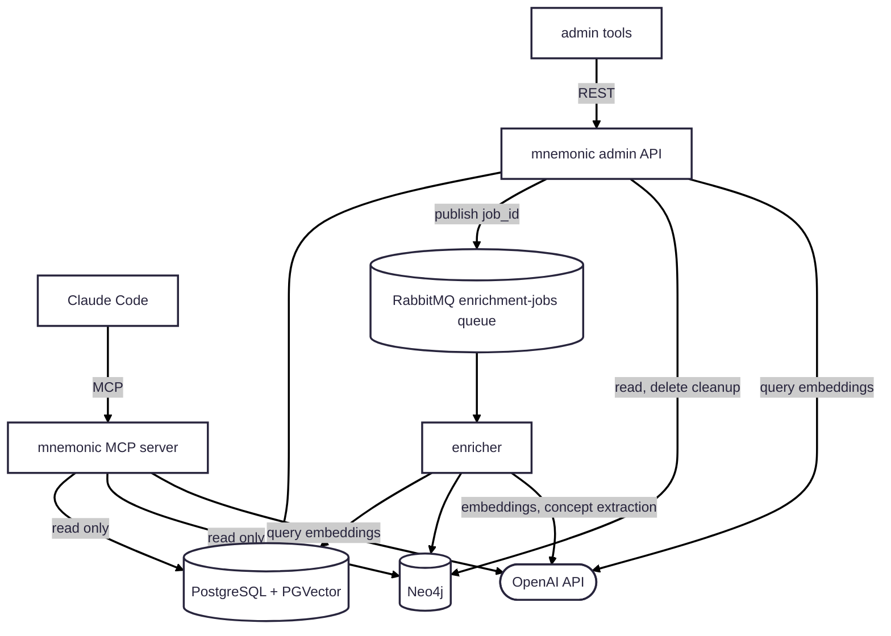

# MVP 2

> Back to [Project README](../../README.md)

Iteration 2 decomposes the local runtime and introduces async enrichment:

1. Split MCP server, Admin API, and enricher into separate local services.
2. Add RabbitMQ for enrichment jobs published by the Admin API.
3. Keep MCP read-only and verify enrichment updates PostgreSQL + PGVector and Neo4j.

MVP 2 is the current topology. For ports, protocols and the detailed flows, see [System Architecture](../architecture/system/02-system-architecture.md).

---

Copyright (c) 2025-2026 Jeremy K. Johnson. All rights reserved.
