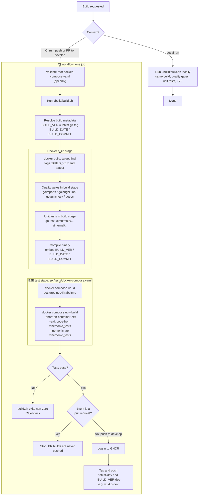

# Build Pipeline Diagram

> Back to [Project README](../../README.md)

This diagram shows how `src/build/build.sh` drives both local builds and CI builds in `mnemonic-api`, `mnemonic-mcp` and `mnemonic-enricher`. The steps below are from `mnemonic-api` (`src/build/build.sh`, `src/build/Dockerfile`, `.github/workflows/mnemonic-api-ci.yaml`); the other two services differ only in image name (`ghcr.io/twistingmercury/mnemonic` for mcp, `ghcr.io/twistingmercury/mnemonic-enrichment` for the enricher), workflow file name and E2E service names.
<!-- Reference diagram remains in mnemonic/_draft-skills/docker-first-ci-cd-implementation/references/docker-first-ci-cd-diagram.md -->

The workflow also contains a `main` branch path that pushes `:latest` and `:BUILD_VER`, but no `main` branch exists yet, so only the `develop` path runs.

---

Copyright (c) 2025-2026 Jeremy K. Johnson. All rights reserved.
