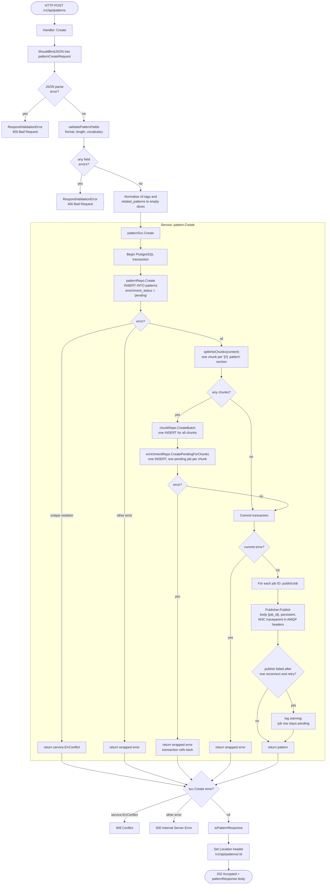
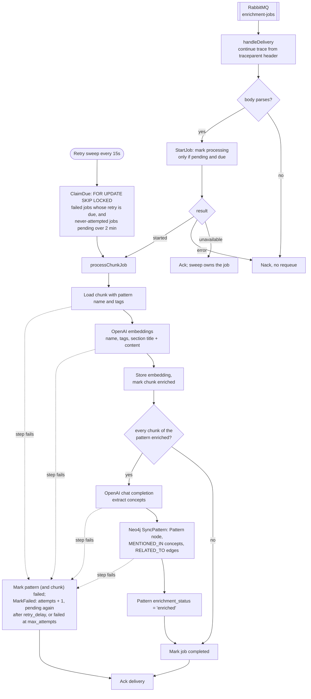

# POST /v1/api/patterns — Activity Diagram

> Back to [Project README](../../README.md)

Posting a pattern has two halves. `mnemonic-api` validates the request, writes the pattern, its chunks and one enrichment job per chunk in a single PostgreSQL transaction, publishes each job ID to the RabbitMQ `enrichment-jobs` queue, and returns `202 Accepted`. `mnemonic-enricher` then embeds each chunk and, after the pattern's last chunk is embedded, extracts concepts and syncs the Neo4j graph. For the end-to-end sequence across all components, see [System Architecture - Data Loading via Admin API](../architecture/system/02-system-architecture.md#data-loading-via-admin-api).

## API: request to 202 Accepted

Source: `mnemonic-api` `src/internal/handlers/patterns/patterns.go` (`Create`), `src/internal/service/pattern/service.go` (`Create`, `insertChunksAndJobs`, `publishJob`), `src/internal/queue/rabbitmq/publisher.go` (`Publish`).

## Enricher: job to enriched pattern

Source: `mnemonic-enricher` `src/internal/enricher/enrichment.go` (`Run`, `handleDelivery`, `handleRetry`), `src/internal/service/enrichment/service.go` (`processChunkJob`, `runGraphPipeline`), `src/internal/repository/enrichmentjob/repository.go` (`Start`, `ClaimDue`, `MarkFailed`).

## Notes

- `validatePatternFields` limits: `name` required, max 128 runes, kebab-case; `content` required, max 100000 bytes; `description` max 500 runes; `tags` max 20 items; `entity_type` required, max 100 runes, kebab-case; `language` and `domain` required, max 64 runes, kebab-case, and must be in the configured vocabulary (`vocabulary.languages`, `vocabulary.domains`), otherwise `INVALID_VALUE` (see [ADR-007](../architecture/system/00-architectural-decisions.md#adr-007)).
- Error responses are RFC 7807 problem details. The service maps a duplicate name to `409 Conflict`; any other failure returns `500` and nothing is persisted, because the pattern, chunks and jobs share one transaction.
- `enrichment_status` is always `pending` on insert; enrichment happens asynchronously, so a `202` does not mean the pattern is searchable yet.
- Only sections preceded by a `[//]: pattern` decorator line and a heading become chunks. Content with no decorated section produces no chunks and no enrichment jobs.
- Jobs are published only after the transaction commits, so a rolled-back write never enqueues work. Publishing is best-effort ([ADR-009](../architecture/system/00-architectural-decisions.md#adr-009)): on failure the publisher waits `queue.rabbitmq.reconnect_delay` (default 5s), reconnects once and retries; if that also fails it increments `mnemonic.queue.publish_failures_total` and the job row stays `pending`. The enricher's retry sweep picks it up after the 2-minute grace period.
- The API does not write to Neo4j when a pattern is created; the enricher builds the graph. The API's only graph write is the best-effort cleanup on `DELETE`.
- A delivery whose job the sweep already took, or that is waiting out its retry delay, is acked without processing (`Start` is conditional). Maintenance every 5 minutes returns jobs stuck in `processing` longer than `enrichment.job_timeout` to `pending` and deletes old completed and failed jobs.

---

Copyright (c) 2025-2026 Jeremy K. Johnson. All rights reserved.
