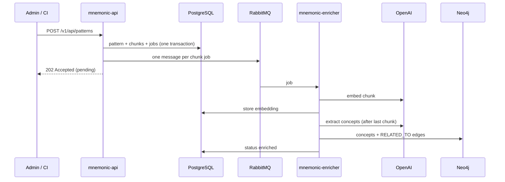

# Introduction to Mnemonic

This guide introduces Mnemonic and explains what it does, who should use it, and how to think about it in your daily work.

## What is Mnemonic?

Mnemonic is a service your team runs that acts as shared memory for AI coding assistants. It holds your team's knowledge — coding conventions, architectural decisions, best practices, lessons learned — in a searchable form. When you use Claude Code or another AI assistant, Mnemonic is there to answer questions like "how does our team handle database migrations?" or "what's our error handling pattern in Go?"

## The problem Mnemonic solves

When teams start using AI coding assistants, a common pattern emerges:

Each person discovers their own tricks and figures out their own workflows. One developer learns a technique that saves 10 minutes of work and keeps it to themselves (or mentions it in Slack where it gets lost). Another writes up a coding convention that only lives in their notes. A third figures out the team's architectural patterns but never documents them.

After a few weeks, useful knowledge lives in one person's head. New hires start from scratch. The AI coding assistant guesses at conventions instead of knowing them.

Mnemonic fixes this. It's a single place where team knowledge can live, and a single source of truth your AI assistant can draw from.

## The bigger picture

Mnemonic becomes even more powerful when combined with other tools in the AI-assisted development ecosystem — specialist subagents, iterative automation loops, and recursive context management. When your AI assistant can pull from a shared knowledge base while delegating to focused subagents that also draw from the same patterns, you get consistency that scales across your entire team. The same conventions, the same architectural guidance, the same best practices — not just on your machine, but on every developer's machine. Context stays lean, output stays consistent, and institutional knowledge stops being a bottleneck.

## How Mnemonic works at a high level

The system has two main flows: search and loading knowledge.

### Developers search for knowledge

You work normally in Claude Code. When you need your team's perspective on something, you ask Claude Code to search Mnemonic.

Claude Code connects to Mnemonic using MCP (Model Context Protocol) — the native way Claude Code talks to external services. No extra CLI, no API keys scattered in shell scripts, just a configured MCP server.

When you search, Claude Code calls one of three read-only Mnemonic tools:

- `search_patterns` — find patterns by natural language query
- `find_related_patterns` — given one pattern, find related ones
- `get_pattern` — retrieve a specific pattern by ID

All pattern lookups are read-only. Claude Code can read what your team has stored, but it cannot write or modify. That keeps things predictable.

### Admins and CI load knowledge into Mnemonic

Your team owns a knowledge base — a collection of patterns that matter to you. Someone (an admin, a CI pipeline, a maintenance script) uses Mnemonic's REST API to POST new patterns or updates.

When a pattern is submitted:

1. The API stores it in PostgreSQL, splits its content into chunks (one per `[//]: pattern` section), and queues one enrichment job per chunk on RabbitMQ
2. The enrichment worker (mnemonic-enricher) generates a semantic embedding for each chunk using OpenAI's `text-embedding-3-large` model
3. The embeddings are stored in PGVector, a PostgreSQL extension that makes semantic search fast
4. Once every chunk is embedded, the worker asks OpenAI (`gpt-4o-mini`) to extract the pattern's key concepts and writes them to a Neo4j graph, linking patterns that share concepts
5. Within a few moments, the pattern becomes searchable

This happens asynchronously and transparently. You don't need to understand embeddings to use Mnemonic — the system handles that.

## Who this documentation is for

This guide series is written for three audiences:

**Developers:** You want to connect Claude Code to your team's Mnemonic instance and start using shared knowledge. See the Quick Start guide.

**Admins:** You deploy and maintain Mnemonic for your team, load patterns, and oversee the knowledge base. See Setting Up for Your Team.

**Pattern authors:** You write and maintain the patterns your team stores in Mnemonic. See Authoring Patterns and Managing Patterns.

You don't need to be in all three groups. A developer who only searches never touches the API. An admin might never write patterns. Use the guide that matches your role.

## What's in this guide series

**[01 - Introduction](01-introduction.md)** (this document)
An overview of what Mnemonic is and the problems it solves.

**[02 - Core Concepts](02-concepts.md)**
Detailed explanations of the key ideas: patterns, embeddings, semantic search, and MCP tools.

**[03 - Quick Start for Developers](03-quickstart.md)**
How to configure Mnemonic as an MCP server in Claude Code and start using it. Takes about 5 minutes.

**[04 - Setting Up for Your Team](04-setting-up-for-your-team.md)**
How to deploy Mnemonic, manage the knowledge base, and keep the system running. For admins and team leads.

**[05 - Authoring Patterns](05-authoring-patterns.md)**
How to write patterns that work well with semantic search, frontmatter conventions, and tips for clarity.

**[06 - Managing Patterns](06-managing-patterns.md)**
Strategies for keeping your knowledge base fresh, organizing patterns, versioning, and handling deprecation.

## Current status and maturity

Mnemonic is in **Emerging** status — it works, but the design is still evolving and breaking changes are possible. The core idea is proven, but APIs and file formats may shift.

**Phase 1 features (now):**

- Pattern storage, embedding, and semantic search
- MCP tool surface for developers
- Basic REST API for pattern management
- Graph relationships between patterns
- Web UI for pattern browsing and import (mnemonic-admin, early)

**Phase 1 limitations:**

- No authentication or authorization on the REST API or the MCP endpoint (runs in trusted local/team networks only)
- No versioning or rollback of patterns (`version` is a free-text label; an update replaces the pattern)
- No audit trail
- No complex query language

If you're thinking about adopting Mnemonic for your team, that maturity level should inform your expectations. It's solid for what it does, but it's not a hardened enterprise system. You can run it today, and it will improve.

## Next steps

If you want to **use Mnemonic** in Claude Code, start with the Quick Start guide.

If you want to **run Mnemonic for your team**, start with the Team Setup guide.

If you want to **understand how Mnemonic works internally**, read the Core Concepts guide, then explore the architecture documentation in the parent directory.

---

Copyright (c) 2025-2026 Jeremy K. Johnson. All rights reserved.
