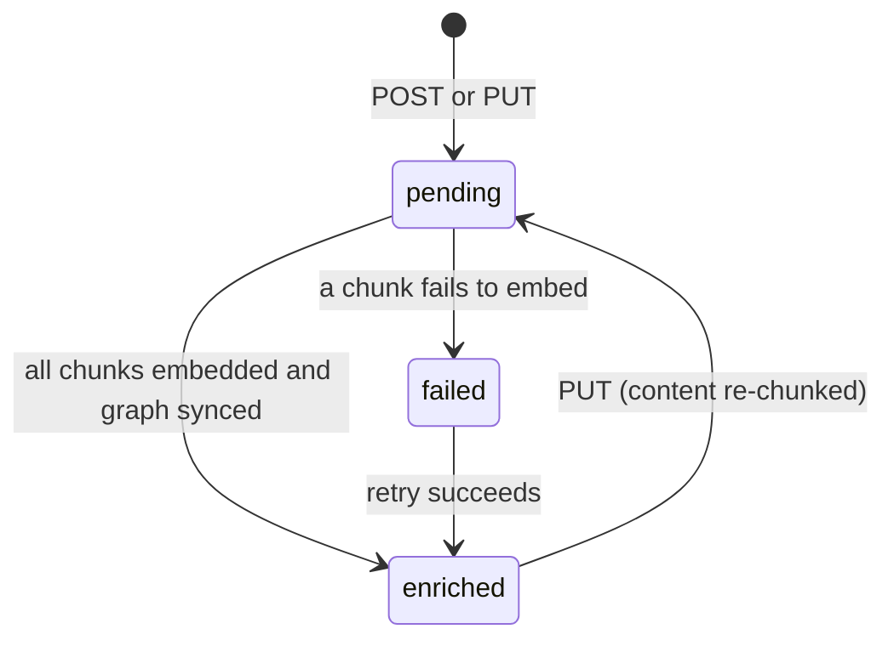
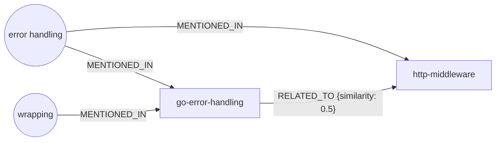

# Core Concepts

This guide explains the key ideas behind Mnemonic: patterns, semantic search, embeddings, enrichment, and MCP. Understanding these concepts will help you use Mnemonic effectively and make informed decisions about how to structure your team's knowledge.

## Patterns: The Core Unit of Knowledge

A pattern is a Markdown document that captures a piece of team knowledge — a coding convention, architectural decision, best practice, or lesson learned. Patterns are the core unit of knowledge that lives in Mnemonic.

### Structure of a Pattern

Every pattern has two parts: metadata and content. In a pattern file the metadata is YAML frontmatter; when the file is loaded, each frontmatter field becomes a field of the API's create request and the body becomes `content`.

**Frontmatter (YAML):**

Patterns begin with YAML metadata:

```yaml
---
name: go-error-handling
description: How our team handles errors in Go services
entity_type: pattern
language: go
domain: backend
tags:
  - error-handling
  - reliability
---
```

`language`, `domain` and `tags` can be used as search filters, and the pattern name and tags are folded into each chunk's embedding text alongside the section title and body. `name` and `description` are also matched by the API's keyword (`search`) filter on the list endpoint.

**Content Body:**

The body is regular Markdown. It explains the pattern, includes code examples, rationale, exceptions, and anything else your team needs to know.

### Marking Sections for Search: Pattern Decorators

Not every section of a pattern is meant to be indexed for semantic search. Mnemonic uses decorators to mark which sections should be included in the searchable vector index.

Sections prefixed with `[//]: pattern` are indexed as independent searchable chunks:

```markdown
[//]: pattern
## How We Handle Errors

Our team uses the following approach...
```

The full content is stored in Mnemonic (and returned by `get_pattern`), but only decorated sections are indexed for semantic search. A decorated section runs from its heading to the next `[//]: pattern` line or the end of the file, so it also absorbs any undecorated headings after it. Put undecorated material such as an Overview before the first decorator to keep it out of search; content after the last decorated section is part of that section's chunk.

There is no special handling for `## Overview`: it stays out of the index only because, by convention, it is not decorated. A pattern with no decorators produces no chunks and never becomes searchable.

Each decorated section becomes an independently searchable chunk. If your pattern has three decorated sections, all three are indexed separately, allowing more precise matches when Claude Code searches.

### Example Pattern Structure

```markdown
---
name: go-error-handling
description: How our team handles errors in Go services
entity_type: pattern
language: go
domain: backend
tags:
  - error-handling
  - reliability
---

## Overview

This pattern describes how we handle errors in Go services.

[//]: pattern
## The Sentinel Error Approach

We use sentinel errors for expected failure modes...

[//]: pattern
## Wrapping Errors

When propagating errors up the stack...

[//]: pattern
## Logging Failures

We log errors at the boundary where we handle them...
```

In this example, three sections are indexed: "The Sentinel Error Approach," "Wrapping Errors," and "Logging Failures." The Overview is not indexed. If you appended an undecorated `## Changelog` after "Logging Failures," it would become part of the "Logging Failures" chunk; keep such material above the first decorator instead.

## Embeddings: Making Patterns Searchable

When you create a pattern, Mnemonic doesn't just store the text. It generates a semantic embedding for each chunk — a numeric representation of meaning — that makes similarity search fast and relevant. The text embedded for a chunk is `pattern name | tags | section title` followed by the section body.

### What Is an Embedding?

An embedding is a list of 2,000 numbers that represents the semantic content of a piece of text. Think of it as a fingerprint of meaning: similar ideas produce similar embeddings, while unrelated ideas produce very different embeddings.

Mnemonic uses OpenAI's `text-embedding-3-large` model to generate embeddings (with Matryoshka truncation at 2000 dimensions). The model is trained to capture semantic relationships, so "error handling in Go" and "how to propagate failures in a service" produce similar embeddings even though the words are different.

### How Embeddings Enable Search

When Claude Code searches Mnemonic with a query like "how do we handle errors?", here's what happens:

1. Mnemonic embeds your query to a 2,000-dimensional vector
2. It searches PGVector (a Postgres extension) to find the chunks with the most similar embeddings
3. Results are ranked by cosine similarity: how closely aligned the vectors are; each result is one chunk (section), so one pattern can appear more than once

**Cosine similarity scores range from 0.0 to 1.0:**

- **1.0** = identical meaning
- **0.7–1.0** = highly relevant (typical search threshold)
- **0.5–0.7** = somewhat related
- **Below 0.5** = probably unrelated

The MCP `search_patterns` tool defaults to 0.5 (`mcp.default_search_threshold`); the REST endpoint `GET /v1/api/patterns/search` defaults to 0.7. Both accept a `threshold` per request.

### Why This Matters for Pattern Authors

Embeddings work best when your patterns are:

- **Specific**: "Error handling in Go services" ranks better than a vague "error patterns"
- **Clear**: Write naturally; the embedding model understands plain English
- **Complete**: Include examples and rationale; more context produces better embeddings
- **Chunked**: Use multiple decorated sections if your pattern covers different subtopics

Embeddings don't care about keyword matching. You don't need exact words to find what you need. A query about "propagating failures" will find your error-handling pattern because the concepts are similar, not because the words match exactly.

## Semantic Search: Finding Patterns by Concept

Semantic search in Mnemonic is concept-driven, not keyword-driven. This is what makes it powerful.

### Vector Similarity Search

When you ask Mnemonic "how do we handle timeouts in our API services?", the system:

1. Generates an embedding of your query
2. Searches the PGVector index to find patterns with similar embeddings
3. Returns the closest matches, ranked by similarity score

This works across languages and different wording. A pattern titled "timeout strategies in REST APIs" will match your query even though you used different words.

### Search Filters and Tags

Beyond semantic similarity, you can filter results using:

- **Tags**: Match patterns that have specific tags (AND logic: all specified tags required)
- **Language**: Narrow to patterns for a specific language (go, python, typescript, etc.)
- **Domain**: Filter by domain (backend, testing, frontend, devops, etc.)

There is no agent filter. These filters work together with semantic search. Your query is still embedded and ranked by similarity, but only patterns matching all your filters are considered.

### Similarity Threshold

The `search_patterns` default threshold is 0.5, configurable per server with `MNEMONIC_MCP_DEFAULT_SEARCH_THRESHOLD`. When Claude Code calls `search_patterns`, it can adjust the threshold:

- Higher threshold (0.7–0.9): Stricter, only highly relevant patterns
- Lower threshold (0.3–0.5): Broader, catches more tangential ideas

The default strikes a balance between relevance and coverage. You can tune it based on your team's pattern library size and specificity.

## Enrichment: The Background Pipeline

When a pattern is posted to Mnemonic, it doesn't instantly become searchable. It goes through an enrichment pipeline that generates embeddings and builds knowledge graph relationships.

### The Enrichment Lifecycle

**1. Pattern arrives via REST API**

Someone (an admin, CI pipeline, or sync script) POSTs a new pattern to Mnemonic's admin API. In one transaction the API stores the pattern with status `pending`, splits the content into chunks, and creates one enrichment job per chunk.

**2. Enrichment worker claims the job**

After the transaction commits, the API publishes each job ID to the `enrichment-jobs` RabbitMQ queue. The enrichment worker (mnemonic-enricher) consumes the message, claims the job row in PostgreSQL, and begins processing. If publishing fails, the job row stays `pending` and the enricher's 15-second retry sweep picks it up.

**3. Embedding is generated**

The worker sends the chunk text to OpenAI's embedding API, which returns a 2,000-dimensional vector. The embedding is stored on the chunk in PostgreSQL and the chunk is marked `enriched`, ready for vector search.

**4. Knowledge graph is built**

When the last chunk of a pattern is embedded, the worker sends the full pattern content to OpenAI (`gpt-4o-mini`) to extract key concepts. In Neo4j it merges a `Pattern` node, a `Concept` node per concept linked by `MENTIONED_IN`, and recomputes `RELATED_TO` edges to every pattern whose concept overlap (shared concepts divided by the larger concept count) is at least 0.3 (`enrichment.related_to_min_similarity`).

**5. Pattern is marked as enriched**

The worker updates the pattern status to `enriched`. Semantic search returns only chunks that are `enriched`.



### Why Async?

Enrichment happens asynchronously (not during the HTTP POST) because calling the embedding API takes time. Making the user wait for OpenAI would be slow. Instead, Mnemonic accepts the pattern immediately (HTTP 202 Accepted) and enriches it in the background. By the time you use Claude Code a few moments later, the pattern is ready to search.

### Requirements

Enrichment requires an OpenAI API key. Set the `MNEMONIC_OPENAI_API_KEY` environment variable for the enricher (and for the API and MCP server, which embed search queries). With a missing or invalid key, enrichment jobs fail and patterns end up `failed` with the OpenAI error in `enrichment_error`.

### Failure Handling

If enrichment fails (network timeout, API error, etc.), there are two layers of retry. Each OpenAI call is retried in-process (`openai.retry_attempts`, default 3). If the job still fails, the job is rescheduled after a fixed delay (`enrichment.retry_delay`, default 30s), and the enricher's retry sweep runs it again until the job reaches its maximum attempts. A failed chunk embedding also marks the pattern `failed` (with the error in `enrichment_error`) while the retry is pending; a failed concept-extraction or Neo4j step leaves it `pending`. If a retry succeeds, the pattern moves to `enriched`.

A job that exhausts its attempts stays `failed`. There is no retry endpoint: fix the cause (e.g., rotate an expired API key) and re-submit the pattern with `PUT`, which re-chunks it and creates new jobs, or delete it.

## Knowledge Graphs: Relationships Between Patterns

Beyond semantic embeddings, Mnemonic builds a Neo4j knowledge graph that captures relationships between patterns.

### What the Graph Contains

The enrichment worker analyzes patterns and creates:

- **Nodes**: one `Pattern` node per pattern, and one `Concept` node per key concept extracted from it (e.g., "error handling," "database migration," "HTTP middleware")
- **Edges**: `(Concept)-[:MENTIONED_IN]->(Pattern)`, and `(Pattern)-[:RELATED_TO {similarity}]->(Pattern)` between patterns that share enough concepts



The `related_patterns` field you send to the API is stored with the pattern but is not used to build the graph.

### Why the Graph Matters

The knowledge graph serves two purposes:

1. **Related pattern discovery**: Given one pattern, find others that discuss similar concepts. The `find_related_patterns` MCP tool uses the graph to traverse and return related patterns.

2. **Graph-expanded search**: `search_patterns` takes the top three patterns from the vector results and appends up to five more patterns reached through their `RELATED_TO` edges, in a separate "Related Patterns (via graph)" section. The vector ranking itself is not changed.

Blended ranking that combines vector similarity and graph context into one score is planned, not implemented. Graph relationships are also shown by `get_pattern` and `find_related_patterns`.

## MCP: How Claude Code Talks to Mnemonic

MCP (Model Context Protocol) is the standard way Claude Code integrates with external services. Mnemonic exposes itself as an MCP server that Claude Code can call.

### What MCP Is

MCP is an open protocol for exchanging information between AI assistants and external tools. Messages are JSON-RPC 2.0, carried over a transport; Mnemonic uses the Streamable HTTP transport in stateless mode.

### The Connection

Claude Code connects to Mnemonic via MCP over Streamable HTTP (no authentication):

```text
Claude Code → http://localhost:8081/mcp → Mnemonic MCP Server
```

This is configured in your Claude Code settings. See the Quick Start guide for setup instructions.

### The Three Tools

Mnemonic exposes three read-only MCP tools:

#### `search_patterns`

Semantic search over the team knowledge graph.

**Parameters:**

- `query` (required, string): Your natural language question
- `limit` (optional, default 10, max 50): How many results to return
- `threshold` (optional, default 0.5, range 0.0–1.0): Minimum similarity score
- `tags` (optional, string array): Filter by tags (AND logic)
- `language` (optional, string): Filter by pattern language
- `domain` (optional, string): Filter by pattern domain

**Returns:** Markdown text with one entry per matching section: pattern name, match percentage, section title, tags, and the section content; then a "Related Patterns (via graph)" section when the graph adds any.

Example: Claude Code might call this when you ask "how do we test database migrations?" and it determines that team knowledge is relevant.

#### `find_related_patterns`

Find patterns related to a given pattern via the knowledge graph.

**Parameters:**

- `pattern_id` (required, UUID): ID of the starting pattern
- `limit` (optional, default 5, max 20): How many related patterns to return

**Returns:** Markdown with related patterns, shared concepts, and similarity scores.

Example: After retrieving a pattern about database migrations, Claude Code might call this to find related patterns about schema management or rollback strategies.

#### `get_pattern`

Retrieve a specific pattern by UUID.

**Parameters:**

- `id` (required, UUID): The pattern's ID

**Returns:** Markdown with full pattern content, metadata, related patterns, and extracted concepts. Graph details are omitted while enrichment is still pending.

Example: When you ask "show me the migration pattern," Claude Code calls this tool with the ID.

### Read-Only Access

All MCP tools are read-only. Claude Code can search and retrieve patterns, but it cannot create, modify, or delete them. Pattern management happens via the REST API, not through MCP. This keeps the team's knowledge base controlled and authoritative.

### Error Handling

If a tool call fails (pattern not found, database unavailable, etc.), Mnemonic returns a clear error message in the tool result. Claude Code sees the error and can inform you or retry. For protocol-level errors (malformed requests, unknown tools), MCP returns standard JSON-RPC errors.

See [MCP Tools](../architecture/mnemonic/08-mcp-tools.md) for complete tool specifications and error codes.

## System Components: A Quick Tour

Here's where everything runs:

| Component | Port | Purpose |
| --------- | ---- | ------- |
| **mnemonic-mcp** | 8081 | MCP server for Claude Code (`/mcp`) |
| **mnemonic-api** | 8080 | Admin REST API for pattern CRUD (`/v1/api`) |
| **mnemonic-enricher** | 8082 | Async enrichment worker (host port for its `/health`) |
| **PostgreSQL** | 5432 | Pattern storage and PGVector indexes |
| **Neo4j** | 7687 | Knowledge graph |
| **RabbitMQ** | 5672 | Message queue between API and enricher |
| **mnemonic-admin** | 3000 | Web UI for pattern management |

Ports are the host ports in the docs repo's docker-compose.yaml. Inside each container, every Mnemonic service serves `/health` and `/version` on port 8080 and Prometheus metrics on port 9090; the MCP server adds port 8081 for `/mcp`.

Developers interact with the MCP server (port 8081). Admins use the REST API (port 8080) and the web UI (port 3000). The enrichment worker runs in the background; port 8082 exposes only its health and version endpoints.

For deployment details, see [System Architecture](../architecture/system/02-system-architecture.md).

## What Mnemonic Does NOT Do

Mnemonic is focused and purposeful. It deliberately does not:

- **Generate answers or code**: Mnemonic calls OpenAI only to embed text and, during enrichment, to extract a pattern's concepts (`gpt-4o-mini`). It does not generate answers, write code, or make decisions. That's Claude Code's job.
- **Store user credentials**: Mnemonic never receives or stores user passwords or authentication tokens. Its only secrets are its own service credentials (database passwords, the OpenAI key), supplied through configuration.
- **Execute tools or file operations**: Mnemonic cannot run commands, write files, or take actions on your system.
- **Make workflow decisions**: Mnemonic is a memory system, not a workflow engine. You decide when and how to use the knowledge it provides.

This narrow scope keeps Mnemonic simple, secure, and focused on its core job: being your team's searchable knowledge base.

## Next Steps

Now that you understand the concepts, you're ready to:

- **Use Mnemonic**: See [Quick Start for Developers](03-quickstart.md) to configure Claude Code
- **Dive deeper**: See [System Architecture](../architecture/system/02-system-architecture.md) for technical details and component interactions

---

Copyright (c) 2025-2026 Jeremy K. Johnson. All rights reserved.
