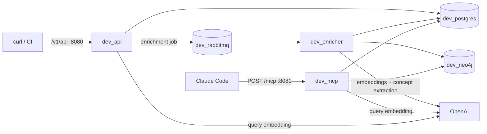

# Quick Start for Developers

Get your AI coding assistant connected to Mnemonic and searching team patterns in about 5 minutes.

## Prerequisites

Before you start, you need:

- Docker and Docker Compose installed and running
- An OpenAI API key (used for embeddings with `text-embedding-3-large` and concept extraction with `gpt-4o-mini`)
- Claude Code or another MCP-compatible AI coding assistant running on the same machine (the MCP endpoint is on `localhost`)
- curl and jq (for loading and checking a test pattern)

## Step 1: Clone the Docs Repository

The `mnemonic-docs` repository includes a Docker Compose file that runs the full Mnemonic stack. Clone it and change into the repo root:

```bash
git clone git@github.com:twistingmercury/mnemonic-docs.git
cd mnemonic-docs
```

## Step 2: Start the Stack

Export your OpenAI API key and start all services:

```bash
export MNEMONIC_OPENAI_API_KEY="sk-your-key-here"
docker compose up -d
```

Docker Compose pulls the `latest-dev` images from GHCR (`pull_policy: always`) and starts seven services:

| Service (compose name) | Host port(s) | What is on it |
| --- | --- | --- |
| PostgreSQL (`dev_postgres`) | 5432 | Pattern rows, chunks, embeddings (PGVector), enrichment jobs |
| Neo4j (`dev_neo4j`) | 7474 (browser), 7687 (Bolt) | Concept and `RELATED_TO` graph |
| RabbitMQ (`dev_rabbitmq`) | 5672 (AMQP), 15672 (management UI) | `enrichment-jobs` queue |
| MCP server (`dev_mcp`) | 8081 | Streamable HTTP MCP endpoint at `/mcp` only |
| Admin API (`dev_api`) | 8080 | REST API at `/v1/api`, plus `/health`, `/version`, `/swagger/index.html` |
| Enricher (`dev_enricher`) | 8082 (container port 8080) | `/health` and `/version` only; the worker itself has no API |
| Admin UI (`dev_admin`) | 3000 | Web UI for pattern browsing |

The MCP server's own `/health` and `/version` listen on its container port 8080, which this compose file does not publish. No service publishes its Prometheus metrics port (9090).



Wait about 30 seconds for all services to be healthy.

## Step 3: Verify the Stack is Healthy

Check that all containers are running:

```bash
docker compose ps
```

All services should show `Up`; every service except `dev_admin` defines a health check and should show `(healthy)`. Verify the API and enricher health endpoints, and run the MCP server's built-in health probe inside its container:

```bash
curl -s http://localhost:8080/health | jq .
curl -s http://localhost:8082/health | jq .
docker compose exec dev_mcp /mnemonic --health
```

Each `/health` returns HTTP 200 with a JSON status object listing every dependency it checks (PostgreSQL, Neo4j and the OpenAI embedding model; the API also lists RabbitMQ). An OpenAI or RabbitMQ problem shows as a warning without failing the check. The `--health` probe prints the same status and exits non-zero if the server is unhealthy.

## Step 4: Load a Test Pattern

POST a single test pattern to the API to populate the knowledge base:

```bash
curl -X POST http://localhost:8080/v1/api/patterns \
  -H 'Content-Type: application/json' \
  -d '{
    "name": "go-error-handling",
    "description": "Best practices for error handling in Go",
    "entity_type": "best-practice",
    "language": "go",
    "domain": "backend",
    "tags": ["go", "errors", "best-practices"],
    "content": "# Go Error Handling\n\n## Overview\n\nThis pattern covers Go error handling best practices.\n\n[//]: pattern\n\n## Wrapping Errors\n\nUse fmt.Errorf with %w to wrap errors and preserve the error chain.\n\n```go\nif err != nil {\n    return fmt.Errorf(\"failed to connect: %w\", err)\n}\n```\n\nThis allows callers to use errors.Is and errors.As for inspection."
  }'
```

The API returns HTTP 202 Accepted with a `Location: /v1/api/patterns/{id}` header and the created pattern as JSON (`id`, `enrichment_status: "pending"`, and the fields you sent). The API splits the content into one chunk per `[//]: pattern` section and queues one enrichment job per chunk.

**Note:** When content has `[//]: pattern` lines, only the sections they precede become searchable chunks. Content with no decorator becomes a single chunk holding the whole body, so it is still enriched and searchable, just not section by section. See [Authoring Patterns](05-authoring-patterns.md#the--pattern-decorator).

> **Tip:** Instead of loading a single test pattern, you can use the [mnemonic-patterns](https://github.com/twistingmercury/mnemonic-patterns) repository to load a curated set of pre-defined patterns. Clone it and run `make load` to validate and upload them all to the API.

## Step 5: Wait for Enrichment

Enrichment adds a semantic embedding to each chunk so it can be found via natural language search, then extracts concepts into the Neo4j graph. This takes a few seconds. Check the enrichment status:

```bash
curl -s http://localhost:8080/v1/api/patterns | jq '.data[].enrichment_status'
```

Wait until you see `"enriched"` (not `"pending"` or `"failed"`). If it shows `"failed"`, `curl -s http://localhost:8080/v1/api/patterns/{id} | jq .enrichment_error` shows why; the enricher retries failed jobs automatically.

## Step 6: Configure Your AI Coding Assistant

### Claude Code

The Mnemonic MCP server speaks MCP over Streamable HTTP (stateless) at `http://localhost:8081/mcp`. It has no authentication. Add it to Claude Code in one of three ways.

**Option A: CLI command (quickest)**

```bash
claude mcp add --transport http mnemonic http://localhost:8081/mcp
```

With no `-s` flag this uses the `local` scope: the server is available to you, in the current project only.

**Option B: Project-level config file (recommended for team repos)**

```bash
claude mcp add -s project --transport http mnemonic http://localhost:8081/mcp
```

This writes `.mcp.json` in the project root. You can also create it by hand:

```json
{
  "mcpServers": {
    "mnemonic": {
      "type": "http",
      "url": "http://localhost:8081/mcp"
    }
  }
}
```

Commit this file so the whole team gets the configuration. Claude Code asks each person to approve project-scoped servers the first time.

**Option C: User-level (all your projects)**

```bash
claude mcp add -s user --transport http mnemonic http://localhost:8081/mcp
```

This stores the server in `~/.claude.json`.

Check the connection with `claude mcp list` (or `/mcp` inside Claude Code); `mnemonic` should show as connected. Start a new Claude Code session if it was already running.

### Other MCP-Compatible Assistants

If you're using a different AI assistant that supports MCP:

1. Locate its MCP configuration file (varies by tool)
2. Add the Mnemonic server endpoint: `http://localhost:8081/mcp`
3. Specify the transport as Streamable HTTP (no authentication headers are needed)
4. Restart the assistant

## Step 7: Verify It Works

In Claude Code or your AI assistant, ask a question that matches the test pattern you loaded:

> "Search Mnemonic for Go error handling best practices."

or

> "Search mnemonic for information about wrapping errors in Go."

The assistant should call the `search_patterns` MCP tool and return the pattern you loaded. If it does, you're ready to go.

## What's Next

**[Setting Up for Your Team](04-setting-up-for-your-team.md)** — Move beyond the test pattern. Run Mnemonic for your team on a trusted network and load the full pattern library.

**[Authoring Patterns](05-authoring-patterns.md)** — Learn to write patterns that work well with semantic search. Covers the API fields, the `[//]: pattern` decorator, section structure, and tips for clarity.

**[Managing Patterns](06-managing-patterns.md)** — Keep your knowledge base organized and fresh. Loading, updating, deleting, and monitoring patterns through the REST API and scripts.

---

Copyright (c) 2025-2026 Jeremy K. Johnson. All rights reserved.
