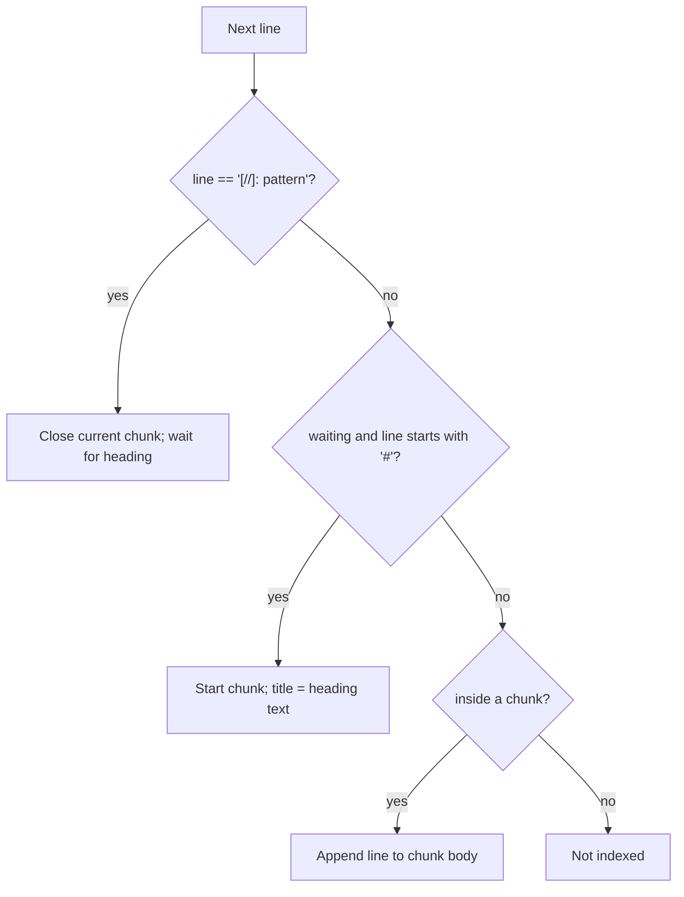

# Pattern File Schema

> Back to [Project README](../../README.md)

This document defines the schema for Mnemonic pattern files.

Pattern files are Markdown documents with YAML frontmatter. When a file is loaded, each frontmatter field becomes a field of the API's create request (`POST /v1/api/patterns`) and the body becomes `content`. The body uses `[//]: pattern` decorators to mark which sections are indexed as searchable chunks. The whole body is stored and returned by `get_pattern`, but only decorated sections become chunks; content before the first decorator, including the `## Overview` section and the H1 title, is never indexed.

The constraints below are the ones mnemonic-api enforces (`src/internal/handlers/patterns/patterns.go`, `validatePatternFields`) on both create and update. A violation returns `400` with one `{field, code, message}` entry per problem.

---

## Frontmatter

### Required Fields

| Field         | Type   | Format     | Constraints                                                                                                        |
| ------------- | ------ | ---------- | ------------------------------------------------------------------------------------------------------------------ |
| `name`        | string | kebab-case | Regex `^[a-z][a-z0-9-]*$`, 1-128 characters. Unique: a duplicate returns `409 Conflict`.                           |
| `entity_type` | string | kebab-case | Regex `^[a-z][a-z0-9-]*$`, 1-100 characters. Free value, e.g. `best-practice`, `cli-pattern`, `api-specification`. |
| `language`    | string | enum       | Kebab-case, max 64 characters, and in the API's `vocabulary.languages` list (below).                               |
| `domain`      | string | enum       | Kebab-case, max 64 characters, and in the API's `vocabulary.domains` list (below).                                 |
| `content`     | string | Markdown   | The file body. Non-empty, at most 100,000 bytes.                                                                   |

Default `vocabulary.languages` (`src/internal/config/defaults.go`):
`agnostic`, `bash`, `c`, `cpp`, `csharp`, `cql`, `cypher`, `dart`, `delphi`, `docker`, `elixir`, `erlang`, `go`, `json`, `java`, `javascript`, `kotlin`, `lua`, `markdown`, `matlab`, `mql`, `objective-c`, `perl`, `php`, `plsql`, `powershell`, `python`, `r`, `react`, `ruby`, `rust`, `scala`, `shell`, `sql`, `swift`, `terraform`, `toml`, `tsql`, `typescript`, `visual-basic`, `yaml`, `zig`.

Default `vocabulary.domains`:
`api-design`, `backend`, `frontend`, `testing`, `devops`, `cli`, `data-design`, `documentation`, `data-access`, `security`, `shell-scripting`, `configuration`, `observability`, `source-management`.

An operator can replace either list in the API's config file (`vocabulary.languages`, `vocabulary.domains`); the API refuses to start if a list is empty. The mnemonic-patterns validator keeps its own copy of these lists, so keep the two in step.

### Optional Fields

| Field              | Type            | Constraints and notes                                                                                                                                |
| ------------------ | --------------- | ---------------------------------------------------------------------------------------------------------------------------------------------------- |
| `description`      | string          | Max 500 characters. Used for keyword search on the list endpoint and for display. Required by the mnemonic-patterns validator, optional for the API. |
| `tags`             | array of string | At most 20. AND filter in search; included in each chunk's embedding text.                                                                           |
| `version`          | string          | Free-text version of the language, framework, or spec this pattern targets, e.g. `Go 1.21+`. Not validated.                                          |
| `related_patterns` | array of string | Stored and returned as given; not validated and not used to build the graph.                                                                         |

`agents` is not an API field: there is no agent storage, filter, or weighting in any Mnemonic service. An `agents:` key in frontmatter is ignored.

### Unknown Fields

The API ignores JSON fields it does not know, and the validator ignores unknown frontmatter. This permits
human-facing metadata (e.g. `author`, `created`) in the file; it is not stored in Mnemonic.

### Validation Errors

| `code`           | Meaning                                        |
| ---------------- | ---------------------------------------------- |
| `REQUIRED`       | Field missing or empty                         |
| `MAX_LENGTH`     | String too long                                |
| `MAX_ITEMS`      | More than 20 tags                              |
| `TOO_LARGE`      | `content` over 100,000 bytes                   |
| `INVALID_FORMAT` | Not kebab-case                                 |
| `INVALID_VALUE`  | `language` or `domain` not in the allowed list |

---

## Body Structure

The body uses H1 for the file title and any number of H2/H3 sections for content.

### Required Sections

| Section       | Purpose                                       | Decorated?                                           |
| ------------- | --------------------------------------------- | ---------------------------------------------------- |
| `## Overview` | What the pattern is, when to use it, and why. | No — keep it undecorated, before the first decorator |

This requirement comes from the mnemonic-patterns validator; the API does not check section names.

### Decorated Sections

All sections intended to appear in search results must be preceded by a `[//]: pattern` line before the heading. A section without its own decorator is not indexed on its own: before the first decorator it is not indexed at all, and after a decorated section it becomes part of that section's chunk.

```markdown
[//]: pattern

## Implementation

Content that will be indexed...
```

H3 headings are supported the same as H2:

```markdown
[//]: pattern

### Named Sub-Technique

More content...
```

There are no prescribed section names beyond `## Overview`. Choose headings that make the content independently discoverable — each decorated section should make sense when returned as a standalone search result.

---

## Chunking

The `[//]: pattern` decorator controls which sections are stored in the Mnemonic vector index.

### Decorator Syntax

```text
[//]: pattern
```

**Rules:**

- The decorator must be the exact line `[//]: pattern`, with no leading or trailing whitespace and LF line endings (a CRLF file is not recognized)
- Place it on its own line before a heading of any level (`#`, `##`, `###`, etc.); blank lines in between are allowed
- The heading text, without the `#` marks, becomes the chunk's section title (max 255 characters; longer fails the create with a 500)
- Everything after that heading until the next `[//]: pattern` or end of file becomes the chunk body, including any undecorated headings in between
- Lines before the first decorator are not indexed (they are still stored with the pattern)
- A pattern with no decorated sections has no chunks, so it is never enriched and never appears in search

The splitter is `splitIntoChunks` in mnemonic-api `src/internal/service/pattern/service.go`.



### What Gets Indexed vs. Discarded

| Content                                                 | Indexed?                              |
| ------------------------------------------------------- | ------------------------------------- |
| Decorated section (heading + body)                      | Yes                                   |
| `## Overview` (undecorated, before the first decorator) | No — intentionally excluded           |
| Intro prose before first decorator                      | No                                    |
| Undecorated section after a decorated one               | Yes — appended to the preceding chunk |
| Empty decorated body (after trimming)                   | No — dropped silently                 |

### Example

```markdown
---
name: my-pattern
...
---

# My Pattern

## Overview

This section has no decorator — it will not be indexed.
Intro text, context, and motivation go here.

[//]: pattern

## Core Implementation

This section IS decorated — it will be indexed as a chunk with
title "Core Implementation" and this content as the body.

[//]: pattern

### Named Variant

This H3 section is also decorated and will be indexed separately.

## Notes

This section has no decorator, but it follows a decorated section,
so it is indexed as part of the "Named Variant" chunk.
```

### When to Decorate

- **Do decorate:** any section with independently useful content — code examples, named techniques, configuration patterns, best practices
- **Do not decorate:** `## Overview`, summary sections, introductory prose, sections that only make sense in context of others — and place them before the first decorator so they are not absorbed into a chunk

---

## Complete Example

```markdown
---
name: cobra-configuration-pattern
entity_type: cli-pattern
language: go
domain: cli
description: Configuration management with explicit config injection, environment variable overrides, and config precedence for Cobra CLIs
tags:
  - cobra
  - cli
  - configuration
  - go
  - environment-variables
version: Go 1.21+
related_patterns:
  - cobra-root-command-pattern
  - cobra-subcommand-pattern
---

# Cobra Configuration Pattern

## Overview

This pattern demonstrates configuration management for Cobra CLIs with explicit
config passing, environment variable overrides, and clear precedence rules.

[//]: pattern

## Implementation

...

[//]: pattern

## Example

...

[//]: pattern

## Key Patterns

...
```

---

## Validation Rules

`install/validate.sh` in the mnemonic-patterns repository enforces the following before loading (the API's own rules are in [Frontmatter](#frontmatter) above):

1. File exists and is readable.
2. YAML frontmatter is present and parseable.
3. All required frontmatter fields are present and non-empty.
4. `name` matches `^[a-z][a-z0-9-]*$`.
5. `language` is one of the allowed enum values.
6. `domain` is one of the allowed enum values.
7. `entity_type` uses kebab-case.
8. `description` is non-empty.
9. At least one `[//]: pattern` decorator is present in the body.
10. The `## Overview` section is present.

Unknown frontmatter fields are ignored.

---

Copyright (c) 2025-2026 Jeremy K. Johnson. All rights reserved.
